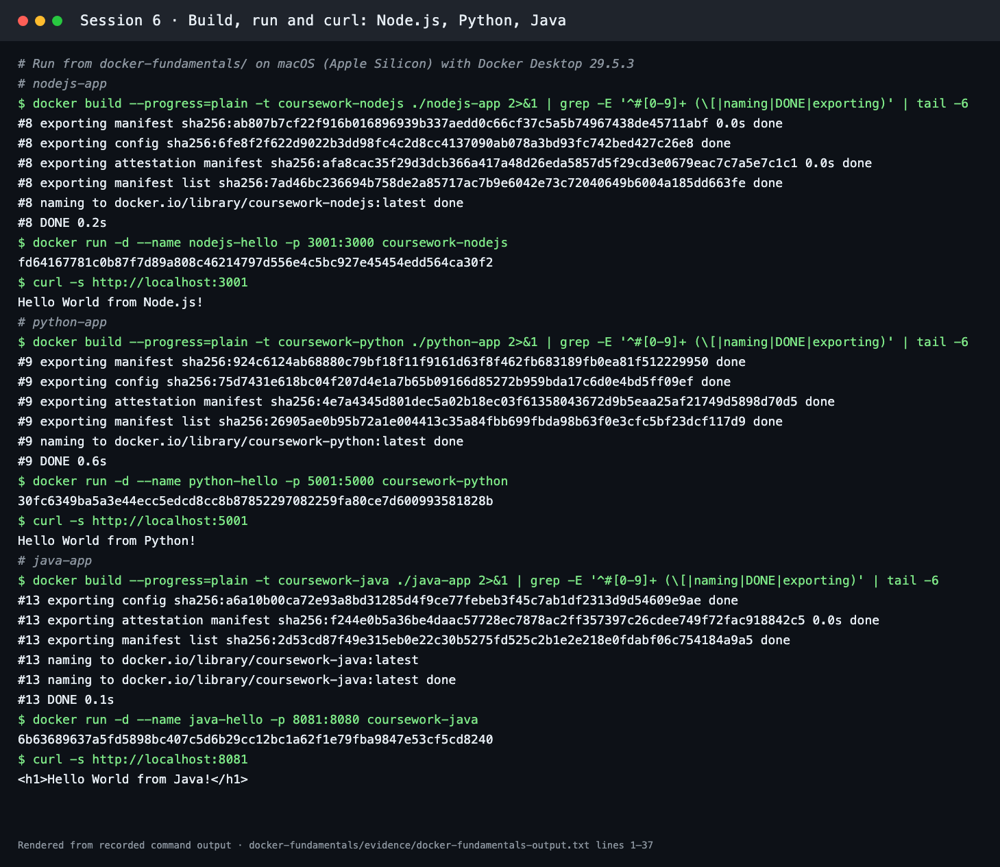
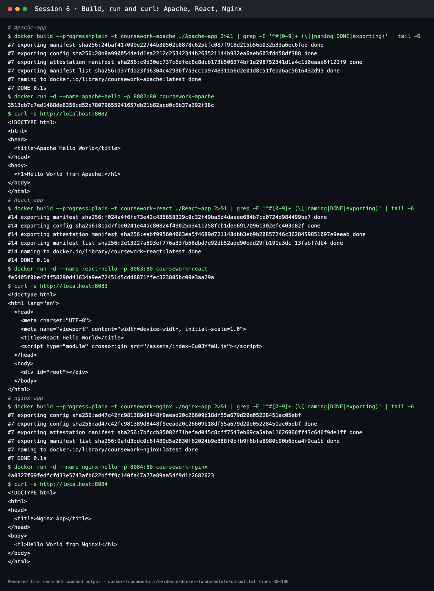
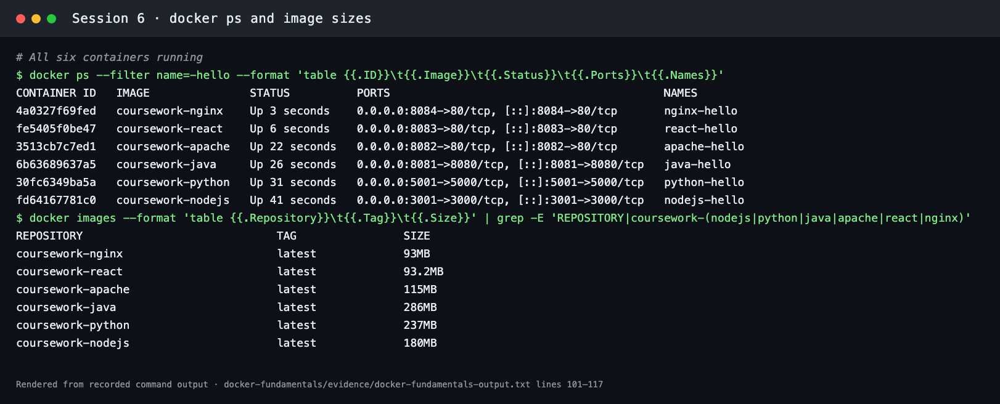
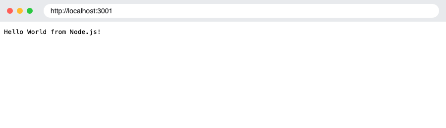
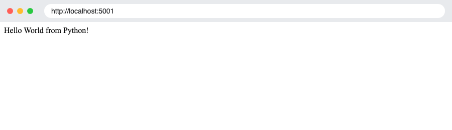
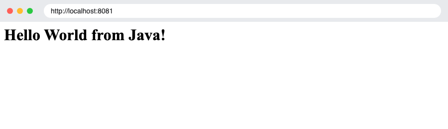
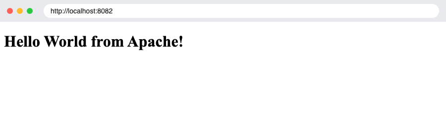
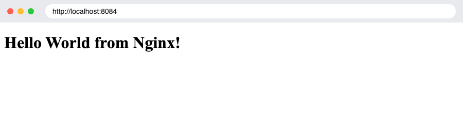

# Docker Fundamentals

**Session 6** · Student: **Abhinav** (24BCS10282)

This module contains six isolated Hello World applications with custom `Dockerfile` specifications built for Node.js, Python, Java, Apache, React, and Nginx.

## 1. Application Directory Matrix

| Application | Folder | Container Port | Build Command | Expected Output |
| --- | --- | ---: | --- | --- |
| Node.js | [`nodejs-app`](nodejs-app/) | 3000 | `docker build -t coursework-nodejs ./nodejs-app` | Hello World from Node.js! |
| Python/Flask | [`python-app`](python-app/) | 5000 | `docker build -t coursework-python ./python-app` | Hello World from Python! |
| Java | [`java-app`](java-app/) | 8080 | `docker build -t coursework-java ./java-app` | Hello World from Java! |
| Apache | [`Apache-app`](Apache-app/) | 80 | `docker build -t coursework-apache ./Apache-app` | Hello World from Apache! |
| React | [`React-app`](React-app/) | 80 | `docker build -t coursework-react ./React-app` | Hello World from React! |
| Nginx | [`nginx-app`](nginx-app/) | 80 | `docker build -t coursework-nginx ./nginx-app` | Hello World from Nginx! |

## 2. Build, Container Run, and HTTP Verification Commands

```bash
# 1. Node.js Application
docker build -t coursework-nodejs ./nodejs-app
docker run -d --name nodejs-hello -p 3001:3000 coursework-nodejs
curl --fail http://localhost:3001

# 2. Python/Flask Application
docker build -t coursework-python ./python-app
docker run -d --name python-hello -p 5001:5000 coursework-python
curl --fail http://localhost:5001

# 3. Java Application
docker build -t coursework-java ./java-app
docker run -d --name java-hello -p 8081:8080 coursework-java
curl --fail http://localhost:8081

# 4. Apache Application
docker build -t coursework-apache ./Apache-app
docker run -d --name apache-hello -p 8082:80 coursework-apache
curl --fail http://localhost:8082

# 5. React Application
docker build -t coursework-react ./React-app
docker run -d --name react-hello -p 8083:80 coursework-react
curl --fail http://localhost:8083

# 6. Nginx Application
docker build -t coursework-nginx ./nginx-app
docker run -d --name nginx-hello -p 8084:80 coursework-nginx
curl --fail http://localhost:8084
```

## 3. Real execution output

All six images were built and run with Docker Desktop 29.5.3 on macOS (Apple Silicon). The full transcript, including build steps, container IDs, curl responses, `docker ps` and image sizes, is in [evidence/docker-fundamentals-output.txt](evidence/docker-fundamentals-output.txt).

```text
CONTAINER ID   IMAGE               STATUS          PORTS                                         NAMES
4a0327f69fed   coursework-nginx    Up 3 seconds    0.0.0.0:8084->80/tcp, [::]:8084->80/tcp       nginx-hello
fe5405f0be47   coursework-react    Up 6 seconds    0.0.0.0:8083->80/tcp, [::]:8083->80/tcp       react-hello
3513cb7c7ed1   coursework-apache   Up 22 seconds   0.0.0.0:8082->80/tcp, [::]:8082->80/tcp       apache-hello
6b63689637a5   coursework-java     Up 26 seconds   0.0.0.0:8081->8080/tcp, [::]:8081->8080/tcp   java-hello
30fc6349ba5a   coursework-python   Up 31 seconds   0.0.0.0:5001->5000/tcp, [::]:5001->5000/tcp   python-hello
fd64167781c0   coursework-nodejs   Up 41 seconds   0.0.0.0:3001->3000/tcp, [::]:3001->3000/tcp   nodejs-hello
```

| Image | Size | Base |
| --- | --- | --- |
| coursework-nginx | 93 MB | `nginx:alpine` |
| coursework-react | 93.2 MB | `node:18-alpine` build stage → `nginx:alpine` runtime |
| coursework-apache | 115 MB | `httpd:2.4-alpine` |
| coursework-java | 286 MB | `eclipse-temurin:21-jdk-alpine` build → `eclipse-temurin:21-jre-alpine` runtime |
| coursework-python | 237 MB | `python:3.11-slim` |
| coursework-nodejs | 180 MB | `node:18-alpine` |





### Hello World in the browser

Real headless-Chrome captures of each running container, made with [scripts/capture-webpage.py](../scripts/capture-webpage.py). The address bar shows the URL that was loaded.

| Node.js (3001) | Python (5001) |
| --- | --- |
|  |  |
| **Java (8081)** | **Apache (8082)** |
|  |  |
| **React (8083)** | **Nginx (8084)** |
|  |  |

The React page is rendered by JavaScript (`createRoot(...).render(<App />)`) from the Vite build that the multi-stage Dockerfile copies into Nginx.

Cleanup:

```bash
docker rm -f nodejs-hello python-hello java-hello apache-hello react-hello nginx-hello
```

## 4. Key Takeaways

- **Container Isolation:** Each application stack runs in its own isolated filesystem and network namespace without port conflicts on host interfaces.
- **Port Mapping (`-p host:container`):** Maps a host machine port to the exposed container port (e.g., `-p 3001:3000`).
- **Multi-stage builds:** the Java and React images compile in one stage and copy only the output into a smaller runtime stage.
- **Base Images:** Custom applications leverage minimal base images (`alpine`, `python:3.11-slim`, `eclipse-temurin` JDK/JRE on Alpine, `httpd:2.4-alpine`) to optimize container footprint.
