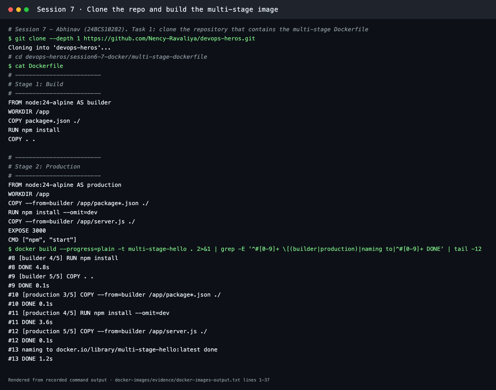
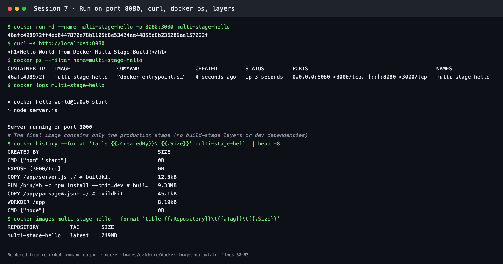
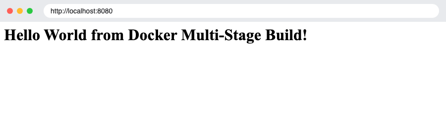
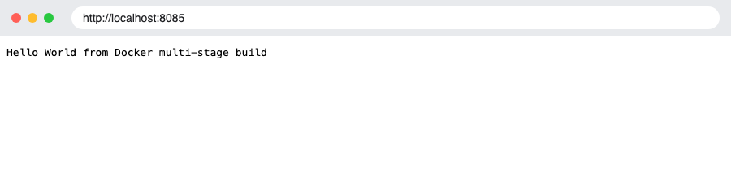
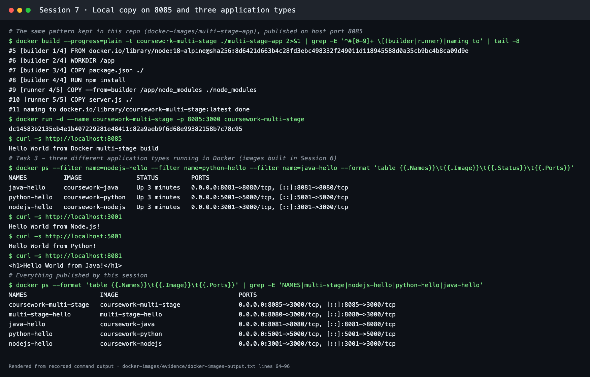

# Docker Images and Multi-Stage Builds

**Session 7**

| Name | Enrollment number |
| --- | --- |
| **Abhinav** | **24BCS10282** |

Everything below was run with Docker Desktop 29.5.3 on macOS (Apple Silicon). The full transcript is in [evidence/docker-images-output.txt](evidence/docker-images-output.txt). Terminal screenshots are renders of that transcript, and browser screenshots are real headless-Chrome captures of the running containers.

## Task 1: Run the multi-stage Dockerfile

The multi-stage Dockerfile comes from the course repository, which was cloned as the task asks:

```bash
git clone --depth 1 https://github.com/Nency-Ravaliya/devops-heros.git
cd devops-heros/session6-7-docker/multi-stage-dockerfile
docker build -t multi-stage-hello .
docker run -d --name multi-stage-hello -p 8080:3000 multi-stage-hello
curl http://localhost:8080
docker ps --filter name=multi-stage-hello
```

```dockerfile
# Stage 1: Build
FROM node:24-alpine AS builder
WORKDIR /app
COPY package*.json ./
RUN npm install
COPY . .

# Stage 2: Production
FROM node:24-alpine AS production
WORKDIR /app
COPY --from=builder /app/package*.json ./
RUN npm install --omit=dev
COPY --from=builder /app/server.js ./
EXPOSE 3000
CMD ["npm", "start"]
```

- The **builder** stage installs all dependencies and copies the source.
- The **production** stage starts again from a clean base, copies only `package*.json` and `server.js` from the builder, and installs production dependencies (`--omit=dev`).
- `docker history` confirms that the final image has only the production-stage layers: `npm install --omit=dev` (9.33 MB), `server.js` (12.3 kB), and the `npm start` command.



## Task 2: Documentation and verification

**Application output on port 8080:**

```text
$ curl -s http://localhost:8080
<h1>Hello World from Docker Multi-Stage Build!</h1>
```

**`docker ps` showing the container on port 8080:**

```text
CONTAINER ID   IMAGE               COMMAND                  CREATED         STATUS         PORTS                                         NAMES
46afc498972f   multi-stage-hello   "docker-entrypoint.s…"   4 seconds ago   Up 3 seconds   0.0.0.0:8080->3000/tcp, [::]:8080->3000/tcp   multi-stage-hello
```

The app listens on container port 3000 (`Server running on port 3000` in `docker logs`). `-p 8080:3000` publishes it on **host port 8080**.



Browser at `http://localhost:8080`:



This repository also keeps the same two-stage pattern in [`multi-stage-app/`](multi-stage-app/) (`node:18-alpine` builder → runner). It was built and run on port **8085**, where it returns `Hello World from Docker multi-stage build`:



## Task 3: Deploy 3 different application types

Node.js, Python (Flask) and Java apps from [Session 6](../docker-fundamentals/README.md) running side by side:

| App | Image | Host port → container port | Response |
| --- | --- | --- | --- |
| Node.js | `coursework-nodejs` (`node:18-alpine`) | 3001 → 3000 | `Hello World from Node.js!` |
| Python | `coursework-python` (`python:3.11-slim` + Flask) | 5001 → 5000 | `Hello World from Python!` |
| Java | `coursework-java` (JDK build stage → JRE runtime) | 8081 → 8080 | `<h1>Hello World from Java!</h1>` |

```bash
docker ps --filter name=nodejs-hello --filter name=python-hello --filter name=java-hello
curl http://localhost:3001
curl http://localhost:5001
curl http://localhost:8081
```



## Cleanup

```bash
docker rm -f multi-stage-hello coursework-multi-stage nodejs-hello python-hello java-hello
```

*In an interview I'd say:* A multi-stage build compiles or installs in a throwaway stage and copies only what the app needs at runtime into the final stage. Images get smaller and leave out compilers, caches and dev dependencies, which also shrinks the attack surface.
