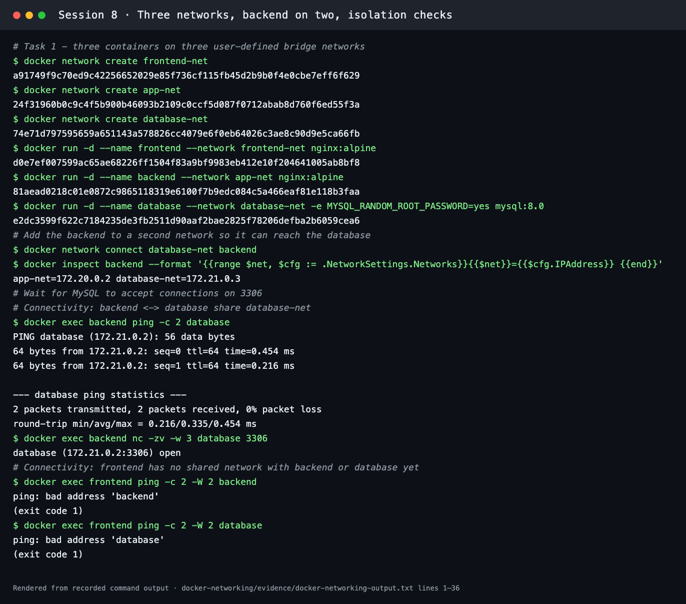
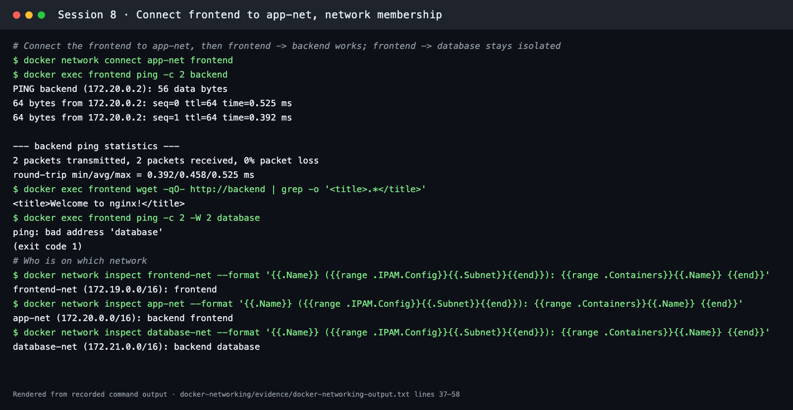
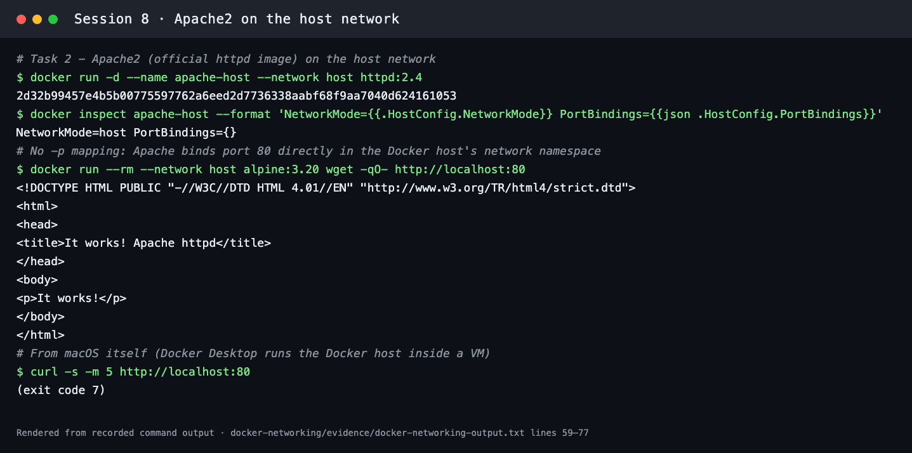
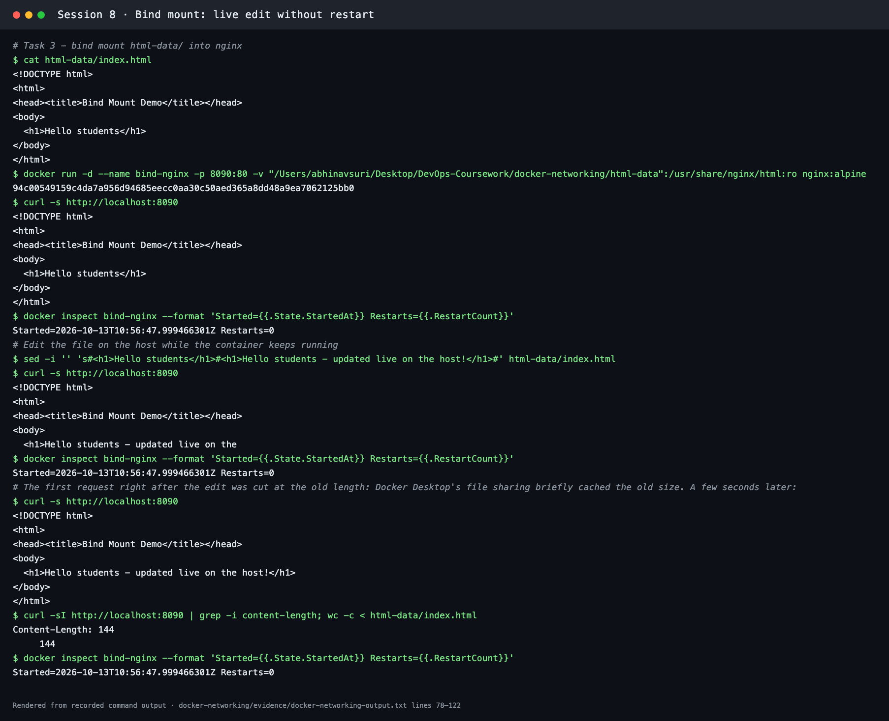
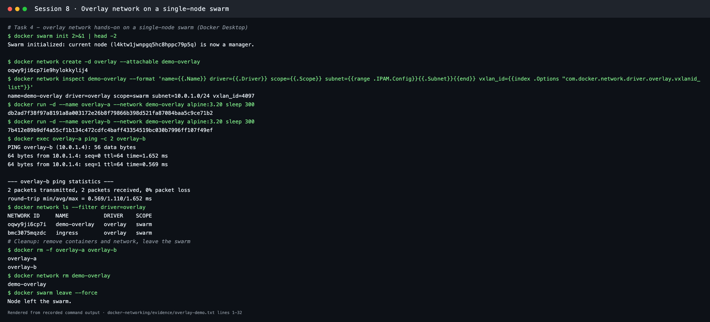

# Docker Networking and Volumes

**Session 8** · Student: **Abhinav** (24BCS10282)

Every task was run with Docker Desktop 29.5.3 on macOS (Apple Silicon) using [`run-demo.sh`](run-demo.sh), which prints each command and its real output. The transcripts are [evidence/docker-networking-output.txt](evidence/docker-networking-output.txt) and [evidence/overlay-demo.txt](evidence/overlay-demo.txt). Terminal screenshots are renders of those transcripts, and the bind-mount screenshots are real browser captures.

```bash
bash run-demo.sh 2>&1 | tee evidence/docker-networking-output.txt
```

## Task 1: Three containers, three networks

| Container | Image | Networks |
| --- | --- | --- |
| `frontend` | `nginx:alpine` | `frontend-net`, later also `app-net` |
| `backend` | `nginx:alpine` | `app-net` + `database-net` (**two networks**) |
| `database` | `mysql:8.0` (`MYSQL_RANDOM_ROOT_PASSWORD=yes`, so no password is hard-coded) | `database-net` |

```text
 frontend ── frontend-net (172.19.0.0/16)
     │
     └──────── app-net (172.20.0.0/16) ──── backend
                                              │
                         database-net (172.21.0.0/16) ──── database
```

```bash
docker network create frontend-net
docker network create app-net
docker network create database-net
docker run -d --name frontend --network frontend-net nginx:alpine
docker run -d --name backend  --network app-net      nginx:alpine
docker run -d --name database --network database-net -e MYSQL_RANDOM_ROOT_PASSWORD=yes mysql:8.0
docker network connect database-net backend     # backend: app-net=172.20.0.2 database-net=172.21.0.3
docker exec backend ping -c 2 database
docker exec backend nc -zv -w 3 database 3306
docker exec frontend ping -c 2 backend
docker network connect app-net frontend
docker exec frontend wget -qO- http://backend
```

### Connectivity results

| From → To | Shared network? | Result |
| --- | --- | --- |
| backend → database | `database-net` | ✅ `ping` 0% loss; `nc -zv database 3306` → **open** |
| frontend → backend (before connect) | none | ❌ `ping: bad address 'backend'`: Docker's embedded DNS only resolves names on shared networks |
| frontend → database | none | ❌ `ping: bad address 'database'` |
| frontend → backend (after `docker network connect app-net frontend`) | `app-net` | ✅ `ping` 0% loss; HTTP returned `<title>Welcome to nginx!</title>` |
| frontend → database (after connect) | still none | ❌ isolated: the database is reachable only through the backend tier |

`docker network inspect` confirmed membership: `frontend-net: frontend`, `app-net: backend frontend`, `database-net: backend database`.




## Task 2: Host network (Apache2)

```bash
docker run -d --name apache-host --network host httpd:2.4      # httpd = the official Apache2 HTTP Server image
docker inspect apache-host --format 'NetworkMode={{.HostConfig.NetworkMode}} PortBindings={{json .HostConfig.PortBindings}}'
docker run --rm --network host alpine:3.20 wget -qO- http://localhost:80
curl -s -m 5 http://localhost:80        # from macOS
```

- `NetworkMode=host PortBindings={}`: there is **no `-p` mapping**. Apache binds port 80 directly in the Docker host's network stack.
- A second container on the host network fetched `http://localhost:80` and received Apache's `It works!` page.
- `curl` **from macOS** failed (exit 7). On Docker Desktop the "Docker host" is a Linux VM, so `--network host` means the VM's network, not the Mac's. On a Linux server, or with Docker Desktop's optional host-networking setting turned on, `http://<host>:80` answers directly.



## Task 3: Bind mount

[`html-data/index.html`](html-data/index.html) contains `<h1>Hello students</h1>`.

```bash
docker run -d --name bind-nginx -p 8090:80 -v "$PWD/html-data":/usr/share/nginx/html:ro nginx:alpine
curl -s http://localhost:8090                       # Hello students
sed -i '' 's#<h1>Hello students</h1>#<h1>Hello students - updated live on the host!</h1>#' html-data/index.html
curl -s http://localhost:8090                       # updated text, no restart
docker inspect bind-nginx --format 'Started={{.State.StartedAt}} Restarts={{.RestartCount}}'
```

| Before the edit | After the edit (same container) |
| --- | --- |
|  |  |

- `Started=2026-10-13T10:56:47.999Z Restarts=0` was identical before and after, so **the container was not restarted**. The bind mount shows the host file directly.
- The very first request after the edit came back cut off at the old file length. Docker Desktop's file sharing briefly caches file attributes, and nginx serves with `sendfile`. A few seconds later the full 144-byte file was served (`Content-Length: 144`). On a Linux host the change is visible immediately.
- The mount is `:ro`, so the container cannot modify the host files.



The demo restores `index.html` to `Hello students` afterwards (`git checkout html-data/index.html`).

## Task 4: Overlay networks

### What is an overlay network?

An **overlay network** is a virtual layer-2 network that spans **multiple Docker hosts**. Each host's Docker engine wraps container traffic in **VXLAN** (UDP 4789) packets that travel over the normal underlay network between hosts. The containers see one flat subnet (here `10.0.1.0/24`), even when they run on different machines. Overlay networks are created on a Docker **Swarm** manager, which stores the network state and handles membership.

### Use cases

- Multi-host microservices in Docker Swarm stacks (`docker stack deploy`), where services find each other by name on any node
- The routing mesh: the built-in `ingress` overlay load-balances a published port across every node
- Encrypted east-west traffic between hosts with `docker network create -d overlay --opt encrypted` (IPsec)
- Standalone containers on different hosts talking to each other (`--attachable` overlays)

### How it works across hosts

1. `docker swarm init` on a manager and `docker swarm join` on workers. Managers talk over TCP 2377.
2. Nodes exchange network membership with a gossip protocol (TCP/UDP **7946**).
3. `docker network create -d overlay` allocates a subnet and a **VXLAN ID** (VNI).
4. When a container on host A sends to a container on host B, the engine encapsulates the frame in UDP **4789** with that VNI. Host B decapsulates it and delivers it to the container.
5. Embedded DNS resolves service and container names across the whole overlay, and VIPs load-balance between replicas.

### Hands-on (single-node swarm)

```bash
docker swarm init
docker network create -d overlay --attachable demo-overlay
docker network inspect demo-overlay     # driver=overlay scope=swarm subnet=10.0.1.0/24 vxlan_id=4097
docker run -d --name overlay-a --network demo-overlay alpine:3.20 sleep 300
docker run -d --name overlay-b --network demo-overlay alpine:3.20 sleep 300
docker exec overlay-a ping -c 2 overlay-b          # resolves 10.0.1.4, 0% loss
docker rm -f overlay-a overlay-b && docker network rm demo-overlay && docker swarm leave --force
```

The network got **scope `swarm`** and VXLAN ID **4097**. Swarm's own `ingress` overlay also appeared in `docker network ls --filter driver=overlay`. Both containers sit on one Docker Desktop node here, but adding a second node with `docker swarm join` would let `overlay-b` run elsewhere with no change to the commands.



*In an interview I'd say:* Bridge networks connect containers on one host. Overlay networks use VXLAN tunnels, managed through Swarm, to give containers on many hosts one shared subnet and DNS, with optional IPsec encryption.
