# SpendWise: Final DevOps Project

**Course:** SST DevOps & Cloud · **Session 21** · **Author:** Abhinav (24BCS10282)

SpendWise is a small expense tracker for students. You add what you spend (mess fees, books, travel…) and see totals by category. It is my own application, written for this project:

- a FastAPI backend with PostgreSQL and Alembic migrations
- a React frontend

The project takes it through the whole DevOps life cycle: tests, Docker images, a CI/CD pipeline with DevSecOps gates, Kubernetes via a Helm chart, Prometheus/Grafana monitoring, GitOps with Argo CD, and Terraform for the AWS infrastructure (VPC + EKS).

Everything below was actually run:

- Command transcripts are saved in [evidence/](evidence/).
- Terminal screenshots are renders of those transcripts made with [scripts/render-evidence-png.py](../scripts/render-evidence-png.py). Each image names its source file and lines.
- The `browser-*` screenshots are real headless-Chrome captures of the running UIs.

## Contents

1. [Rubric map](#rubric-map)
2. [Project overview](#project-overview)
3. [Architecture](#architecture)
4. [Technologies used](#technologies-used)
5. [Repository layout](#repository-layout)
6. [Application setup](#application-setup)
7. [Docker setup](#docker-setup)
8. [Kubernetes deployment](#kubernetes-deployment)
9. [Helm deployment](#helm-deployment)
10. [Terraform infrastructure](#terraform-infrastructure)
11. [CI/CD pipeline](#cicd-pipeline)
12. [DevSecOps implementation](#devsecops-implementation)
13. [Monitoring](#monitoring)
14. [GitOps](#gitops)
15. [Troubleshooting](#troubleshooting)
16. [Screenshots](#screenshots)
17. [Lessons learned](#lessons-learned)
18. [Cleanup](#cleanup)

## Rubric map

| Module | What is required | Where it is |
| --- | --- | --- |
| M1 Application | FastAPI `/health`, ≥ 4 REST endpoints (GET/POST/PUT/DELETE), PostgreSQL table managed by Alembic, React UI | [application/backend/app/main.py](application/backend/app/main.py), [alembic/versions/0001_create_expenses.py](application/backend/alembic/versions/0001_create_expenses.py), [application/frontend/src/App.jsx](application/frontend/src/App.jsx) · [screenshot](screenshots/browser-01-compose-app.png) |
| M2 Testing | pytest passes, ≥ 5 tests over ≥ 3 endpoints, test DB, `pytest.ini` / `conftest.py` | [tests/test_expenses.py](application/backend/tests/test_expenses.py) (9 tests, 97% coverage), [tests/conftest.py](application/backend/tests/conftest.py) (SQLite test DB), [pytest.ini](application/backend/pytest.ini) · [screenshot](screenshots/02-tests.png) |
| M3 Git & GitHub | Public repo, meaningful commits, `.gitignore` | [github.com/Abhinavsuri90/DevOps-Coursework](https://github.com/Abhinavsuri90/DevOps-Coursework), [.gitignore](.gitignore) (`.env`, `__pycache__/`, `node_modules/`, `.venv/`, state files) · [commit history](screenshots/browser-13-github-commits.png) |
| M4 Docker | Backend Dockerfile, multi-stage frontend Dockerfile, non-root, `docker compose up --build` | [docker/backend.Dockerfile](docker/backend.Dockerfile), [docker/frontend.Dockerfile](docker/frontend.Dockerfile), [docker/docker-compose.yml](docker/docker-compose.yml) · [screenshot](screenshots/01-docker-compose.png) |
| M5 CI/CD | Workflow on push to `main`, pytest gate, frontend build, both images built, pushed to GHCR with SHA tags | [.github/workflows/final-devops-project.yml](../.github/workflows/final-devops-project.yml) (copy in [.github/workflows/](.github/workflows/)) · [green run](screenshots/browser-11-github-actions-run.png) · [GHCR SHA tags](screenshots/browser-12-ghcr-tags.png) |
| M6 DevSecOps | Trivy on both images, fails on HIGH/CRITICAL, explanation | `build-images` job + [security/trivy.yaml](security/trivy.yaml) · [Trivy results from CI](screenshots/browser-15-github-trivy-annotations.png) · [explanation](#devsecops-implementation) |
| M7 Terraform | VPC with 2 public subnets, EKS with a node group, plan/apply/destroy, `tfvars.example` | [terraform/](terraform/) · [Terraform infrastructure](#terraform-infrastructure) |
| M8 Kubernetes + Helm | Namespace, chart, 2+ replicas each, ClusterIP Services, Ingress `/` → frontend and `/api` → backend | [kubernetes/namespace.yaml](kubernetes/namespace.yaml), [helm/spendwise/](helm/spendwise/) · [screenshots](#kubernetes-deployment) |
| M9 Observability | `/metrics`, Prometheus scraping, Grafana panels with live data | [monitoring/](monitoring/), ServiceMonitor/rules/dashboard in the chart · [Monitoring](#monitoring) |
| M10 Docs + demo | This README; commit → pipeline → deployment update | this file · [recorded live demo](#live-demo-m10-commit--pipeline--deployment-update-recorded) |

## Project overview

| Method | Path | What it does |
| --- | --- | --- |
| GET | `/health` | Liveness/readiness: runs `SELECT 1` against the database and returns the app version |
| GET | `/metrics` | Prometheus metrics (request counts, latency histograms, expenses created per category) |
| GET | `/api/version` | The running build (`APP_VERSION` = the commit SHA in CI and GitOps), shown in the UI footer |
| GET | `/api/expenses?category=&limit=` | Newest expenses first, optionally filtered by category. `limit` defaults to 100, max 500 |
| POST | `/api/expenses` | Create an expense (`title`, `amount` > 0, `category` from a fixed list, `spent_on`, optional `notes`) |
| GET | `/api/expenses/{id}` | One expense, or 404 |
| PUT | `/api/expenses/{id}` | Replace an expense |
| DELETE | `/api/expenses/{id}` | Delete an expense (204) |
| GET | `/api/summary` | Total, count, and totals per category (computed in SQL) |

The React UI shows three summary cards (total, number of expenses, top category), an "add expense" form, a category filter, and the expense table with delete buttons. The footer shows the running version (the commit SHA), so every deployment is visible in the browser. API calls are relative (`/api/...`), so the same build works behind Docker Compose (the nginx proxy) and behind the Kubernetes Ingress.

The DevOps flow follows the assignment:

```text
Application → Git → GitHub → CI pipeline → Build & Test → Security scanning → Docker images
  → Container registry (GHCR) → Kubernetes → Helm → Monitoring → GitOps (Argo CD)
Infrastructure: Terraform → AWS VPC + EKS
```

## Architecture

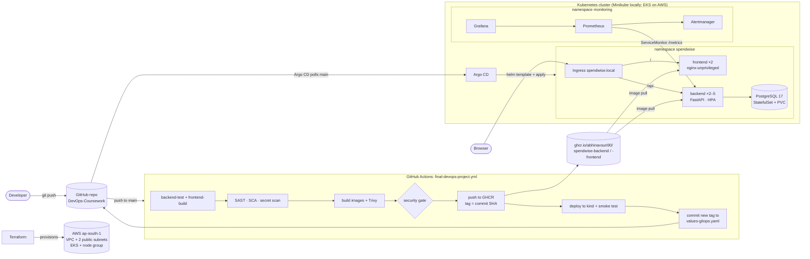

**Request path:** browser → ingress-nginx (`spendwise.local`) → `/` goes to the frontend Service, which serves the React build, and `/api` goes to the backend Service (FastAPI) → PostgreSQL via the headless Service `spendwise-postgres`. Prometheus scrapes each backend Pod's `/metrics` every 15 s. Grafana and Alertmanager read from Prometheus.

**Delivery path:** a push to `main` runs the pipeline. If every gate passes, the images are pushed to GHCR tagged with the commit SHA, and the pipeline commits the new tag to [helm/spendwise/values-gitops.yaml](helm/spendwise/values-gitops.yaml). Argo CD sees that commit and rolls the cluster forward. The pipeline never needs credentials for the real cluster.

## Technologies used

| Area | Technology (version) |
| --- | --- |
| Backend | Python 3.13, FastAPI 0.143, Uvicorn 0.54, SQLAlchemy 2.1, Alembic 1.20, psycopg 3.3, prometheus-client 0.26 |
| Frontend | React 19.3, Vite 8.3, served by `nginxinc/nginx-unprivileged:1.30-alpine` |
| Database | PostgreSQL 17 (`postgres:17-alpine`) |
| Tests & quality | pytest 9.1, pytest-cov 7.1, ruff 0.17 |
| Containers | Docker 29.5, Docker Compose, multi-stage builds |
| Kubernetes | Minikube 1.39 (Kubernetes 1.37), ingress-nginx, metrics-server, kind (in CI) |
| Packaging | Helm 4.3 |
| CI/CD | GitHub Actions, GitHub Container Registry (GHCR) |
| DevSecOps | Bandit 1.9, CodeQL, pip-audit 2.10, npm audit, Trivy 0.74, Gitleaks 8.30 |
| Monitoring | kube-prometheus-stack (Prometheus 3.15, Alertmanager, Grafana, kube-state-metrics, node-exporter) |
| GitOps | Argo CD (Helm chart `argo/argo-cd`) |
| Infrastructure as code | Terraform 1.16, AWS provider 6.68, AWS VPC + EKS |

## Repository layout

```text
final-devops-project/
├── application/
│   ├── backend/            # FastAPI app, Alembic migrations, pytest tests, pytest.ini
│   └── frontend/           # React + Vite UI
├── docker/                 # backend.Dockerfile, frontend.Dockerfile (multi-stage), nginx.conf.template,
│                           # docker-compose.yml, .env.example
├── kubernetes/             # namespace.yaml, create-db-secret.sh, render.sh, spendwise-rendered.yaml
├── helm/spendwise/         # the Helm chart (values.yaml, values-local.yaml, values-gitops.yaml, templates/)
├── terraform/              # VPC + 2 public subnets + EKS cluster + managed node group
├── .github/workflows/      # copy of the pipeline (the active file is in the repo root .github/workflows/)
├── security/               # trivy.yaml, gitleaks.toml, SECURITY.md
├── monitoring/             # kube-prometheus-stack values, traffic generator, prom.sh helper
├── gitops/                 # Argo CD Application + Argo CD install values
├── troubleshooting/        # Helm values overlays that inject the five challenge faults
├── evidence/               # recorded command transcripts
└── screenshots/            # rendered transcripts + browser captures
```

## Application setup

**Backend (no Docker needed).** Without `DATABASE_URL` the app uses a local SQLite file. With Docker or Kubernetes it gets a PostgreSQL URL.

```bash
cd final-devops-project/application/backend
python3 -m venv .venv && source .venv/bin/activate
pip install -r requirements-dev.txt
alembic upgrade head                      # creates the expenses table (migration 0001)
uvicorn app.main:app --reload --port 8000 # http://localhost:8000/docs for the OpenAPI UI
```

**Frontend.** In dev mode Vite proxies `/api` to the backend on port 8000:

```bash
cd final-devops-project/application/frontend
npm ci && npm run dev                     # http://localhost:5173
```

**Tests.** [tests/conftest.py](application/backend/tests/conftest.py) replaces the `get_db` dependency with an in-memory SQLite database (`StaticPool`) and recreates the tables for every test, so tests never touch a real database. [pytest.ini](application/backend/pytest.ini) sets the test path and the `pythonpath`.

```bash
ruff check . && pytest -v --cov=app --cov-report=term-missing
```

The 9 tests cover:

- `/health` and `/api/version`
- create and list, the category filter, and the `limit` bound with newest-first ordering
- get, update and delete, including 404s
- `/api/summary` totals
- validation errors (422)
- `/metrics`

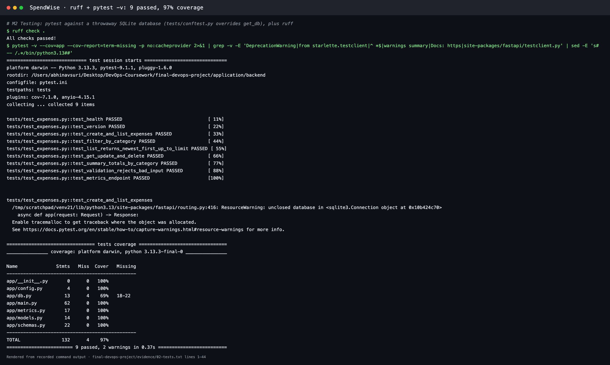

## Docker setup

| File | What it does |
| --- | --- |
| [docker/backend.Dockerfile](docker/backend.Dockerfile) | `python:3.13-alpine`. Installs the pinned requirements, then **removes pip** (it bundles libraries that image scanners flag), creates user `spendwise` (uid 10001) and runs as it. The entrypoint [entrypoint.sh](application/backend/entrypoint.sh) runs `alembic upgrade head`, then Uvicorn. Has a `HEALTHCHECK` on `/health` |
| [docker/frontend.Dockerfile](docker/frontend.Dockerfile) | **Multi-stage.** Stage 1 `node:24-alpine` runs `npm ci && npm run build`. Stage 2 `nginx-unprivileged:1.30-alpine` (uid 101, port 8080) serves `dist/`. The [nginx template](docker/nginx.conf.template) proxies `/api/` to `${BACKEND_HOST}:${BACKEND_PORT}`, adds `/healthz`, and falls back to `index.html` for the SPA |
| [docker/docker-compose.yml](docker/docker-compose.yml) | `postgres` (healthcheck with `pg_isready`, named volume), `backend` (waits for a healthy database), `frontend` on `localhost:3000`. The DB password comes from `docker/.env` (git-ignored, see [.env.example](docker/.env.example)). Compose stops with an error if it is missing |

Both images use the project folder as build context. [.dockerignore](.dockerignore) keeps only `application/` and `docker/` in it.

```bash
cd final-devops-project/docker
cp .env.example .env && sed -i '' "s/change-me/$(openssl rand -hex 16)/" .env   # macOS sed; use sed -i on Linux
docker compose up --build --detach
docker compose ps
open http://localhost:3000
```

The recorded run:

- Compose builds both images and starts PostgreSQL first, then the backend once the database is healthy.
- The backend applies migration 0001.
- The smoke test goes through the frontend's nginx `/api` proxy.
- Both app containers run as non-root (`uid=10001(spendwise)`, `uid=101(nginx)`).

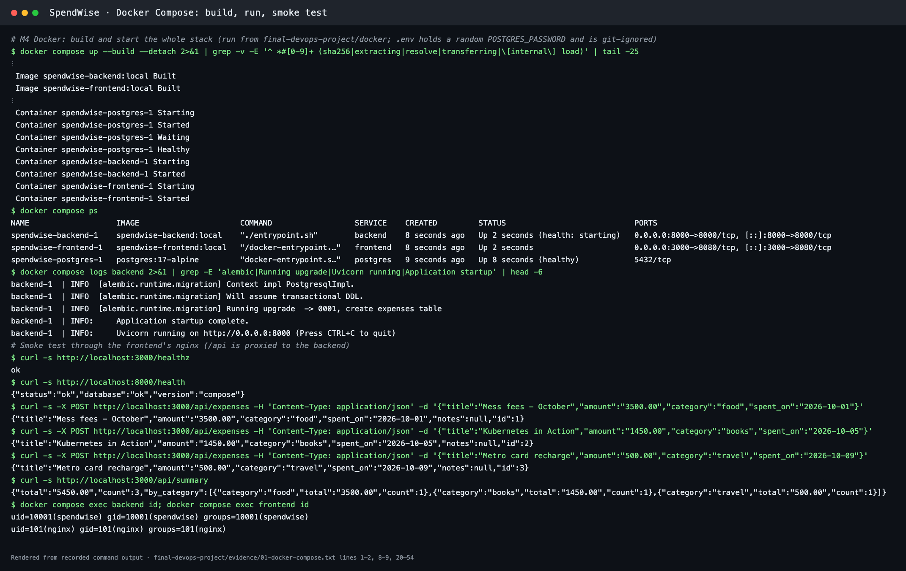

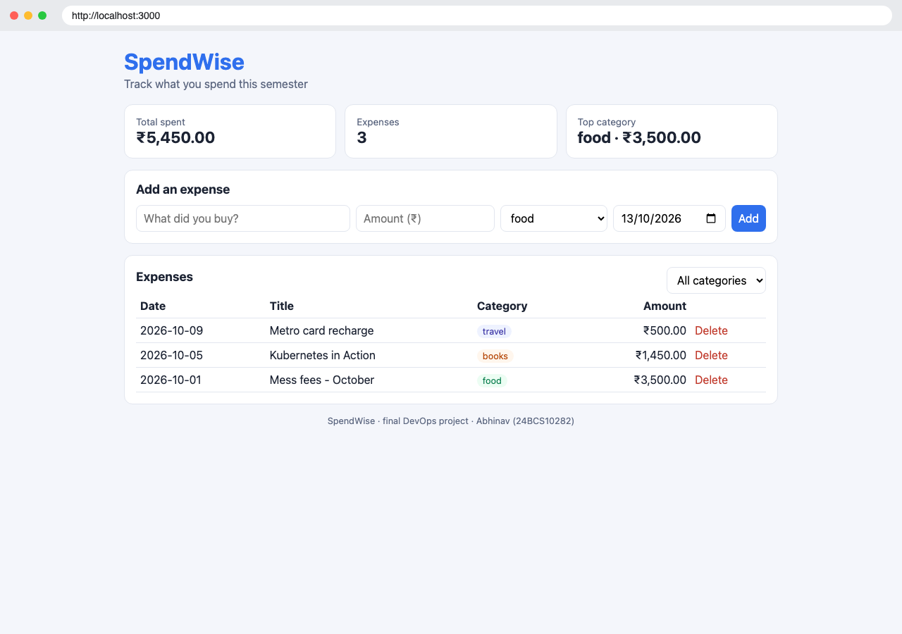

## Kubernetes deployment

The cluster is Minikube (Kubernetes v1.37, containerd, 4 CPUs) with the `ingress` and `metrics-server` addons. The chart creates these objects in namespace `spendwise`:

| Object | Name | Notes |
| --- | --- | --- |
| Namespace | `spendwise` | [kubernetes/namespace.yaml](kubernetes/namespace.yaml) |
| Deployment | `spendwise-backend` | FastAPI. The HPA owns the replica count (2–5). Init container `wait-for-db` runs `pg_isready` until PostgreSQL answers. Readiness, liveness and startup probes on `/health`. Hardened `securityContext` |
| Deployment | `spendwise-frontend` | 2 replicas of nginx-unprivileged. Read-only root filesystem with `emptyDir` mounts for `/etc/nginx/conf.d` and `/tmp`. Probes on `/healthz` |
| StatefulSet | `spendwise-postgres` | PostgreSQL 17 as uid 70. `volumeClaimTemplates` → PVC `data-spendwise-postgres-0` (1 Gi, `standard` StorageClass). `pg_isready` probes |
| Service (ClusterIP) | `spendwise-backend` :8000, `spendwise-frontend` :80 → 8080 | `spendwise-postgres` is headless (`clusterIP: None`) for the StatefulSet |
| ConfigMap | `spendwise-config` | Non-secret settings: `DB_HOST`, `DB_PORT`, `DB_NAME`, `DB_USER`, plus `BACKEND_HOST`/`BACKEND_PORT` for the frontend's nginx proxy |
| Secret | `spendwise-db` | Database password, created at deploy time by [create-db-secret.sh](kubernetes/create-db-secret.sh) with `openssl rand`. Never stored in Git. `DATABASE_URL` is assembled in the Pod from env vars, using the password from `secretKeyRef` |
| Ingress | `spendwise` (class `nginx`) | Host `spendwise.local`: `/api` → backend, `/` → frontend |
| HorizontalPodAutoscaler | `spendwise-backend` | 2–5 replicas at 70% CPU (3 at most in the Minikube values files). It needs CPU requests, see fault 5 |
| PodDisruptionBudget | backend and frontend | `minAvailable: 1` during node drains |
| ServiceMonitor, PrometheusRule, dashboard ConfigMap | monitoring | See [Monitoring](#monitoring) |

```bash
minikube start --cpus 4 --memory 3500 --addons ingress,metrics-server
docker compose -f docker/docker-compose.yml build     # build with the host Docker...
minikube image load spendwise-backend:local           # ...then copy the images into Minikube
minikube image load spendwise-frontend:local
kubectl apply -f kubernetes/namespace.yaml
bash kubernetes/create-db-secret.sh spendwise
```

[kubernetes/spendwise-rendered.yaml](kubernetes/spendwise-rendered.yaml) contains the plain manifests that the chart produces ([render.sh](kubernetes/render.sh)), so you can review them, or apply them with `kubectl` without Helm.

All Pods are Running with two replicas each of backend and frontend. Both Services are ClusterIP, and the Ingress has the two paths. (The 2 restarts on the very first install were a real startup race, fixed with the init container; see [Troubleshooting](#real-issues-found-while-building).)

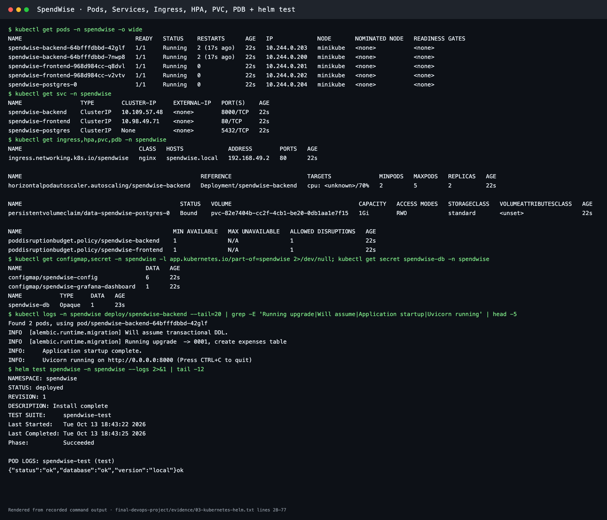

The Ingress routes `/api` to the backend and `/` to the frontend (ingress-nginx is port-forwarded to `127.0.0.1:18080`, and the browser maps `spendwise.local` to it):

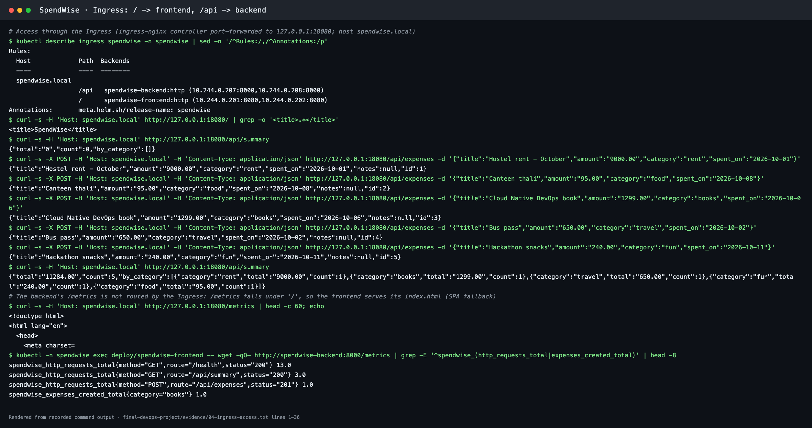


## Helm deployment

```text
helm/spendwise/
├── Chart.yaml                 # spendwise 1.0.0
├── values.yaml                # defaults: GHCR images (tag must be set), 2 replicas, HPA 2–5 @ 70%, ingress, resources
├── values-local.yaml          # Minikube: images spendwise-*:local, monitoring objects on, HPA max 3
├── values-gitops.yaml         # Argo CD: GHCR images (CI writes the commit SHA tag here), HPA max 3
├── files/grafana-dashboard.json
└── templates/
    ├── _helpers.tpl  configmap.yaml  secret.yaml (only if no existingSecret)
    ├── postgres.yaml backend.yaml  frontend.yaml  ingress.yaml  hpa.yaml  pdb.yaml
    ├── servicemonitor.yaml  prometheusrule.yaml  grafana-dashboard.yaml  NOTES.txt
    └── tests/test-connection.yaml   # `helm test`: calls the backend /health and the frontend /healthz
```

```bash
helm lint helm/spendwise -f helm/spendwise/values-local.yaml
helm upgrade --install spendwise helm/spendwise -n spendwise -f helm/spendwise/values-local.yaml --wait --timeout 6m
helm list -n spendwise
helm test spendwise -n spendwise --logs
helm history spendwise -n spendwise
helm rollback spendwise <revision> -n spendwise --wait      # used in troubleshooting fault 1
```

The image helper in [_helpers.tpl](helm/spendwise/templates/_helpers.tpl) uses `required` for the image tags, so an install without a tag fails at render time rather than deploying `latest`. The database password can come from an existing Secret (`database.existingSecret`, the default) or `--set database.password=…`. It is never written to a values file.

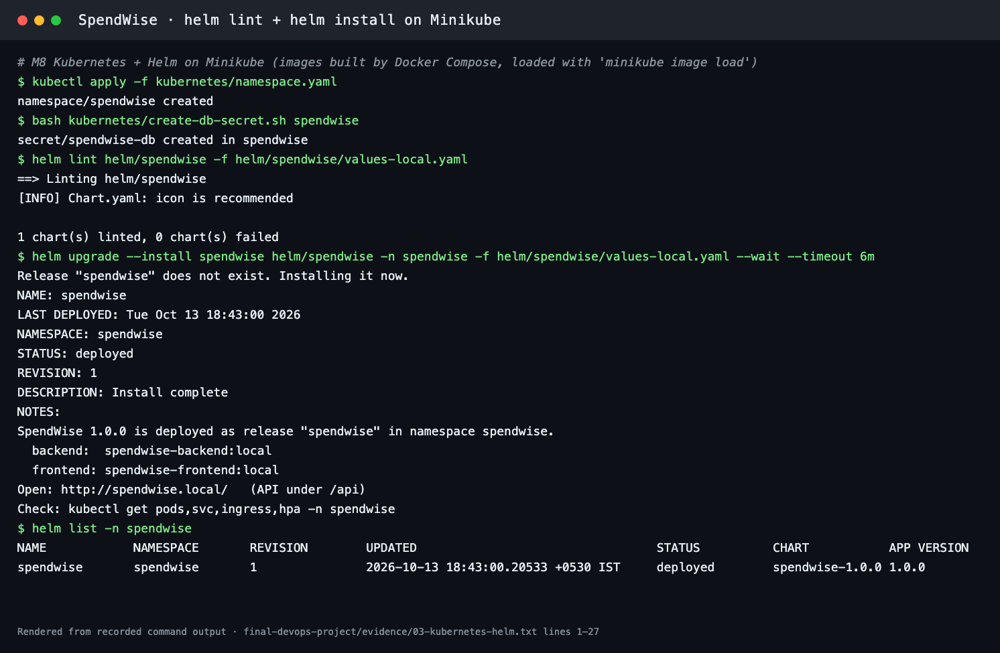

## Terraform infrastructure

[terraform/](terraform/) provisions the AWS side in `ap-south-1` (Mumbai):

| File | Resources |
| --- | --- |
| [versions.tf](terraform/versions.tf) | Terraform ≥ 1.6, AWS provider `~> 6.68`, `default_tags` (Project, Owner, ManagedBy) on every resource |
| [vpc.tf](terraform/vpc.tf) | `aws_vpc` 10.21.0.0/16 (DNS hostnames on), `aws_internet_gateway`, **two public subnets** in two AZs (10.21.1.0/24, 10.21.2.0/24, `map_public_ip_on_launch`, tagged `kubernetes.io/role/elb` for load balancers), a public route table `0.0.0.0/0 → IGW` and its associations |
| [iam.tf](terraform/iam.tf) | Cluster role (`eks.amazonaws.com`, `AmazonEKSClusterPolicy`) and node role (`ec2.amazonaws.com`: `AmazonEKSWorkerNodePolicy`, `AmazonEKS_CNI_Policy`, `AmazonEC2ContainerRegistryReadOnly`) |
| [eks.tf](terraform/eks.tf) | `aws_eks_cluster` `spendwise-eks` (public endpoint, `authentication_mode = "API"`, creator gets cluster-admin through an access entry) and an `aws_eks_node_group` with 1 × `t3.small` On-Demand (min 1, max 2) in the public subnets |
| [variables.tf](terraform/variables.tf) / [terraform.tfvars.example](terraform/terraform.tfvars.example) | Region, names, CIDRs, node size and count. No credentials: Terraform reads them from `aws configure` / `aws login` |
| [outputs.tf](terraform/outputs.tf) | VPC and subnet IDs, AZs, cluster name, version and endpoint, node group status, and the `aws eks update-kubeconfig` command |

Public subnets keep this lab cheap: there is no NAT gateway, which would cost money every hour even when idle. The nodes still get no inbound traffic except through Kubernetes Services. In production the nodes would go in private subnets behind a NAT gateway.

```bash
cd final-devops-project/terraform
cp terraform.tfvars.example terraform.tfvars
terraform init
terraform fmt -check && terraform validate
terraform plan -out tfplan            # review everything that will be created
terraform apply tfplan                # about 10-15 minutes, most of it the EKS control plane
aws eks update-kubeconfig --region ap-south-1 --name spendwise-eks
kubectl get nodes                     # the managed node group's t3.small node is Ready
terraform destroy                     # always, straight after the demo
```

**Cost:** the EKS control plane is billed per hour, plus the `t3.small` node and its public IPv4 address. Applying, checking, and destroying in one sitting costs well under one US dollar.

### Validation and dependency graph

`init`, `fmt`, `validate` and `graph` run without cloud access ([evidence/09-terraform-local-checks.txt](evidence/09-terraform-local-checks.txt)). The graph shows the creation order:

1. VPC
2. Internet Gateway and subnets
3. Route table and associations
4. IAM roles and policy attachments
5. EKS cluster
6. Node group

`destroy` runs in the reverse order.

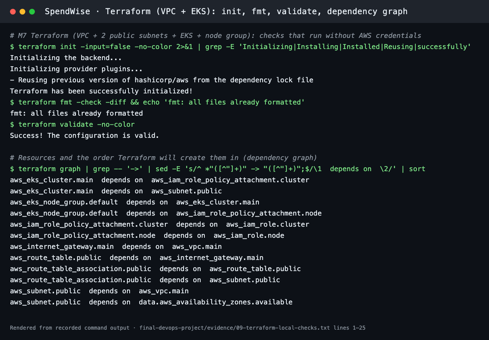

`plan`, `apply` and `destroy` call AWS and need credentials (`aws login` or `aws configure`, region `ap-south-1`). With the defaults, the plan creates **15 resources**: VPC, IGW, 2 subnets, route table, 2 associations, 2 IAM roles, 4 policy attachments, EKS cluster and node group. To show the result:

- `aws eks update-kubeconfig …` then `kubectl get nodes` lists the `t3.small` worker.
- In the AWS Console (region Mumbai), open **VPC → Your VPCs** for `spendwise-eks-vpc` with its two public subnets, and **EKS → Clusters** for `spendwise-eks` with node group `spendwise-eks-nodes`.
- `terraform destroy` must end with `Destroy complete! Resources: 15 destroyed.`

## CI/CD pipeline

The active workflow is [.github/workflows/final-devops-project.yml](../.github/workflows/final-devops-project.yml) in the repository root, because GitHub only runs workflows from there. An identical copy is kept in [.github/workflows/](.github/workflows/) inside this folder, and the first job `diff`s the two.

**Triggers:**

- push to `main` (paths: this folder and the workflow file). Documentation, evidence, screenshots and `values-gitops.yaml` are excluded, so the GitOps commit does not start a new run
- pull requests
- manual `workflow_dispatch`

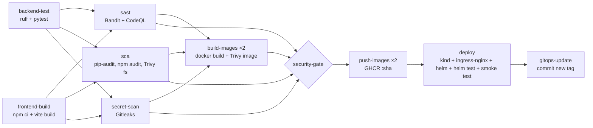

| Job | What it does | Fails the pipeline when |
| --- | --- | --- |
| `backend-test` | Python 3.13: `ruff check`, `pytest --cov` (SQLite test DB). Uploads JUnit + coverage XML as an artifact | A lint error or any failing test |
| `frontend-build` | Node 24: `npm ci`, `npm run build`, uploads `dist/` | The build fails |
| `sast` / `sca` / `secret-scan` | Security stages, see [DevSecOps](#devsecops-implementation) | A finding above the threshold |
| `build-images` (matrix: backend, frontend) | `docker build` with `APP_VERSION=<sha>`, **Trivy image scan**, the Trivy result published as a run annotation, image saved as an artifact | The build fails or there is a fixable HIGH/CRITICAL CVE |
| `security-gate` | Runs with `if: always()`, writes a summary table, and requires every security job to be `success` | Any security job failed, was skipped or was cancelled |
| `push-images` (matrix) | `main` only. Loads the scanned image, tags it `ghcr.io/abhinavsuri90/spendwise-<component>:<12-char sha>`, pushes with `GITHUB_TOKEN` (`packages: write`) | The push fails |
| `deploy` | Creates a **kind** cluster, installs ingress-nginx, creates the DB Secret and a GHCR pull Secret, then runs `helm upgrade --install` with the SHA tags, `helm test`, and a smoke test **through the Ingress** (`/`, a POST to `/api/expenses`, `/api/summary`). If anything fails, a diagnostics step publishes Pod states and warning events | The rollout, `helm test`, or the smoke test fails |
| `gitops-update` | `main` only. `yq` writes the new tag into `values-gitops.yaml`, then commits `gitops: deploy spendwise <sha>` and pushes (with retry and rebase) | The push fails |

Images are tagged only with the **commit SHA**, never `latest`, so every running Pod can be traced to the exact commit that built and scanned it. Pushing the *scanned* image artifact (instead of rebuilding) guarantees that the image in GHCR is the one Trivy checked.

### Pipeline runs on GitHub

Every run is listed under [Actions → "Final project · SpendWise CI/CD"](https://github.com/Abhinavsuri90/DevOps-Coursework/actions/workflows/final-devops-project.yml).

**A green run.** [Run 38690443409](https://github.com/Abhinavsuri90/DevOps-Coursework/actions/runs/38690443409), on commit `73177c1`, passed all 12 jobs in 5 min 49 s:

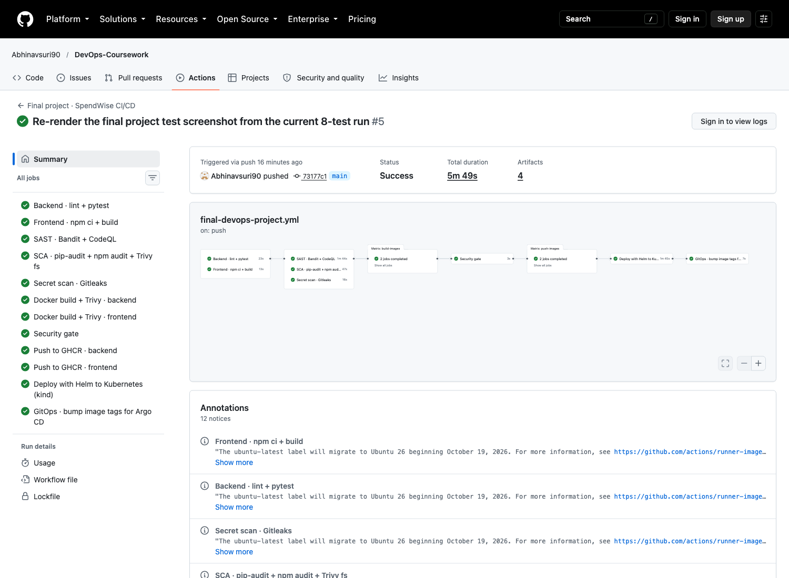

**Images in GHCR.** They are tagged with the 12-character commit SHA, never `latest` (`ghcr.io/abhinavsuri90/spendwise-backend` and `-frontend`):

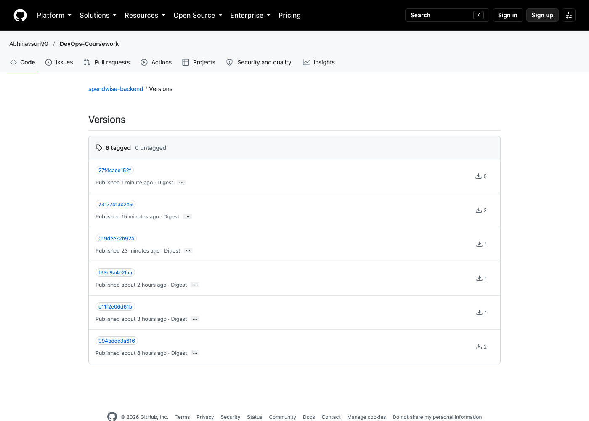

**Commit history (M3).** It has meaningful messages, including the bot's `gitops: deploy spendwise <sha>` commits:

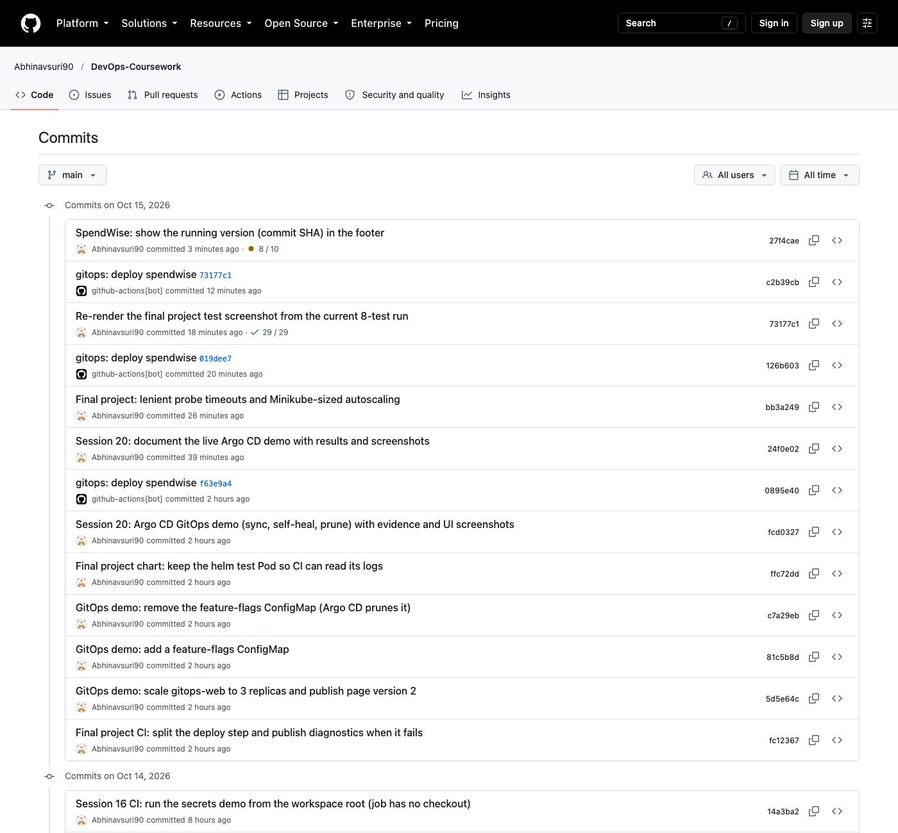

**Getting the deploy job green (a real issue).** The first runs failed in *Deploy with Helm to Kubernetes (kind)*, while everything before it was green.

- Job logs on GitHub require signing in, but annotations are public. So I split the step in three and added a failure-only *Diagnostics* step that publishes Pod states and warning events as an annotation.
- The next run showed that `helm upgrade --install` had **succeeded** with every Pod Running. Only `helm test` failed, and the test Pod no longer existed.
- **Root cause:** the test hook had `hook-delete-policy: hook-succeeded`, so Helm deleted the Pod as soon as it passed. The Helm on the runner then failed while reading that Pod's logs for `--logs`. (Helm 4.3 on my laptop reads the logs first, which is why it passed locally.)
- **Fix:** keep the test Pod (`before-hook-creation` only). Every run since has been green.

## DevSecOps implementation

| Practice | Tool | Job | Gate | Configuration |
| --- | --- | --- | --- | --- |
| SAST (Python) | Bandit 1.9.4 | `sast` | Fails on medium or high severity | `[tool.bandit]` in [pyproject.toml](application/backend/pyproject.toml) |
| SAST (Python + JavaScript) | GitHub CodeQL | `sast` | Results in the repo's Security → Code scanning tab | `build-mode: none`, source root `application/` |
| SCA (Python) | pip-audit 2.10.1 | `sca` | Any known vulnerability (`--strict`) | [requirements.txt](application/backend/requirements.txt) (all pinned) |
| SCA (npm) | npm audit | `sca` | High or critical | [package-lock.json](application/frontend/package-lock.json) |
| SCA (lock files) | Trivy 0.74 `fs` | `sca` | Fixable HIGH/CRITICAL | [security/trivy.yaml](security/trivy.yaml) |
| Secret scanning | Gitleaks 8.30.1 | `secret-scan` | Any finding | [security/gitleaks.toml](security/gitleaks.toml) (default rules + allowlist for evidence/screenshots/lock files) |
| Container image scanning | Trivy 0.74 `image` | `build-images` (both images) | Fixable HIGH/CRITICAL | [security/trivy.yaml](security/trivy.yaml): `severity: [HIGH, CRITICAL]`, `exit-code: 1`, `ignore-unfixed: true` |
| Security gate | `security-gate` job | before `push-images` | Every job above must be `success` | workflow |

More hardening is described in [security/SECURITY.md](security/SECURITY.md):

- non-root users everywhere
- read-only root filesystems, `allowPrivilegeEscalation: false`, all capabilities dropped, `RuntimeDefault` seccomp
- pip removed from the runtime image
- secrets created at deploy time, never in Git
- SHA image tags

**Local dry run** of the security stages with the same tool versions as CI:

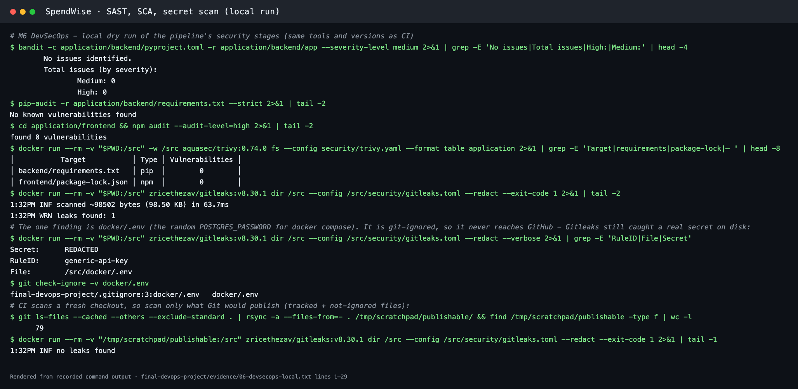

Gitleaks found one real secret on disk: `docker/.env` (the random Compose DB password). That file is git-ignored and never reaches GitHub. A scan of exactly what Git would publish is clean, which is what CI sees on a fresh checkout.

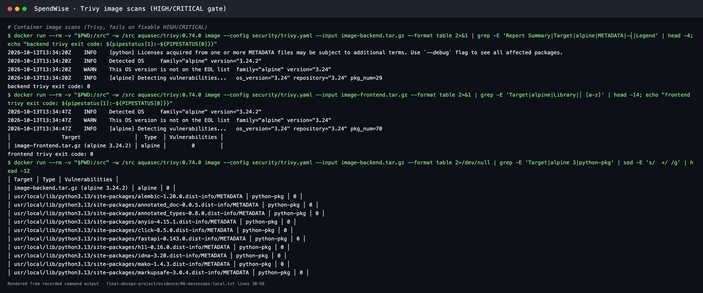

**Trivy in the pipeline.** Each `build-images` job scans its image and then publishes the result as an annotation, so it can be read on the run page without signing in. Both images reported **0 CRITICAL and 0 HIGH** fixable vulnerabilities, in the Alpine OS packages and in the backend's Python packages. That is why the security gate passed and the images were pushed:

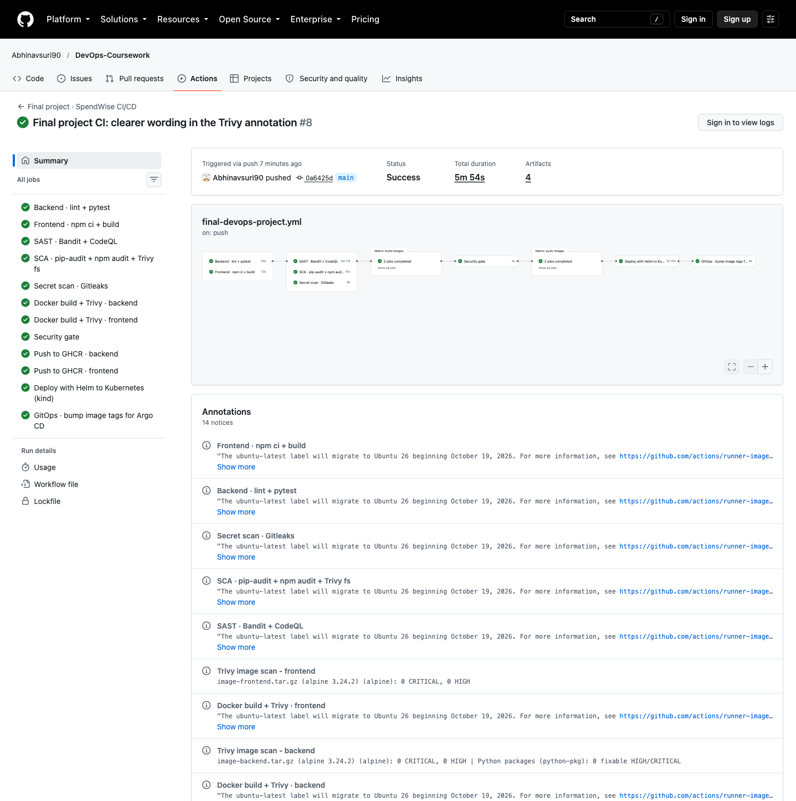

**What Trivy scanned and what the result means:**

- **What it scanned:** Trivy unpacked each built image and checked two things against its vulnerability database: the operating-system packages (Alpine 3.24: 29 packages in the backend image, 70 in the frontend), and every language package it found (the Python `site-packages` of the backend, with each package's `METADATA`).
- **Result:** 0 HIGH or CRITICAL vulnerabilities with an available fix in both images, so the gate passes. This does not mean "no vulnerabilities exist": it means nothing at the severity we block on has a released fix we could upgrade to.
- **What failing looks like:** Session 17's first image scan failed on CVEs in libraries vendored inside `pip` (e.g. CVE-2025-47273 in setuptools, a path traversal). Removing pip from the runtime image is why both images here scan clean. See [Session 17](../session-17-devsecops/README.md#the-image-scan-caught-a-real-problem-and-the-gate-failed).

## Monitoring

**Stack:** [kube-prometheus-stack](https://github.com/prometheus-community/helm-charts/tree/main/charts/kube-prometheus-stack) (Prometheus Operator, Prometheus, Alertmanager, Grafana, kube-state-metrics, node-exporter), installed in namespace `monitoring` with [monitoring/kube-prometheus-stack-values.yaml](monitoring/kube-prometheus-stack-values.yaml). The Grafana admin password comes from a Secret created at install time, so nothing is committed.

```bash
kubectl create namespace monitoring
kubectl -n monitoring create secret generic grafana-admin \
  --from-literal=admin-user=admin --from-literal=admin-password="$(openssl rand -hex 12)"
helm upgrade --install kps prometheus-community/kube-prometheus-stack -n monitoring \
  -f monitoring/kube-prometheus-stack-values.yaml --wait --timeout 15m
kubectl -n monitoring port-forward svc/kps-kube-prometheus-stack-prometheus 9090:9090 &
kubectl -n monitoring port-forward svc/kps-grafana 3000:80 &
kubectl apply -f monitoring/traffic-generator.yaml     # synthetic users so the panels have data
```

| Signal | How it is collected | Where to see it |
| --- | --- | --- |
| **Application metrics** | [app/metrics.py](application/backend/app/metrics.py): `spendwise_http_requests_total{method,route,status}`, `spendwise_http_request_duration_seconds` (histogram), `spendwise_expenses_created_total{category}`. The route label is the route *template*, so cardinality stays bounded | `GET /metrics` on the backend, scraped by Prometheus |
| **Scraping** | The chart's [ServiceMonitor](helm/spendwise/templates/servicemonitor.yaml) selects the backend Service, port `http`, path `/metrics`, every 15 s | Prometheus → Status → Target health |
| **Alerts** | [PrometheusRule](helm/spendwise/templates/prometheusrule.yaml): `SpendWiseHighErrorRate` (> 5% 5xx for 2 m), `SpendWiseBackendDown` (no backend target up for 1 m), `SpendWiseSlowRequests` (p95 > 500 ms for 5 m) | Prometheus → Alerts, Alertmanager |
| **Dashboards** | [files/grafana-dashboard.json](helm/spendwise/files/grafana-dashboard.json) shipped as a ConfigMap labelled `grafana_dashboard: "1"`. Grafana's sidecar loads it automatically. 12 panels: requests/s, 5xx error rate, p95 latency, expenses created, backend Pods up, HPA replicas, then time series by route, p50/p95 latency, expenses by category, CPU and memory per Pod, status codes | Grafana → "SpendWise - Application Overview" |
| **CPU / memory** | cAdvisor (kubelet) + kube-state-metrics, `kubectl top` via metrics-server (also feeds the HPA) | Grafana panels, `kubectl top pods -n spendwise` |
| **Health** | `/health` (DB check) for readiness, liveness and startup probes, plus `pg_isready` for PostgreSQL | `kubectl get pods`, `kubectl describe pod` events |
| **Logs** | Each container logs to stdout (Uvicorn access log, Alembic migrations, nginx access log) | `kubectl logs -n spendwise deploy/spendwise-backend`, `kubectl logs ... -c wait-for-db`, `--previous` after a crash |

The backend's `/metrics` endpoint:

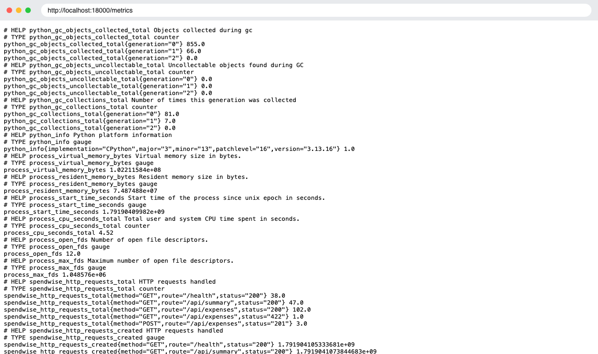

Prometheus scrapes both backend Pods (`2 / 2 up`):

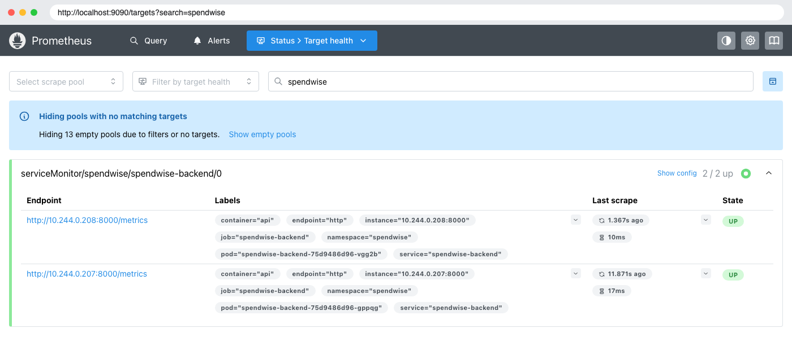

The Grafana dashboard with live data from the synthetic traffic:

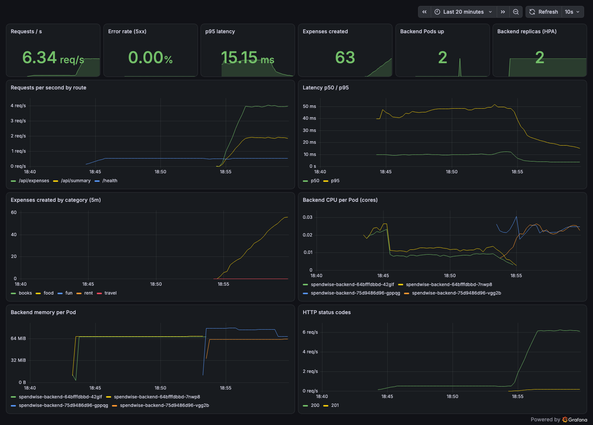

The same checks from the terminal (metrics, ServiceMonitor, targets, rule health, PromQL):

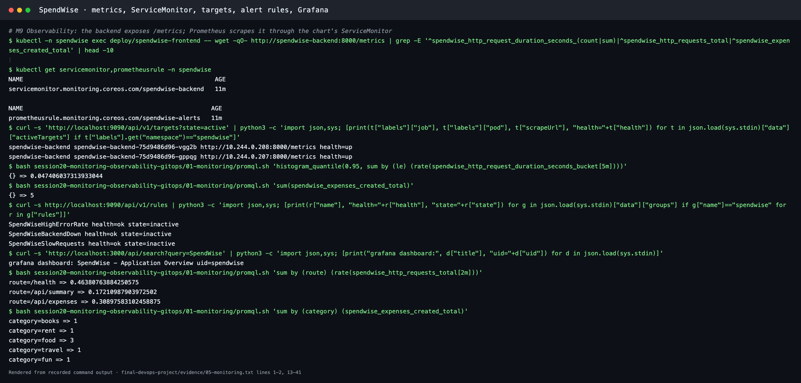

[monitoring/prom.sh](monitoring/prom.sh) is a small helper used throughout the troubleshooting transcripts:

- `targets` lists scrape targets with health and the last scrape error
- `alerts` lists Prometheus alert states
- `am` lists what reached Alertmanager
- `query '<PromQL>'` runs an instant query

**On an 8 GB laptop.** Minikube has about 3.4 GB of memory for everything: the control plane, the monitoring stack, Argo CD and the app. When Argo CD runs too, pause what you are not showing, and bring it back for the monitoring part of a demo:

```bash
kubectl -n monitoring patch prometheus kps-kube-prometheus-stack-prometheus --type merge -p '{"spec":{"replicas":1}}'
kubectl -n monitoring patch alertmanager kps-kube-prometheus-stack-alertmanager --type merge -p '{"spec":{"replicas":1}}'
kubectl -n monitoring scale deploy/kps-grafana --replicas=1
kubectl -n spendwise scale deploy/spendwise-traffic --replicas=1      # synthetic traffic for the panels
```

## GitOps

**Git is the source of truth for what runs in the cluster.** The CI pipeline never runs `kubectl` against it. It only commits the new image tag to Git, and **Argo CD**, running inside the cluster, pulls that change and applies it.

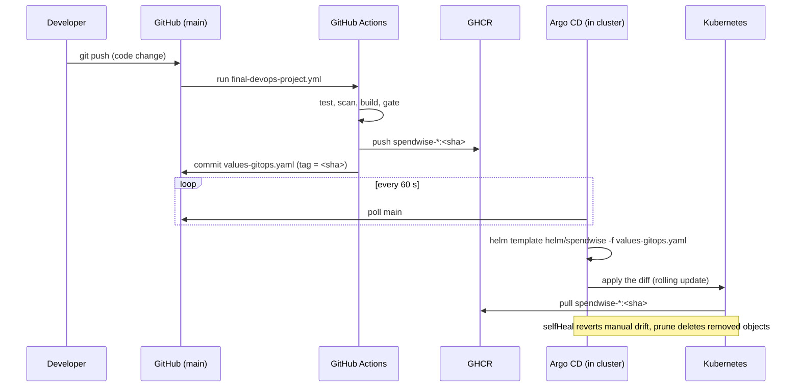

| File | Purpose |
| --- | --- |
| [gitops/argocd-values.yaml](gitops/argocd-values.yaml) | Small Argo CD install for Minikube: no Dex, notifications or ApplicationSet controller, Git polled every 60 s, read-only anonymous UI for screenshots |
| [gitops/argocd-application.yaml](gitops/argocd-application.yaml) | `Application` **spendwise**: repo `Abhinavsuri90/DevOps-Coursework`, branch `main`, path `final-devops-project/helm/spendwise`, value file `values-gitops.yaml`, destination namespace `spendwise`. `automated` sync with **prune** and **selfHeal**, plus a retry back-off |
| [helm/spendwise/values-gitops.yaml](helm/spendwise/values-gitops.yaml) | The only file CI changes: `backend.image.tag` and `frontend.image.tag` |

```bash
helm repo add argo https://argoproj.github.io/argo-helm
helm upgrade --install argocd argo/argo-cd -n argocd --create-namespace -f gitops/argocd-values.yaml --wait
helm uninstall spendwise -n spendwise          # hand the namespace over from the manual Helm release to Argo CD
kubectl apply -f gitops/argocd-application.yaml
kubectl -n argocd get applications.argoproj.io spendwise -w
```

The database Secret stays outside Git: it is created once per cluster by `kubernetes/create-db-secret.sh`. With Sealed Secrets or the External Secrets Operator it could also live in Git, in encrypted form. When the manual release is uninstalled, the StatefulSet's PVC is kept, so the Argo CD-managed PostgreSQL starts with all existing data.

### GitOps handover (recorded)

Until now the namespace had been deployed by hand with Helm. For GitOps I handed it over to Argo CD ([evidence/10-gitops-argocd.txt](evidence/10-gitops-argocd.txt)):

- `helm uninstall spendwise` removed the release. StatefulSet PVCs are not deleted, so all 2,313 rows stayed.
- `kubectl apply -f gitops/argocd-application.yaml` registered the Application. Argo CD rendered the chart with `values-gitops.yaml` from `main`, pulled the images from GHCR, and reported **Synced + Healthy** with the same 2,313 rows.
- To fit Argo CD into the laptop's cluster (4 CPUs and about 3.4 GB of memory), Prometheus and Alertmanager were paused during the demo and Grafana was scaled down. The monitoring screenshots above were taken earlier.

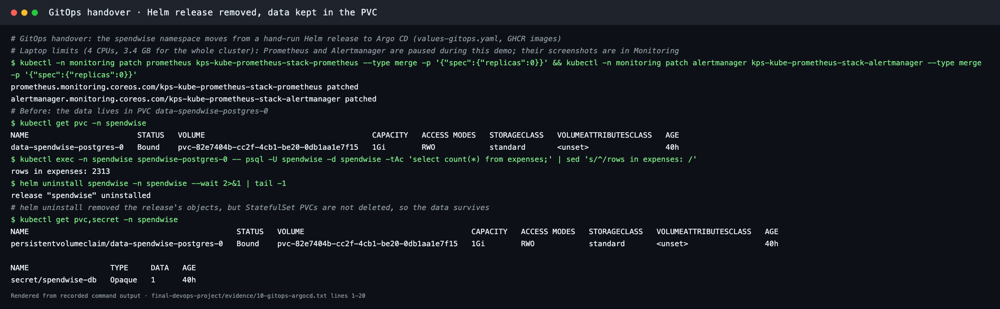

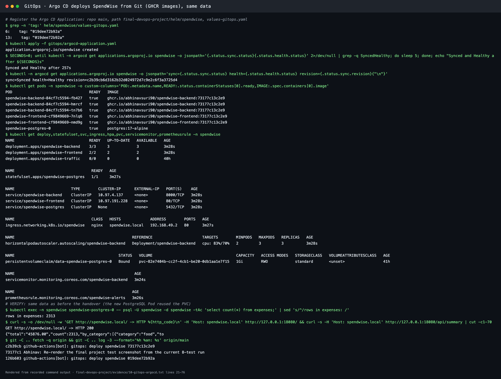

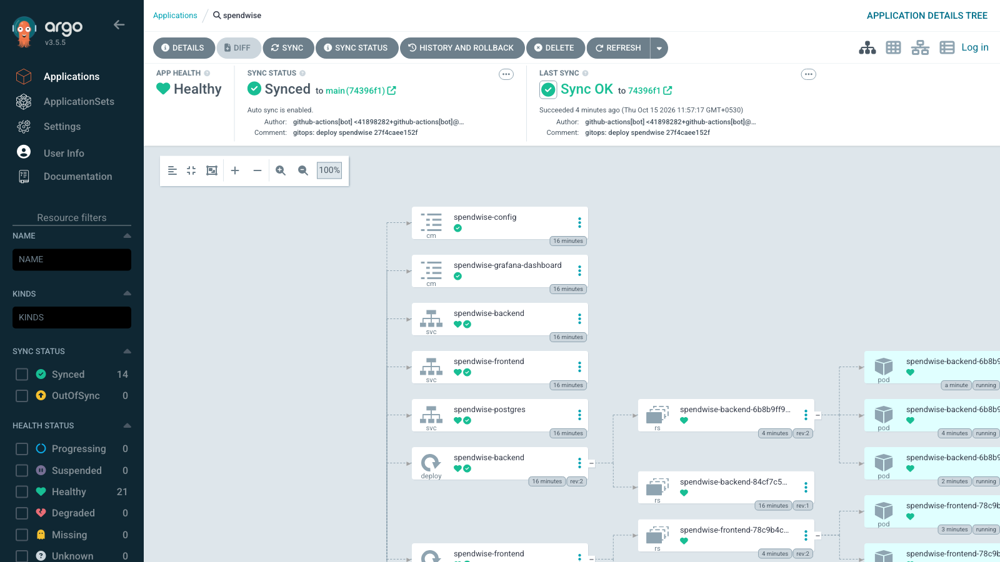

### Live demo (M10): commit → pipeline → deployment update (recorded)

One commit, and everything after it is automatic ([evidence/11-m10-commit-to-deploy.txt](evidence/11-m10-commit-to-deploy.txt)):

| Step | What happened | When (UTC) |
| --- | --- | --- |
| 1. Developer | Commit [`27f4cae`](https://github.com/Abhinavsuri90/DevOps-Coursework/commit/27f4cae) *"SpendWise: show the running version (commit SHA) in the footer"* (backend `GET /api/version` + a test, React footer), then `git push` | 06:20:45 |
| 2. CI | [Run 38691857530](https://github.com/Abhinavsuri90/DevOps-Coursework/actions/runs/38691857530): all 12 jobs green in 5 min 18 s, images pushed as `spendwise-*:27f4caee152f` | 06:20:49 → 06:26:07 |
| 3. GitOps commit | `github-actions[bot]` committed [`74396f1`](https://github.com/Abhinavsuri90/DevOps-Coursework/commit/74396f1) *"gitops: deploy spendwise 27f4caee152f"*, changing only the two image tags | 06:26:03 |
| 4. Argo CD | Detected `74396f1` and rolled out the new Pods (no restarts) | applied 06:27:16, Healthy 234 s after the commit appeared |
| 5. Result | `GET /api/version` → `{"version":"27f4caee152f"}`, and the footer shows **version 27f4caee152f** | |

| Before: tag `73177c13c2e9`, no version in the footer | After: tag `27f4caee152f`, footer shows the version |
| --- | --- |
| 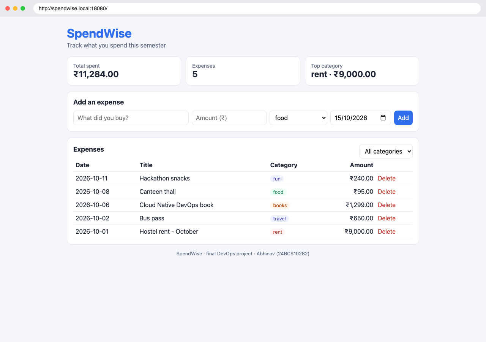 | 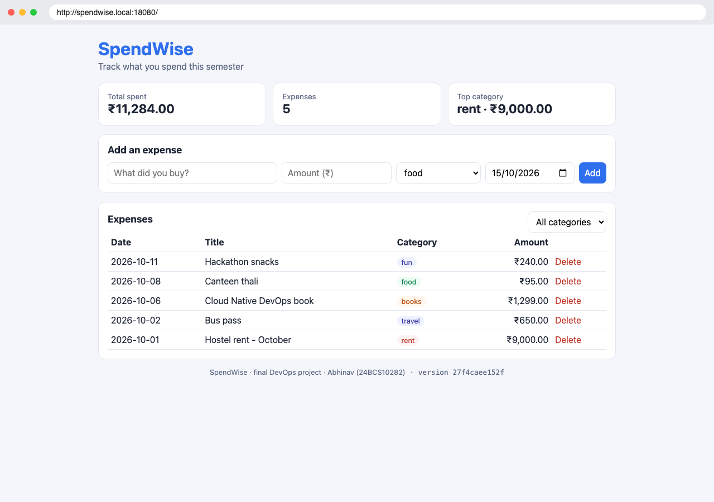 |

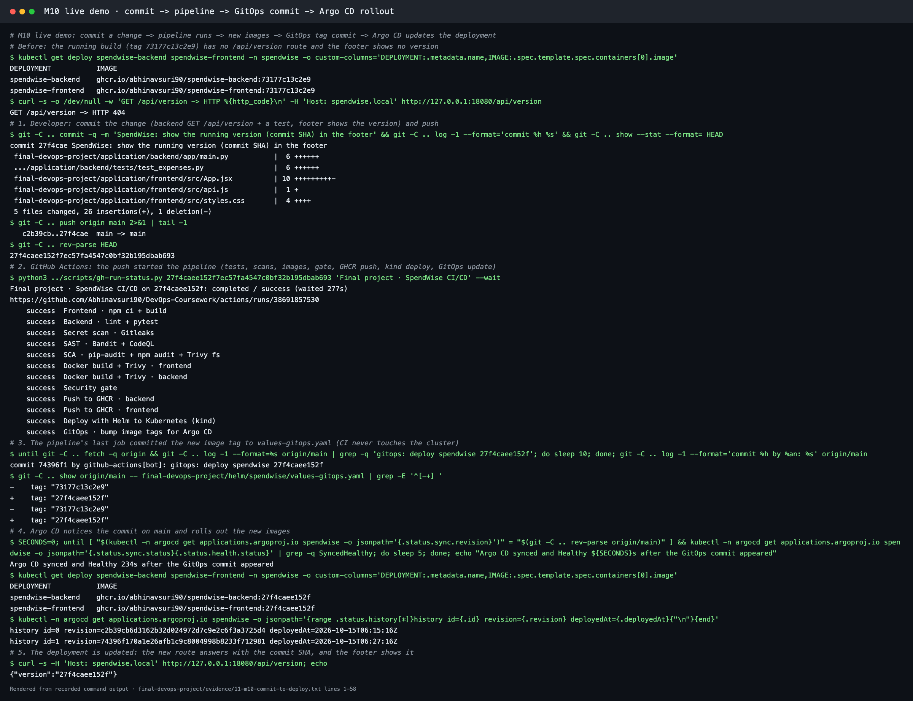

**To repeat it live during the presentation:**

1. Change something visible, for example the subtitle in [App.jsx](application/frontend/src/App.jsx), then commit and push.
2. Open the run on the **Actions** tab and wait for the pipeline.
3. Run `git pull` to see the bot's tag commit.
4. Watch Argo CD's UI or `kubectl -n spendwise get pods -w`.
5. Refresh the app: the footer shows the new commit SHA.

To show self-heal as well, run `kubectl -n spendwise scale deploy/spendwise-frontend --replicas=1`; Argo CD sets it back to 2 within seconds, because Git says 2. Session 20's [GitOps task](../session20-monitoring-observability-gitops/03-gitops/README.md) records sync, self-heal and prune step by step.

## Troubleshooting

### Final troubleshooting challenge: five injected faults

Each fault is a small Helm values overlay in [troubleshooting/](troubleshooting/), applied with `helm upgrade … -f helm/spendwise/values-local.yaml -f troubleshooting/break-N-….yaml`. Every fault was then worked through the same six steps, **Identify → Investigate → Root cause → Fix → Verify → Document**, and the full transcripts are in [evidence/](evidence/).

| # | Injected fault | Symptom (identify) | Investigation | Root cause | Fix | Verified by |
| --- | --- | --- | --- | --- | --- | --- |
| 1 | Backend image tag `locla` ([break-1](troubleshooting/break-1-image-tag.yaml)) | New backend Pod `ImagePullBackOff`, rollout stuck (old Pods keep serving) | `kubectl describe pod` → `Failed to pull image "spendwise-backend:locla"`; `helm get values` | Typo in the image tag, so the image does not exist | `helm rollback spendwise 4` (last good revision) | Rollout complete, Pods on `:local`, API answers, `helm history` shows "Rollback to 4" |
| 2 | Ingress host `spendwise.locl` ([break-2](troubleshooting/break-2-ingress-host.yaml)) | Every page and API call → **404** | Pods and Services healthy → `kubectl get ingress` shows the wrong host; controller logs | No Ingress rule matches `spendwise.local`, so the controller's default backend answers 404 | `helm upgrade` with the correct values | Host `spendwise.local` again, `/` → 200, `/api/summary` → JSON ([browser capture of the 404](screenshots/browser-05-troubleshoot-ingress-404.png)) |
| 3 | DB Secret name `spendwise-db-v2` ([break-3](troubleshooting/break-3-db-secret.yaml)) | `spendwise-postgres-0` **CreateContainerConfigError**, API **503**, backends crash-looping | `describe pod` → `secret "spendwise-db-v2" not found`; `get secrets`; StatefulSet `secretKeyRef` | The release references a Secret that does not exist | `helm upgrade` with the right name. **That alone did not fix it** (see below) | All Pods Running, **168 rows still there** (PVC kept the data), `helm history` revision 13 deployed |
| 4 | Metrics path `/metric` ([break-4](troubleshooting/break-4-metrics-path.yaml)) | App fine for users, but both Prometheus targets **DOWN**, `up == 0`, **`SpendWiseBackendDown` firing** and delivered to Alertmanager | Target error `server returned HTTP status 404`; ServiceMonitor path; `wget /metric` (404) vs `/metrics` (200) | ServiceMonitor scrapes a path the app doesn't serve | `helm upgrade` with `/metrics` | Targets up after 30 s, alert resolved 25 s later, per-route rates flowing again |
| 5 | Backend CPU request and limit removed ([break-5](troubleshooting/break-5-hpa-requests.yaml)) | HPA target `cpu: <unknown>/70%`, `ScalingActive=False` (`FailedGetResourceMetric`). Autoscaling silently stops | `kubectl top` still reports CPU for the new Pods; the Deployment's `api` container has no `requests.cpu` | Utilisation = usage ÷ request. With no request (and no limit to default from) there is nothing to divide by | `helm upgrade` with the chart's resources | `requests.cpu: 50m` back, HPA shows a real percentage, `ScalingActive=True` (`ValidMetricFound`) |

**Fault 3's second root cause.** After the Secret name was fixed, `helm upgrade --wait` still timed out. The StatefulSet template was correct (`spendwise-db`), but Pod `spendwise-postgres-0` was still the old, broken revision (`spendwise-db-v2`). With the default `OrderedReady` policy, a StatefulSet waits for its Pod to become Ready before replacing it, and a Pod that can never become Ready is never replaced. This is the documented *forced rollback* case. **Fix:** delete the stuck Pod (`kubectl delete pod spendwise-postgres-0`) so that the controller recreates it from the corrected template. Then restart the crash-looping backends and run `helm upgrade` again (revision 13).

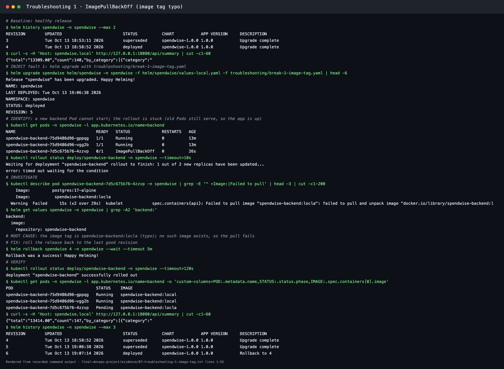

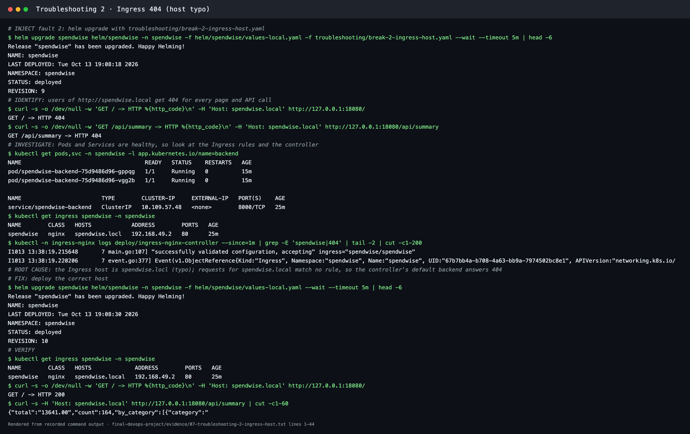

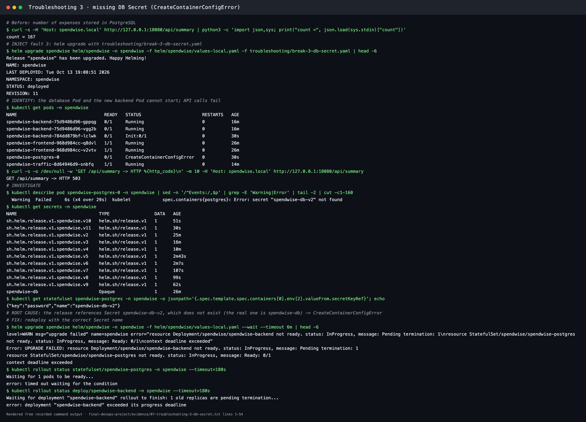

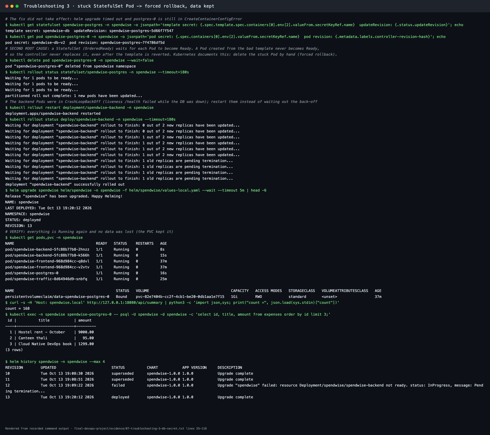

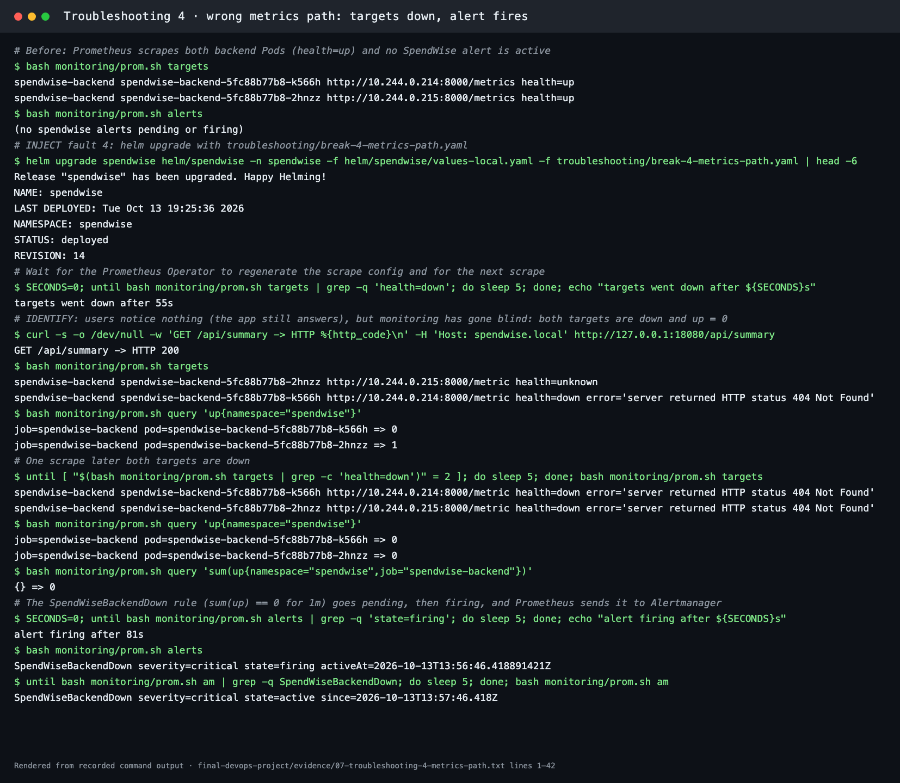

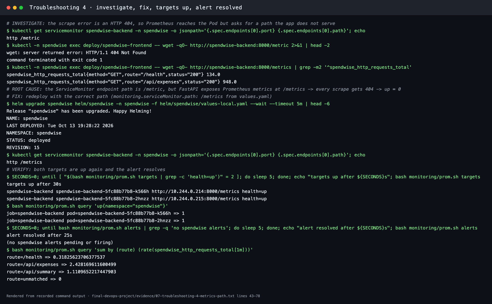

| Fault 4 in the browser | |
| --- | --- |
| 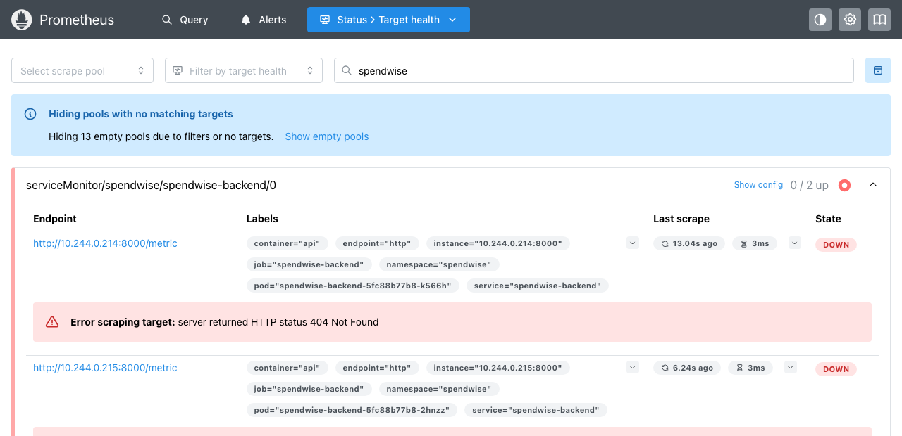 | 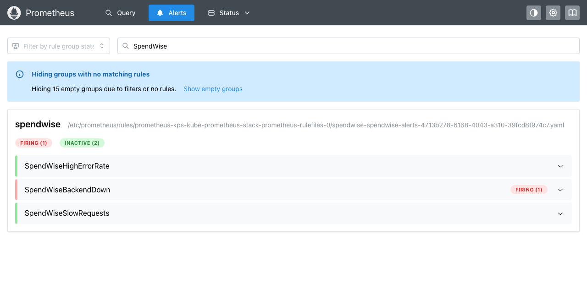 |

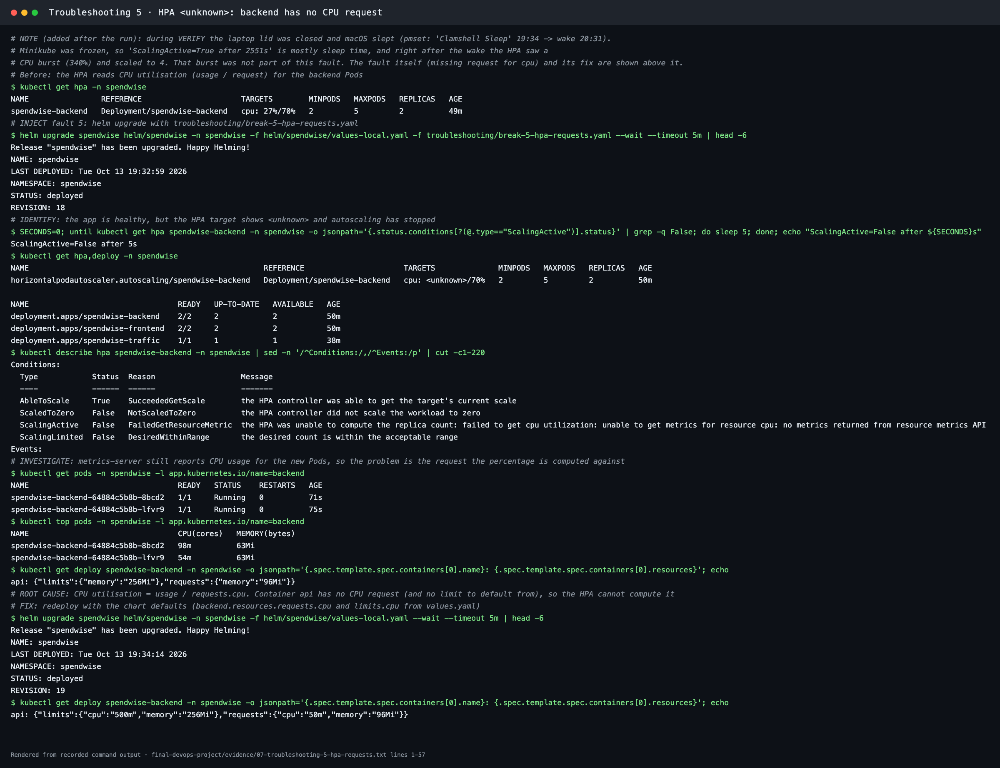

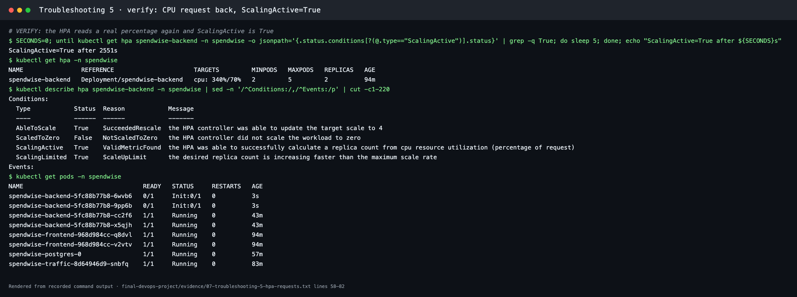

The fault 5 transcript has a note at the top: the laptop went to sleep during the verify step, which explains the long wait in that recording.

### Real issues found while building

These were not planted. They came up while building and running the project, and each one is recorded in the evidence.

| Issue | Symptom | Root cause | Fix | Evidence |
| --- | --- | --- | --- | --- |
| Startup race | Each backend Pod restarted twice on the first install | The backend ran `alembic upgrade head` before PostgreSQL accepted connections | Init container `wait-for-db` that loops on `pg_isready` | [03-kubernetes-helm.txt](evidence/03-kubernetes-helm.txt) lines 78–95 |
| `pg_isready` "no attempt" | The upgrade with the init container hung (revision 2 failed) | Without `-U`, `pg_isready` uses the OS user name. uid 10001 has no entry in the postgres image, so it exits 3 without trying | Pass `-U "$DB_USER" -d "$DB_NAME"` (revision 3 deployed) | [03-kubernetes-helm.txt](evidence/03-kubernetes-helm.txt) lines 96–129, [screenshot](screenshots/05-startup-race-fix.png) |
| Stuck StatefulSet rollout | A correct `helm upgrade` still timed out | `OrderedReady` never replaces a Pod that cannot become Ready | Delete the stuck Pod (forced rollback) | Fault 3 above |
| Unbounded list endpoint | HPA pinned at `maxReplicas` (5) under synthetic traffic | `GET /api/expenses` returned **every** row, so each call grew with the table (368 rows, 38 KB) | `limit` parameter (default 100, max 500) + a test. Handling time 0.082 → 0.037 s/s, CPU about 167m → 74m | [08-real-issue-unbounded-list.txt](evidence/08-real-issue-unbounded-list.txt), [before](screenshots/18-real-issue-unbounded-list.png), [after](screenshots/19-real-issue-fix-verified.png) |
| A masked fault | An injected Ingress *path* fault (`/apis`) did **not** break the app | The frontend's nginx also proxies `/api/` to the backend, so misrouted calls still worked through one extra hop | Kept as a finding and replaced by the host-typo fault (#2) | [07-troubleshooting-extra-masked-path.txt](evidence/07-troubleshooting-extra-masked-path.txt), [screenshot](screenshots/17-extra-masked-ingress-path.png) |
| Grafana "No data" | The 5xx error-rate stat was empty while there were no errors | `rate(…{status=~"5.."})` returns *no series*, not 0, when nothing has failed | `… or vector(0)` in the panel query | [files/grafana-dashboard.json](helm/spendwise/files/grafana-dashboard.json) |
| Gitleaks finding on disk | The local secret scan found 1 leak | `docker/.env` (the random Compose password) is a real secret, but it is git-ignored | Scan exactly what Git publishes: clean. CI scans a fresh checkout | [06-devsecops-local.txt](evidence/06-devsecops-local.txt) |
| CI deploy failed only on GitHub | `helm test` failed in the kind job, but not on my laptop | `hook-delete-policy: hook-succeeded` deleted the test Pod before the runner's Helm read its logs (`--logs`) | Keep the test Pod (`before-hook-creation`) and publish Pod states and events as a public annotation when the deploy fails | [Pipeline runs on GitHub](#pipeline-runs-on-github) |
| Restart storm on Minikube | After Argo CD was added the node hit 96% CPU pressure and about 98% memory. Probes timed out and backends restarted in a loop, and each restart (migrations + start-up) added more load | Default 1 s probe timeouts, plus too many Pods for a 3.4 GB node (HPA up to 5, Argo CD, the full monitoring stack) | Lenient liveness (5 s timeout, 6 failures) and readiness (3 s) probes, `maxReplicas: 3` in the Minikube values files, extras paused during the demo. The next GitOps rollout replaced every Pod with **0 restarts** | [chart templates](helm/spendwise/templates/backend.yaml), [values-gitops.yaml](helm/spendwise/values-gitops.yaml) |
| Laptop sleep | After the Mac slept with the lid closed, probes timed out and Pods restarted; metrics-server briefly had no data (HPA `<unknown>`) | The Minikube VM freezes while macOS sleeps, then everything catches up at once | Keep the lid open and use `caffeinate` during demos. `minikube stop/start` cleared the backlog | Fault 5 note |

## Screenshots

| # | Screenshot | Shows |
| --- | --- | --- |
| 1 | [browser-01-compose-app.png](screenshots/browser-01-compose-app.png) | The app from Docker Compose at `localhost:3000` (M1, M4) |
| 2 | [01-docker-compose.png](screenshots/01-docker-compose.png) | `docker compose up --build`, health, non-root users, migration (M4) |
| 3 | [02-tests.png](screenshots/02-tests.png) | ruff + `pytest -v`: 9 passed, 97% coverage (M2) |
| 4 | [03-helm-install.png](screenshots/03-helm-install.png) | `helm lint`, `helm upgrade --install`, `helm list` (M8) |
| 5 | [04-k8s-objects-helm-test.png](screenshots/04-k8s-objects-helm-test.png) | `kubectl get pods`, `get svc`, Ingress/HPA/PVC/PDB, `helm test` (M8) |
| 6 | [05-startup-race-fix.png](screenshots/05-startup-race-fix.png) | Real issue: startup race and `pg_isready` fix |
| 7 | [06-ingress-routing.png](screenshots/06-ingress-routing.png) | Ingress rules `/api` → backend, `/` → frontend, requests through the Ingress (M8) |
| 8 | [browser-02-k8s-ingress-app.png](screenshots/browser-02-k8s-ingress-app.png) | The app through the Ingress at `http://spendwise.local` (M8) |
| 9 | [browser-08-backend-metrics.png](screenshots/browser-08-backend-metrics.png) | Backend `/metrics` (M9) |
| 10 | [browser-03-prometheus-targets-up.png](screenshots/browser-03-prometheus-targets-up.png) | Prometheus targets `2/2 up` (M9) |
| 11 | [browser-04-grafana-spendwise.png](screenshots/browser-04-grafana-spendwise.png) | Grafana dashboard with live panels (M9) |
| 12 | [07-monitoring.png](screenshots/07-monitoring.png) | ServiceMonitor, targets, rules, PromQL in the terminal (M9) |
| 13 | [08-devsecops-scans.png](screenshots/08-devsecops-scans.png) | Bandit, pip-audit, npm audit, Trivy fs, Gitleaks (M6) |
| 14 | [09-trivy-image-scan.png](screenshots/09-trivy-image-scan.png) | Trivy image scans of both images (M6) |
| 15–19 | [10](screenshots/10-fault1-image-tag.png) · [11](screenshots/11-fault2-ingress-host.png) · [12](screenshots/12-fault3-db-secret.png) · [13](screenshots/13-fault3-recovery.png) · [14](screenshots/14-fault4-metrics-path.png) · [15](screenshots/15-fault4-fix.png) · [16](screenshots/16-fault5-hpa-requests.png) · [16b](screenshots/16b-fault5-verify.png) | Troubleshooting challenge, faults 1–5 |
| 20 | [browser-05](screenshots/browser-05-troubleshoot-ingress-404.png) · [browser-06](screenshots/browser-06-troubleshoot-targets-down.png) · [browser-07](screenshots/browser-07-troubleshoot-alert-firing.png) | Faults 2 and 4 in the browser (404, targets down, alert firing) |
| 21 | [17-extra-masked-ingress-path.png](screenshots/17-extra-masked-ingress-path.png) | The masked fault |
| 22 | [18](screenshots/18-real-issue-unbounded-list.png) · [19](screenshots/19-real-issue-fix-verified.png) | Real issue: unbounded list endpoint, before and after |
| 23 | [20-terraform-validate-graph.png](screenshots/20-terraform-validate-graph.png) | Terraform init/fmt/validate and dependency graph (M7) |
| 24 | [browser-11-github-actions-run.png](screenshots/browser-11-github-actions-run.png) | Green GitHub Actions run, all 12 jobs (M5) |
| 25 | [browser-12-ghcr-tags.png](screenshots/browser-12-ghcr-tags.png) | GHCR images tagged with commit SHAs (M5) |
| 26 | [browser-15-github-trivy-annotations.png](screenshots/browser-15-github-trivy-annotations.png) | Trivy results of both images, published by the pipeline (M6) |
| 27 | [browser-13-github-commits.png](screenshots/browser-13-github-commits.png) | Commit history (M3) |
| 28 | [21](screenshots/21-gitops-handover.png) · [22](screenshots/22-argocd-deploys-spendwise.png) · [browser-10](screenshots/browser-10-argocd-spendwise.png) | GitOps handover to Argo CD, and the Argo CD application tree |
| 29 | [browser-09](screenshots/browser-09-gitops-before.png) · [browser-14](screenshots/browser-14-gitops-after.png) · [23](screenshots/23-m10-commit-to-deploy.png) | M10 live demo: before, after, and the whole chain in the terminal |

## Lessons learned

1. **Probes and start-up order matter as much as the code.** The app was correct, but it crashed on the first install because the database was not ready yet. An init container and proper readiness probes turned that into a clean start.
2. **Read the exact error, then check the object it names.** All five faults were found the same way: symptom → `describe` / events / logs → the object named in the error (image, Ingress host, Secret, ServiceMonitor path, resource requests).
3. **A correct fix can still fail to roll out.** StatefulSets don't replace Pods that never became Ready, so knowing the controller's behaviour was part of the fix.
4. **Monitoring can break silently.** With the wrong metrics path users saw nothing wrong, and only the `SpendWiseBackendDown` alert revealed it. Alert on `up` for everything you scrape.
5. **Autoscaling needs requests.** With no CPU request the HPA reports `<unknown>` and never scales. An unbounded endpoint, on the other hand, makes the HPA scale out until it hits its maximum. The HPA hides performance bugs; it does not fix them.
6. **Scan images, not just code.** A clean `requirements.txt` still produced an image with HIGH CVEs (pip's vendored libraries, in Session 17). Removing tools you don't need at runtime is a security fix.
7. **Tag images with the commit SHA and promote the scanned artifact.** It is always clear what is running, and it is the same bytes that passed the gate.
8. **Keep secrets out of Git by design.** Random passwords are created at deploy time, `.env` is git-ignored, CI uses the short-lived `GITHUB_TOKEN`, and Gitleaks runs on every push.
9. **GitOps removes cluster credentials from CI.** The pipeline only commits a tag. Argo CD pulls the change, and drift is reverted automatically.
10. **Make CI failures readable by everyone.** GitHub logs need a login, but annotations do not, so the pipeline publishes its diagnostics and Trivy results as annotations. That is how the `helm test` problem that happened only on the runner was found.
11. **Size liveness probes for the slowest node you run on.** With 1 s timeouts a busy laptop cluster restarted healthy Pods in a loop. Lenient liveness, strict readiness and a smaller HPA cap made the next rollout restart-free.

## Cleanup

```bash
helm uninstall spendwise -n spendwise && kubectl delete namespace spendwise   # PVC and data deleted with the namespace
helm uninstall kps -n monitoring && kubectl delete namespace monitoring
helm uninstall argocd -n argocd && kubectl delete namespace argocd
cd terraform && terraform destroy                                            # never leave EKS running
docker compose -f docker/docker-compose.yml down --volumes
minikube stop
```
