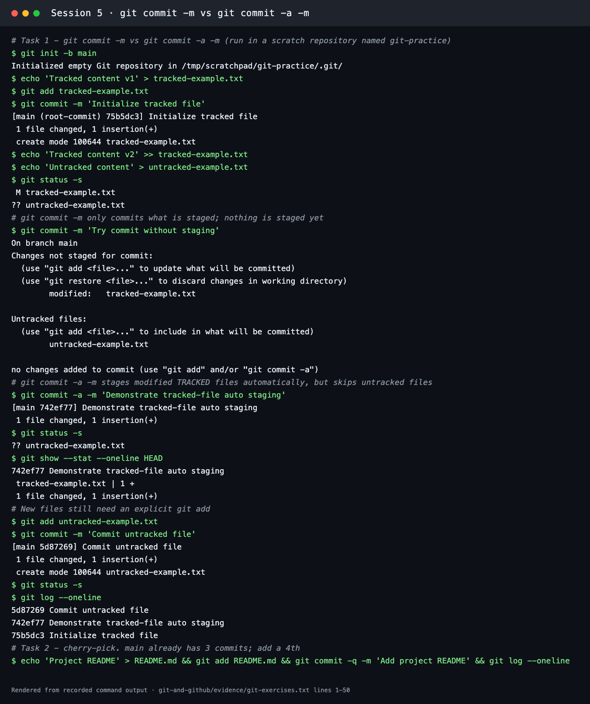
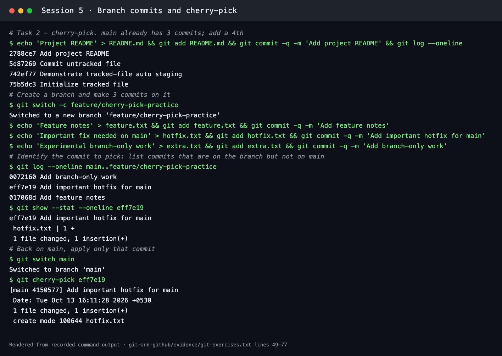
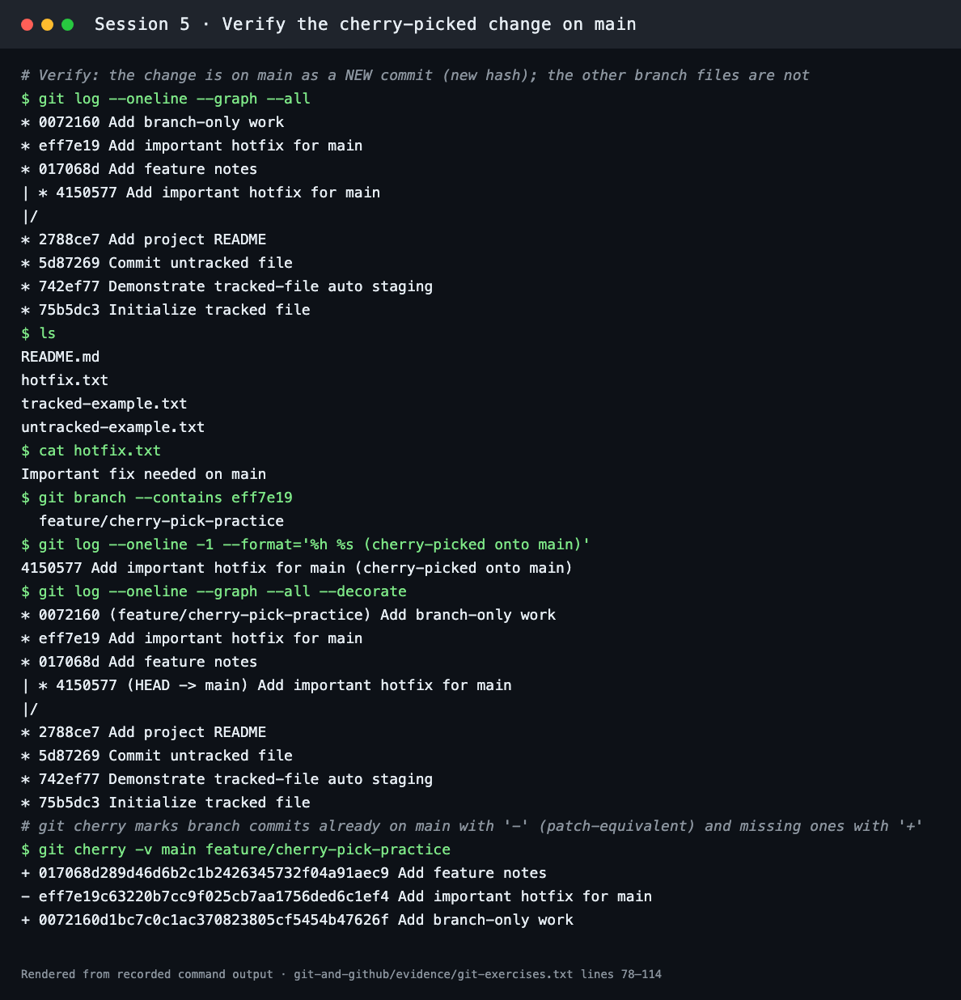

# Git and GitHub Homework

**Session 5** · Student: **Abhinav** (24BCS10282)

Both exercises were run in a scratch repository called `git-practice` (Git 2.x on macOS). The complete terminal transcript is in [evidence/git-exercises.txt](evidence/git-exercises.txt). The screenshots are renders of that transcript, made with [scripts/render-evidence-png.py](../scripts/render-evidence-png.py).

## 1. `git commit -m` vs `git commit -a -m`

| Command | What gets committed |
| --- | --- |
| `git commit -m "msg"` | Only what is already in the **staging area** (added with `git add`) |
| `git commit -a -m "msg"` | Stages every **modified or deleted tracked** file automatically, then commits. **Untracked (new) files are never included** |

### Test and observed behaviour

```bash
git init -b main
echo 'Tracked content v1' > tracked-example.txt
git add tracked-example.txt
git commit -m 'Initialize tracked file'
echo 'Tracked content v2' >> tracked-example.txt     # modify a tracked file
echo 'Untracked content' > untracked-example.txt     # create a new file
git status -s
git commit -m 'Try commit without staging'
git commit -a -m 'Demonstrate tracked-file auto staging'
git status -s
git add untracked-example.txt
git commit -m 'Commit untracked file'
```

| Step | Output | Meaning |
| --- | --- | --- |
| `git status -s` | ` M tracked-example.txt` / `?? untracked-example.txt` | One modified tracked file, one untracked file |
| `git commit -m …` | `no changes added to commit (use "git add" and/or "git commit -a")` | Nothing was staged, so `-m` alone commits nothing |
| `git commit -a -m …` | `[main 742ef77] … 1 file changed, 1 insertion(+)` | The tracked file was auto-staged and committed |
| `git status -s` | `?? untracked-example.txt` | The new file was **skipped** by `-a` |
| `git add` + `git commit -m` | `[main 5d87269] Commit untracked file` | New files need an explicit `git add` |



*In an interview I'd say:* `git commit -a` saves the `git add` step for files Git already tracks, but it never picks up new files. Those must be added explicitly, which also stops accidental commits of stray files.

---

## 2. Git cherry-pick

`git cherry-pick <commit>` re-applies the change introduced by one existing commit onto the current branch, as a **new** commit with a new hash.

### Steps

```bash
# main: 4 commits (3 from task 1 + README)
echo 'Project README' > README.md && git add README.md && git commit -m 'Add project README'
git log --oneline

# new branch with 3 commits
git switch -c feature/cherry-pick-practice
echo 'Feature notes' > feature.txt && git add feature.txt && git commit -m 'Add feature notes'
echo 'Important fix needed on main' > hotfix.txt && git add hotfix.txt && git commit -m 'Add important hotfix for main'
echo 'Experimental branch-only work' > extra.txt && git add extra.txt && git commit -m 'Add branch-only work'

# identify the commit
git log --oneline main..feature/cherry-pick-practice
git show --stat --oneline eff7e19

# pick it onto main
git switch main
git cherry-pick eff7e19

# verify
git log --oneline --graph --all --decorate
ls && cat hotfix.txt
git cherry -v main feature/cherry-pick-practice
```

`git log main..feature/cherry-pick-practice` listed the three branch-only commits, and the hotfix was `eff7e19`:

```text
0072160 Add branch-only work
eff7e19 Add important hotfix for main
017068d Add feature notes
```



### Verification

```text
* 0072160 (feature/cherry-pick-practice) Add branch-only work
* eff7e19 Add important hotfix for main
* 017068d Add feature notes
| * 4150577 (HEAD -> main) Add important hotfix for main
|/
* 2788ce7 Add project README
* 5d87269 Commit untracked file
* 742ef77 Demonstrate tracked-file auto staging
* 75b5dc3 Initialize tracked file
```

- `main` now has `hotfix.txt` ("Important fix needed on main") in the new commit **`4150577`**. The original commit `eff7e19` remains only on the feature branch.
- `ls` on main shows `README.md hotfix.txt tracked-example.txt untracked-example.txt`. `feature.txt` and `extra.txt` were **not** brought over.
- `git cherry -v main feature/cherry-pick-practice` marks the hotfix with `-`, meaning an equivalent patch is already on main, and the two other commits with `+`, meaning not on main.



*In an interview I'd say:* cherry-pick copies the patch of a specific commit to another branch as a brand-new commit. It is useful for back-porting a hotfix without merging unfinished work. If the same lines changed on both branches, Git stops for conflict resolution (`git cherry-pick --continue` or `--abort`).
