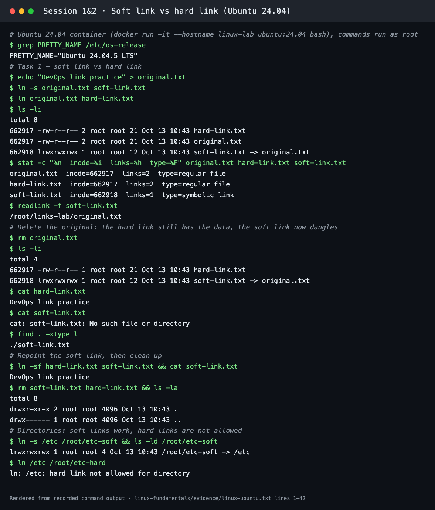
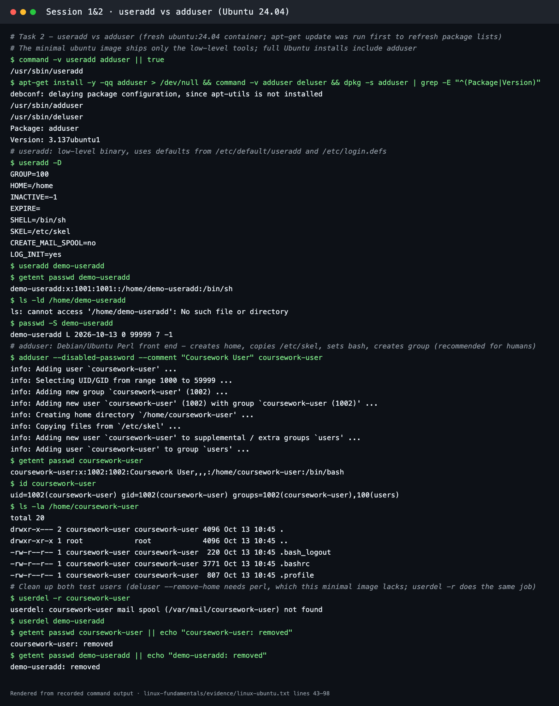
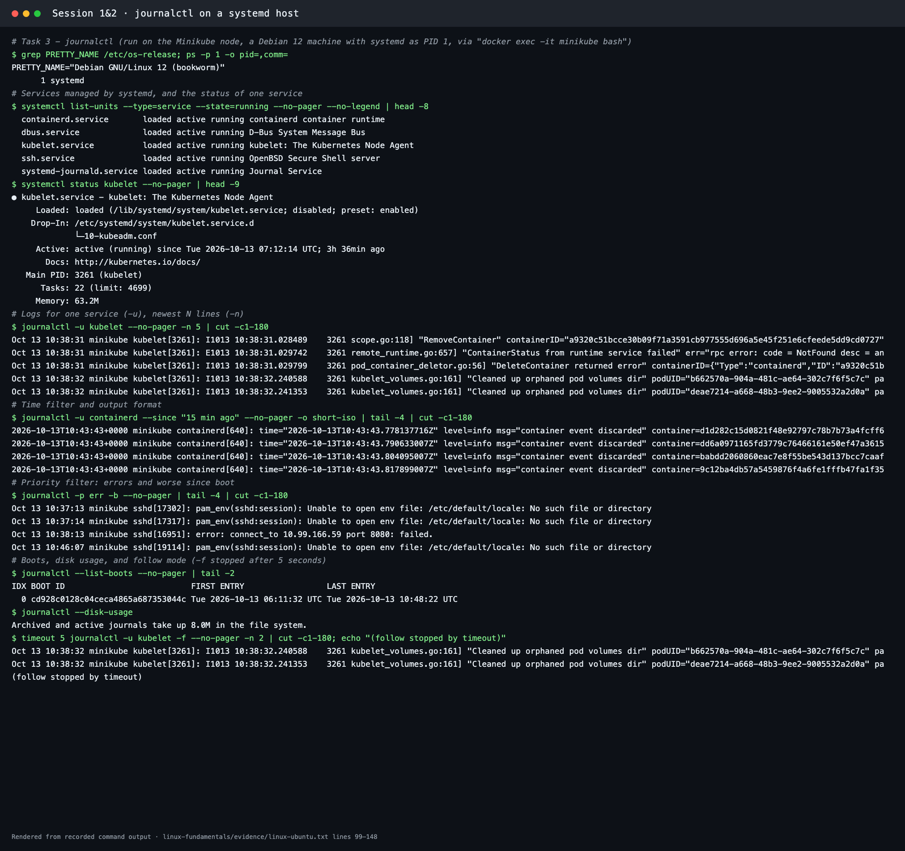
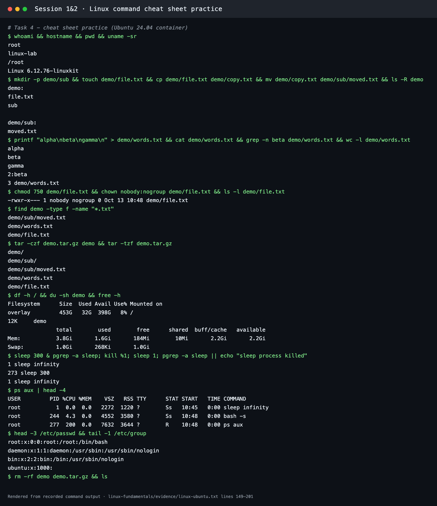

# Linux Fundamentals

**Sessions 1 & 2** · Student: **Abhinav** (24BCS10282)

The Linux tasks were run on real Linux:

- Tasks 1, 2 and 4 in an **Ubuntu 24.04** container (`docker run -it --hostname linux-lab ubuntu:24.04 bash`).
- Task 3 on the **Minikube node** (Debian 12 with **systemd as PID 1**). A plain container does not run systemd, so `journalctl` needs a real systemd host.

The full transcript is [evidence/linux-ubuntu.txt](evidence/linux-ubuntu.txt), and the screenshots are renders of it. An earlier attempt on the macOS host is kept in [evidence/linux-output.txt](evidence/linux-output.txt). It shows why these tasks need Linux: macOS has no `adduser`, `useradd` or `journalctl`.

## 1. Soft Link & Hard Link

| | Hard link | Soft (symbolic) link |
| --- | --- | --- |
| What it is | Another directory entry for the **same inode** (same data) | A small file that stores a **path** to the target |
| Inode | Same as the original | Its own inode |
| Original deleted | Data survives until the last hard link is removed | Link **dangles** (broken) |
| Across file systems | No | Yes |
| Directories | Not allowed | Allowed |
| Create | `ln target link` | `ln -s target link` |

```bash
echo "DevOps link practice" > original.txt
ln -s original.txt soft-link.txt
ln original.txt hard-link.txt
ls -li
stat -c "%n  inode=%i  links=%h  type=%F" original.txt hard-link.txt soft-link.txt
rm original.txt
cat hard-link.txt        # still works
cat soft-link.txt        # No such file or directory
find . -xtype l          # lists broken symlinks
ln -sf hard-link.txt soft-link.txt
rm soft-link.txt hard-link.txt
ln -s /etc /root/etc-soft   # OK
ln /etc /root/etc-hard      # hard link not allowed for directory
```

Observed on Ubuntu:

- `original.txt` and `hard-link.txt` share **inode 662917** with a link count of 2. `soft-link.txt` has its own inode, 662918.
- After `rm original.txt`, the hard link still printed `DevOps link practice` and its link count dropped to 1. The soft link failed with `No such file or directory`, and `find . -xtype l` reported it as broken.
- `ln /etc /root/etc-hard` was refused: `hard link not allowed for directory`.



*In an interview I'd say:* A hard link is another name for the same inode, so the data lives until every name is removed. A soft link only stores a path, so it can point across file systems or at directories, but it breaks when the target is deleted or moved.

## 2. `adduser` vs `useradd`

| | `useradd` | `adduser` |
| --- | --- | --- |
| Type | Low-level binary (shadow-utils), on every distro | Debian/Ubuntu front end (Perl) that calls `useradd` |
| Home directory | Not created unless you pass `-m` | Created and populated from `/etc/skel` |
| Shell | `/bin/sh` by default (`useradd -D`) | `/bin/bash` |
| Group | Uses defaults | Creates a matching user group, can add extra groups |
| Password | None (account locked) | Prompts, or `--disabled-password` |
| Best for | Scripts that need exact, portable control | **Humans on Ubuntu/Debian: the recommended command** |

```bash
useradd -D                                  # defaults: SHELL=/bin/sh, home not created
useradd demo-useradd
getent passwd demo-useradd                  # ...:/home/demo-useradd:/bin/sh
ls -ld /home/demo-useradd                   # No such file or directory
adduser --disabled-password --comment "Coursework User" coursework-user
getent passwd coursework-user               # ...:/home/coursework-user:/bin/bash
id coursework-user                          # groups=1002(coursework-user),100(users)
ls -la /home/coursework-user                # .bash_logout .bashrc .profile copied from /etc/skel
userdel -r coursework-user && userdel demo-useradd
```

The minimal `ubuntu:24.04` image only had `useradd`, so `adduser` (3.137ubuntu1) was installed with `apt-get install adduser`. Its output shows each step it automates: creating the group, choosing a UID, creating the home directory, copying `/etc/skel`, and adding the `users` group.



*In an interview I'd say:* On Ubuntu I create people with `adduser` because it applies safe defaults (home directory, bash, skeleton files, a personal group). In automation or on other distributions I use `useradd` with explicit flags such as `useradd -m -s /bin/bash -G sudo name`.

## 3. `journalctl`

`journalctl` queries the binary logs collected by **systemd-journald**: kernel, boot and every systemd service.

| Need | Command |
| --- | --- |
| One service | `journalctl -u kubelet` |
| Last N lines | `journalctl -u kubelet -n 50` |
| Follow live | `journalctl -u kubelet -f` |
| Time window | `journalctl --since "15 min ago"` / `--until "2026-10-13 12:00"` |
| Severity | `journalctl -p err -b` (errors and worse, this boot) |
| Boots | `journalctl --list-boots`, `journalctl -b -1` (previous boot) |
| Kernel | `journalctl -k` |
| Output format | `-o short-iso`, `-o json-pretty` |
| Disk space | `journalctl --disk-usage`, `journalctl --vacuum-time=7d` |

Observed on the systemd node:

- `systemctl list-units --type=service --state=running` listed containerd, dbus, kubelet, ssh and systemd-journald.
- `systemctl status kubelet` showed `active (running)` with its PID and memory.
- `journalctl -u kubelet -n 5` printed the kubelet's latest log lines (container clean-up messages from the earlier labs).
- `journalctl -u containerd --since "15 min ago" -o short-iso` printed ISO-timestamped containerd events.
- `journalctl -p err -b` filtered to error-priority messages (sshd PAM warnings and a failed port-forward from the Session 9 lab).
- `--list-boots` showed one boot, and `--disk-usage` reported `8.0M`. `-f` streamed new kubelet lines until stopped.



*In an interview I'd say:* When a service misbehaves I start with `systemctl status <svc>`, then `journalctl -u <svc> --since "10 min ago" -p warning` to narrow the window and severity, and `-f` while I reproduce the problem.

## 4. Linux Command Cheat Sheet

| Purpose | Command |
| --- | --- |
| Who/where am I | `whoami`, `hostname`, `pwd`, `uname -sr` |
| List files with details & hidden files | `ls -lah`, `ls -R` |
| Navigate directories | `cd /path/to/dir` |
| Create directory & empty file | `mkdir -p demo/sub && touch demo/file.txt` |
| Copy, move/rename, remove | `cp src dest`, `mv old new`, `rm -rf dir` |
| View & search file content | `cat`, `less`, `head`, `tail`, `grep -n pattern file`, `wc -l` |
| Find files | `find demo -type f -name "*.txt"` |
| Change permissions & ownership | `chmod 750 file`, `chown user:group file` |
| Disk space & memory usage | `df -h`, `du -sh dir`, `free -h` |
| Process listing & management | `ps aux`, `top`, `pgrep -a name`, `kill PID` / `kill %1` |
| Archiving & compression | `tar -czf archive.tar.gz dir`, `tar -tzf archive.tar.gz` |
| Users & groups | `id`, `getent passwd user`, `/etc/passwd`, `/etc/group` |
| Command documentation | `man command` or `command --help` |

Each command above was practised on Ubuntu 24.04 (Task 4 in the transcript): creating, copying and moving files, `grep -n beta` → `2:beta`, `chmod 750` + `chown nobody:nogroup` → `-rwxr-x--- nobody nogroup`, creating and listing a tar.gz, `df`/`du`/`free`, and starting, finding and killing a background `sleep` process.



The first macOS run of the same basics is kept below for comparison: BSD `ls` adds `@` for extended attributes, and `df` shows APFS volumes.

```text
$ ls -li original.txt soft-link.txt hard-link.txt      (macOS)
96028174 -rw-r--r--@ 2 abhinavsuri  staff  21 Sep  4 23:58 hard-link.txt
96028174 -rw-r--r--@ 2 abhinavsuri  staff  21 Sep  4 23:58 original.txt
96028175 lrwxr-xr-x@ 1 abhinavsuri  staff  12 Sep  4 23:58 soft-link.txt -> original.txt
```
