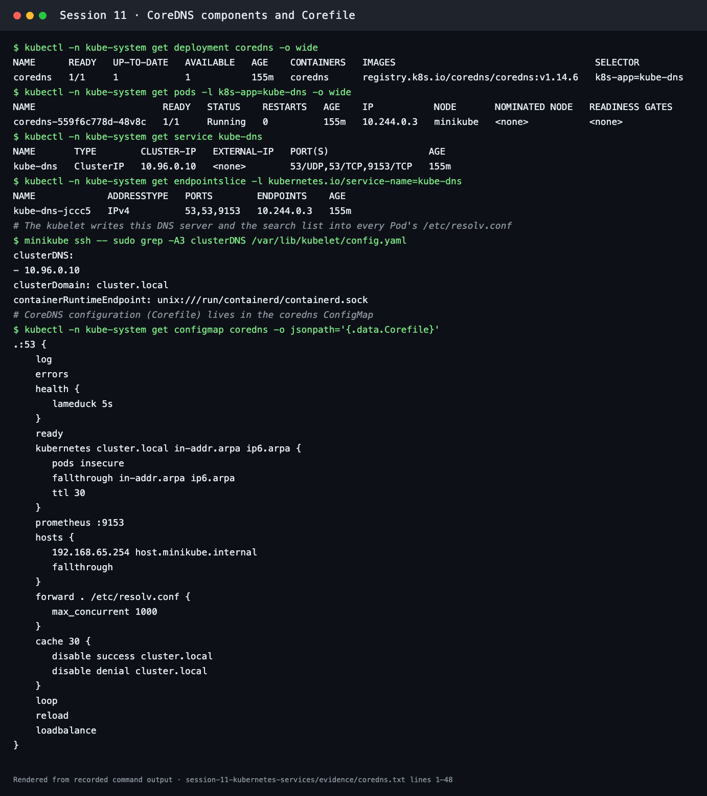
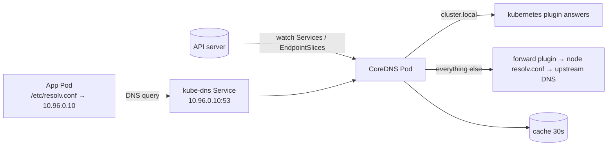
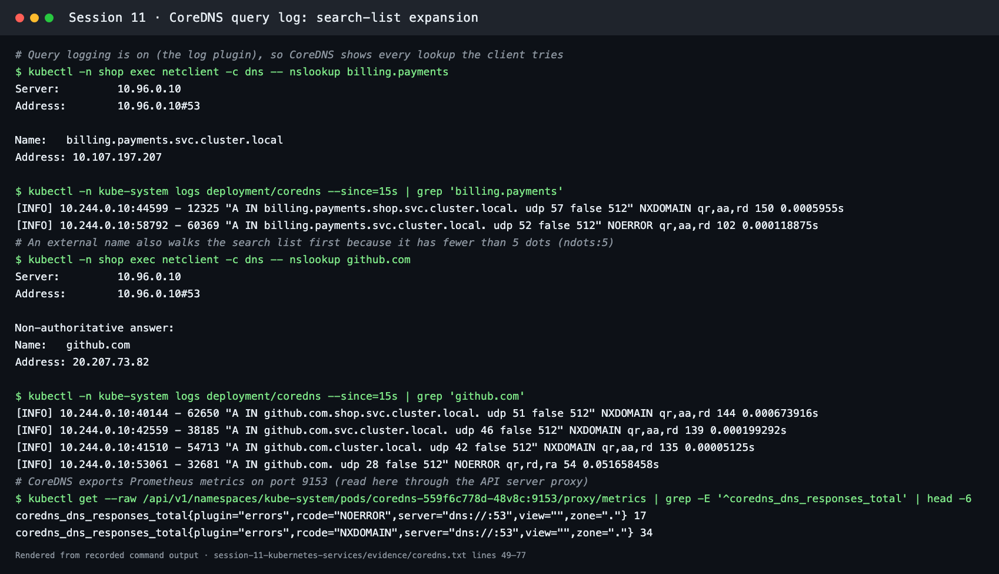
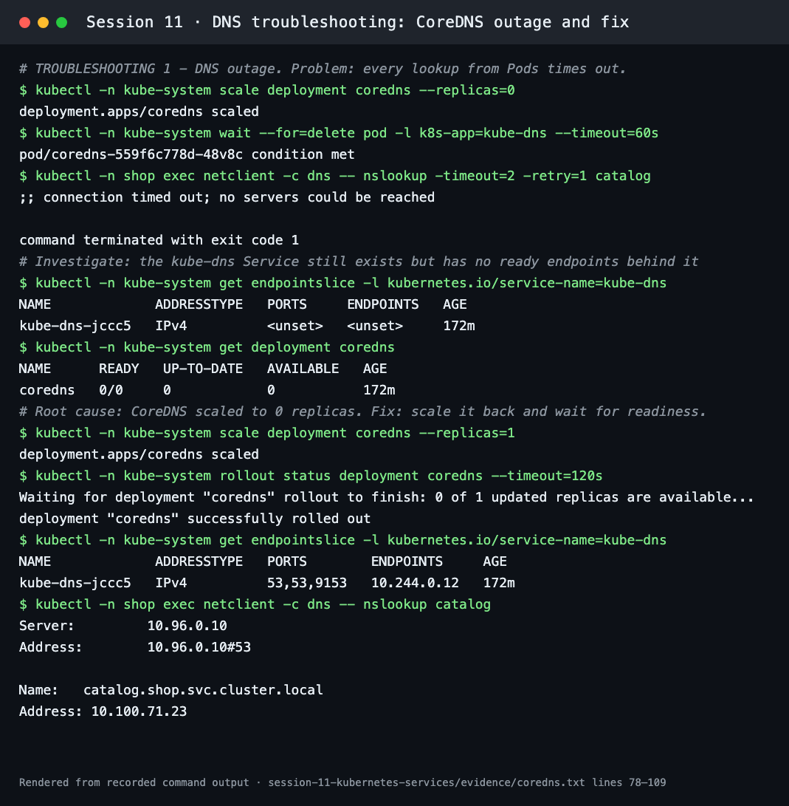
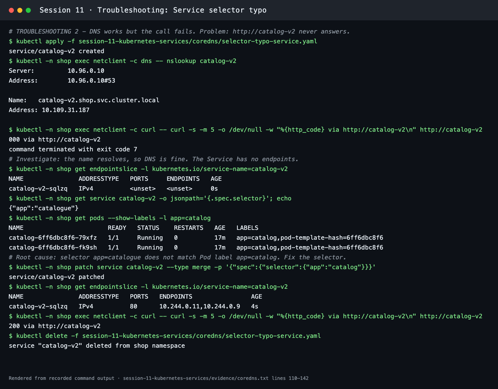

# CoreDNS

**Session 11 · Task 4** · Author: Abhinav

Every command below was run on a Minikube cluster (Kubernetes v1.37.0, CoreDNS v1.14.6). The full transcript is in [evidence/coredns.txt](../evidence/coredns.txt). The client Pod and Services come from the [FQDN lab](../fqdn/README.md).

## What is CoreDNS?

CoreDNS is a DNS server written in Go and built from **plugins**. Each line in its configuration file (the *Corefile*) enables one plugin. It is a graduated CNCF project and has been the default cluster DNS in Kubernetes since v1.13. In the cluster it runs as:

| Object | Name in this cluster | Purpose |
| --- | --- | --- |
| Deployment | `kube-system/coredns` (1 replica on Minikube; usually 2+) | Runs the DNS server Pods |
| Service | `kube-system/kube-dns`, ClusterIP `10.96.0.10`, ports 53/UDP, 53/TCP, 9153/TCP | Stable address every Pod uses as its nameserver |
| ConfigMap | `kube-system/coredns` | Holds the Corefile |
| Kubelet setting | `clusterDNS: 10.96.0.10`, `clusterDomain: cluster.local` | Written into each Pod's `/etc/resolv.conf` |

The Service keeps the historical name `kube-dns` so existing clients and docs keep working.



## Why Kubernetes uses CoreDNS

- **Service discovery without hard-coded IPs:** Pods are replaced and get new IPs, but DNS names stay stable.
- **Plugin architecture:** Kubernetes records, caching, forwarding, metrics, health checks, rewrites and stub domains are all small plugins in one binary. The older `kube-dns` needed three containers (kubedns, dnsmasq, sidecar).
- **Live configuration:** the `reload` plugin picks up Corefile changes without restarting Pods.
- **Observability:** the `prometheus` plugin exports metrics on `:9153` and the `log` plugin records each query.
- **Small and fast:** a single Go binary that scales horizontally behind the `kube-dns` Service.

## How Service discovery works

1. The `kubernetes` plugin **watches the API server** for Services, EndpointSlices and Pods.
2. When a Service is created, CoreDNS immediately answers for `<svc>.<ns>.svc.cluster.local`. For headless Services it answers with each ready Pod IP taken from the EndpointSlices.
3. A Pod's resolver uses `nameserver 10.96.0.10` and the search list from `/etc/resolv.conf`.
4. Clients connect to the answer. For ClusterIP Services, kube-proxy then load-balances to a ready Pod.



## How DNS queries are resolved

With `ndots:5`, any name with fewer than five dots is first tried with each search domain. The `log` plugin (enabled in Minikube's Corefile) recorded exactly this sequence:

```text
# nslookup billing.payments   (from namespace shop)
"A IN billing.payments.shop.svc.cluster.local." NXDOMAIN
"A IN billing.payments.svc.cluster.local."      NOERROR   → 10.107.197.207

# nslookup github.com
"A IN github.com.shop.svc.cluster.local." NXDOMAIN
"A IN github.com.svc.cluster.local."      NXDOMAIN
"A IN github.com.cluster.local."          NXDOMAIN
"A IN github.com."                        NOERROR   → forwarded upstream
```

The first three lookups for `github.com` are wasted round trips. For external hosts called very often, use a trailing dot (`github.com.`) or tune `dnsConfig.options` (`ndots`) in the Pod spec.



## CoreDNS configuration (the real Corefile from this cluster)

```text
.:53 {
    log
    errors
    health {
       lameduck 5s
    }
    ready
    kubernetes cluster.local in-addr.arpa ip6.arpa {
       pods insecure
       fallthrough in-addr.arpa ip6.arpa
       ttl 30
    }
    prometheus :9153
    hosts {
       192.168.65.254 host.minikube.internal
       fallthrough
    }
    forward . /etc/resolv.conf {
       max_concurrent 1000
    }
    cache 30 {
       disable success cluster.local
       disable denial cluster.local
    }
    loop
    reload
    loadbalance
}
```

| Plugin | What it does |
| --- | --- |
| `.:53` | Serve every zone (`.`) on port 53 |
| `log` | Log every query (Minikube enables it; most clusters leave it off for volume) |
| `errors` | Log errors to stdout |
| `health` / `ready` | HTTP `:8080/health` for liveness and `:8181/ready` for readiness probes |
| `kubernetes` | Answer `cluster.local` and reverse zones from the Kubernetes API. `pods insecure` enables `a-b-c-d.<ns>.pod` records |
| `prometheus :9153` | Metrics such as `coredns_dns_requests_total` and `coredns_dns_responses_total{rcode=…}` |
| `hosts` | Static entries (Minikube adds `host.minikube.internal`) |
| `forward . /etc/resolv.conf` | Send non-cluster names to the node's upstream resolvers |
| `cache 30` | Cache answers for 30 s (cluster.local caching is disabled here so changes appear at once) |
| `loop` | Detect forwarding loops and stop |
| `reload` | Reload the Corefile automatically when the ConfigMap changes |
| `loadbalance` | Shuffle A records in each answer (round-robin) |

To change it, edit the ConfigMap with `kubectl -n kube-system edit configmap coredns`. For example, a stub domain for a company zone is added with `forward corp.example 10.0.0.53` inside its own server block. The `reload` plugin applies the change within about 30 seconds.

## How to troubleshoot DNS issues

Checklist, from the client outwards:

1. **Is it DNS?** Run `kubectl exec <pod> -- nslookup <svc>.<ns>.svc.cluster.local`. If the name resolves but the call fails, the problem is the Service, endpoints or network, not DNS.
2. **Pod configuration:** check `cat /etc/resolv.conf` (nameserver 10.96.0.10, correct search list, `dnsPolicy`).
3. **CoreDNS health:** check `kubectl -n kube-system get pods -l k8s-app=kube-dns` and `kubectl -n kube-system logs deploy/coredns`.
4. **The kube-dns Service has endpoints:** check `kubectl -n kube-system get endpointslice -l kubernetes.io/service-name=kube-dns`.
5. **Corefile:** look for a broken `forward`, missing zones or loops (`kubectl -n kube-system get cm coredns -o yaml`).
6. **Network policy and CNI:** UDP/TCP 53 must be allowed from Pods to CoreDNS.
7. **Upstream:** if external names fail but cluster names work, check `forward` and the node's resolv.conf.

### Drill 1: CoreDNS outage

| Step | Observation |
| --- | --- |
| Problem | `nslookup catalog` → `;; connection timed out; no servers could be reached` |
| Investigate | `kube-dns` EndpointSlice shows `<unset>` endpoints; `deployment/coredns` is `0/0` |
| Root cause | CoreDNS was scaled to 0 replicas, so the Service had nothing behind it |
| Fix | `kubectl -n kube-system scale deployment coredns --replicas=1` + `rollout status` |
| Verify | Endpoint `10.244.0.12` is back and `nslookup catalog` → `10.100.71.23` |



### Drill 2: DNS works, the Service doesn't (selector typo)

[selector-typo-service.yaml](selector-typo-service.yaml) is adapted from the instructor's `troubleshooting/empty-endpoints.yaml`.

| Step | Observation |
| --- | --- |
| Problem | `curl http://catalog-v2` → `000`, curl exit 7 (connection failed) |
| Investigate | `nslookup catalog-v2` **succeeds** (10.109.31.187), so DNS is fine. EndpointSlice shows `<unset>` |
| Root cause | The Service selects `app=catalogue`; the Pods are labelled `app=catalog` |
| Fix | `kubectl -n shop patch service catalog-v2 --type merge -p '{"spec":{"selector":{"app":"catalog"}}}'` |
| Verify | EndpointSlice lists `10.244.0.11,10.244.0.9`; `curl` → `200` |



## Commands used

```bash
kubectl -n kube-system get deployment coredns -o wide
kubectl -n kube-system get pods -l k8s-app=kube-dns -o wide
kubectl -n kube-system get service kube-dns
kubectl -n kube-system get endpointslice -l kubernetes.io/service-name=kube-dns
minikube ssh -- sudo grep -A3 clusterDNS /var/lib/kubelet/config.yaml
kubectl -n kube-system get configmap coredns -o jsonpath='{.data.Corefile}'
kubectl -n kube-system logs deployment/coredns --since=15s
kubectl get --raw /api/v1/namespaces/kube-system/pods/<coredns-pod>:9153/proxy/metrics | grep coredns_dns_responses_total
kubectl -n kube-system scale deployment coredns --replicas=0   # drill only; restore to 1 afterwards
kubectl apply -f session-11-kubernetes-services/coredns/selector-typo-service.yaml
```
