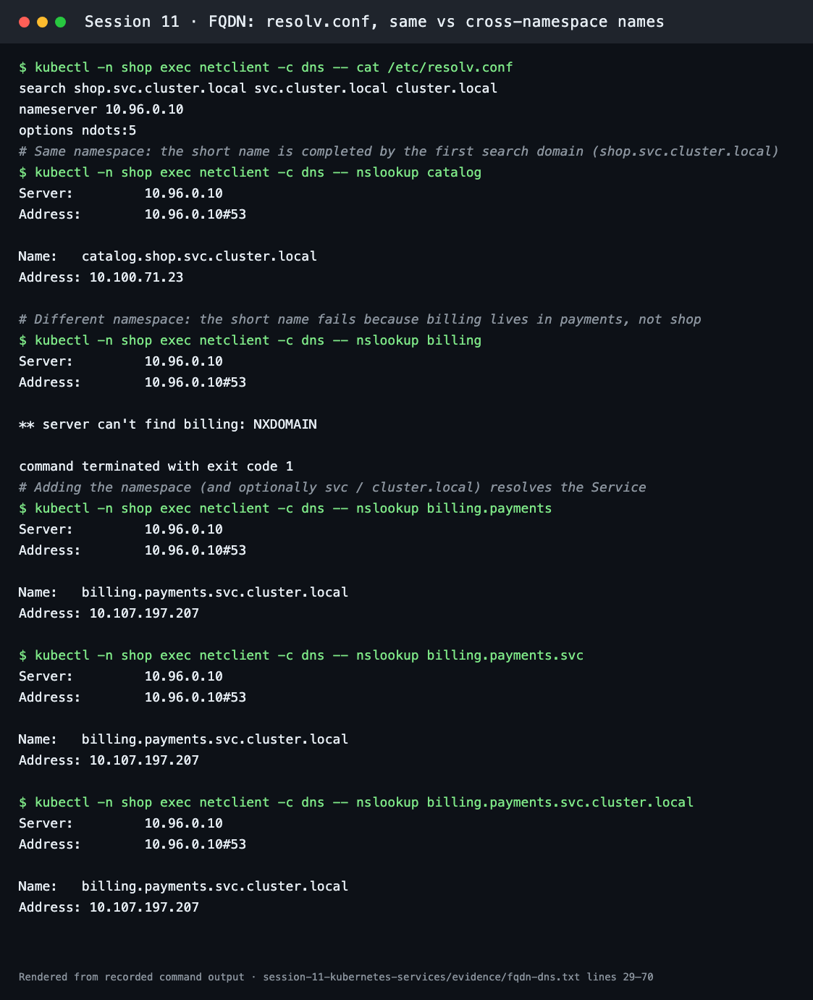
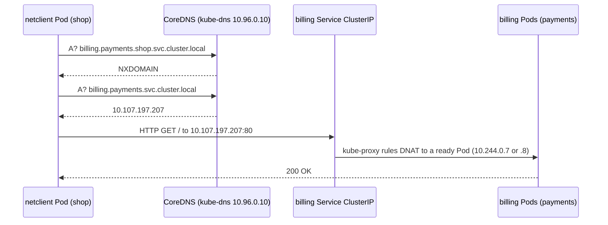
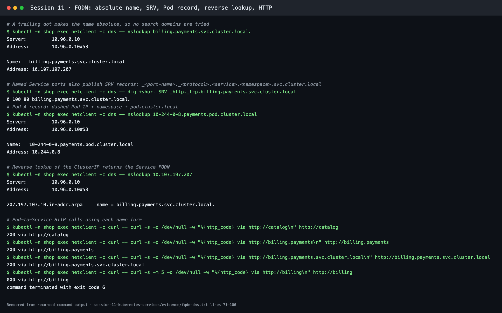

# FQDN in Kubernetes

**Session 11 · Task 3** · Author: Abhinav

Every command below was run on a Minikube cluster (Kubernetes v1.37.0). The full transcript is in [evidence/fqdn-dns.txt](../evidence/fqdn-dns.txt), and the lab objects are in [dns-lab.yaml](dns-lab.yaml): two namespaces (`shop`, `payments`), one Service in each, and a `netclient` Pod with `nslookup`/`dig` and `curl` containers.

```bash
kubectl apply -f session-11-kubernetes-services/fqdn/dns-lab.yaml
kubectl -n shop wait --for=condition=Ready pod/netclient --timeout=300s
```

## What is an FQDN?

A **Fully Qualified Domain Name** is the complete, unambiguous name of a host, written from the most specific label to the root. `catalog` is a short name that only makes sense in context. `catalog.shop.svc.cluster.local.` is fully qualified: it names exactly one record anywhere in the cluster's DNS tree. The final dot is the DNS root, so a name that ends in `.` is never expanded with search domains.

## Kubernetes Service DNS

Kubernetes runs a cluster DNS server (CoreDNS, see [../coredns/README.md](../coredns/README.md)). For every Service it publishes records automatically:

- A ClusterIP Service gets an **A/AAAA record** pointing at its stable ClusterIP. Pods behind it can come and go, but the name and IP stay the same.
- A **headless** Service (`clusterIP: None`) gets one A record **per ready Pod** instead of a single virtual IP.
- Every named port gets an **SRV record** containing the port number.
- An ExternalName Service gets a **CNAME** to an outside host.

The kubelet points every Pod at that DNS server through `/etc/resolv.conf`:

```text
search shop.svc.cluster.local svc.cluster.local cluster.local
nameserver 10.96.0.10
options ndots:5
```

`10.96.0.10` is the `kube-dns` Service. The search list starts with the Pod's own namespace.

## Kubernetes DNS naming convention

```text
billing . payments . svc . cluster.local
   │         │        │        └── cluster domain (kubelet clusterDomain)
   │         │        └── record type: svc (Service) or pod
   │         └── namespace
   └── Service name (metadata.name)
```

| Object | DNS name pattern | Answer |
| --- | --- | --- |
| ClusterIP Service | `<svc>.<ns>.svc.cluster.local` | ClusterIP (A) |
| Headless Service | `<svc>.<ns>.svc.cluster.local` | Every ready Pod IP (multiple A records) |
| StatefulSet Pod behind a headless Service | `<pod>.<svc>.<ns>.svc.cluster.local` | That Pod's IP |
| Named Service port | `_<port>._<proto>.<svc>.<ns>.svc.cluster.local` | SRV: priority, weight, port, target |
| Any Pod | `<a-b-c-d>.<ns>.pod.cluster.local` | The dashed IP as an A record |
| ExternalName Service | `<svc>.<ns>.svc.cluster.local` | CNAME to the external host |
| Reverse lookup | `<d>.<c>.<b>.<a>.in-addr.arpa` | PTR to the Service FQDN |

## Namespace-based DNS

The resolver appends the search domains in order until one answers. That is why a short name only works **inside the same namespace**:

| Name typed in a `shop` Pod | First query tried | Result in this lab |
| --- | --- | --- |
| `catalog` | `catalog.shop.svc.cluster.local` | ✅ 10.100.71.23 |
| `billing` | `billing.shop.svc.cluster.local` | ❌ `NXDOMAIN` (billing is in `payments`) |
| `billing.payments` | `billing.payments.shop.svc.cluster.local` → `billing.payments.svc.cluster.local` | ✅ 10.107.197.207 |
| `billing.payments.svc.cluster.local.` | as written (absolute) | ✅ 10.107.197.207 |

Because `ndots:5` means "names with fewer than 5 dots are relative", even `github.com` walks the search list first. The CoreDNS query log in the [CoreDNS README](../coredns/README.md#how-dns-queries-are-resolved) shows each attempt. Writing the FQDN, ideally with a trailing dot, avoids the extra lookups.



## Pod-to-Service communication



1. The app calls a name, such as `http://billing.payments`.
2. The Pod's resolver asks CoreDNS, using the search list.
3. CoreDNS answers with the Service ClusterIP.
4. The node's kube-proxy rules send the packet to one ready Pod from the Service's EndpointSlice.

Measured from the `shop` namespace:

```text
200 via http://catalog
200 via http://billing.payments
200 via http://billing.payments.svc.cluster.local
000 via http://billing        (curl exit 6: could not resolve host)
```

## Examples of Kubernetes FQDNs (all resolved in this lab)

| FQDN | What it is |
| --- | --- |
| `catalog.shop.svc.cluster.local` | Service in namespace `shop` |
| `billing.payments.svc.cluster.local` | Service in namespace `payments` |
| `_http._tcp.billing.payments.svc.cluster.local` | SRV record → `0 100 80 billing.payments.svc.cluster.local.` |
| `10-244-0-8.payments.pod.cluster.local` | A record for the Pod IP 10.244.0.8 |
| `207.197.107.10.in-addr.arpa` | PTR → `billing.payments.svc.cluster.local.` |
| `compare-sts-0.compare-sts.default.svc.cluster.local` | One StatefulSet Pod behind a headless Service ([comparison lab](../kubernetes-object-comparison/README.md)) |
| `kubernetes.default.svc.cluster.local` | The API server's built-in Service |
| `kube-dns.kube-system.svc.cluster.local` | The cluster DNS Service itself |



## Commands used

```bash
kubectl -n shop exec netclient -c dns -- cat /etc/resolv.conf
kubectl -n shop exec netclient -c dns -- nslookup catalog
kubectl -n shop exec netclient -c dns -- nslookup billing                       # NXDOMAIN
kubectl -n shop exec netclient -c dns -- nslookup billing.payments
kubectl -n shop exec netclient -c dns -- nslookup billing.payments.svc.cluster.local.
kubectl -n shop exec netclient -c dns -- dig +short SRV _http._tcp.billing.payments.svc.cluster.local
kubectl -n shop exec netclient -c dns -- nslookup 10-244-0-8.payments.pod.cluster.local
kubectl -n shop exec netclient -c dns -- nslookup "$(kubectl -n payments get svc billing -o jsonpath='{.spec.clusterIP}')"
kubectl -n shop exec netclient -c curl -- curl -s -o /dev/null -w '%{http_code}\n' http://billing.payments
kubectl delete -f session-11-kubernetes-services/fqdn/dns-lab.yaml
```

Pod IPs and ClusterIPs differ on every cluster, so substitute your own values.

## Key takeaway

Use the **short name** inside a namespace, `<service>.<namespace>` across namespaces, and the full **`<service>.<namespace>.svc.cluster.local`** in configuration that must work from anywhere. The name stays stable while Pods and their IPs change.
