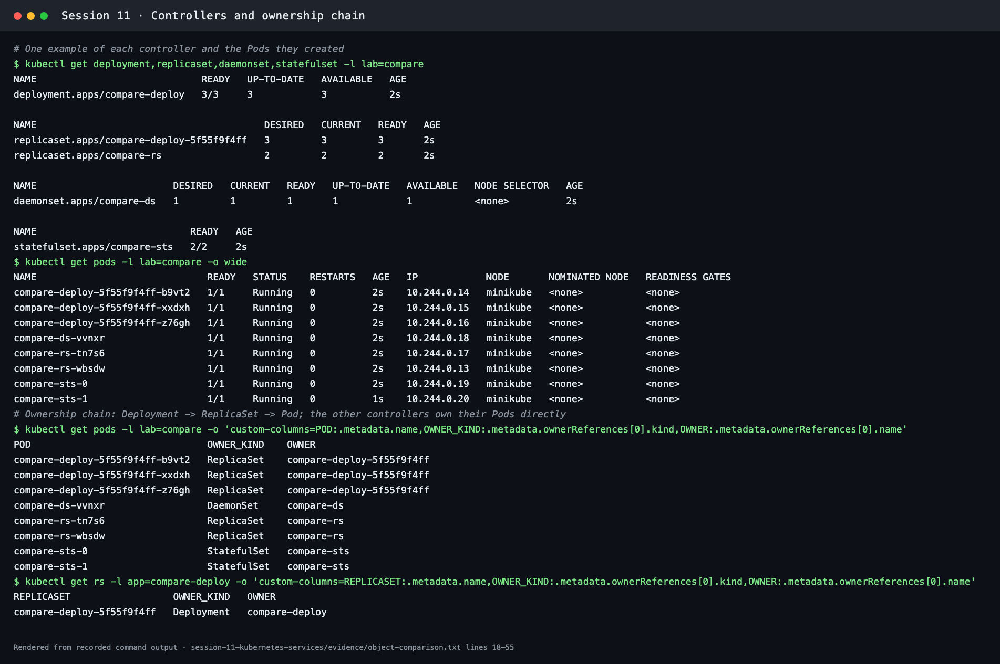
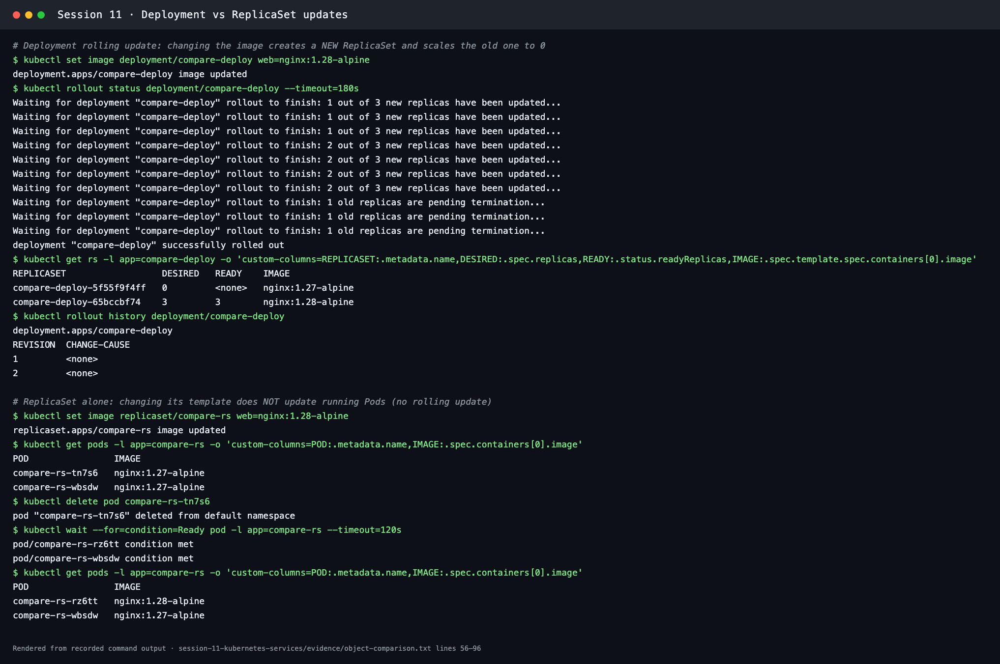
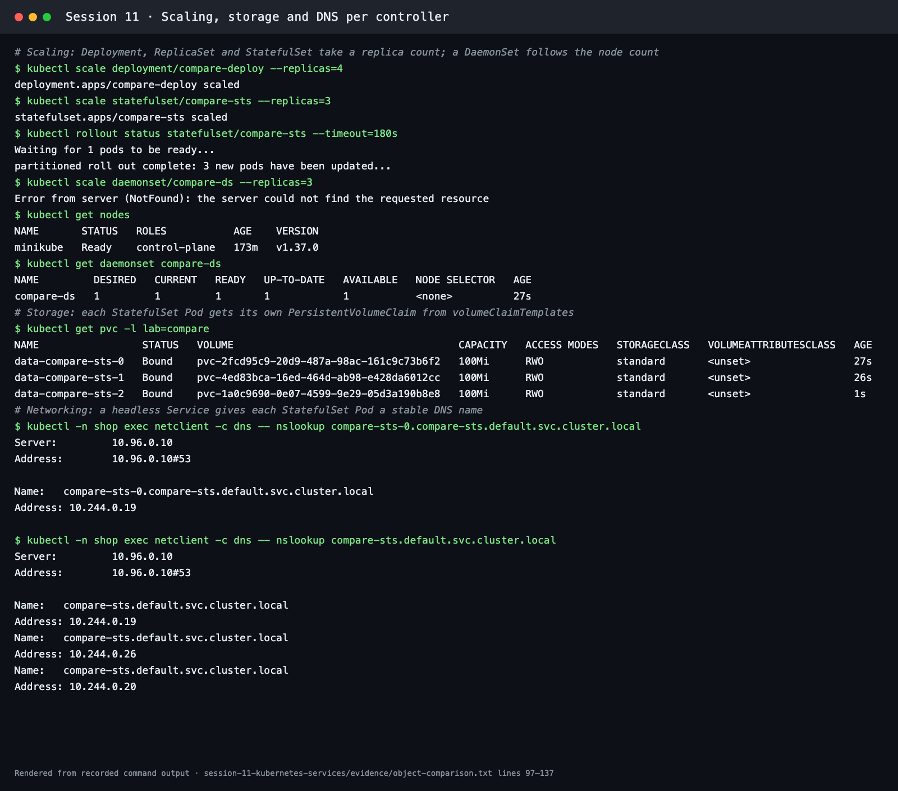
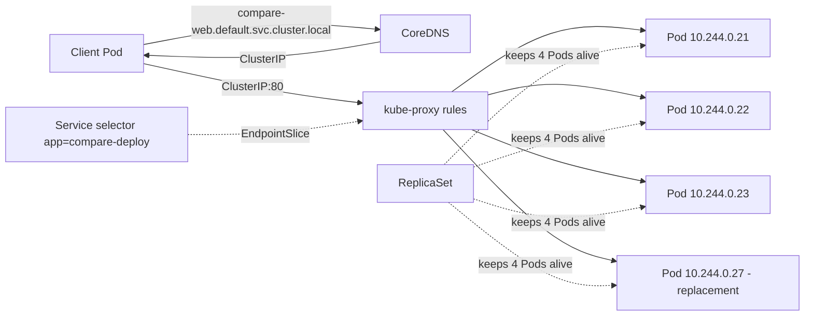
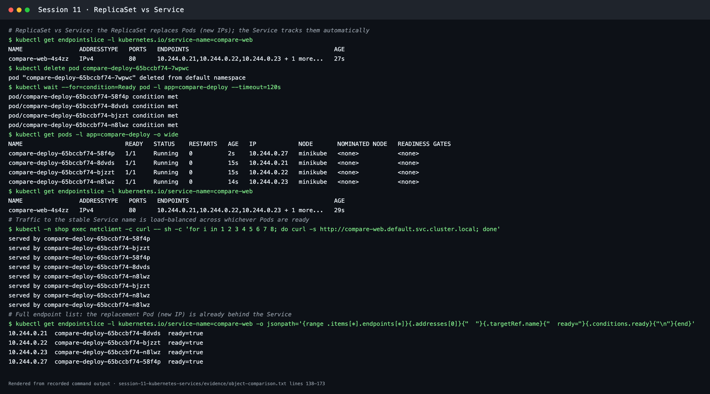

# Kubernetes object comparison

**Session 11 · Task 2** · Author: Abhinav

[controllers.yaml](controllers.yaml) creates one small example of each controller (a Deployment, a standalone ReplicaSet, a DaemonSet, and a StatefulSet with a headless Service), plus a ClusterIP Service. They were run side by side on Minikube (Kubernetes v1.37.0). The full output is in [evidence/object-comparison.txt](../evidence/object-comparison.txt).

```bash
kubectl apply -f session-11-kubernetes-services/kubernetes-object-comparison/controllers.yaml
kubectl get deployment,replicaset,daemonset,statefulset -l lab=compare
kubectl get pods -l lab=compare -o wide
```



---

## 1. Deployment vs ReplicaSet

| | ReplicaSet | Deployment |
| --- | --- | --- |
| **Purpose** | Keep *N* identical Pods running at all times | Manage an application's versions declaratively; it owns and drives ReplicaSets |
| **Pod management** | Creates or deletes Pods directly to match `replicas` and the label selector | Never creates Pods itself. It creates a ReplicaSet per Pod-template version, and that ReplicaSet creates the Pods |
| **Scaling** | `kubectl scale rs/compare-rs --replicas=3` | `kubectl scale deploy/compare-deploy --replicas=4`, which changes the current ReplicaSet's count. HPA normally targets the Deployment |
| **Rolling updates** | **None.** Changing the template affects only Pods created later | Built in: `RollingUpdate` (`maxSurge`/`maxUnavailable`) or `Recreate`, plus `rollout status`, `history`, `undo`, `pause` and `resume` |
| **Relationship** | Owned by a Deployment through `ownerReferences` (names like `compare-deploy-65bccbf74`, where the suffix is the template hash) | The parent. It keeps old ReplicaSets at 0 replicas for rollback (`revisionHistoryLimit`, default 10) |

**What the lab showed**

- **Ownership:** each `compare-deploy-…` Pod is owned by ReplicaSet `compare-deploy-5f55f9f4ff`, which is owned by Deployment `compare-deploy`. The standalone `compare-rs` Pods are owned directly by `compare-rs`.
- **Deployment update:** after `kubectl set image deployment/compare-deploy web=nginx:1.28-alpine`, a new ReplicaSet `compare-deploy-65bccbf74` ran 3 Pods with `nginx:1.28-alpine`. The old ReplicaSet `compare-deploy-5f55f9f4ff` was scaled to 0 but kept, and `rollout history` showed revisions 1 and 2.
- **ReplicaSet update:** after `kubectl set image replicaset/compare-rs …`, both running Pods were **still `nginx:1.27-alpine`**. Only after one Pod was deleted did its replacement get `nginx:1.28-alpine`, leaving mixed versions. This is why applications use Deployments, not bare ReplicaSets.



---

## 2. Deployment vs DaemonSet vs StatefulSet

| | Deployment | DaemonSet | StatefulSet |
| --- | --- | --- | --- |
| **Use cases** | Stateless web apps, APIs, workers | One agent per node: log shippers, monitoring exporters, CNI/kube-proxy, storage drivers | Stateful apps needing stable identity and storage: databases, Kafka, ZooKeeper, Elasticsearch |
| **Pod creation** | Through a ReplicaSet, all at once, with random names (`compare-deploy-65bccbf74-58f4p`) | One Pod on each matching node (`compare-ds-vvnxr`), added and removed as nodes join or leave | **Ordered**: `-0`, then `-1`, then `-2`, each waiting for the previous to be Ready. Names are stable (`compare-sts-0`) |
| **Scaling** | `replicas` field, `kubectl scale` or HPA | **No `replicas` field**: `kubectl scale daemonset` returned `NotFound` for the scale subresource. It scales with the number of nodes (here 1 node gives 1 Pod), or is limited with `nodeSelector`/affinity/tolerations | `replicas`. Scaling up adds the next ordinal (`compare-sts-2`) and scaling down removes the highest first |
| **Networking** | Usually a ClusterIP Service. Pods are interchangeable | Often `hostNetwork`/`hostPort` for node-level agents, or a Service for metrics | A **headless Service** gives each Pod a DNS name: `compare-sts-0.compare-sts.default.svc.cluster.local` resolved to `10.244.0.19` |
| **Storage** | Usually none, or one shared PVC. Replacement Pods are disposable | Typically `hostPath` to read node logs or devices | `volumeClaimTemplates` create **one PVC per Pod** (`data-compare-sts-0/1/2`), which stays with that ordinal and is **kept** when Pods or the StatefulSet are deleted |
| **Update strategy** | RollingUpdate / Recreate | RollingUpdate (per node) / OnDelete | RollingUpdate in reverse ordinal order (supports `partition`) / OnDelete |
| **Examples** | nginx frontend, FastAPI backend | Fluent Bit, node-exporter, kube-proxy, Calico | PostgreSQL, MySQL, Redis Sentinel, Kafka |



---

## 3. ReplicaSet vs Service

| | ReplicaSet | Service |
| --- | --- | --- |
| **Responsibility** | **Availability.** Keeps the desired number of Pods running and replaces any that are deleted or crash. Usually managed by a Deployment | **Reachability.** Gives a stable virtual IP and DNS name and load-balances to the Pods that match its selector |
| **Works on** | The Pod lifecycle (create/delete) | Network traffic (EndpointSlices + kube-proxy rules) |
| **Selects Pods by** | Label selector (to count and own them) | Label selector (to route to them) |
| **Knows about traffic?** | No | Yes |
| **Creates Pods?** | Yes | No |

### Why a Service is required

Pods are disposable, so a replacement Pod gets a new IP. In the lab, deleting `compare-deploy-65bccbf74-7wpwc` produced a new Pod `compare-deploy-65bccbf74-58f4p` with IP `10.244.0.27`. Without a Service, every client would need to discover and track those changing IPs itself. The Service `compare-web` kept the same name and ClusterIP throughout, and its EndpointSlice was updated automatically to include `10.244.0.27`.

### How traffic reaches Pods

1. The client resolves `compare-web.default.svc.cluster.local` through CoreDNS and gets the Service ClusterIP.
2. It sends the packet to `ClusterIP:80`.
3. kube-proxy (iptables/IPVS rules on every node) translates that address to one **ready** endpoint from the Service's EndpointSlice, which tracks Pods matching `app=compare-deploy`.
4. The Pod answers. Eight requests in the lab were spread over all four Pods:

```text
served by compare-deploy-65bccbf74-58f4p
served by compare-deploy-65bccbf74-bjzzt
served by compare-deploy-65bccbf74-58f4p
served by compare-deploy-65bccbf74-8dvds
served by compare-deploy-65bccbf74-n8lwz
...
```



So the ReplicaSet makes sure Pods **exist**, and the Service makes sure they can be **found**. Production apps need both: a Deployment (which manages ReplicaSets) plus a Service.



## Cleanup

```bash
kubectl delete -f session-11-kubernetes-services/kubernetes-object-comparison/controllers.yaml
kubectl delete pvc -l lab=compare   # StatefulSet PVCs are retained by design
```
