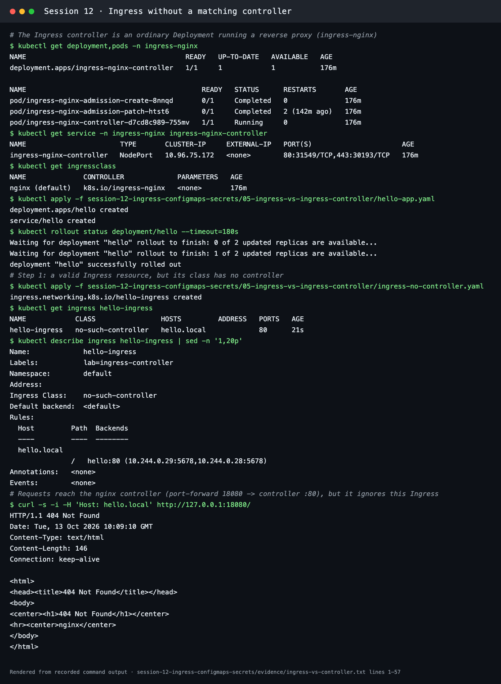
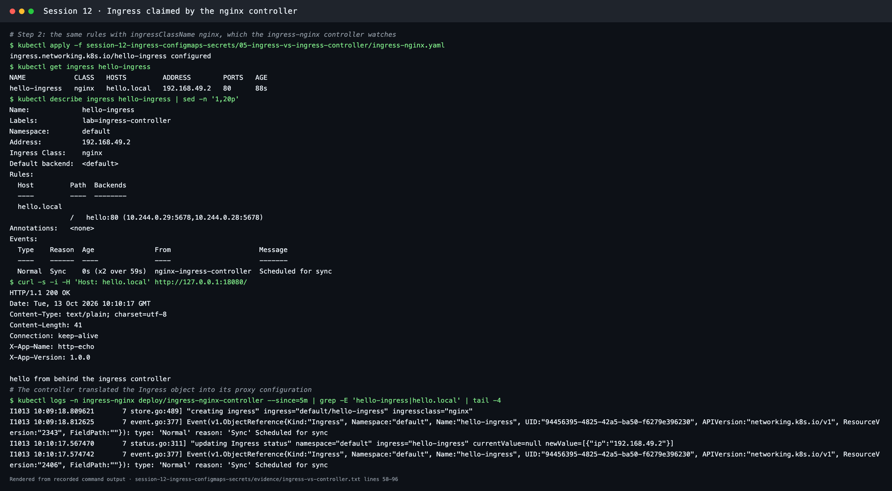
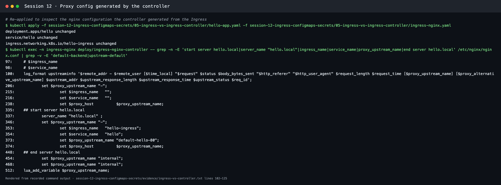

# Ingress vs Ingress Controller

**Session 12 · Task 4** · Author: Abhinav

The demo below applies the **same routing rules twice**: first with an IngressClass that no controller watches, then with `nginx`. It ran on Minikube (Kubernetes v1.37.0, ingress-nginx controller v1.15.1). The full transcript is in [evidence/ingress-vs-controller.txt](../evidence/ingress-vs-controller.txt).

## What is Ingress?

An **Ingress** is a Kubernetes API object (`networking.k8s.io/v1`) that *declares* how external HTTP(S) traffic should reach Services:

- host rules (`hello.local`, `api.campus.local`)
- path rules (`/`, `/api`, with `Prefix` or `Exact` matching)
- TLS settings (which Secret holds the certificate for which hosts)
- an `ingressClassName` saying **which controller** should implement it

An Ingress is only **configuration stored in etcd**. It does not listen on any port and does not forward a single packet by itself.

```yaml
spec:
  ingressClassName: nginx
  rules:
    - host: hello.local
      http:
        paths:
          - path: /
            pathType: Prefix
            backend:
              service:
                name: hello
                port:
                  number: 80
```

## What is an Ingress Controller?

An **Ingress Controller** is a running application, usually a Deployment plus a Service, that:

1. **watches** the API server for Ingress, Service, EndpointSlice and Secret objects of its class
2. **translates** them into configuration for a real reverse proxy or load balancer
3. **serves** the traffic: TLS termination, host/path routing, and load balancing to Pod endpoints
4. **writes status** back to the Ingress (the `ADDRESS` column)

In this cluster it is the `ingress-nginx-controller` Deployment in the `ingress-nginx` namespace (enabled with `minikube addons enable ingress`). It registers the IngressClass `nginx (default)` with controller `k8s.io/ingress-nginx`.

## Difference between them

| | Ingress | Ingress Controller |
| --- | --- | --- |
| Kind | API resource (YAML) | Software (Pods running a proxy) |
| Who creates it | App teams, one per app or host | Platform team, once per cluster (or per class) |
| Contains | Rules: hosts, paths, backends, TLS | nginx, Envoy, HAProxy or a cloud LB integration, plus a reconcile loop |
| Does it handle traffic? | No | Yes |
| Exists without the other? | Yes, but does nothing | Yes, but serves only its default backend (404) |
| Examples | `hello-ingress`, `yatri-ingress`, `campus-ingress-tls` | ingress-nginx, Traefik, HAProxy Ingress, Contour, Kong, AWS Load Balancer Controller, GKE Ingress |

The relationship is similar to a **Deployment and the controller-manager**: the object says *what*, and the controller makes it *happen*.

## Why both are required

**Ingress without a controller (Step 1):**

| Check | Result |
| --- | --- |
| `kubectl get ingress hello-ingress` | Class `no-such-controller`, **ADDRESS empty** |
| `kubectl describe ingress` | Backends resolved (`hello:80 (10.244.0.29:5678,10.244.0.28:5678)`) but **Events: `<none>`**, because no controller picked it up |
| `curl -H 'Host: hello.local' http://127.0.0.1:18080/` | **404 Not Found** from nginx's default backend. The running controller ignores Ingresses of other classes |



**Same rules, class `nginx` (Step 2):**

| Check | Result |
| --- | --- |
| `kubectl get ingress hello-ingress` | Class `nginx`, **ADDRESS 192.168.49.2** (written by the controller) |
| `kubectl describe ingress` | Event `Normal Sync … nginx-ingress-controller Scheduled for sync` |
| Controller logs | `"creating ingress" ingress="default/hello-ingress" ingressclass="nginx"` and `"updating Ingress status" … newValue=[{"ip":"192.168.49.2"}]` |
| `curl -H 'Host: hello.local' …` | **HTTP 200 `hello from behind the ingress controller`** |



**What the controller generated.** Inside the controller Pod, `/etc/nginx/nginx.conf` now contains a server block built from the Ingress. The objects were re-applied (unchanged) to inspect it:

```text
335:	## start server hello.local
337:		server_name "hello.local" ;
353:			set $ingress_name   "hello-ingress";
354:			set $service_name   "hello";
373:			set $proxy_upstream_name "default-hello-80";
448:	## end server hello.local
```



So the **Ingress** gives a portable, declarative description of routing, and the **controller** turns it into a working proxy. You need the rules *and* the engine.

## Examples

| Situation | Ingress | Controller |
| --- | --- | --- |
| Local Minikube (this demo and the [full demo](../04-full-demo/)) | `hello-ingress`, `yatri-ingress` (`/` → frontend, `/api` → backend) | ingress-nginx addon |
| Two hostnames on one IP | `campus-ingress-tls` in [03-ingress](../03-ingress/ingress-tls.yaml) | ingress-nginx with TLS Secret `campus-tls-cert` |
| AWS EKS | Ingress with `ingressClassName: alb` | AWS Load Balancer Controller creates an Application Load Balancer |
| Multiple controllers in one cluster | `ingressClassName: internal` vs `external` | Two ingress-nginx installs, each watching its own class |

## Commands used

```bash
kubectl get deployment,pods -n ingress-nginx
kubectl get ingressclass
kubectl apply -f 05-ingress-vs-ingress-controller/hello-app.yaml
kubectl apply -f 05-ingress-vs-ingress-controller/ingress-no-controller.yaml
kubectl get ingress hello-ingress
kubectl port-forward -n ingress-nginx svc/ingress-nginx-controller 18080:80 &   # Docker driver on macOS
curl -i -H 'Host: hello.local' http://127.0.0.1:18080/                          # 404
kubectl apply -f 05-ingress-vs-ingress-controller/ingress-nginx.yaml
curl -i -H 'Host: hello.local' http://127.0.0.1:18080/                          # 200
kubectl exec -n ingress-nginx deploy/ingress-nginx-controller -- grep -n 'start server hello.local' /etc/nginx/nginx.conf
kubectl delete -f 05-ingress-vs-ingress-controller/ingress-nginx.yaml -f 05-ingress-vs-ingress-controller/hello-app.yaml
```
