# Session 12: ConfigMaps, Secrets, Ingress, and a two-tier demo

Run from this directory with a Minikube cluster and `kubectl`. The [ConfigMap and Secret](evidence/config-and-secret.txt), [full demo](evidence/full-demo-run.txt), [Ingress and TLS](evidence/ingress-and-tls.txt), [HTTPS virtual hosts](evidence/hybrid-hosts-verified.txt), and [cleanup](evidence/full-demo-cleanup.txt) outputs came from a temporary cluster. [PNG renders of recorded output](screenshots/README.md) are included; direct desktop screenshots were not captured.

## Deliverables

| Task | Where |
| --- | --- |
| 1. ConfigMap demo (create, inject, verify, live update) | Sections 1–2, YAML in [01-configmap](01-configmap/) |
| 2. Secret demo (create, inject, verify, why not in Git) | Sections 3–5, YAML in [02-secret](02-secret/) |
| 3. Ingress demo (deploy, Service, Ingress, routing, TLS) | Sections 7–14, YAML in [03-ingress](03-ingress/) and [04-full-demo](04-full-demo/) |
| 4. Ingress vs Ingress Controller | [05-ingress-vs-ingress-controller/README.md](05-ingress-vs-ingress-controller/README.md), with a live with/without-controller demo |
| 5. Troubleshooting (before/after) | [troubleshooting/README.md](troubleshooting/README.md): Secret newline, ConfigMap key, Ingress backend |
| Output and screenshots | [evidence/](evidence/), inline below, [screenshots index](screenshots/README.md) |

## 1–2. ConfigMap and live update

```bash
kubectl apply -f 01-configmap/app-config.yaml
kubectl apply -f 01-configmap/app-pod.yaml
kubectl wait --for=condition=Ready pod/config-demo --timeout=120s
kubectl exec config-demo -- printenv APP_MESSAGE
kubectl patch configmap app-config --type merge -p '{"data":{"APP_MESSAGE":"Updated message"}}'
kubectl get pod config-demo -o jsonpath='{.metadata.uid}'; echo
kubectl exec config-demo -- printenv APP_MESSAGE
kubectl delete pod config-demo
kubectl apply -f 01-configmap/app-pod.yaml
kubectl exec config-demo -- printenv APP_MESSAGE
```

Environment variables sourced from a ConfigMap are set when the container starts, so the existing Pod retains the old value. Restarting the Pod picks up the new value. A ConfigMap projected as a volume can update eventually, except for `subPath` mounts. The Pod UID changes on recreation.

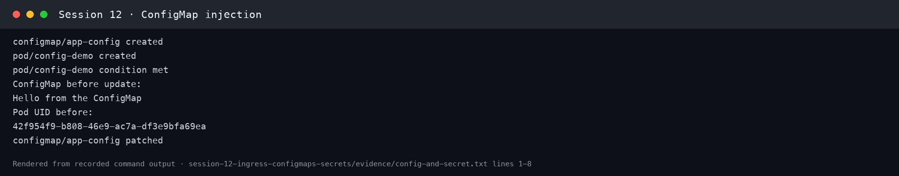
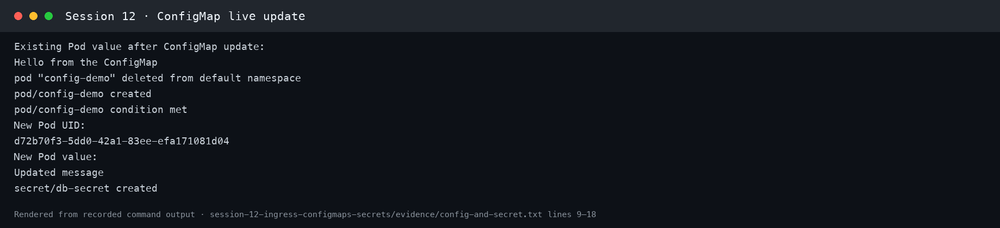

## 3–4. Secret and base64 newline behavior

```bash
kubectl apply -f 02-secret/db-secret.yaml
kubectl create secret generic db-secret \
  --from-file=password=<(openssl rand -hex 16 | tr -d '\n') \
  --from-literal=username=demo-user \
  --dry-run=client -o yaml | kubectl apply -f -
kubectl apply -f 02-secret/secret-pod.yaml
kubectl wait --for=condition=Ready pod/secret-demo --timeout=120s
kubectl get secret db-secret -o yaml
kubectl get secret db-secret -o jsonpath='{.data.username}' | base64 --decode; echo
printf %s 'example-bytes' | base64
printf '%s\n' 'example-bytes' | base64
```

The two encodings differ because the second includes a trailing newline. An authentication system comparing literal bytes can reject a password with that newline. `stringData` is an alternative input field that Kubernetes encodes into the Secret's base64 `data` field. Base64 is encoding, not encryption. The checked-in Secret manifest has no credential data; the commands create a random demo password at runtime. Use a secret manager or a deployment-time Secret for real credentials.

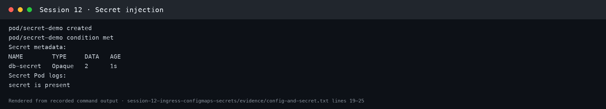
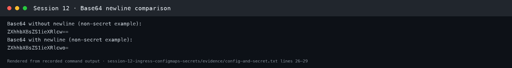

## 5. Enterprise secret management

A production pipeline should fetch credentials from an approved secrets service or Kubernetes external secrets controller, grant narrowly scoped access through workload identity/RBAC, rotate them, and keep them out of Git and logs. Kubernetes encryption at rest and restricted API access are separate controls; neither follows automatically from base64 encoding.

## 6. Combined injection

`04-full-demo/backend.yaml` uses `envFrom.configMapRef` for non-sensitive app settings and `env.valueFrom.secretKeyRef` for a demo password. The backend responds with `APP_MESSAGE` and does not print the password.

```bash
bash 04-full-demo/run-demo.sh
kubectl rollout status deployment/yatri-backend
kubectl exec deployment/yatri-backend -- printenv APP_MESSAGE
kubectl exec deployment/yatri-backend -- sh -c 'test -n "$DB_PASSWORD" && echo "secret is present"'
```

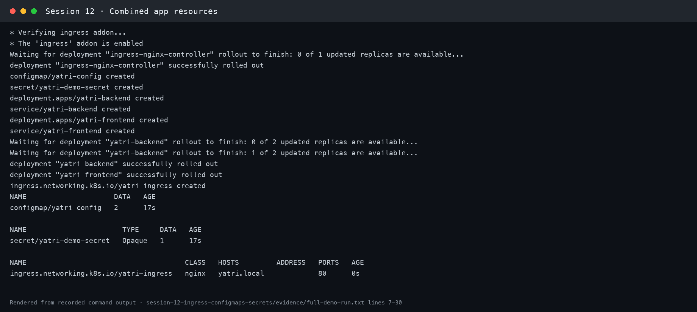

## 7–8. Ingress resource and controller

The full comparison, with a demo of the same Ingress with and without a controller, is in [05-ingress-vs-ingress-controller/README.md](05-ingress-vs-ingress-controller/README.md).

An Ingress resource declares HTTP host/path routing. An Ingress controller watches those resources and configures the proxy that actually serves traffic. A resource alone does not create an active route.

```bash
minikube addons enable ingress
kubectl get pods -n ingress-nginx
kubectl get ingressclass
kubectl describe ingress yatri-ingress
```

Wait for the controller Pod to become ready before testing routes.

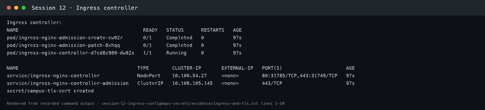

## 9. Local hostname resolution

Pointing a hostname at `minikube ip` in `/etc/hosts` is a local machine configuration, not part of a Kubernetes manifest. For a reversible check without editing system files, use curl's `--resolve` option:

```bash
INGRESS_IP=$(minikube ip)
curl --resolve "yatri.local:80:${INGRESS_IP}" http://yatri.local/
```

With the Docker driver, host routing to the Minikube IP may require `minikube tunnel` or `minikube service ingress-nginx-controller -n ingress-nginx --url`. Use the address that your driver actually exposes.

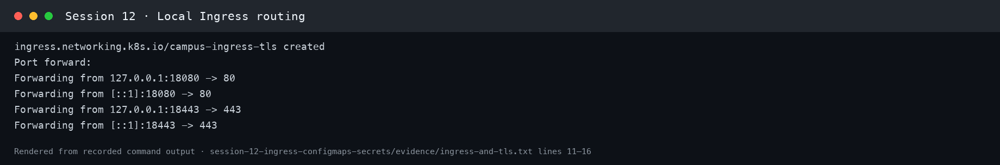

## 10. Path routing

`04-full-demo/ingress.yaml` sends `/api` to the backend and `/` to the frontend. NGINX's regex capture and `rewrite-target: /$2` strip the `/api` prefix before forwarding.

```bash
bash 04-full-demo/run-demo.sh
kubectl describe ingress yatri-ingress
INGRESS_IP=$(minikube ip)
curl --resolve "yatri.local:80:${INGRESS_IP}" http://yatri.local/
curl --resolve "yatri.local:80:${INGRESS_IP}" http://yatri.local/api/
```

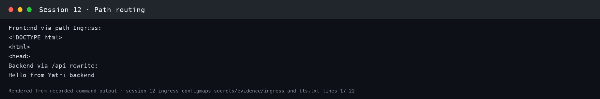

## 11–12. Virtual hosts and hybrid routing

`03-ingress/ingress-tls.yaml` routes `portal.campus.local/` to the frontend and both `api.campus.local/api` and `api.campus.local/` to the backend. Both hostnames share one Ingress address. The two Deployments and Services from the full demo must be running.

```bash
kubectl apply -f 03-ingress/ingress-tls.yaml
kubectl describe ingress campus-ingress-tls
INGRESS_IP=$(minikube ip)
curl -H 'Host: portal.campus.local' "http://${INGRESS_IP}/"
curl -H 'Host: api.campus.local' "http://${INGRESS_IP}/api/"
```

Because this Ingress has TLS, NGINX may redirect HTTP requests to HTTPS. The tested HTTPS routes returned 200 for both hosts using local port forwarding; see the evidence linked above.

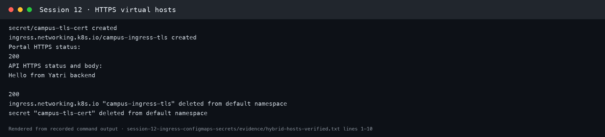
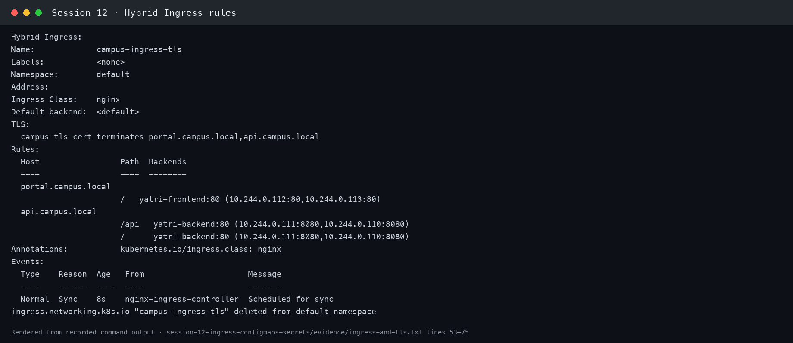

## 13. TLS termination

Create a local test certificate with both DNS names in its SAN. The private key stays outside Git and is deleted after the demo.

```bash
cert_dir=$(mktemp -d)
openssl req -x509 -nodes -days 7 -newkey rsa:2048 \
  -keyout "$cert_dir/tls.key" -out "$cert_dir/tls.crt" \
  -subj '/CN=campus.local/O=CampusDevOps' \
  -addext 'subjectAltName=DNS:portal.campus.local,DNS:api.campus.local'
kubectl create secret tls campus-tls-cert --cert="$cert_dir/tls.crt" --key="$cert_dir/tls.key"
kubectl apply -f 03-ingress/ingress-tls.yaml
INGRESS_IP=$(minikube ip)
curl -k -v --resolve "portal.campus.local:443:${INGRESS_IP}" https://portal.campus.local/ 2>&1 | grep -E 'Server certificate|HTTP/|SSL connection'
rm -rf "$cert_dir"
```

When the Docker driver's Minikube IP is unreachable from macOS, use `kubectl port-forward -n ingress-nginx service/ingress-nginx-controller 18443:443` in another terminal, then `curl -k --resolve portal.campus.local:18443:127.0.0.1 https://portal.campus.local:18443/`.

The self-signed certificate needs `-k` only for local testing. A real deployment needs a trusted certificate and safe key management.

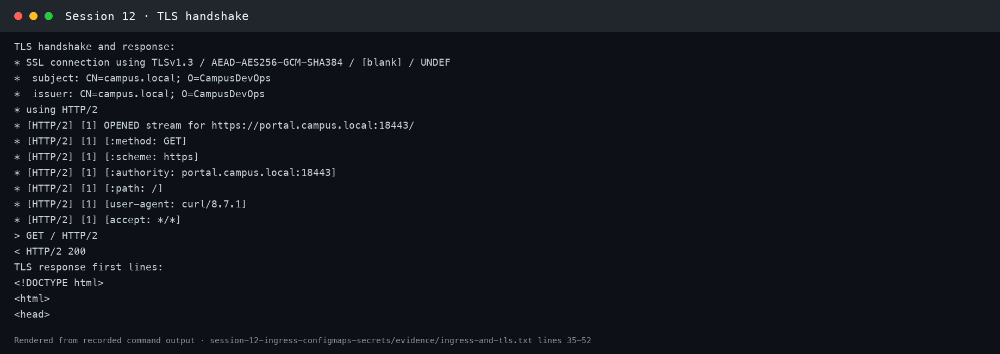

## 14. Full demo and cleanup

Both `backend.yaml` and `frontend.yaml` contain two YAML documents separated by `---`: a Deployment and its Service. The automation uses these files, waits for ready Deployments, and shows the resulting objects.

```bash
bash 04-full-demo/run-demo.sh
kubectl get configmap,secret,ingress,deployment,service,pods -l app=yatri-app
bash 04-full-demo/cleanup.sh
kubectl get ingress yatri-ingress || echo 'Ingress deleted'
kubectl get deployment yatri-backend yatri-frontend || echo 'Deployments deleted'
kubectl delete -f 03-ingress/ingress-tls.yaml --ignore-not-found
kubectl delete secret campus-tls-cert --ignore-not-found
kubectl delete -f 01-configmap/ -f 02-secret/ --ignore-not-found
```

The cleanup script removes full-demo resources. The last commands remove the separate exercises.

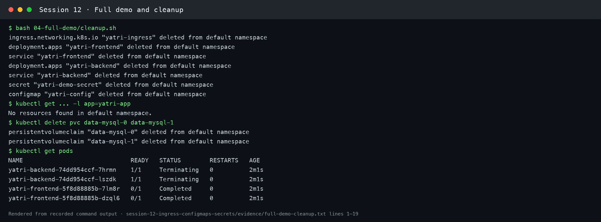

## 15. Troubleshooting

Three before/after investigations (Secret trailing newline against a real PostgreSQL, missing ConfigMap key, Ingress backend pointing at a missing Service) are documented in [troubleshooting/README.md](troubleshooting/README.md).
