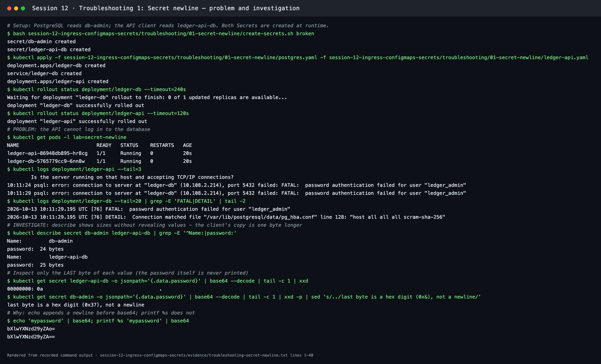
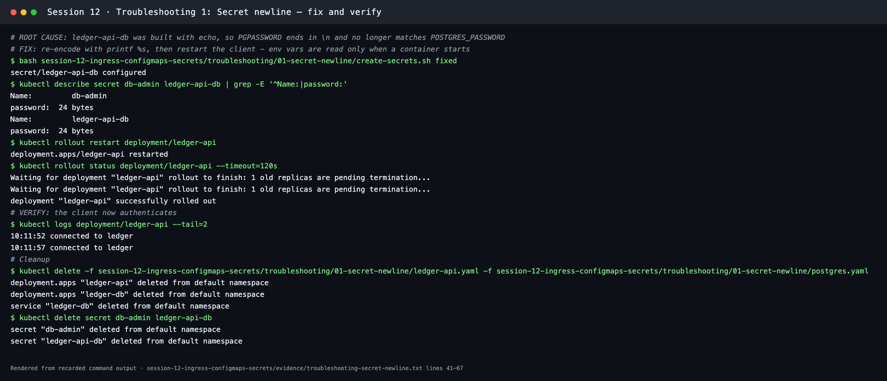
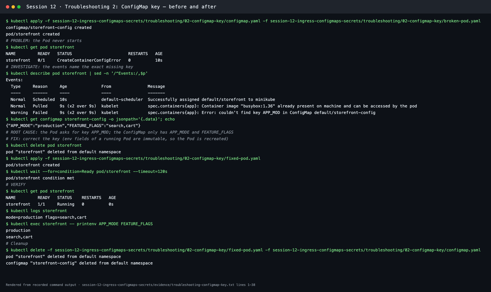
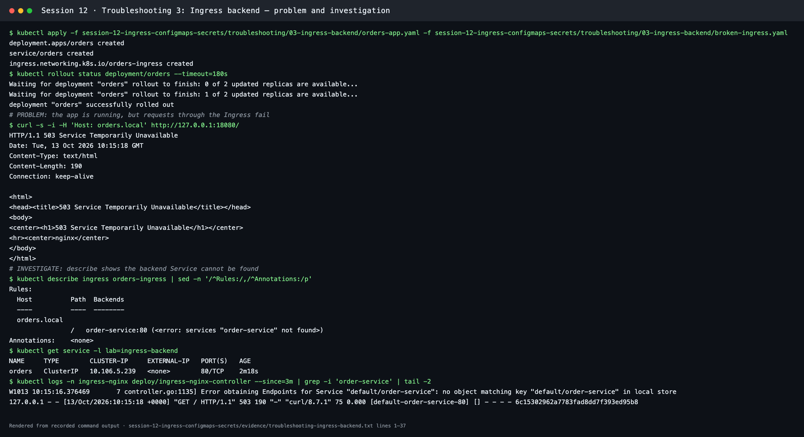
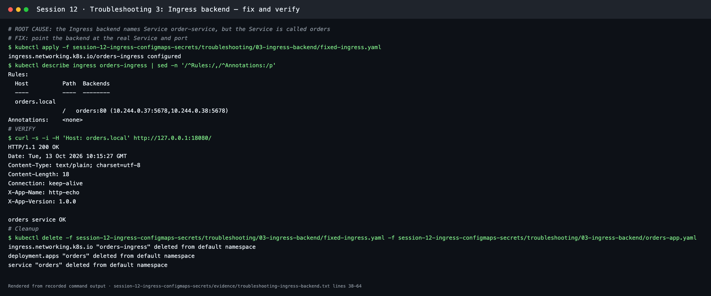

# Session 12 troubleshooting

**Session 12 · Task 5** · Author: Abhinav

Three faults, one for each Session 12 topic (Secret, ConfigMap, Ingress). Each was reproduced on Minikube (Kubernetes v1.37.0) and taken through the same steps: **identify → investigate → root cause → fix → verify**. Scenario 1 is the instructor's `troubleshooting/secret-base64-gotcha.md` incident, rebuilt as a working lab with a real PostgreSQL server.

| # | Folder | Symptom | Root cause | Evidence |
| --- | --- | --- | --- | --- |
| 1 | [01-secret-newline](01-secret-newline/) | `FATAL: password authentication failed for user "ledger_admin"` | Client Secret built with `echo \| base64`, so the password ends in `\n` | [transcript](../evidence/troubleshooting-secret-newline.txt) |
| 2 | [02-configmap-key](02-configmap-key/) | Pod stuck in `CreateContainerConfigError` | `configMapKeyRef` asks for `APP_MOD`, but the key is `APP_MODE` | [transcript](../evidence/troubleshooting-configmap-key.txt) |
| 3 | [03-ingress-backend](03-ingress-backend/) | `503 Service Temporarily Unavailable` through the Ingress | Ingress backend names Service `order-service`, but it is `orders` | [transcript](../evidence/troubleshooting-ingress-backend.txt) |

---

## 1. Secret with a trailing newline (instructor scenario)

**Setup.** `ledger-db` (postgres:16-alpine) takes `POSTGRES_PASSWORD` from Secret `db-admin`. `ledger-api` connects every 5 s with `PGPASSWORD` from Secret `ledger-api-db`. [create-secrets.sh](01-secret-newline/create-secrets.sh) generates a random password at runtime, so **no password exists in Git**. Run with `broken`, it rebuilds the client copy the way the developer in the incident did: `echo "$password" | base64`.

```bash
bash troubleshooting/01-secret-newline/create-secrets.sh broken
kubectl apply -f troubleshooting/01-secret-newline/postgres.yaml -f troubleshooting/01-secret-newline/ledger-api.yaml
```

**1. Identify.** Both Pods are `Running`, but the client log and the database log disagree about the password:

```text
10:11:29 psql: error: connection to server at "ledger-db" (10.108.2.214), port 5432 failed: FATAL:  password authentication failed for user "ledger_admin"
2026-10-13 10:11:29.195 UTC [76] FATAL:  password authentication failed for user "ledger_admin"
```

**2. Investigate**, without printing the password:

```bash
kubectl describe secret db-admin ledger-api-db | grep -E '^Name:|password:'
#   db-admin       password:  24 bytes
#   ledger-api-db  password:  25 bytes      <- one extra byte
kubectl get secret ledger-api-db -o jsonpath='{.data.password}' | base64 --decode | tail -c 1 | xxd
#   00000000: 0a      <- the extra byte is a newline (\n)
echo 'mypassword' | base64      # bXlwYXNzd29yZAo=  (ends in "Ao=" = \n)
printf %s 'mypassword' | base64 # bXlwYXNzd29yZA==
```

**3. Root cause.** `echo` appends `\n`, and base64 encodes it faithfully. The client sends `password\n` (25 bytes), and PostgreSQL compares exact bytes against the 24-byte password.



**4. Fix.** Re-encode with `printf %s` (or use `kubectl create secret … --from-literal`, or `stringData:`). Then restart the client, because environment variables from a Secret are read **only when the container starts**:

```bash
bash troubleshooting/01-secret-newline/create-secrets.sh fixed   # both Secrets now 24 bytes
kubectl rollout restart deployment/ledger-api
kubectl rollout status deployment/ledger-api
```

**5. Verify.**

```text
10:11:52 connected to ledger
10:11:57 connected to ledger
```



**Lesson.** Base64 is encoding, not encryption, and it preserves invisible characters. Keep Secret values out of Git, create them with `printf %s`, `--from-literal` or `stringData`, and check `describe` byte counts when authentication fails "with the right password".

---

## 2. ConfigMap key does not exist

```bash
kubectl apply -f troubleshooting/02-configmap-key/configmap.yaml -f troubleshooting/02-configmap-key/broken-pod.yaml
```

| Step | Command | Output |
| --- | --- | --- |
| Identify | `kubectl get pod storefront` | `0/1  CreateContainerConfigError` |
| Investigate | `kubectl describe pod storefront` (Events) | `Error: couldn't find key APP_MOD in ConfigMap default/storefront-config` |
| Investigate | `kubectl get configmap storefront-config -o jsonpath='{.data}'` | `{"APP_MODE":"production","FEATURE_FLAGS":"search,cart"}` |
| Root cause | — | Typo in `configMapKeyRef.key` (`APP_MOD` ≠ `APP_MODE`). The image and command are fine; the kubelet refuses to start a container whose env source is missing |
| Fix | `kubectl delete pod storefront && kubectl apply -f troubleshooting/02-configmap-key/fixed-pod.yaml` | Pod `env` fields are immutable, so the Pod is recreated |
| Verify | `kubectl logs storefront` / `printenv` | `mode=production flags=search,cart` |

`optional: true` on a key reference would let the Pod start without the key. That is useful for truly optional settings, but here it would have hidden the bug.



---

## 3. Ingress backend points at the wrong Service

```bash
kubectl apply -f troubleshooting/03-ingress-backend/orders-app.yaml -f troubleshooting/03-ingress-backend/broken-ingress.yaml
kubectl port-forward -n ingress-nginx svc/ingress-nginx-controller 18080:80 &
curl -i -H 'Host: orders.local' http://127.0.0.1:18080/
```

| Step | Command | Output |
| --- | --- | --- |
| Identify | `curl -i -H 'Host: orders.local' …` | `HTTP/1.1 503 Service Temporarily Unavailable` |
| Investigate | `kubectl describe ingress orders-ingress` | `order-service:80 (<error: services "order-service" not found>)` |
| Investigate | `kubectl get service -l lab=ingress-backend` | Only `orders` exists |
| Investigate | Controller logs | `Error obtaining Endpoints for Service "default/order-service": no object matching key …` |
| Root cause | — | The Ingress backend `service.name` does not match the Service, so nginx has no upstream and returns 503 |
| Fix | `kubectl apply -f troubleshooting/03-ingress-backend/fixed-ingress.yaml` | Backend becomes `orders:80 (10.244.0.37:5678,10.244.0.38:5678)` |
| Verify | `curl -i -H 'Host: orders.local' …` | `HTTP/1.1 200 OK` → `orders service OK` |




A **404** from ingress-nginx usually means no rule matched the host or path, while a **503** means a rule matched but its backend has no ready endpoints (wrong Service name or port, selector mismatch, or Pods not Ready).

## Quick triage checklist for Session 12 objects

```bash
kubectl get pods; kubectl describe pod <pod>                   # CreateContainerConfigError = missing ConfigMap/Secret or key
kubectl get configmap,secret                                   # do the referenced objects exist in this namespace?
kubectl describe secret <name>                                 # byte counts reveal hidden newlines
kubectl rollout restart deployment/<name>                      # env from ConfigMap/Secret changes need a restart
kubectl describe ingress <name>                                # backends and errors per rule
kubectl get endpointslice -l kubernetes.io/service-name=<svc>  # are there ready endpoints?
kubectl logs -n ingress-nginx deploy/ingress-nginx-controller  # controller-side errors
```
