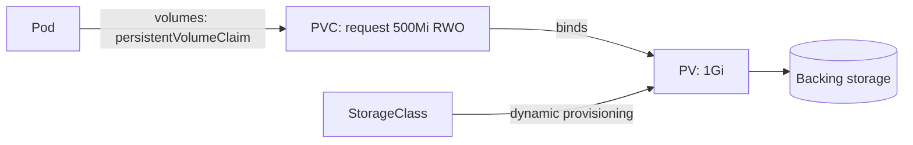
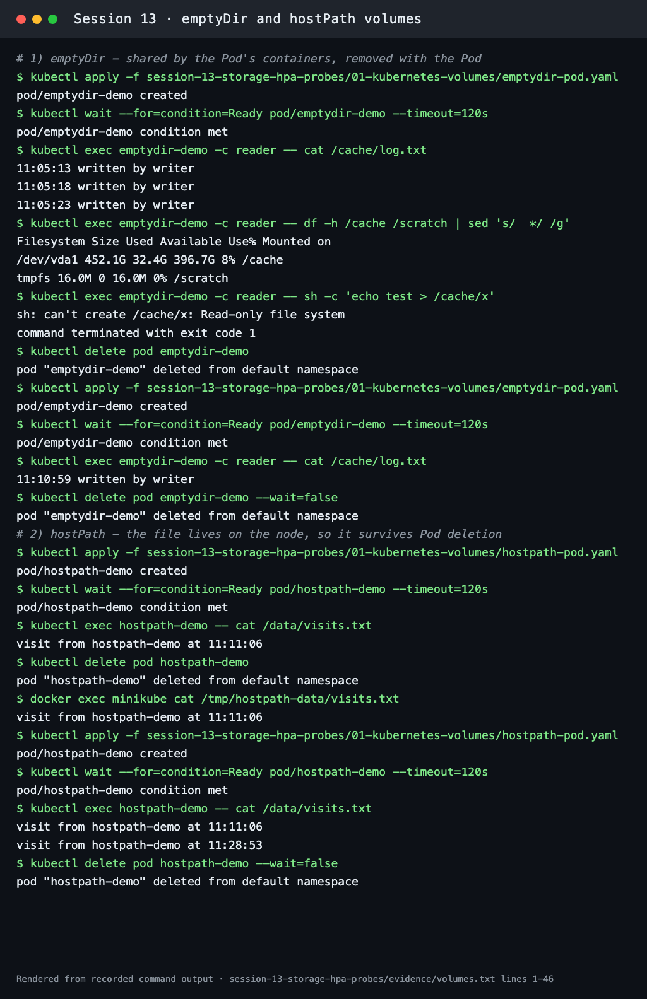
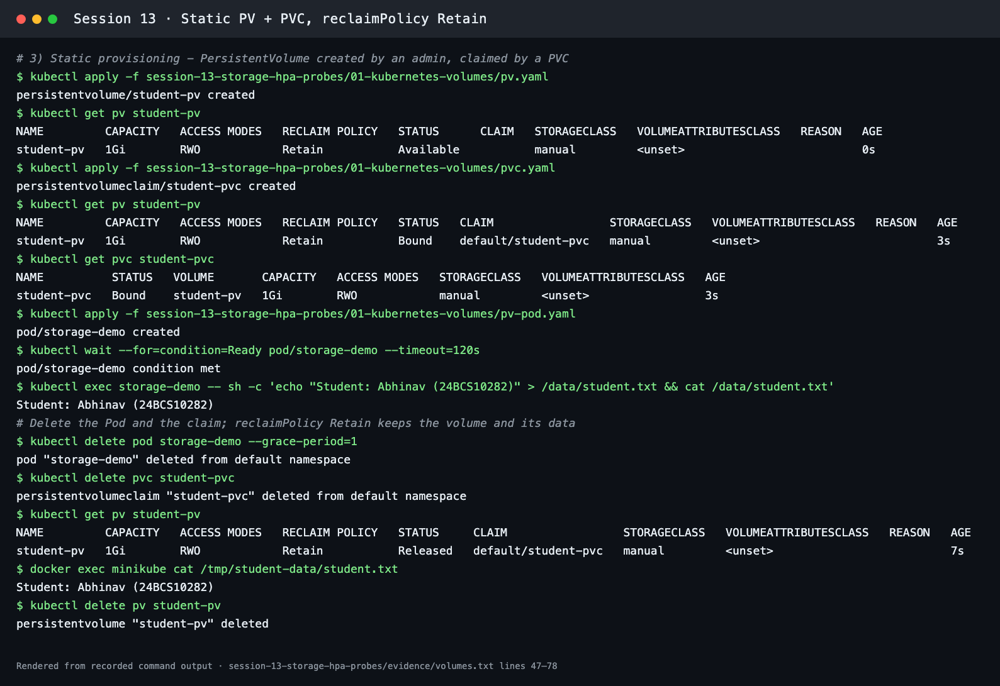
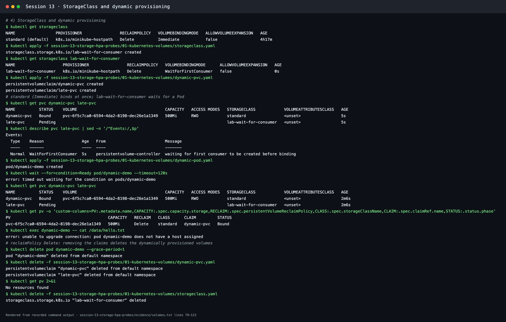
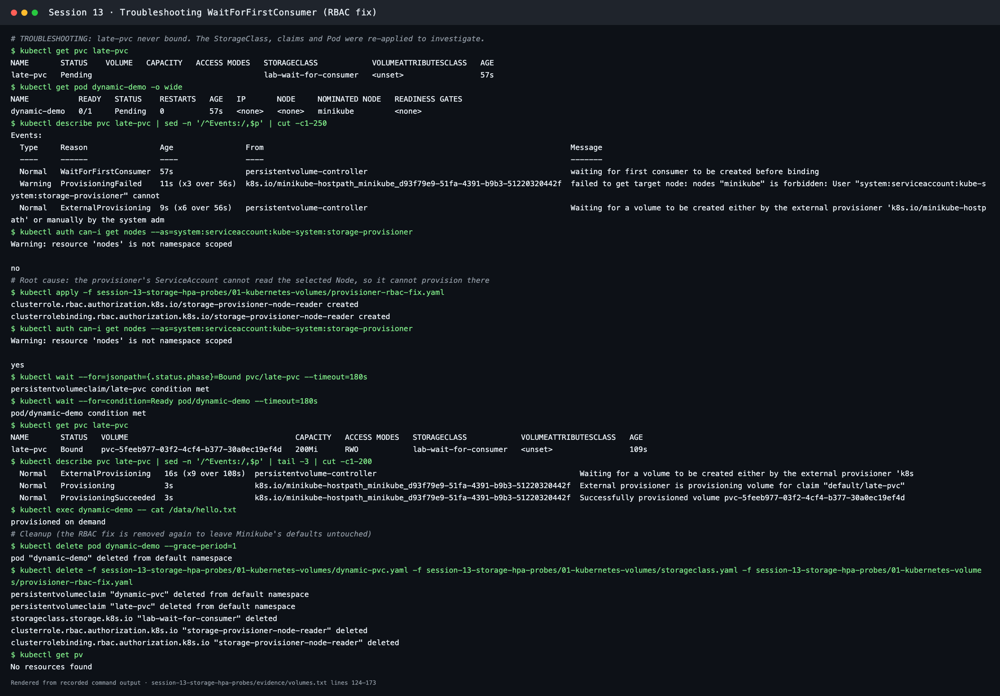
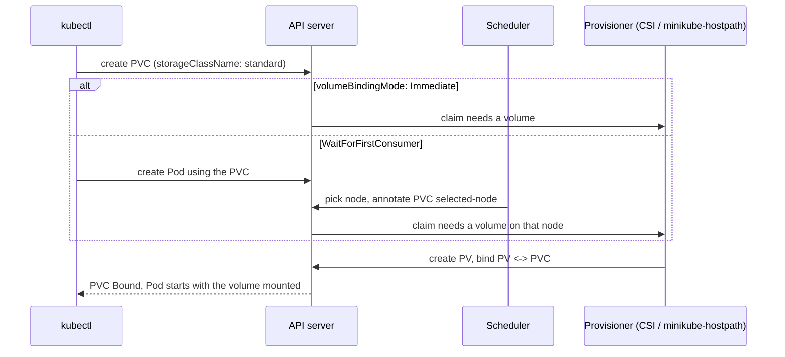

# Kubernetes Volumes

**Session 13 · Task 1** · Author: Abhinav (24BCS10282)

Every example below was applied on Minikube (Kubernetes v1.37.0). The full transcript is in [../evidence/volumes.txt](../evidence/volumes.txt).

A container's own filesystem is **ephemeral**: when the container restarts, anything it wrote is gone. Volumes give Pods storage with a longer lifetime.

| Type | Lifetime of the data | Where it lives | Typical use |
| --- | --- | --- | --- |
| `emptyDir` | As long as the **Pod** exists | Node disk (or RAM with `medium: Memory`) | Scratch space, cache, sharing files between containers in a Pod |
| `hostPath` | As long as the **node's** directory exists | A path on one node | Node agents (logs, `/var/run/...`), single-node labs |
| PersistentVolume (PV) | Independent of Pods, governed by the reclaim policy | Network or cloud disk, NFS, local disk, … | Databases and stateful apps |
| PersistentVolumeClaim (PVC) | A request that binds to one PV | — | What a Pod actually mounts |
| StorageClass | — | — | Template for **dynamic provisioning** of PVs |



---

## emptyDir

[emptydir-pod.yaml](emptydir-pod.yaml) has two containers. `writer` appends a line every 5 s to `/cache/log.txt`, and `reader` mounts the same `emptyDir` read-only. A second `emptyDir` uses `medium: Memory`.

```bash
kubectl apply -f emptydir-pod.yaml
kubectl exec emptydir-demo -c reader -- cat /cache/log.txt
kubectl exec emptydir-demo -c reader -- df -h /cache /scratch
kubectl delete pod emptydir-demo && kubectl apply -f emptydir-pod.yaml
kubectl exec emptydir-demo -c reader -- cat /cache/log.txt
```

**Observed:**
- The reader saw the writer's lines (`11:05:13 written by writer`, …), so the volume is shared between containers.
- `/cache` lives on node disk (`/dev/vda1`), while `/scratch` is a 16 MiB **tmpfs** in RAM.
- Writing from the reader failed with `Read-only file system`, because of `readOnly: true` on that mount.
- After the Pod was deleted and recreated, the log held **only one new line**. emptyDir data dies with the Pod.

## hostPath

[hostpath-pod.yaml](hostpath-pod.yaml) mounts the node directory `/tmp/hostpath-data` (`type: DirectoryOrCreate`). Each Pod start appends a visit line.

```bash
kubectl apply -f hostpath-pod.yaml
kubectl exec hostpath-demo -- cat /data/visits.txt
kubectl delete pod hostpath-demo
docker exec minikube cat /tmp/hostpath-data/visits.txt     # file is on the node
kubectl apply -f hostpath-pod.yaml
kubectl exec hostpath-demo -- cat /data/visits.txt         # two lines now
```

**Observed:** the file stayed on the node after the Pod was deleted, and the new Pod appended a second line. **Caveats:** the data lives on *one* node, so a Pod rescheduled elsewhere won't see it. Broad hostPath mounts are also a security risk, because they give access to the node's files. That's why production clusters restrict them.



---

## PersistentVolume and PersistentVolumeClaim (static provisioning)

- A **PersistentVolume** is a cluster-wide piece of storage with a capacity, access modes (`ReadWriteOnce`, `ReadOnlyMany`, `ReadWriteMany`, `ReadWriteOncePod`) and a **reclaim policy** (`Retain` or `Delete`).
- A **PersistentVolumeClaim** is a namespaced request: "I need 500Mi, RWO, class X". Kubernetes binds it to a matching PV, and the Pod mounts the **claim**, not the PV.

[pv.yaml](pv.yaml) creates `student-pv` (1Gi, RWO, `Retain`, class `manual`, hostPath `/tmp/student-data`). [pvc.yaml](pvc.yaml) asks for 500Mi of class `manual`. Using the same class name stops the default StorageClass from dynamically provisioning a different volume. [pv-pod.yaml](pv-pod.yaml) mounts the claim.

| Step | `kubectl get pv student-pv` |
| --- | --- |
| PV created | `Available` |
| PVC created | `Bound` to `default/student-pvc`. The claim shows capacity **1Gi**, the whole PV, even though it asked for 500Mi |
| Pod wrote `Student: Abhinav (24BCS10282)` to `/data/student.txt` | — |
| Pod and PVC deleted | `Released`, because `Retain` keeps the volume and its data. `docker exec minikube cat /tmp/student-data/student.txt` still printed the line |
| `kubectl delete pv student-pv` | An admin must clean up a `Retain` volume manually |



---

## StorageClass and dynamic provisioning

A **StorageClass** describes *how* to create volumes on demand: the provisioner (CSI driver), parameters, reclaim policy, binding mode, and whether volumes can be expanded. With dynamic provisioning, nobody pre-creates PVs. A PVC naming a class makes the provisioner create a PV for it.

```bash
kubectl get storageclass
# standard (default)   k8s.io/minikube-hostpath   Delete   Immediate   false
kubectl apply -f storageclass.yaml       # lab-wait-for-consumer: WaitForFirstConsumer
kubectl apply -f dynamic-pvc.yaml        # dynamic-pvc (standard), late-pvc (lab-wait-for-consumer)
kubectl get pvc dynamic-pvc late-pvc
kubectl apply -f dynamic-pod.yaml        # first consumer of late-pvc
```

| Claim | Class | Binding mode | Result |
| --- | --- | --- | --- |
| `dynamic-pvc` | `standard` | `Immediate` | **Bound within 5 s** to the auto-created `pvc-6f5c7ca0-…` (500Mi, reclaim `Delete`) |
| `late-pvc` | `lab-wait-for-consumer` | `WaitForFirstConsumer` | `Pending`, with event `waiting for first consumer to be created before binding`. Delayed binding lets the scheduler pick the node first, so the volume is created where the Pod will run |

Deleting the claims removed the dynamically provisioned PVs (`kubectl get pv` → `No resources found`), because the reclaim policy is **Delete**.



### Troubleshooting: WaitForFirstConsumer never bound on Minikube

When the Pod was created, `late-pvc` still did not bind, and the Pod stayed `Pending` (`kubectl wait` timed out).

| Step | Finding |
| --- | --- |
| Identify | `late-pvc` `Pending`; Pod `dynamic-demo` `Pending` with `NOMINATED NODE minikube` |
| Investigate | `kubectl describe pvc late-pvc` → `ProvisioningFailed: failed to get target node: nodes "minikube" is forbidden: User "system:serviceaccount:kube-system:storage-provisioner" cannot get resource "nodes"` |
| Confirm | `kubectl auth can-i get nodes --as=system:serviceaccount:kube-system:storage-provisioner` → **no** |
| Root cause | With delayed binding, the scheduler writes the chosen node into the claim (`volume.kubernetes.io/selected-node`), and the provisioner must read that Node. Minikube's provisioner ServiceAccount has no RBAC permission for Nodes |
| Fix | [provisioner-rbac-fix.yaml](provisioner-rbac-fix.yaml): ClusterRole `get/list/watch nodes` + ClusterRoleBinding to `kube-system/storage-provisioner` |
| Verify | `can-i` → **yes**; `ProvisioningSucceeded`; `late-pvc` `Bound`; the Pod read `provisioned on demand` from the new volume |

The RBAC fix was removed again afterwards to leave Minikube's defaults untouched.



---

## Dynamic provisioning flow



## Summary

- **emptyDir:** per-Pod scratch space, shared by its containers, gone with the Pod.
- **hostPath:** node files. Survives the Pod, but is tied to one node and is risky.
- **PV / PVC:** storage decoupled from Pods. The claim is the request, the volume is the supply.
- **Reclaim policy:** `Retain` keeps the data after the claim is deleted (manual clean-up), and `Delete` removes the volume.
- **StorageClass:** provisions volumes on demand. `WaitForFirstConsumer` puts the volume on the node where the Pod is scheduled.
