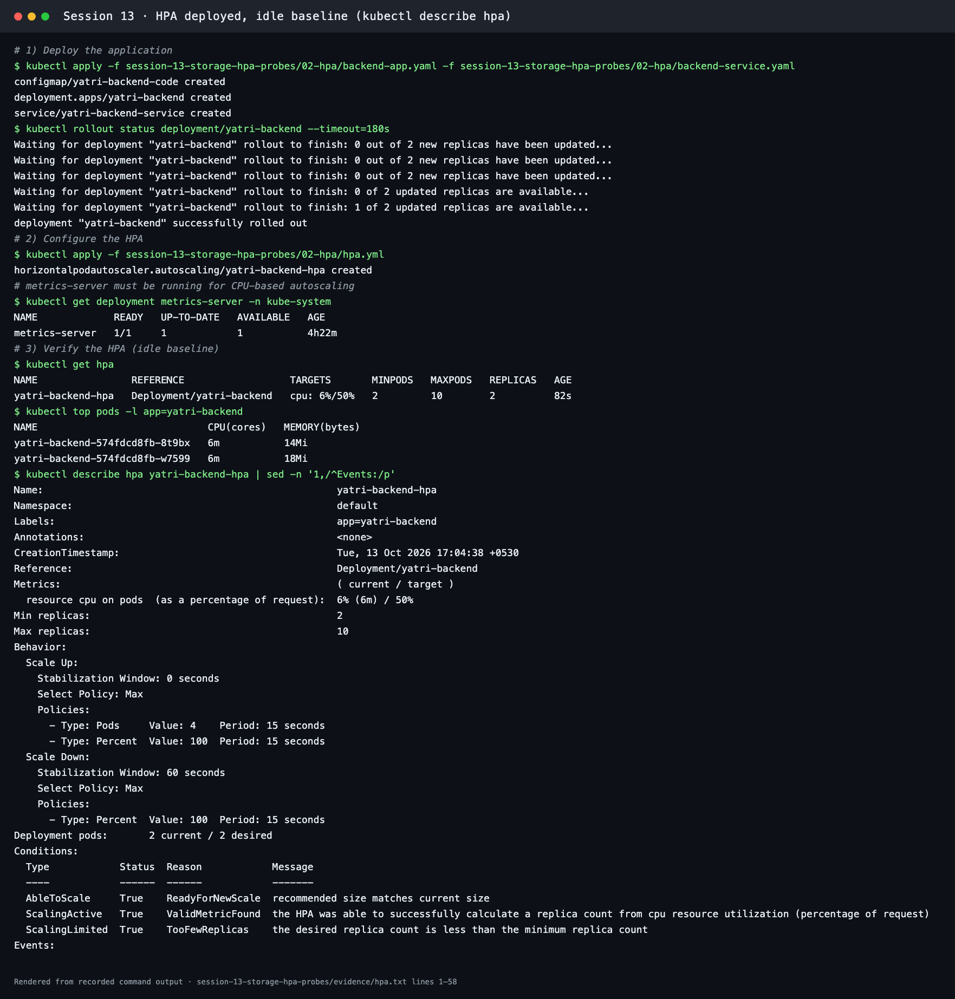
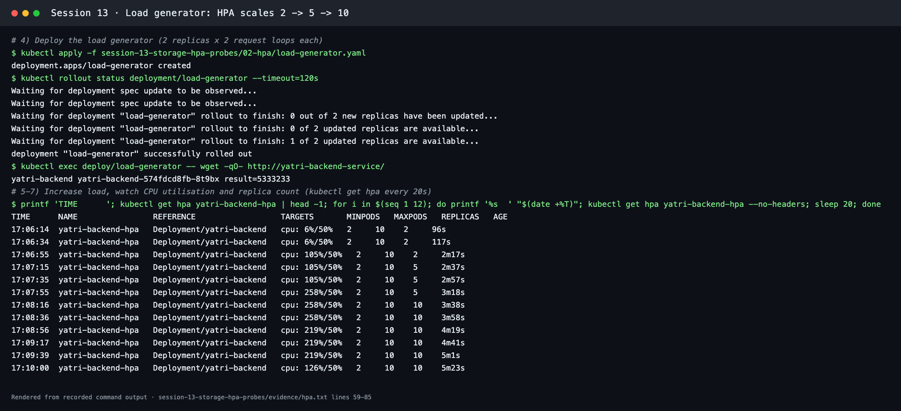
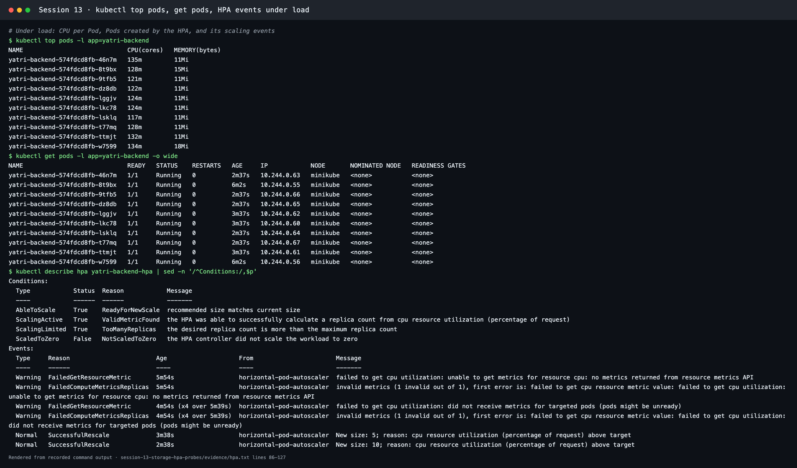
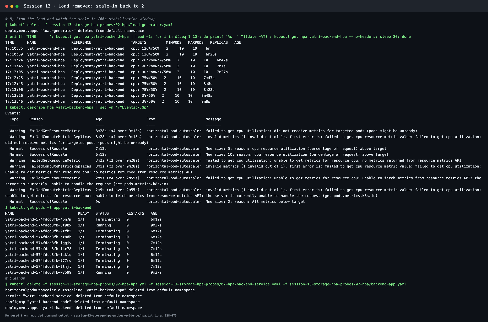
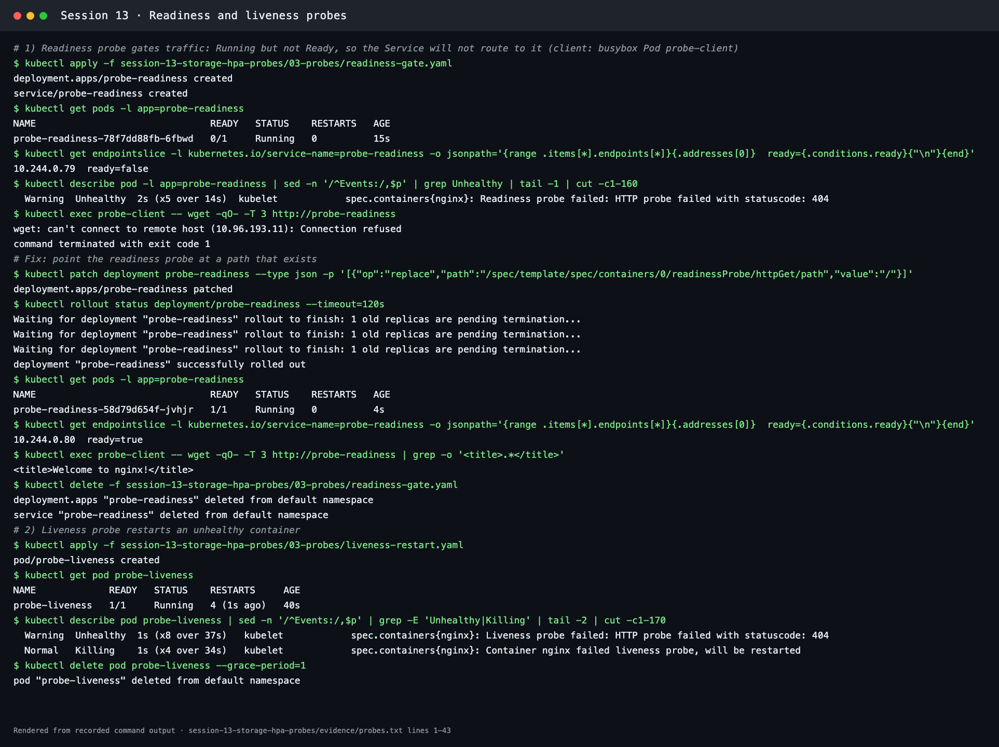
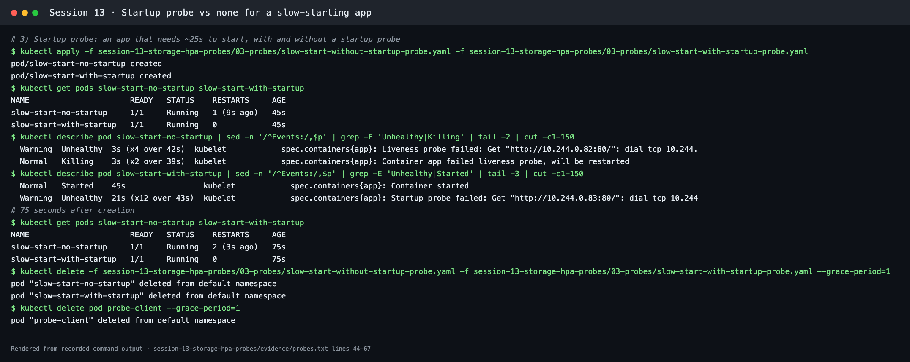

# Session 13: Kubernetes Storage, HPA & Probes

**Course:** SST DevOps & Cloud · **Author:** Abhinav (24BCS10282)

Everything here was run on Minikube v1.39.0 / Kubernetes v1.37.0 (Docker driver, Apple Silicon) with the `metrics-server` add-on. Raw output is in [evidence/](evidence/). The screenshots are renders of those transcripts made with [scripts/render-evidence-png.py](../scripts/render-evidence-png.py), and each image names its source lines.

| Task | Where |
| --- | --- |
| 1. Kubernetes volumes (emptyDir, hostPath, PV, PVC, StorageClass, dynamic provisioning) | [01-kubernetes-volumes/README.md](01-kubernetes-volumes/README.md) |
| 2. HPA hands-on with `hpa.yml` and a load generator | [This page](#task-2-hpa-hands-on), files in [02-hpa/](02-hpa/) |
| Probes (startup, readiness, liveness) | [This page](#probes), files in [03-probes/](03-probes/) |
| 3. Mini project | [mini-project/README.md](mini-project/README.md) |

---

## Task 2: HPA hands-on

### Files

| File | Purpose |
| --- | --- |
| [02-hpa/backend-app.yaml](02-hpa/backend-app.yaml) | `yatri-backend`: a small Python API (ConfigMap + Deployment, 2 replicas). `/` does about 40k square roots per request, so it uses real CPU. Requests 100m CPU, limit 300m |
| [02-hpa/backend-service.yaml](02-hpa/backend-service.yaml) | `yatri-backend-service`: ClusterIP :80 → 5000 (the instructor's file) |
| [02-hpa/hpa.yml](02-hpa/hpa.yml) | `yatri-backend-hpa`: `autoscaling/v2`, min 2, max 10, **50% CPU**, scale-down stabilization 60 s |
| [02-hpa/load-generator.yaml](02-hpa/load-generator.yaml) | In-cluster load: 2 busybox Pods × 2 `wget` loops against the Service |
| [02-hpa/load_generator.sh](02-hpa/load_generator.sh) | Instructor's host-side script (port-forward + curl loops), kept for reference |

### How the HPA decides

```text
desiredReplicas = ceil( currentReplicas × currentCPU% / targetCPU% )
e.g. 2 Pods at 105% with a 50% target → ceil(2 × 105 / 50) = 5
```

CPU% is measured against each Pod's **CPU request**, so Pods without requests cannot be autoscaled on CPU. The metrics come from **metrics-server** through the `metrics.k8s.io` API.

### 1–3. Deploy, configure and verify

```bash
kubectl apply -f 02-hpa/backend-app.yaml -f 02-hpa/backend-service.yaml
kubectl rollout status deployment/yatri-backend
kubectl apply -f 02-hpa/hpa.yml
kubectl get deployment metrics-server -n kube-system
kubectl get hpa
kubectl top pods -l app=yatri-backend
kubectl describe hpa yatri-backend-hpa
```

At idle: `yatri-backend-hpa  Deployment/yatri-backend  cpu: 6%/50%  2  10  2`, with each Pod at 6m CPU. `describe` shows the metric (`6% (6m) / 50%`), the scale-up and scale-down policies, and the condition `ScalingLimited True TooFewReplicas` (the recommendation was below the minimum of 2).



### 4–7. Load generator, CPU and scaling

```bash
kubectl apply -f 02-hpa/load-generator.yaml
kubectl exec deploy/load-generator -- wget -qO- http://yatri-backend-service/
kubectl get hpa yatri-backend-hpa -w        # recorded every 20 s
```

| Time | `TARGETS` | `REPLICAS` |
| --- | --- | --- |
| 17:06:34 | `cpu: 6%/50%` | 2 |
| 17:06:55 | `cpu: 105%/50%` | 2 |
| 17:07:15 | `cpu: 105%/50%` | **5** |
| 17:07:55 | `cpu: 258%/50%` | 5 |
| 17:08:16 | `cpu: 258%/50%` | **10** (maxReplicas) |
| 17:10:00 | `cpu: 126%/50%` | 10 |



Under load, `kubectl top pods` showed all **10** Pods at 117m–135m CPU (above their 100m request). `describe hpa` recorded:

```text
Normal  SuccessfulRescale  New size: 5; reason: cpu resource utilization (percentage of request) above target
Normal  SuccessfulRescale  New size: 10; reason: cpu resource utilization (percentage of request) above target
ScalingLimited  True  TooManyReplicas  the desired replica count is more than the maximum replica count
```

At the maximum, CPU stayed above target (126%). With 10 replicas the HPA cannot add more, which is why `maxReplicas` must be sized for peak traffic.



### 8. Scale-in

After `kubectl delete -f 02-hpa/load-generator.yaml`, CPU dropped (`75%` → `3%`). After the 60 s stabilization window the HPA logged **`New size: 2; reason: All metrics below target`**, and eight Pods went `Terminating`.

During the scale-in the target briefly read `cpu: <unknown>/50%`. The events show `unable to fetch metrics from resource metrics API: the server is currently unable to handle the request (get pods.metrics.k8s.io)`, meaning metrics-server was momentarily unavailable while the single node was saturated. The HPA does not scale on missing data, and it resumed when metrics returned.



---

## Probes

| Probe | Question it answers | On failure |
| --- | --- | --- |
| `startupProbe` | Has the app finished starting? | Restart. Liveness and readiness don't run until it succeeds |
| `readinessProbe` | Can it take traffic right now? | Removed from Service endpoints, no restart |
| `livenessProbe` | Is it still healthy? | Container restarted |

Results ([evidence/probes.txt](evidence/probes.txt)):

1. **Readiness gate** ([readiness-gate.yaml](03-probes/readiness-gate.yaml), path `/does-not-exist`): Pod `0/1 Running`, endpoint `10.244.0.79 ready=false`, `wget http://probe-readiness` → `Connection refused`. After patching the path to `/`: `1/1`, `ready=true`, `<title>Welcome to nginx!</title>`.
2. **Liveness restart** ([liveness-restart.yaml](03-probes/liveness-restart.yaml), path `/crash`): `Liveness probe failed: HTTP probe failed with statuscode: 404` → `Container nginx failed liveness probe, will be restarted`, **4 restarts in 40 s**.
3. **Startup probe**: the same app needs about 25 s to start.
   - Without a startup probe ([slow-start-without-startup-probe.yaml](03-probes/slow-start-without-startup-probe.yaml)), the 6-second liveness budget killed it repeatedly: **2 restarts by 75 s**, never finishing start-up.
   - With a startup probe ([slow-start-with-startup-probe.yaml](03-probes/slow-start-with-startup-probe.yaml), 30 × 2 s budget), the startup probe failed 12 times while the app warmed up, then succeeded: **0 restarts**.




---

## Commands reference

```bash
kubectl get hpa                       # targets, min/max, current replicas
kubectl get hpa <name> -w             # watch scaling live
kubectl describe hpa <name>           # metrics, behavior, conditions, scaling events
kubectl top pods / kubectl top node   # live CPU and memory from metrics-server
kubectl get pods -o wide
kubectl get pv,pvc,storageclass
kubectl describe pvc <name>           # binding and provisioning events
kubectl describe pod <name>           # probe failures appear as Unhealthy events
```

Cleanup:

```bash
kubectl delete -f 02-hpa/
kubectl delete -f 03-probes/ --ignore-not-found
kubectl delete namespace production-webapp
```
