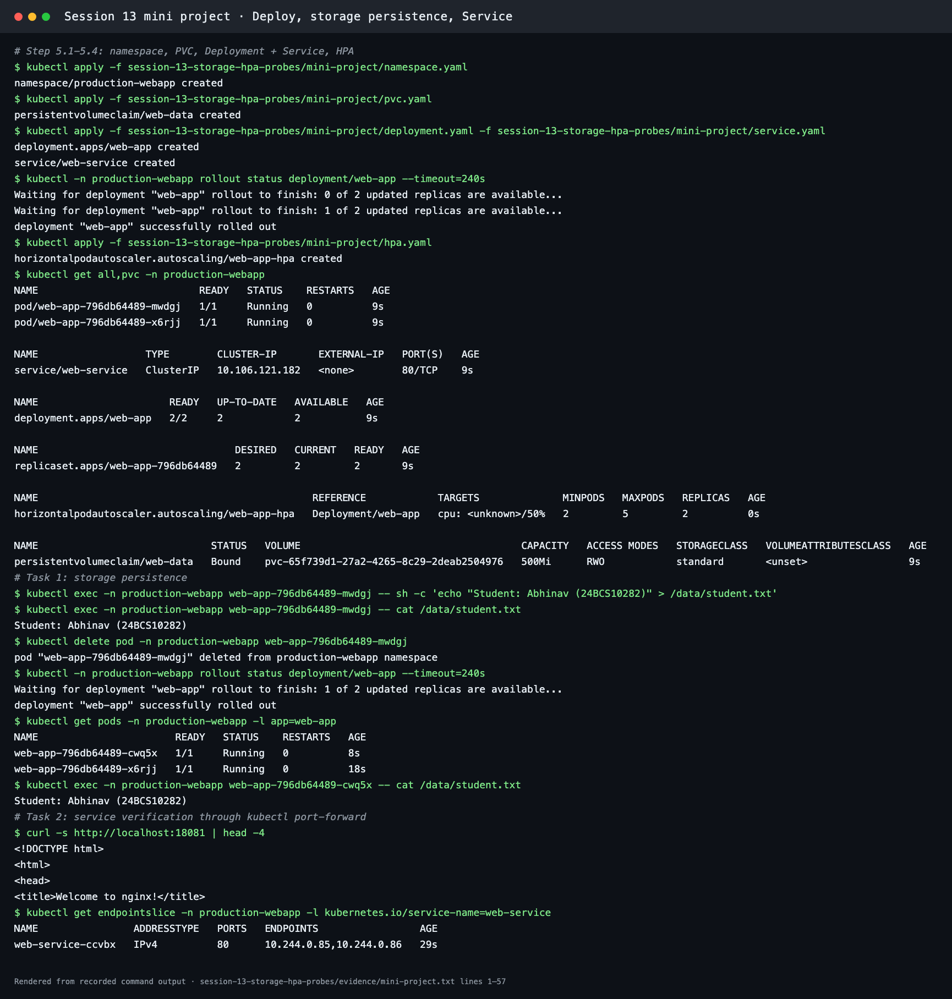
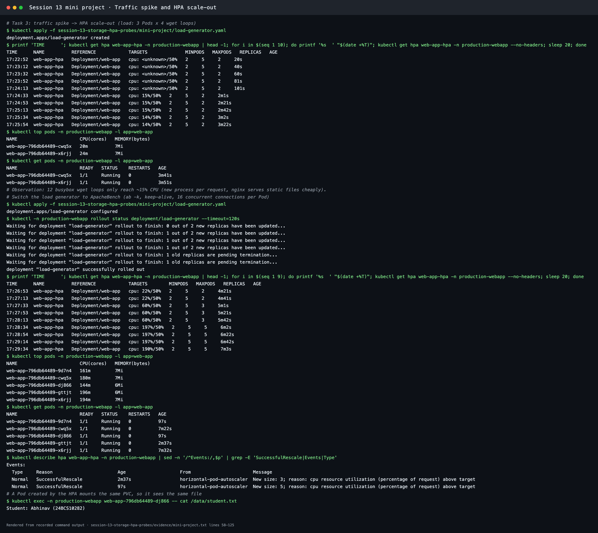
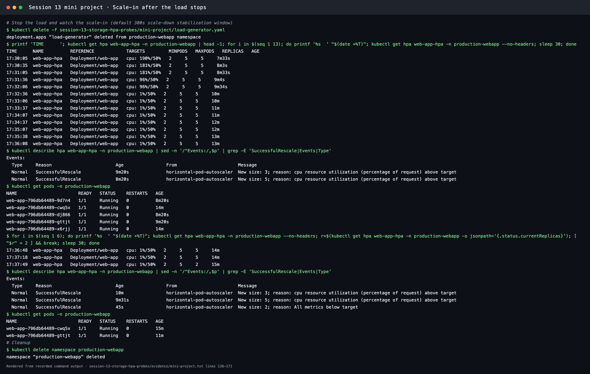

# Mini Project: Production-Ready Kubernetes Web App

**Session 13 · Task 3** · Author: Abhinav (24BCS10282)

This mini project follows the instructor's Session 13 brief: an nginx web app in its own namespace with

1. **State persistence:** a PVC mounted at `/data` that outlives Pod deletion
2. **Elastic scaling:** an HPA on CPU, between 2 and 5 replicas
3. **Health checks:** startup, readiness and liveness probes

It ran on Minikube (Kubernetes v1.37.0, metrics-server enabled). The full transcript is in [../evidence/mini-project.txt](../evidence/mini-project.txt).

## Architecture

```text
                       [ Service: web-service (ClusterIP :80) ]
                                      │
            ┌─────────────────────────┼─────────────────────────┐
            ▼                         ▼                         ▼
     [ Pod: web-app ]          [ Pod: web-app ]          [ Pod: web-app … up to 5 ]
     startup / readiness /     startup / readiness /     startup / readiness /
     liveness probes           liveness probes           liveness probes
     cpu req 100m, lim 200m    cpu req 100m, lim 200m    cpu req 100m, lim 200m
            │                         │                         │
            └──────────── /data ──────┴─────────────────────────┘
                                      │
                    [ PVC web-data 500Mi RWO → StorageClass standard ]

     [ HPA web-app-hpa: 50% CPU, min 2, max 5 ]  ◀── metrics ── [ metrics-server ]
```

## Project structure

```text
mini-project/
├── namespace.yaml       # production-webapp
├── pvc.yaml             # web-data: 500Mi ReadWriteOnce
├── deployment.yaml      # 2 replicas, Recreate strategy, probes, requests/limits, /data mount
├── service.yaml         # ClusterIP web-service :80
├── hpa.yaml             # min 2, max 5, target 50% CPU
├── load-generator.yaml  # ApacheBench traffic spike for Task 3
└── README.md
```

## Deploy

```bash
kubectl apply -f namespace.yaml
kubectl apply -f pvc.yaml
kubectl apply -f deployment.yaml -f service.yaml
kubectl -n production-webapp rollout status deployment/web-app
kubectl apply -f hpa.yaml
kubectl get all,pvc -n production-webapp
```

Result: 2 Pods `Running 1/1`, `service/web-service` ClusterIP, PVC `web-data` **Bound** to a dynamically provisioned 500Mi volume (class `standard`), and HPA `web-app-hpa` (`cpu: <unknown>/50%` for the first minute until metrics arrive).



## Verification tasks

### Task 1: Storage persistence ✅

```bash
POD_NAME=$(kubectl get pods -n production-webapp -l app=web-app -o jsonpath='{.items[0].metadata.name}')
kubectl exec -n production-webapp "$POD_NAME" -- sh -c 'echo "Student: Abhinav (24BCS10282)" > /data/student.txt'
kubectl delete pod -n production-webapp "$POD_NAME"
NEW_POD=$(kubectl get pods -n production-webapp -l app=web-app --sort-by=.metadata.creationTimestamp -o jsonpath='{.items[-1:].metadata.name}')
kubectl exec -n production-webapp "$NEW_POD" -- cat /data/student.txt
```

Pod `web-app-796db64489-mwdgj` wrote the file and was deleted. Its replacement `web-app-796db64489-cwq5x` printed **`Student: Abhinav (24BCS10282)`**. Later, a Pod created by the HPA (`…-dj866`) read the same file, so every replica shares the claim.

### Task 2: Service verification ✅

```bash
kubectl port-forward -n production-webapp svc/web-service 18081:80 &
curl http://localhost:18081            # <title>Welcome to nginx!</title>
kubectl get endpointslice -n production-webapp -l kubernetes.io/service-name=web-service
```

The Service had both Pod IPs (`10.244.0.85,10.244.0.86`) as endpoints.

### Task 3: Trigger HPA elastic scaling ✅

**First attempt.** As in the brief, busybox `wget` loops ran: 3 Pods × 4 loops. CPU stayed around **15%**, below the 50% target, so the HPA correctly did nothing. Each `wget` is a new process, and nginx serves a static page very cheaply.

**Second attempt.** [load-generator.yaml](load-generator.yaml) runs **ApacheBench** (`ab -k -c 16`, keep-alive) from the `httpd:2.4-alpine` image in 2 Pods:

| Time | Targets | Replicas | Event |
| --- | --- | --- | --- |
| 17:27:13 | `cpu: 22%/50%` | 2 | load starting |
| 17:27:33 | `cpu: 60%/50%` | **3** | `New size: 3; reason: cpu resource utilization … above target` |
| 17:28:34 | `cpu: 197%/50%` | **5** | `New size: 5` (max) |
| 17:29:34 | `cpu: 190%/50%` | 5 | `kubectl top`: each Pod 144m–196m, at its 200m limit |



**Scale-in after the load stops:**

| Time | Targets | Replicas |
| --- | --- | --- |
| 17:30:05 | `190%/50%` | 5 (load generator deleted) |
| 17:32:36 | `1%/50%` | 5 (stabilization window running) |
| 17:37:49 | `1%/50%` | **2**: `New size: 2; reason: All metrics below target` |

Scale-down waited about 5 minutes after CPU fell, because of the default **300 s scale-down stabilization window**. It stops replica counts from flapping. The Session 13 HPA lab shortens it to 60 s with `behavior.scaleDown`.



## Probe diagnostics reference

| Probe | Here | What happens on failure |
| --- | --- | --- |
| `startupProbe` | `GET /` every 2 s, up to 30 failures (60 s budget) | Container restarted. Liveness and readiness don't run until it succeeds |
| `readinessProbe` | `GET /` every 5 s, 2 failures | Pod removed from Service endpoints (no restart) |
| `livenessProbe` | `GET /` every 5 s, 3 failures | Container restarted |

The instructor's bonus challenges were run in [../03-probes](../03-probes/), with output in [../evidence/probes.txt](../evidence/probes.txt):
- **Challenge 2 (readiness gating):** with path `/does-not-exist`, the Pod was `Running 0/1`, its endpoint `ready=false`, and calls got `Connection refused`. After fixing the path → `1/1`, `ready=true`, nginx page served.
- **Challenge 3 (liveness restart loop):** with path `/crash`, the probe failed with `HTTP probe failed with statuscode: 404` and the Pod restarted 4 times in 40 s.

## Troubleshooting guide (issues met or checked)

| Issue | Cause | Fix |
| --- | --- | --- |
| HPA shows `cpu: <unknown>/50%` | No metrics yet (just created) or metrics-server unavailable | Wait about 60 s and check `kubectl get deployment metrics-server -n kube-system`. Pods must have **CPU requests** |
| HPA never scales | Load too light to pass the target (the wget attempt, ~15%) | Increase load (ab/keep-alive) or lower the target (bonus challenge 1: 30%) |
| PVC stuck `Pending` | No default StorageClass, or the provisioner can't provision | `kubectl describe pvc` events. See the RBAC fix in [Task 1](../01-kubernetes-volumes/README.md#troubleshooting-waitforfirstconsumer-never-bound-on-minikube) |
| Pods `CrashLoopBackOff` | Liveness probe too strict or wrong path | Check `describe pod` events. Add a startup probe for slow apps |
| RWO volume with several replicas | Fine on single-node Minikube. On multi-node clusters, Pods on other nodes cannot attach it | Use `ReadWriteMany` storage or a StatefulSet with per-Pod volumes |

## Cleanup

```bash
kubectl delete namespace production-webapp
```
