# Session 14: Kubernetes Troubleshooting

**Course:** SST DevOps & Cloud · **Author:** Abhinav (24BCS10282)

Every command was run on Minikube v1.39.0 / Kubernetes v1.37.0. Each scenario has its own transcript in [evidence/](evidence/), and the screenshots are renders of those transcripts made with [scripts/render-evidence-png.py](../scripts/render-evidence-png.py).

| Task | Where |
| --- | --- |
| 1. Troubleshooting commands (`get`, `describe`, `logs`, `exec`, `events`, `explain`, `top`, `get -o wide`) | [Task 1](#task-1-kubernetes-troubleshooting-commands), Pods in [01-kubectl-commands/](01-kubectl-commands/) |
| 2. Common issues, each with problem → investigation → root cause → fix → verification | [Task 2](#task-2-troubleshoot-common-issues), manifests in [02-common-issues/](02-common-issues/) |
| 3. Troubleshooting mini project | [mini-project/README.md](mini-project/README.md) |

## The method used every time

```text
1. Identify      kubectl get pods            what state? restarts? ready?
2. Investigate   kubectl describe / logs / events / exec
3. Root cause    one sentence: what is actually wrong
4. Fix           smallest change that addresses the cause
5. Verify        same checks again; the symptom is gone
6. Document      problem, evidence, cause, fix (this README)
```

---

## Task 1: Kubernetes troubleshooting commands

Demo Pods: [01-kubectl-commands/demo-pods.yaml](01-kubectl-commands/demo-pods.yaml) (`get-demo`, `logs-demo`, and a two-container `exec-demo`). Transcript: [evidence/01-kubectl-commands.txt](evidence/01-kubectl-commands.txt).

| Command | Used for | Example from the run |
| --- | --- | --- |
| `kubectl get` | Status at a glance | `kubectl get pods`, `-l app=get-demo --show-labels`, `-o custom-columns=…`, `-o yaml` |
| `kubectl get -o wide` | Adds Pod IP and node | `get-demo … 10.244.0.95 minikube`, and node OS, kernel and runtime with `get nodes -o wide` |
| `kubectl describe` | Spec, status, conditions and the **Events** that explain failures | `describe pod get-demo` → `Scheduled`, `Pulled`, `Created`, `Started` |
| `kubectl logs` | What the app printed | `--tail=6`, `--since=15s`, `-c sidecar`, `--previous` for the last crashed container |
| `kubectl exec` | Run commands inside a container | `printenv APP_ENV` → `training`; `nginx -v` → `nginx/1.27.5`. The sidecar reached nginx on `localhost` because containers in a Pod share a network |
| `kubectl events` | Cluster events, filterable | `events --for pod/get-demo`, `get events --sort-by=.lastTimestamp`, `events --types=Warning -A` |
| `kubectl explain` | Field documentation from the API | `explain pod.spec.containers.livenessProbe`, `explain deployment.spec.strategy.rollingUpdate.maxUnavailable` |
| `kubectl top` | Live CPU and memory (metrics-server) | `top nodes` → 309m / 1156Mi, `top pod exec-demo --containers`, `top pods -A --sort-by=memory` |

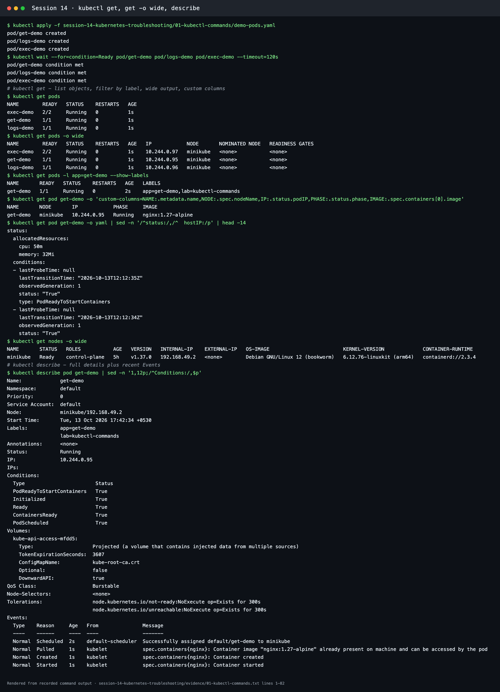
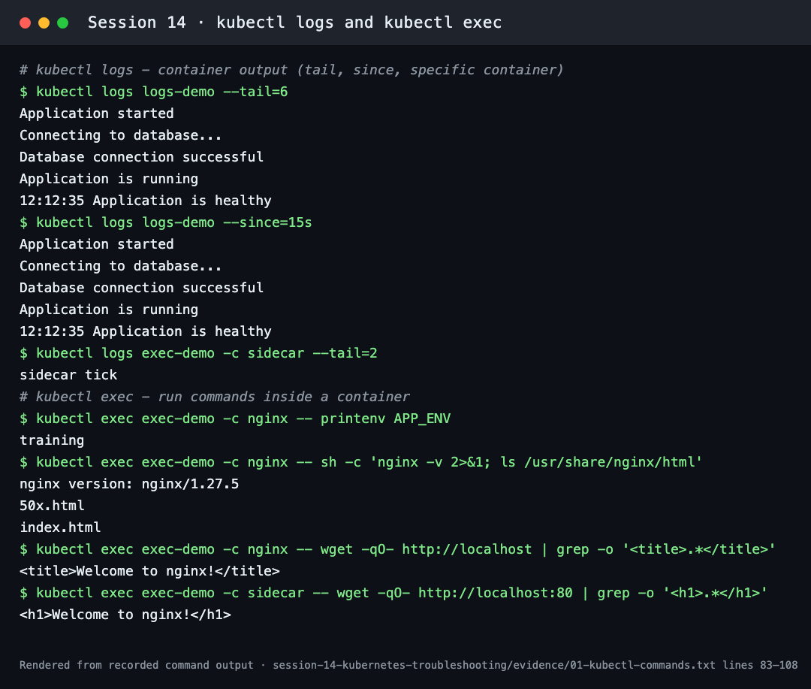
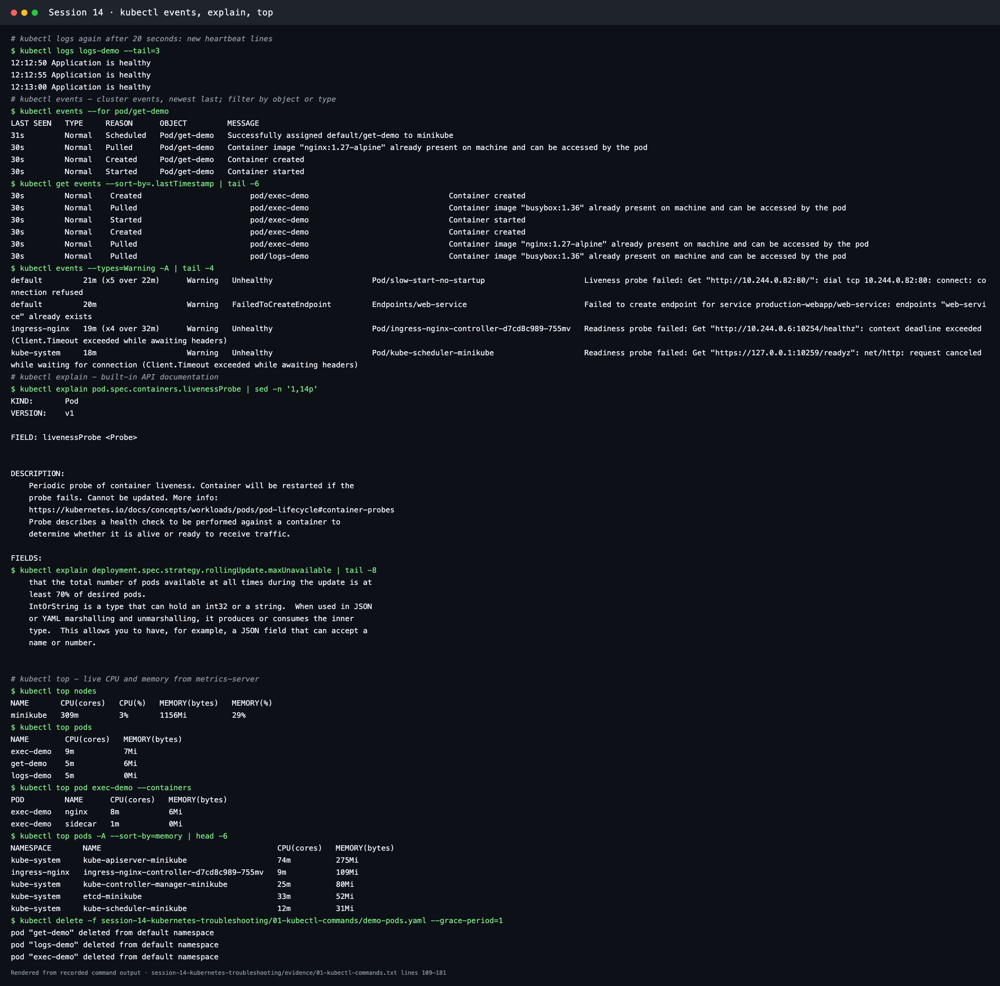

`kubectl events --types=Warning -A` also showed real warnings from earlier load tests, such as ingress-controller and scheduler readiness timeouts while the node was saturated. Events are often the quickest way to see that a cluster was under stress.

---

## Task 2: Troubleshoot common issues

| # | Issue | Symptom seen | Root cause | Fix | Evidence |
| --- | --- | --- | --- | --- | --- |
| 1 | **CrashLoopBackOff** | Restarts climbing, `Back-off restarting failed container` | App exits 1: `DATABASE_URL` missing | Provide the env var | [log](evidence/02-01-crashloopbackoff.txt) |
| 2 | **ErrImagePull / ImagePullBackOff** | `ErrImagePull` ↔ `ImagePullBackOff` | Tag `nginx:1.27-alpne` does not exist | Correct tag | [log](evidence/02-02-imagepull.txt) |
| 3 | **Pending** | `Pending`, no node | 500 CPU / 1000Gi requests; nodeSelector for a missing node | Realistic requests; real node label | [log](evidence/02-03-pending.txt) |
| 4 | **ContainerCreating** | Stuck `ContainerCreating` | Volume ConfigMap `site-config` missing | Create the ConfigMap | [log](evidence/02-04-containercreating.txt) |
| 5 | **Service connectivity** | `Connection refused` via the Service | Selector typo **and** wrong `targetPort` | Fix selector, then port | [log](evidence/02-05-service-connectivity.txt) |
| 6 | **DNS** | `curl exit 6` (cannot resolve) | Client uses a non-existent hostname | Use the real Service FQDN | [log](evidence/02-06-dns.txt) |
| 7 | **Pod networking** | Running and has an endpoint, but connections refused | App bound to `127.0.0.1` only | Bind `0.0.0.0` | [log](evidence/02-07-pod-networking.txt) |
| 8 | **Configuration** | `CreateContainerConfigError` | Referenced Secret does not exist | Create the Secret | [log](evidence/02-08-configuration.txt) |
| 9 | **OOMKilled** (bonus, instructor scenario 5) | `OOMKilled`, exit 137 | 200 MB allocation vs 20Mi limit | Right-size requests/limits | [log](evidence/02-09-oomkilled.txt) |

The instructor's "triage gauntlet" scenarios (crash loop, image pull, pending, DNS, OOMKilled) are rows 1, 2, 3, 6 and 9.

### 1. CrashLoopBackOff

- **Problem:** [broken.yaml](02-common-issues/01-crashloopbackoff/broken.yaml). The Pod restarted 3 times in 46 s.
- **Investigation:**
  - `kubectl logs crashloop-app` → `[FATAL ERROR]: DATABASE_URL environment variable is MISSING!`
  - `describe` → `Last State: Terminated, Reason: Error, Exit Code: 1`
  - Event `Back-off restarting failed container python-app`
- **Root cause:** a required setting was missing, so the process exited immediately, and the kubelet kept restarting it with exponential back-off.
- **Fix:** [fixed.yaml](02-common-issues/01-crashloopbackoff/fixed.yaml) adds `DATABASE_URL`. A Pod's env cannot be edited in place, so the Pod was recreated.
- **Verified:** `1/1 Running`, 0 restarts, log `Application started successfully, using postgres://ledger-db…`.
- **Note:** on this Kubernetes v1.37 cluster, the STATUS column showed `Error` with a rising restart count during back-off, and the container `state` stayed `terminated`. The back-off itself appears in the `BackOff` event. Older clusters typically print `CrashLoopBackOff` in STATUS for the same situation.

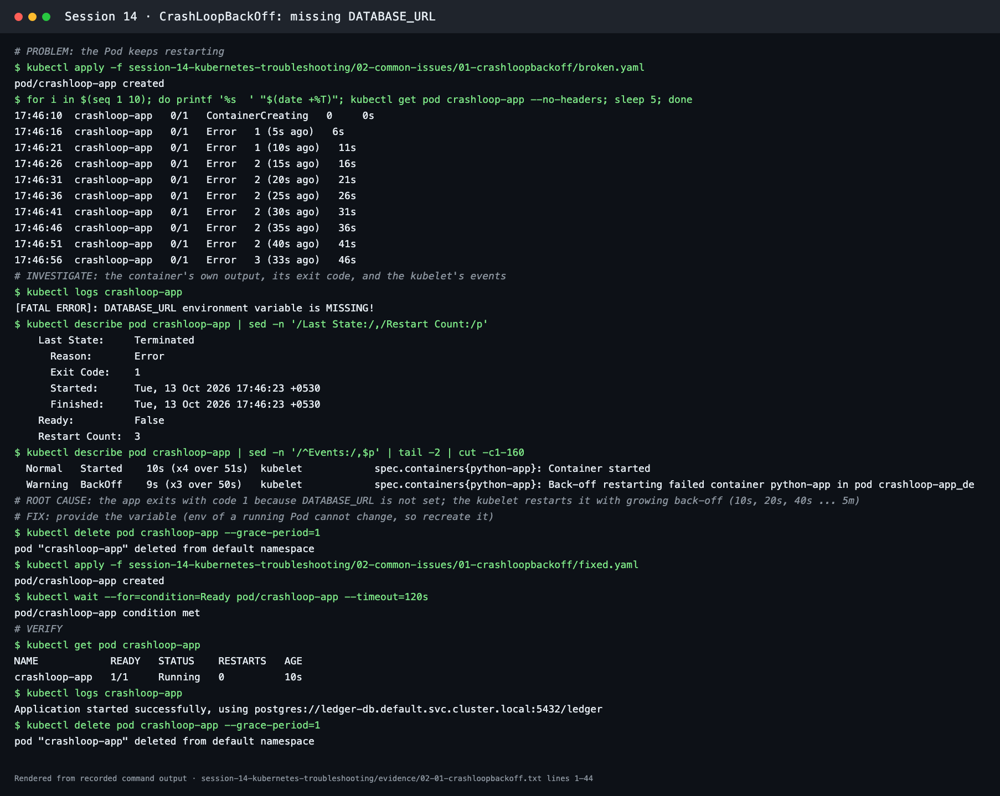

### 2. ErrImagePull and ImagePullBackOff

- **Problem:** [broken.yaml](02-common-issues/02-errimagepull-imagepullbackoff/broken.yaml). Polling every 4 s showed `ContainerCreating → ErrImagePull → ImagePullBackOff → ErrImagePull`.
- **Investigation:** `describe` → `Image: nginx:1.27-alpne` and `Failed to pull image "nginx:1.27-alpne": rpc error: code = NotFound`.
- **Root cause:** a typo in the tag. **ErrImagePull** means a pull attempt just failed. **ImagePullBackOff** means the kubelet is waiting, with growing delays, before trying again. Other common causes are a wrong registry or repository, a private image without `imagePullSecrets`, rate limits, and network or DNS problems. The event message tells them apart.
- **Fix and verification:** tag `nginx:1.27-alpine` → `Running`, `READY true`.

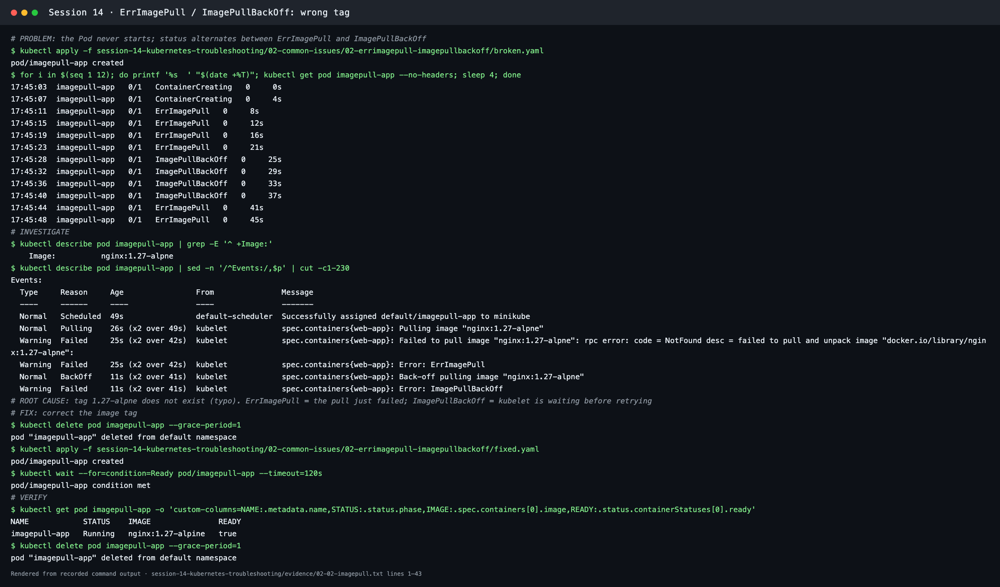

### 3. Pending

- **Problem:** [broken-resources.yaml](02-common-issues/03-pending/broken-resources.yaml) and [broken-nodeselector.yaml](02-common-issues/03-pending/broken-nodeselector.yaml) stayed `Pending` with no IP or node.
- **Investigation:** scheduler events.
  - `0/1 nodes are available: 1 Insufficient cpu, 1 Insufficient memory` (node allocatable: 8 CPU)
  - `0/1 nodes are available: 1 node(s) didn't match Pod's node affinity/selector`; the node label is `kubernetes.io/hostname=minikube`
- **Root cause:** requests that no node can satisfy, and a selector that matches no node.
- **Fix:** [fixed.yaml](02-common-issues/03-pending/fixed.yaml) (100m / 64Mi) and [fixed-nodeselector.yaml](02-common-issues/03-pending/fixed-nodeselector.yaml) (`kubernetes.io/hostname: minikube`) → both `Running`.
- **Other Pending causes:** unbound PVCs, taints without tolerations, or a quota/limit range.

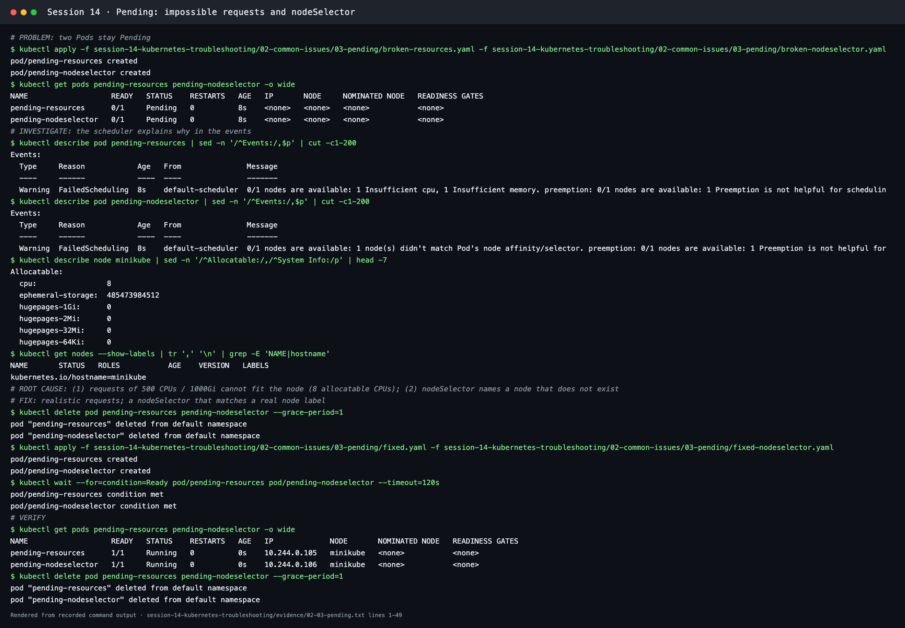

### 4. ContainerCreating

- **Problem:** [broken.yaml](02-common-issues/04-containercreating/broken.yaml) was still in `ContainerCreating` after 20 s.
- **Investigation:** `Warning FailedMount … MountVolume.SetUp failed for volume "site-config" : configmap "site-config" not found`, and `kubectl get configmap site-config` → `NotFound`.
- **Root cause:** a volume source that doesn't exist blocks container creation.
- **Fix:** `kubectl apply -f site-config.yaml`. The kubelet retried the mount, and the **same Pod** started (no recreation).
- **Verified:** `wget http://localhost` → `site-config loaded`.
- **Also learned:** the first config had only `listen 80;`. Inside busybox, `localhost` resolves to `::1` (IPv6), so the check got `Connection refused` until `listen [::]:80;` was added.

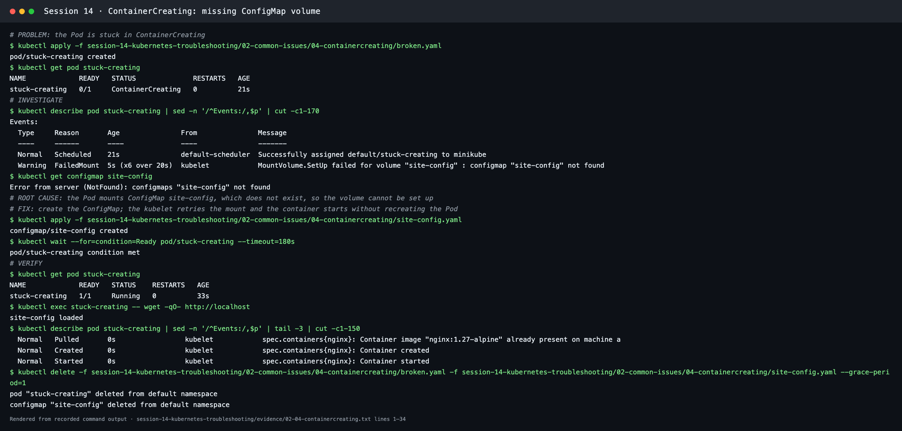

### 5. Service connectivity

- **Problem:** two healthy nginx Pods, but `wget http://web-service` → `Connection refused`.
- **Investigation 1:** the EndpointSlice had `<unset>` endpoints. `describe service` showed `Selector: app=web-ahsgdf`, while the Pods have `app=web`.
- **Fix 1:** patching the selector filled the endpoints, but they were on **port 8080**, and the call still failed.
- **Investigation 2:** `netstat -tln` in a Pod showed nginx on `:80`.
- **Fix 2:** [fixed-service.yaml](02-common-issues/05-service-connectivity/fixed-service.yaml) with `targetPort: 80`.
- **Verified:** `<title>Welcome to nginx!</title>`.
- **Lesson:** fix one cause, then re-test. Problems often stack.

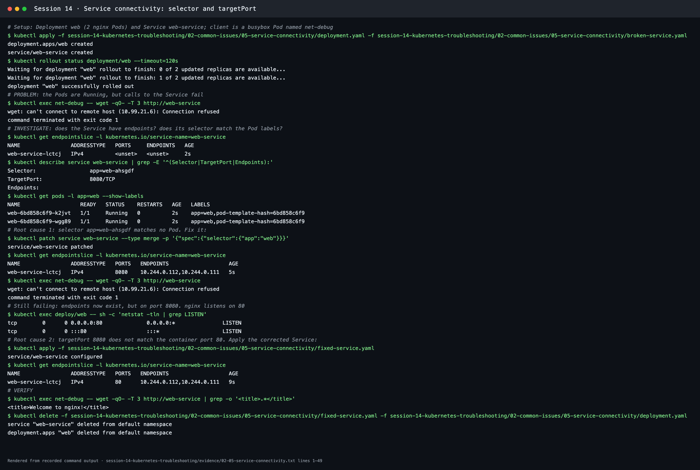

### 6. DNS

- **Problem:** the `dns-client` log showed `request failed (curl exit 6)` every 10 s.
- **Investigation:**
  - `nslookup inventory-api-wrong-name.production.svc.cluster.local` → `NXDOMAIN`
  - `kubectl get svc -n production` → only `inventory-api`
  - `nslookup inventory-api.production.svc.cluster.local` → `10.99.209.147`
  - CoreDNS `Running`
- **Root cause:** DNS works. The application was configured with the wrong Service name.
- **Fix:** [fixed-client.yaml](02-common-issues/06-dns/fixed-client.yaml) → log `inventory-api: 42 items in stock`.
- **More:** CoreDNS outages and selector problems behind a working name are covered in [Session 11 › CoreDNS](../session-11-kubernetes-services/coredns/README.md).

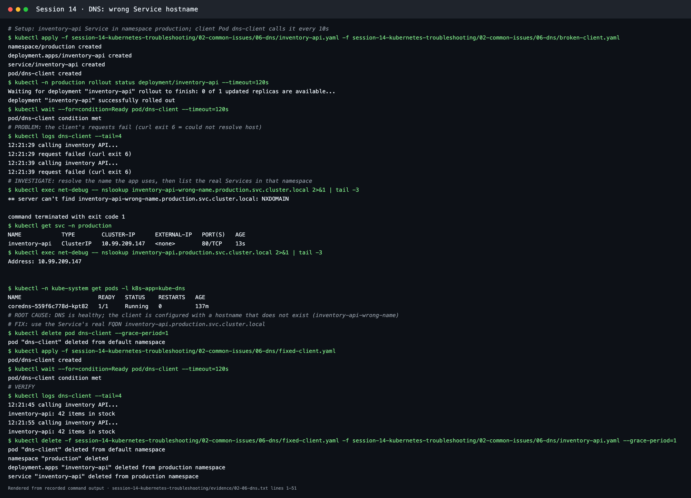

### 7. Pod networking

- **Problem:** `orders-api` was `Running 1/1` and the Service had endpoint `10.244.0.120:8080`, but both `http://orders-api` and the Pod IP directly gave `Connection refused`.
- **Investigation:** inside the Pod, `wget http://127.0.0.1:8080` → `orders-api OK`; `netstat -tln` → `127.0.0.1:8080 LISTEN`; log `listening on 127.0.0.1:8080`.
- **Root cause:** the process listened on loopback only, so traffic arriving on the Pod's network interface had nothing to connect to.
- **Fix:** `kubectl set env deployment/orders-api BIND_ADDRESS=0.0.0.0` → `netstat` shows `0.0.0.0:8080` → `wget http://orders-api` → `orders-api OK`.
- **Lesson:** without a readiness probe, `rollout status` reports success before the app is listening (here about 4 s). A probe makes the rollout wait (see [Session 13 probes](../session-13-storage-hpa-probes/README.md#probes)).

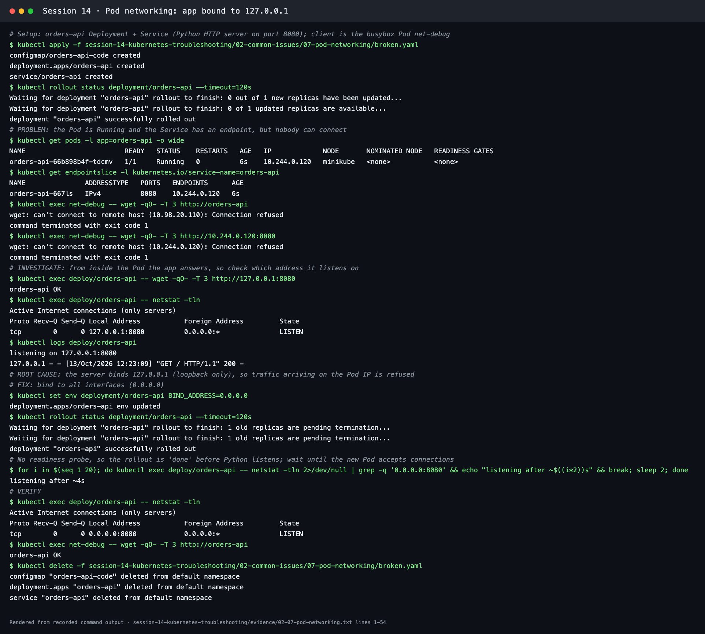

### 8. Configuration

- **Problem:** `payments` Pod showed `CreateContainerConfigError`.
- **Investigation:** `Error: secret "payment-gateway-credentials" not found`.
- **Root cause:** the Deployment references a Secret that was never created in this namespace.
- **Fix:** `kubectl create secret generic payment-gateway-credentials --from-literal=api-key="$(openssl rand -hex 16)"`. The random value is generated inside the command and never printed or committed. The kubelet retried, and the Pod started without a redeploy.
- **Verified:** log `payments started with key length 32`.
- **Same family:** a missing ConfigMap **key** (Session 12 troubleshooting), a wrong env var name, or a bad command/args.

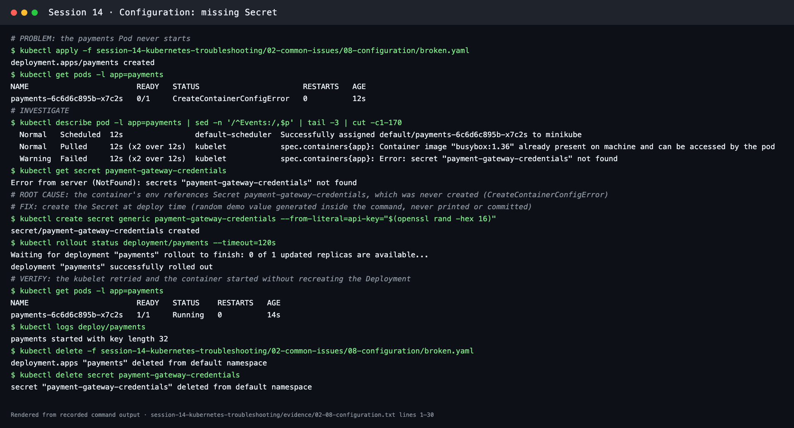

### 9. OOMKilled

- **Problem:** the Pod went `OOMKilled` 3 times in 36 s.
- **Investigation:** `Last State: Terminated, Reason: OOMKilled, Exit Code: 137`, `Limits: memory: 20Mi`; the log stops after `Allocating memory...`.
- **Root cause:** the container's memory use (about 200 MB) was above its limit, so the kernel killed it (SIGKILL = 137).
- **Fix:** [fixed.yaml](02-common-issues/09-oomkilled/fixed.yaml) with request 256Mi and limit 320Mi → `Running`, log `Allocated 200 MB`.
- **In practice:** size limits from `kubectl top` or monitoring, or fix the leak.

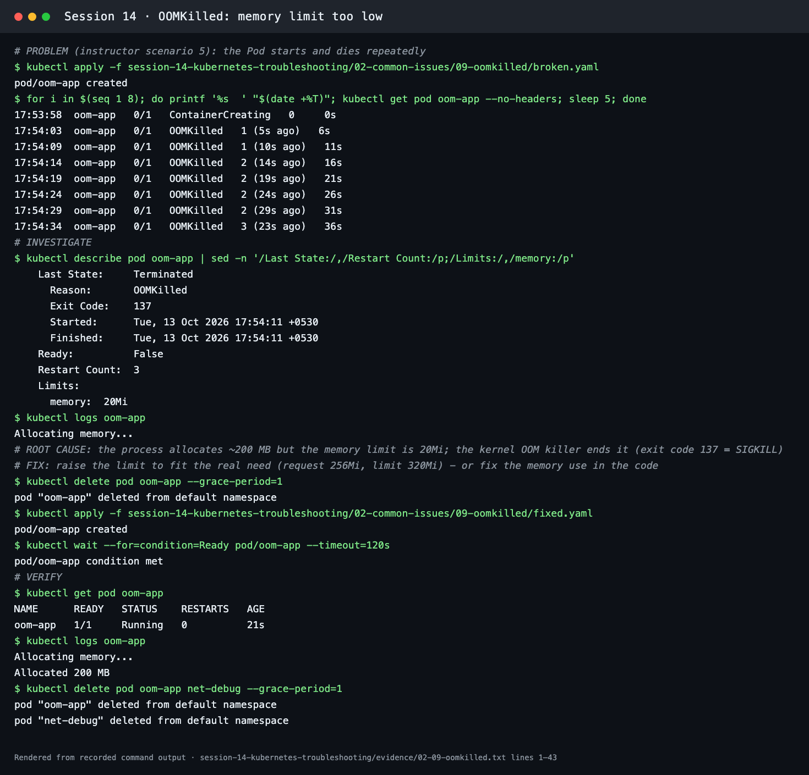

---

## Quick reference: symptom → first command

| Symptom | First look |
| --- | --- |
| `CrashLoopBackOff` / `Error` with restarts | `kubectl logs <pod> [--previous]`, then the exit code in `describe` |
| `ErrImagePull` / `ImagePullBackOff` | `describe` Events → image name, registry, auth |
| `Pending` | `describe` → `FailedScheduling` reason |
| `ContainerCreating` for a long time | `describe` → `FailedMount` / CNI / image events |
| `CreateContainerConfigError` | `describe` → missing ConfigMap or Secret (or key) |
| `OOMKilled` | `describe` → Last State, Limits; `kubectl top` |
| Service unreachable | `get endpointslice`, compare `selector` with `--show-labels`, check `targetPort` |
| Name won't resolve | `nslookup <fqdn>` from a Pod, `kubectl get svc -n <ns>`, CoreDNS Pods |
| Pod IP refuses connections | `kubectl exec … netstat -tln` (bind address and port) |
