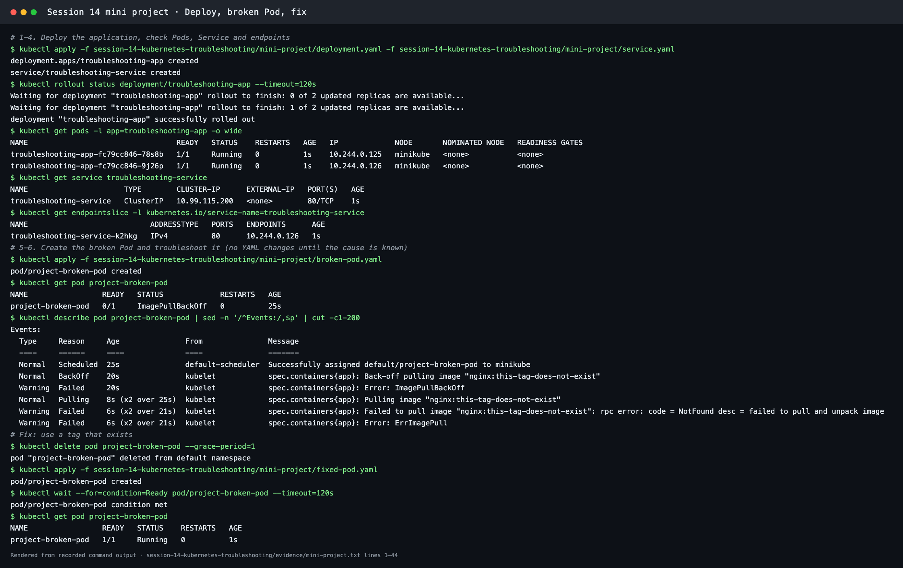
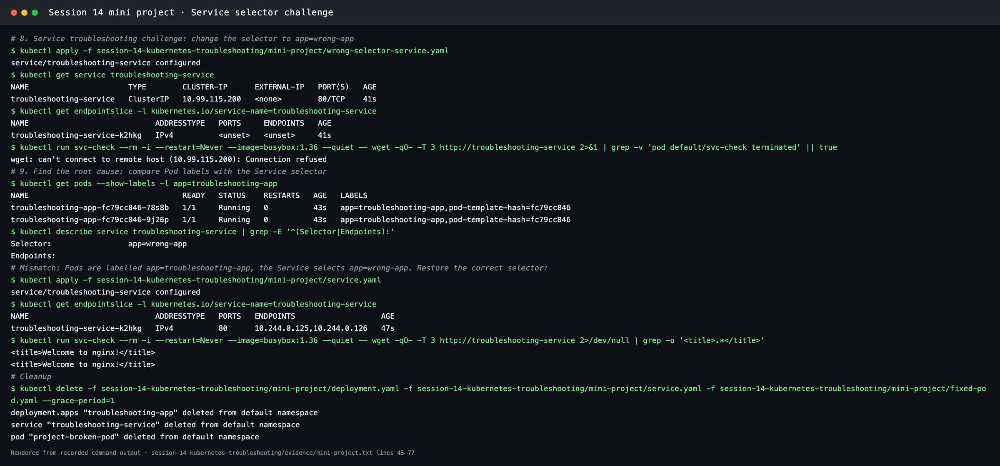

# Kubernetes Troubleshooting Challenge (Mini Project)

**Session 14 · Task 3** · Author: Abhinav (24BCS10282)

This follows the instructor's Session 14 mini-project brief. It ran on Minikube (Kubernetes v1.37.0), and the transcript is in [../evidence/mini-project.txt](../evidence/mini-project.txt).

| File | Purpose |
| --- | --- |
| [deployment.yaml](deployment.yaml) | `troubleshooting-app`: 2 nginx replicas, label `app=troubleshooting-app` |
| [service.yaml](service.yaml) | `troubleshooting-service`: ClusterIP :80 → Pods |
| [broken-pod.yaml](broken-pod.yaml) | `project-broken-pod` with image `nginx:this-tag-does-not-exist` |
| [fixed-pod.yaml](fixed-pod.yaml) | The same Pod with a real image |
| [wrong-selector-service.yaml](wrong-selector-service.yaml) | The Service with `selector: app=wrong-app` (the challenge) |

## 1–4. Deploy and check the application

```bash
kubectl apply -f deployment.yaml -f service.yaml
kubectl rollout status deployment/troubleshooting-app
kubectl get pods -l app=troubleshooting-app -o wide
kubectl get service troubleshooting-service
kubectl get endpointslice -l kubernetes.io/service-name=troubleshooting-service
```

Two Pods `Running` (`10.244.0.125`, `10.244.0.126`), a ClusterIP Service `10.99.115.200:80`, and its EndpointSlice listing the Pod IPs.

## 5–7. The broken Pod

```bash
kubectl apply -f broken-pod.yaml
kubectl get pod project-broken-pod          # 0/1 ImagePullBackOff
kubectl describe pod project-broken-pod     # Events
```

```text
Normal   Pulling  Pulling image "nginx:this-tag-does-not-exist"
Warning  Failed   Failed to pull image "nginx:this-tag-does-not-exist": rpc error: code = NotFound desc = failed to pull and unpack image
Warning  Failed   Error: ErrImagePull
Normal   BackOff  Back-off pulling image "nginx:this-tag-does-not-exist"
Warning  Failed   Error: ImagePullBackOff
```

| Question | Answer |
| --- | --- |
| 1. What is the Pod status? | `ImagePullBackOff` (0/1 ready), alternating with `ErrImagePull` |
| 2. What is the actual error? | `Failed to pull image "nginx:this-tag-does-not-exist": rpc error: code = NotFound` |
| 3. Which command found the reason? | `kubectl describe pod project-broken-pod`, in the **Events** section |
| 4. What is wrong with the image? | The tag `this-tag-does-not-exist` is not published for `nginx` on Docker Hub |
| 5. How would you fix it? | Use an existing tag. [fixed-pod.yaml](fixed-pod.yaml) uses `nginx:1.27-alpine` (the Pod was deleted and re-applied because a Pod's image change is easiest as a recreate) → `1/1 Running` |



## 8–9. Service troubleshooting challenge

```bash
kubectl apply -f wrong-selector-service.yaml
kubectl get endpointslice -l kubernetes.io/service-name=troubleshooting-service    # <unset>
kubectl get pods --show-labels -l app=troubleshooting-app
kubectl describe service troubleshooting-service
kubectl apply -f service.yaml
```

| Check | Broken | Fixed |
| --- | --- | --- |
| Endpoints | `<unset>` / empty | `10.244.0.125,10.244.0.126` |
| `describe service` selector | `app=wrong-app` | `app=troubleshooting-app` |
| Pod labels | `app=troubleshooting-app` | (unchanged) |
| `wget http://troubleshooting-service` from a test Pod | `Connection refused` | `<title>Welcome to nginx!</title>` |

**Root cause:** the Service selector did not match the Pod labels, so the endpoints controller selected no Pods and traffic to the ClusterIP was refused.



## 10. Final troubleshooting checklist

```bash
kubectl get pods -o wide                       # status, restarts, node, IP
kubectl describe pod <pod>                     # events: scheduling, pulling, mounting, probes
kubectl logs <pod> [--previous] [-c <container>]
kubectl get svc,endpointslice                  # does the Service have endpoints?
kubectl get pods --show-labels                 # do labels match the selector?
kubectl exec -it <pod> -- sh                   # test from inside (wget, nslookup, netstat)
kubectl events --types=Warning                 # anything else going wrong?
kubectl top pods                               # CPU and memory pressure
```

## 11. Troubleshooting table

| Problem | Typical cause | Command that reveals it | Fix |
| --- | --- | --- | --- |
| ImagePullBackOff / ErrImagePull | Wrong image or tag, private registry | `describe pod` | Correct the image or add `imagePullSecrets` |
| CrashLoopBackOff | App crashes on start | `logs --previous` | Fix config or code |
| Pending | No node fits (resources, selector, taints, PVC) | `describe pod` | Adjust requests or selectors, add capacity |
| Service has no endpoints | Selector ≠ Pod labels, or Pods not Ready | `get endpointslice`, `--show-labels` | Fix selector or readiness |
| DNS name fails | Wrong name or namespace, CoreDNS down | `nslookup` from a Pod | Use the correct FQDN, fix CoreDNS |
| OOMKilled | Memory limit below usage | `describe pod` (Exit 137) | Raise the limit or fix the leak |
| CreateContainerConfigError | Missing ConfigMap or Secret | `describe pod` | Create the object or correct the key |

## 12. README questions

1. **What does `kubectl get` tell us?** It shows a one-line summary per object: Pod readiness (`1/1`), status (`Running`, `Pending`, `ImagePullBackOff`…), restart count and age. With `-o wide` it adds the Pod IP and node. It shows *what* state things are in, not *why*.
2. **Difference between `get` and `describe`?** `get` lists objects briefly. `describe` gives the full spec and status of one object plus its **Events**, which usually contain the reason (scheduling failure, pull error, mount error, probe failure).
3. **Why use `kubectl logs`?** To read what the application printed (stdout/stderr): stack traces, "missing config", connection errors. `--previous` shows the last crashed instance, and `-c` picks a container.
4. **When use `kubectl exec`?** To test from inside a running container: check files and env vars, call `localhost` or other Services, run `nslookup`, or see which address and port a process listens on (`netstat -tln`).
5. **What does `CrashLoopBackOff` mean?** The container keeps starting and exiting, so the kubelet restarts it with exponentially growing delays (10 s, 20 s, 40 s … up to 5 min). The cause is inside the app or its configuration. Check the logs and the exit code.
6. **What does `ImagePullBackOff` mean?** Pulling the image failed (`ErrImagePull`), and the kubelet is backing off before retrying: a wrong name or tag, a missing registry credential, a rate limit, or no network.
7. **Why can a Pod remain `Pending`?** The scheduler can't place it: insufficient CPU or memory, `nodeSelector`/affinity matching no node, taints without tolerations, or an unbound PVC. `describe` shows `FailedScheduling` with the reason.
8. **Why can a Service have no endpoints?** Its selector matches no Pods (wrong labels or namespace), or the matching Pods are not Ready (failing readiness probe).
9. **Relationship between a Service selector and Pod labels?** The selector is a label query. Every **Ready** Pod whose labels contain all the selector's key/value pairs becomes an endpoint, and if no labels match there are no endpoints.
10. **What is Kubernetes DNS?** CoreDNS, running in `kube-system` behind the `kube-dns` Service (`10.96.0.10`). It gives every Service a name such as `<svc>.<namespace>.svc.cluster.local`, so Pods connect by name instead of changing IPs.

## 13. Final architecture

```text
            kubectl ──► API server ──► Deployment troubleshooting-app (2 replicas)
                                              │
                    ┌─────────────────────────┴──────────────┐
                    ▼                                        ▼
          Pod 10.244.0.125                          Pod 10.244.0.126
      label app=troubleshooting-app             label app=troubleshooting-app
                    ▲                                        ▲
                    └──────── Service troubleshooting-service ┘
                               selector app=troubleshooting-app
                               ClusterIP 10.99.115.200:80

          project-broken-pod: nginx:this-tag-does-not-exist → ImagePullBackOff → fixed to nginx:1.27-alpine
```

## Cleanup

```bash
kubectl delete -f deployment.yaml -f service.yaml -f fixed-pod.yaml
```
