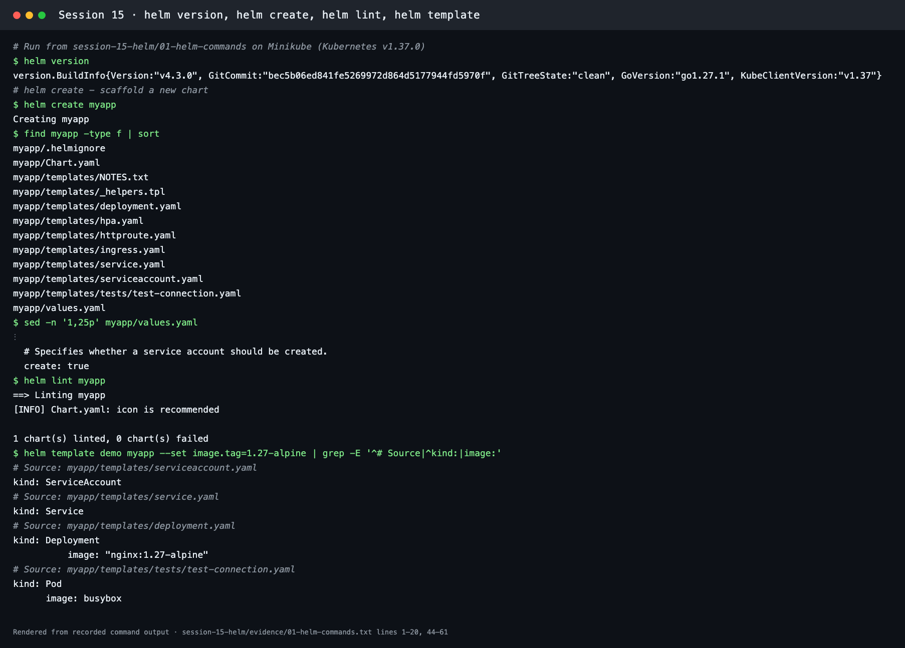
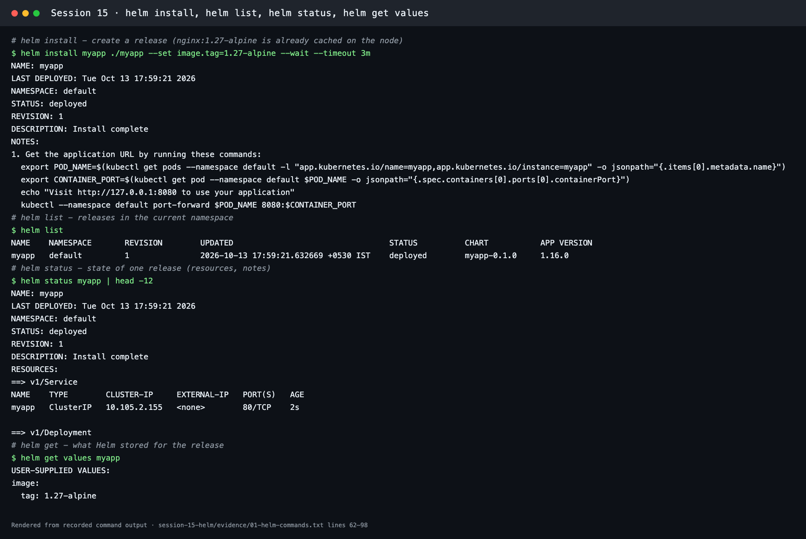
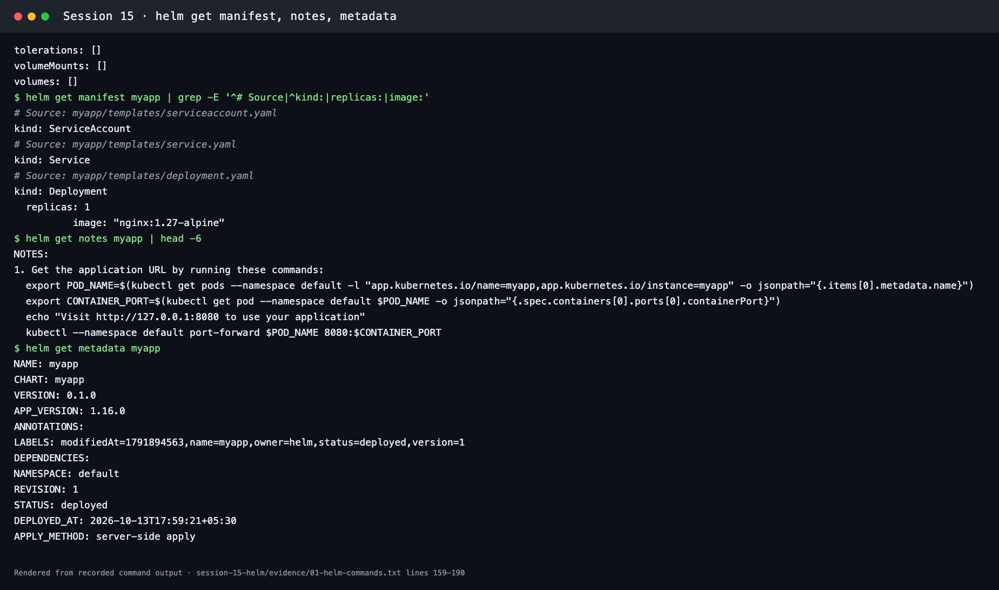
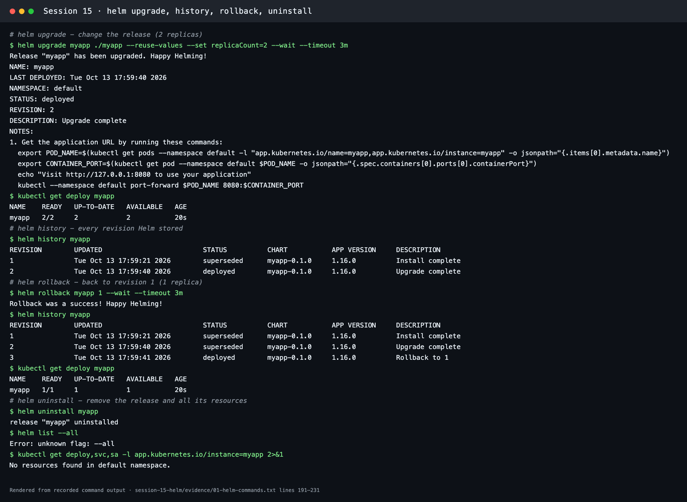
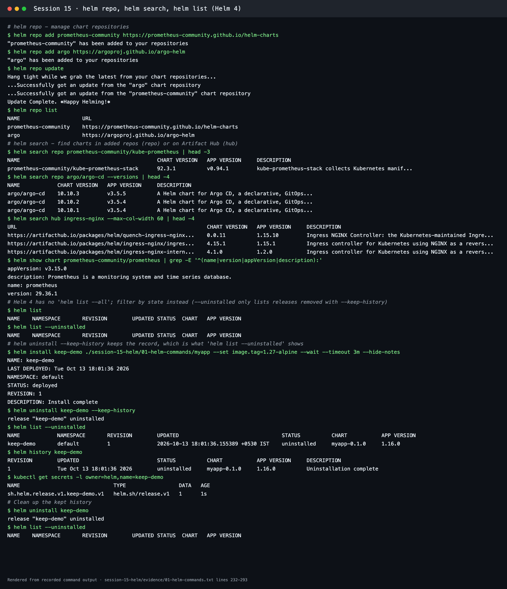
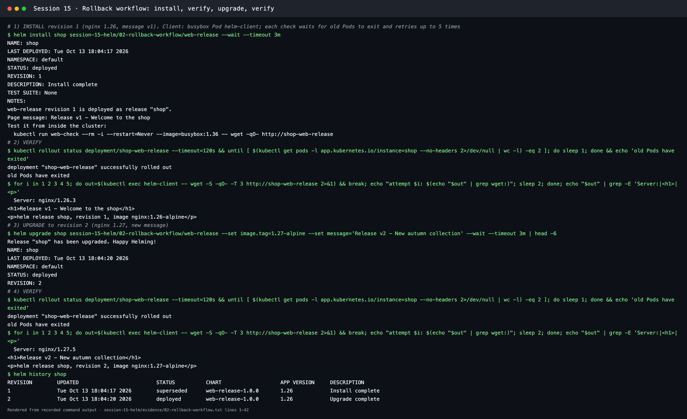
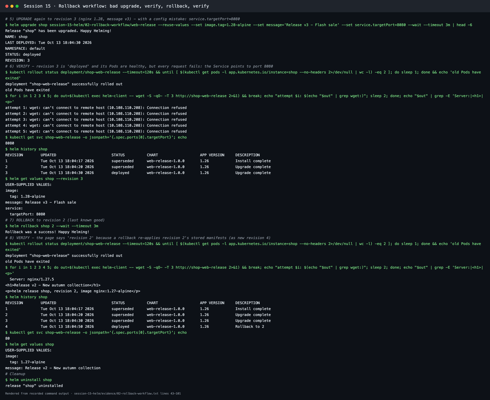

# Session 15: Helm

**Course:** SST DevOps & Cloud · **Author:** Abhinav (24BCS10282)

Helm v4.3.0 on Minikube v1.39.0 / Kubernetes v1.37.0. Transcripts are in [evidence/](evidence/), and the screenshots are renders of them made with [scripts/render-evidence-png.py](../scripts/render-evidence-png.py).

| Task | Where |
| --- | --- |
| 1. All important Helm commands, run and explained | [Task 1](#task-1-helm-commands); chart from `helm create` in [01-helm-commands/myapp](01-helm-commands/myapp/) |
| 2. Complete rollback workflow (install → upgrade → verify → upgrade → verify → rollback → verify) | [Task 2](#task-2-helm-rollback-workflow); chart [02-rollback-workflow/web-release](02-rollback-workflow/web-release/) |
| 3. Mini project (Notes app chart, dev and prod values) | [mini-project/README.md](mini-project/README.md) |

## What Helm is

Helm is the **package manager for Kubernetes**.

- A **chart** is a package: `Chart.yaml` (metadata), `values.yaml` (defaults) and `templates/` (Kubernetes manifests written as Go templates).
- `helm install` renders the templates with values and applies them as a **release**.
- Every install, upgrade or rollback creates a numbered **revision**, stored in a Secret in the release namespace (`sh.helm.release.v1.<release>.v<N>`). That stored history is what makes `helm history` and `helm rollback` possible.

```text
web-release/
├── Chart.yaml            # name, version 1.0.0, appVersion
├── values.yaml           # replicaCount, image, message, service, resources
└── templates/
    ├── _helpers.tpl      # fullname + label helpers
    ├── configmap.yaml    # index.html built from .Values.message and .Release.Revision
    ├── deployment.yaml   # nginx; checksum/site annotation rolls Pods when content changes
    ├── service.yaml      # ClusterIP, targetPort from values
    └── NOTES.txt         # printed after install/upgrade
```

---

## Task 1: Helm commands

Full transcript: [evidence/01-helm-commands.txt](evidence/01-helm-commands.txt).

| Command | What it does | Result here |
| --- | --- | --- |
| `helm create myapp` | Scaffolds a chart: Deployment, Service, ServiceAccount, Ingress, HTTPRoute, HPA, test Pod, helpers, NOTES | `Creating myapp` (12 files) |
| `helm lint myapp` | Checks chart structure and templates | `1 chart(s) linted, 0 chart(s) failed` |
| `helm template demo myapp` | Renders manifests locally without installing | ServiceAccount, Service, Deployment (`nginx:1.27-alpine`), test Pod |
| `helm install myapp ./myapp --set image.tag=1.27-alpine --wait` | Installs a release | `STATUS: deployed`, `REVISION: 1` |
| `helm list` | Releases in the namespace | `myapp … deployed myapp-0.1.0 1.16.0` |
| `helm status myapp` | Release state, resources, notes | Service, Deployment, Pods listed |
| `helm get values / manifest / notes / metadata` | What Helm stored for a revision | User values `image.tag: 1.27-alpine`; manifest with `replicas: 1`; metadata `APPLY_METHOD: server-side apply` |
| `helm upgrade myapp ./myapp --reuse-values --set replicaCount=2` | New revision with changed values | `REVISION: 2`, Deployment `2/2` |
| `helm history myapp` | All revisions and their status | 1 `superseded`, 2 `deployed` |
| `helm rollback myapp 1` | Re-applies revision 1 as a **new** revision | Revision 3 `Rollback to 1`, Deployment back to `1/1` |
| `helm uninstall myapp` | Deletes all release resources and its history | `release "myapp" uninstalled` |
| `helm uninstall --keep-history` + `helm list --uninstalled` | Keeps history after uninstall | `keep-demo … uninstalled`, Secret `sh.helm.release.v1.keep-demo.v1` remains |
| `helm repo add / update / list` | Manage chart repositories | `prometheus-community` and `argo` added (used again in Session 20) |
| `helm search repo` / `helm search hub` | Search added repos / Artifact Hub | `kube-prometheus-stack 92.3.1`, `argo-cd 10.10.3 (v3.5.5)`, `ingress-nginx` charts on Artifact Hub |
| `helm show chart` | Chart metadata from a repo | `prometheus 29.36.1, appVersion v3.15.0` |

**Helm 4 difference found:** `helm list --all` returned `Error: unknown flag: --all`. Helm 4 filters by state instead (`--deployed`, `--failed`, `--pending`, `--superseded`, `--uninstalled`). `--uninstalled` only shows releases removed with `--keep-history`.







---

## Task 2: Helm rollback workflow

The [web-release](02-rollback-workflow/web-release/) chart serves a page that prints the message, the Helm revision that rendered it, and the image. Each **verify** step is an HTTP request from a busybox Pod (`helm-client`), and it also shows nginx's `Server:` header. Before each check, the script waits for the rollout to finish and the old Pods to exit, and retries up to 5 times. Transcript: [evidence/02-rollback-workflow.txt](evidence/02-rollback-workflow.txt).

```bash
helm install shop web-release --wait
helm upgrade shop web-release --set image.tag=1.27-alpine --set message='Release v2 - New autumn collection' --wait
helm upgrade shop web-release --reuse-values --set image.tag=1.28-alpine \
  --set message='Release v3 - Flash sale' --set service.targetPort=8080 --wait
helm history shop
helm get values shop --revision 3
helm rollback shop 2 --wait
```

| Step | Revision | Verify result |
| --- | --- | --- |
| Install | 1 | `Server: nginx/1.26.3`, `<h1>Release v1 - Welcome to the shop</h1>` |
| Upgrade | 2 | `Server: nginx/1.27.5`, `<h1>Release v2 - New autumn collection</h1>` |
| Upgrade again (bad) | 3 | Helm says `deployed` and Pods are `2/2`, but **all 5 attempts: `Connection refused`**. `helm get values --revision 3` shows `service.targetPort: 8080` |
| Rollback to 2 | 4 (`Rollback to 2`) | `Server: nginx/1.27.5`, `<h1>Release v2 - New autumn collection</h1>`; targetPort back to `80` |




### What the workflow showed

- **A rollback is a new revision.** History reads 1 → 2 → 3 → **4 "Rollback to 2"**, and nothing is deleted, so you can roll forward again.
- **A rollback re-applies a stored manifest.** The page printed `revision 2` after the rollback because the ConfigMap was rendered when revision 2 was created.
- **`deployed` does not mean "working".** Helm only knows the resources were applied and became ready. The Service-port mistake was caught by testing the app, which is why every verify step is an HTTP request.
- **Zero-downtime tweaks were needed.** Without them, checks hit Pods that were shutting down (a timeout) or old Pods that were still answering (stale content). The chart now has a readiness probe and a `preStop: sleep 5`, and the checksum annotation restarts Pods only when the page content changes.

---

## Task 3: Mini project

[mini-project/README.md](mini-project/README.md): the Notes app chart, from lint and render through a dev install, the production upgrade (3 replicas, new image), a bad upgrade (`ImagePullBackOff`), rollback to revision 2, and uninstall.


