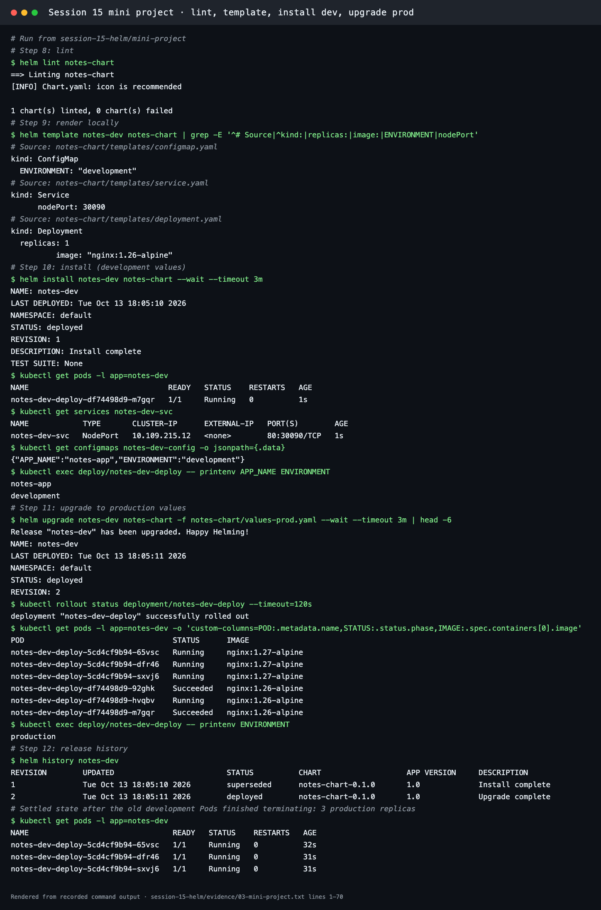
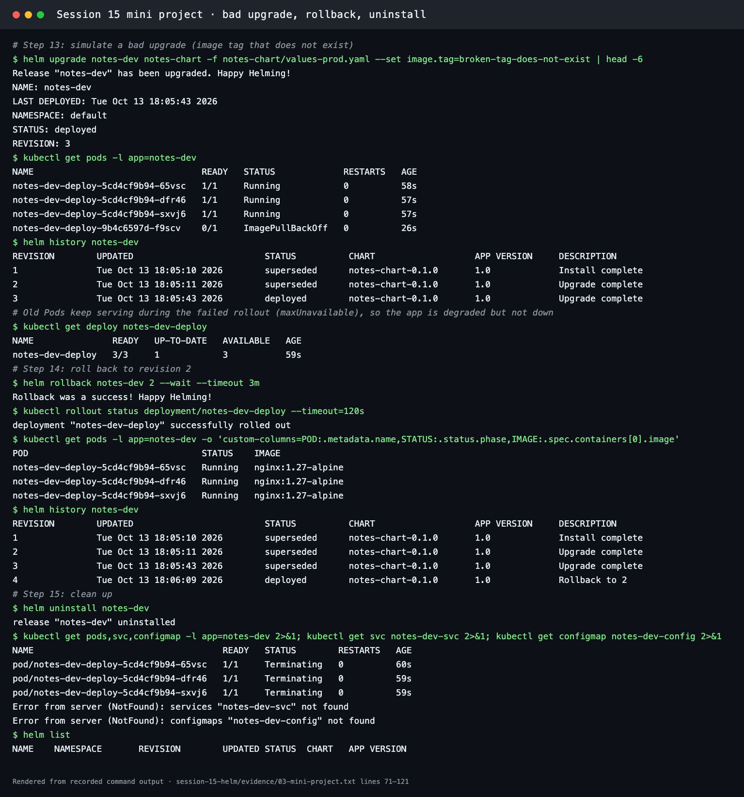

# Mini Project: Package and Deploy the Notes App with Helm

**Session 15 · Task 3** · Author: Abhinav (24BCS10282)

This follows the instructor's Session 15 brief. Helm v4.3.0 ran on Minikube (Kubernetes v1.37.0), and the transcript is in [../evidence/03-mini-project.txt](../evidence/03-mini-project.txt).

## What it builds

```text
notes-chart/
├── Chart.yaml            # notes-chart 0.1.0, appVersion 1.0
├── values.yaml           # development: 1 replica, nginx:1.26-alpine, ENVIRONMENT=development
├── values-prod.yaml      # production: 3 replicas, nginx:1.27-alpine, ENVIRONMENT=production
└── templates/
    ├── configmap.yaml    # <release>-config: APP_NAME, ENVIRONMENT
    ├── deployment.yaml   # <release>-deploy, envFrom the ConfigMap, checksum/config annotation
    └── service.yaml      # <release>-svc, NodePort 30090
```

The instructor's chart uses `nginx:1.24` / `nginx:1.25`. This version uses the `1.26-alpine` / `1.27-alpine` images already cached on the node. It also adds a `checksum/config` annotation so that changing only the ConfigMap still rolls the Pods.

## Steps and results

| Step | Command | Result |
| --- | --- | --- |
| 8. Lint | `helm lint notes-chart` | `1 chart(s) linted, 0 chart(s) failed` |
| 9. Render | `helm template notes-dev notes-chart` | ConfigMap (`ENVIRONMENT: "development"`), NodePort Service `30090`, Deployment `replicas: 1`, `nginx:1.26-alpine` |
| 10. Install (dev) | `helm install notes-dev notes-chart --wait` | `REVISION: 1`; 1 Pod `Running`; `notes-dev-svc NodePort 80:30090`; ConfigMap `{"APP_NAME":"notes-app","ENVIRONMENT":"development"}`; `printenv` inside the Pod → `notes-app`, `development` |
| 11. Upgrade (prod) | `helm upgrade notes-dev notes-chart -f notes-chart/values-prod.yaml --wait` | `REVISION: 2`; **3 Pods** on `nginx:1.27-alpine`; `printenv ENVIRONMENT` → `production` |
| 12. History | `helm history notes-dev` | 1 `superseded` Install complete, 2 `deployed` Upgrade complete |
| 13. Bad upgrade | `helm upgrade … --set image.tag=broken-tag-does-not-exist` | `REVISION: 3`. The new Pod is `ImagePullBackOff`, while the **3 old Pods stay Running** and the Deployment reads `READY 3/3, UP-TO-DATE 1`: degraded but still serving |
| 14. Rollback | `helm rollback notes-dev 2 --wait` | `Rollback was a success! Happy Helming!`; 3 Pods on `nginx:1.27-alpine`; revision 4 `Rollback to 2` |
| 15. Clean up | `helm uninstall notes-dev` | Service and ConfigMap `NotFound`, Pods `Terminating`, `helm list` empty |




## What I practised

- Building a chart from scratch: `Chart.yaml`, `values.yaml` and templates with `.Release.Name` and `.Values.*`
- **Environment-specific values files:** one chart with `-f values-prod.yaml` for production
- Checking a chart before it touches the cluster with `helm lint` and `helm template`
- Release lifecycle commands: `install`, `upgrade`, `history`, `rollback`, `uninstall`
- Why rolling updates protect users: during the bad upgrade the Deployment's `maxUnavailable` kept the old Pods serving until the rollback
- Rollback creates a **new** revision (4) instead of rewriting history

## Reference

```bash
helm lint notes-chart
helm template notes-dev notes-chart
helm install notes-dev notes-chart
helm upgrade notes-dev notes-chart -f notes-chart/values-prod.yaml
helm history notes-dev
helm upgrade notes-dev notes-chart --set image.tag=broken-tag-does-not-exist
helm rollback notes-dev 2
helm uninstall notes-dev
```
