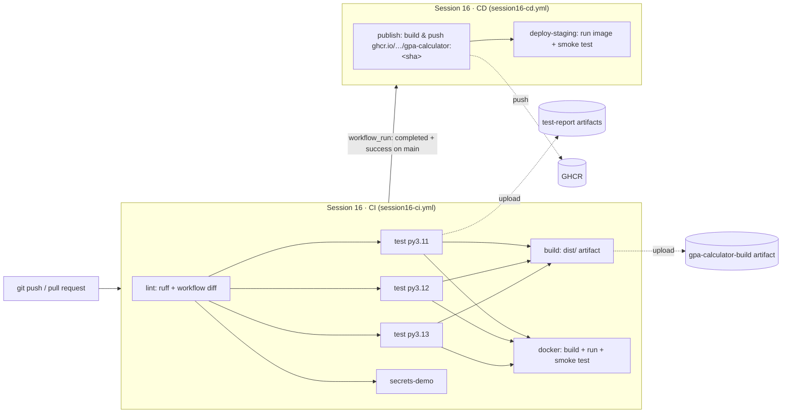
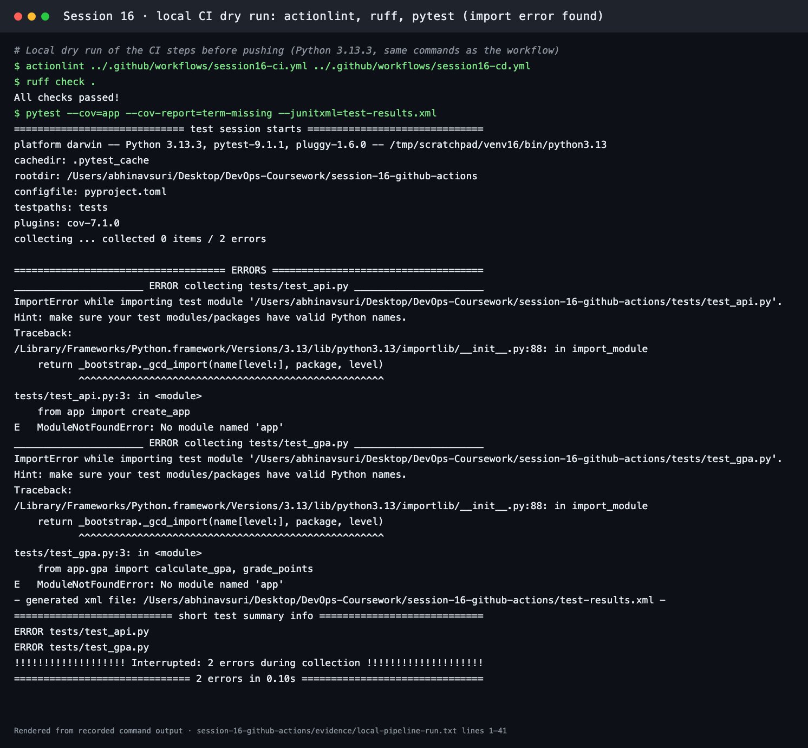
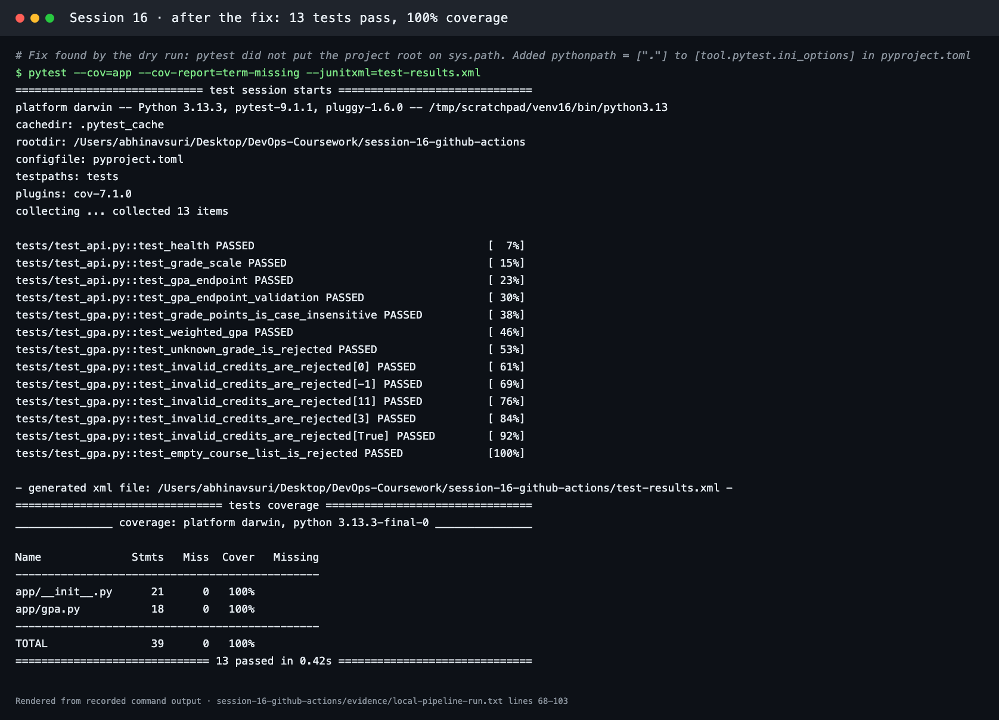
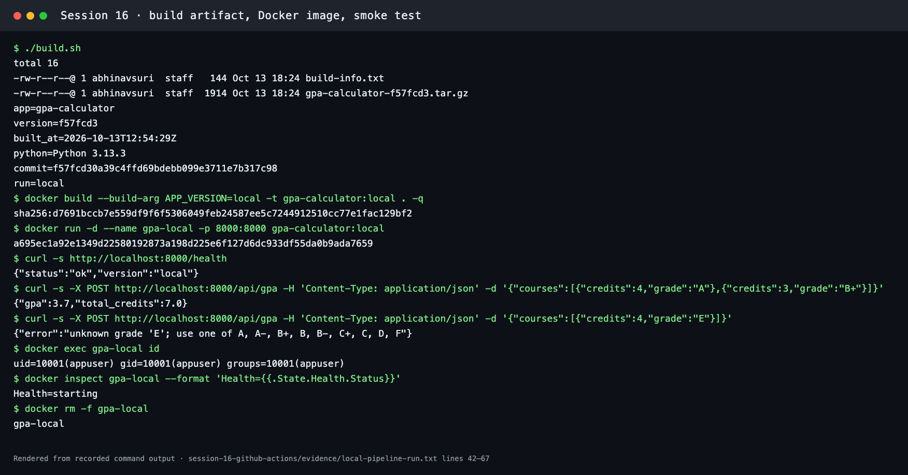
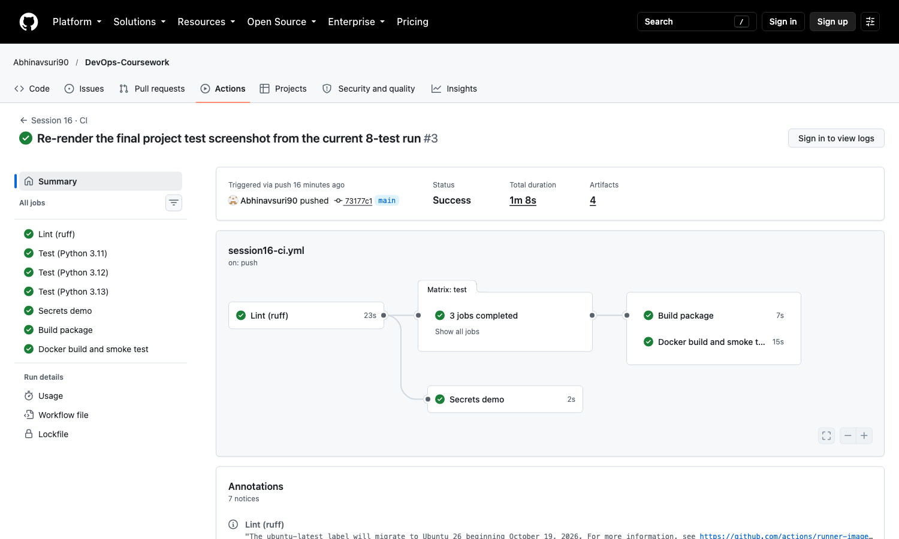
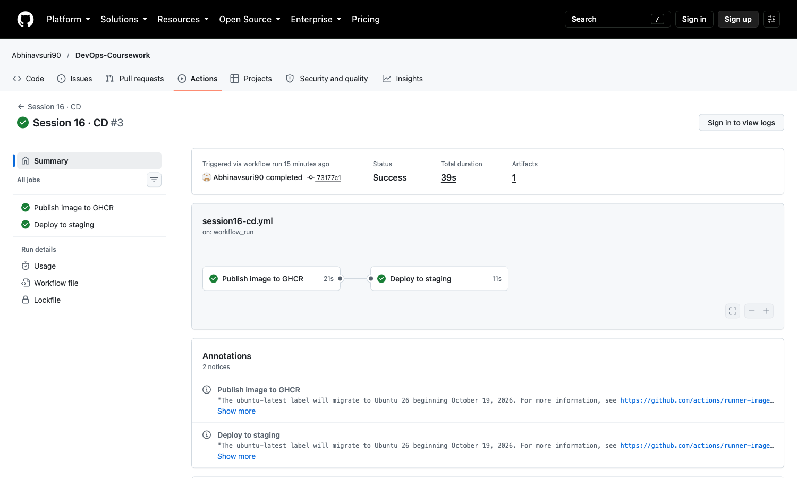

# Session 16: CI/CD & GitHub Actions

**Course:** SST DevOps & Cloud · **Author:** Abhinav (24BCS10282)

This is a CI/CD demo project for a small **GPA Calculator API** (Flask + Gunicorn), modelled on the course's `10-final-cicd-pipeline` example and taken further:

- The **CI** workflow lints, tests on three Python versions, builds a package artifact, and builds and smoke-tests a Docker image.
- A separate **CD** workflow runs only after CI succeeds on `main`. It publishes the image to GitHub Container Registry (GHCR) and deploys it to a `staging` environment, where it is smoke-tested.

The local dry run is recorded in [evidence/](evidence/). The terminal screenshots are renders of that transcript made with [scripts/render-evidence-png.py](../scripts/render-evidence-png.py). The runs on GitHub are linked in [Pipeline runs on GitHub](#pipeline-runs-on-github).

| Deliverable | Where |
| --- | --- |
| Application source code | [app/](app/) (`create_app()` in [app/\_\_init\_\_.py](app/__init__.py), GPA logic in [app/gpa.py](app/gpa.py)), tests in [tests/](tests/) |
| Dockerfile | [Dockerfile](Dockerfile): `python:3.12-slim`, non-root user 10001, Gunicorn, `HEALTHCHECK` |
| GitHub Actions workflows | [.github/workflows/session16-ci.yml](../.github/workflows/session16-ci.yml) and [session16-cd.yml](../.github/workflows/session16-cd.yml) (copies in [workflows/](workflows/)) |
| CI pipeline | `Session 16 · CI`: lint → test (3.11/3.12/3.13) → build artifact + Docker build & smoke test, plus a secrets demo |
| CD pipeline | `Session 16 · CD`: publish image to GHCR → deploy to `staging` → smoke test |
| Screenshots of successful pipeline execution | [screenshots/](screenshots/) and [Pipeline runs on GitHub](#pipeline-runs-on-github) |
| README | this file |

> GitHub only runs workflows stored in the repository's root `.github/workflows/`. The files in [workflows/](workflows/) are copies so that this folder is self-contained. The CI lint job runs `diff` against the active files, so the two can never drift apart.

## The application

| Method | Path | Returns |
| --- | --- | --- |
| GET | `/health` | `{"status":"ok","version":"<git sha>"}`, used by the Docker `HEALTHCHECK` and the smoke tests |
| GET | `/api/grades` | The 4.0 grade scale (A = 4.0 … F = 0.0) |
| POST | `/api/gpa` | Credit-weighted GPA for `{"courses":[{"credits":4,"grade":"A"}, …]}`, or `400` with an error message |

```bash
cd session-16-github-actions
python3 -m venv .venv && source .venv/bin/activate
pip install -r requirements-dev.txt
ruff check . && pytest --cov=app             # 13 tests, 100% coverage
flask --app 'app:create_app()' run --port 8000
curl -s -X POST localhost:8000/api/gpa -H 'Content-Type: application/json' \
  -d '{"courses":[{"credits":4,"grade":"A"},{"credits":3,"grade":"B+"}]}'   # {"gpa":3.7,"total_credits":7.0}
```

## CI vs CD

| | Continuous Integration (CI) | Continuous Delivery / Deployment (CD) |
| --- | --- | --- |
| Question it answers | "Is this change correct and buildable?" | "Can this exact build be released safely, and is it released?" |
| Triggered by | Every push and pull request | A green CI run on the release branch (`main`) |
| Does | Lint, unit tests, build, package, image build | Publish the versioned artifact, deploy to an environment, verify it |
| Output | Pass/fail feedback within minutes, plus test reports | A running, smoke-tested release |
| In this project | [session16-ci.yml](../.github/workflows/session16-ci.yml) | [session16-cd.yml](../.github/workflows/session16-cd.yml) |

**Continuous delivery** means every green build *could* go to production, with a human approving the final step. **Continuous deployment** goes all the way automatically. Here CD deploys to `staging` automatically. Adding a required reviewer to a `production` environment in the repository settings would turn the last hop into a manual approval.

## The CI/CD pipeline



A pipeline is the automated path a commit takes from `git push` to a running release. Each stage is a gate: if `lint` fails, nothing else runs, and if any test version fails, nothing is built or published.

## GitHub Actions concepts, mapped to these workflows

| Concept | What it is | Where it appears here |
| --- | --- | --- |
| **GitHub Actions** | GitHub's built-in automation platform. YAML workflows run on events in the repository | Both workflows in `.github/workflows/` |
| **Workflow** | One YAML file: a name, triggers (`on:`), permissions and jobs | `on: push` / `pull_request` with `paths:` filters so that only Session 16 changes trigger it, plus `workflow_dispatch` for manual runs. CD is triggered by `workflow_run` |
| **Job** | A group of steps that runs on **one fresh runner**. Jobs run in parallel unless `needs:` orders them | `lint`, `test`, `build`, `docker`, `secrets-demo` / `publish`, `deploy-staging`. `needs: test` makes build and docker wait for every test version |
| **Step** | One command (`run:`) or reusable action (`uses:`) inside a job, executed in order | `actions/checkout@v7`, `actions/setup-python@v7`, `run: pytest …`, `docker/build-push-action@v7` |
| **Matrix** | Runs one job definition with several parameter sets | `test` runs on Python 3.11, 3.12 and 3.13 in parallel (`fail-fast: false`) |
| **Runner** | The machine that executes a job | `runs-on: ubuntu-latest`, a GitHub-hosted VM that is created fresh for each job (Docker preinstalled). Self-hosted runners are the alternative for private networks or special hardware |
| **Secrets** | Encrypted values injected at run time and masked in logs | `secrets.GITHUB_TOKEN` (created automatically per run, with the permissions set in `permissions:`) logs in to GHCR and calls the GitHub API. The optional repository secret `DEMO_API_KEY` shows how a secret is used without ever printing it |
| **Artifacts** | Files a job uploads so that later jobs or people can download them | `test-report-py3.x` (JUnit + coverage XML) and `gpa-calculator-build` (tarball + `build-info.txt`) via `actions/upload-artifact@v7` |
| **Environment** | A named deployment target with its own protection rules and secrets | `deploy-staging` uses `environment: staging`, and GitHub records each deployment on the repo's Environments page |
| **Concurrency** | Cancels superseded runs for the same branch | `concurrency: session16-ci-${{ github.ref }}` |
| **Caching** | Reuses downloads between runs | `setup-python` with `cache: pip` |

## Build

- **Package build:** [build.sh](build.sh) creates `dist/gpa-calculator-<sha>.tar.gz` plus `build-info.txt` (version, commit, run ID, Python version). CI uploads it as the `gpa-calculator-build` artifact.
- **Image build:** the `docker` job builds `gpa-calculator:<sha>` from [Dockerfile](Dockerfile) with `--build-arg APP_VERSION=<sha>`, starts it, waits for `/health`, and calls `/api/gpa`.
- **Release build:** the CD `publish` job rebuilds the same commit (`workflow_run.head_sha`) with Buildx and pushes two tags: `ghcr.io/abhinavsuri90/gpa-calculator:<12-char sha>` (immutable, used for the deploy) and `:latest`.

The Dockerfile installs dependencies before copying the source, which keeps the dependency layer cached. It also runs as `appuser` (uid 10001) and has a `HEALTHCHECK`, so `docker ps` shows the container as healthy or unhealthy.

## Test

[tests/](tests/) has 13 pytest tests:

- unit tests of the GPA maths: weighting, case-insensitive grades, invalid credits, unknown grades, empty input
- API tests through Flask's test client: status codes and JSON bodies

`pytest --cov=app` reports 100% line coverage. A failing test fails the `test` job, and because of `needs:` nothing after it runs.

## Pipeline execution

### Local dry run before pushing

Before the first push I ran the same commands as the workflow on my machine. That dry run caught a real problem: the tests could not import `app`, because pytest did not put the project root on `sys.path`.



**Fix:** add `pythonpath = ["."]` to `[tool.pytest.ini_options]` in [pyproject.toml](pyproject.toml). After that all 13 tests pass:



The package build, Docker build, smoke test (including the `400` for an unknown grade) and the non-root check:



### Pipeline runs on GitHub

- **CI runs:** [Actions → "Session 16 · CI"](https://github.com/Abhinavsuri90/DevOps-Coursework/actions/workflows/session16-ci.yml). The job graph shows lint → test (3 Python versions) → build + docker, plus the secrets demo. Each run lists its artifacts (`test-report-py3.x`, `gpa-calculator-build`) at the bottom of the run page.
- **CD runs:** [Actions → "Session 16 · CD"](https://github.com/Abhinavsuri90/DevOps-Coursework/actions/workflows/session16-cd.yml). It starts automatically when CI succeeds on `main`, and the summary shows the published image and the staging health check.
- **Image:** [GHCR packages](https://github.com/Abhinavsuri90?tab=packages): `gpa-calculator`, tagged with the commit SHA and `latest`.
- **Deployments:** the repository's *Environments → staging* page lists each CD deployment.

**CI run** ([run 38690443468](https://github.com/Abhinavsuri90/DevOps-Coursework/actions/runs/38690443468)): lint → tests on Python 3.11, 3.12 and 3.13 → build artifact + Docker build and smoke test, plus the secrets demo. All jobs are green:



**CD run** ([run 38690551859](https://github.com/Abhinavsuri90/DevOps-Coursework/actions/runs/38690551859)): started by `workflow_run` once that CI run succeeded. It published the image to GHCR and deployed it to `staging`:



The first CI run on GitHub had one failed job, *Secrets demo*. The workflow sets `working-directory: session-16-github-actions` for every job, but that job never checks out the repository, so the folder did not exist on the runner. The fix is a job-level `defaults.run.working-directory: .`.

## Secrets: how to add one

1. Open the repository's **Settings → Secrets and variables → Actions → New repository secret**.
2. Set the name to `DEMO_API_KEY` and use any value.
3. Re-run `Session 16 · CI`. The `secrets-demo` job prints only the secret's length, never its value. GitHub also masks any accidental echo as `***`.

`GITHUB_TOKEN` does not need to be created. GitHub generates it for every run and it expires when the run ends. The workflows give it only the permissions they need: `contents: read` for CI, and `packages: write` for CD to push to GHCR.

## Lessons learned

- **Run the pipeline's commands locally first.** The `sys.path` problem would otherwise have shown up as a red run on GitHub.
- **Use `needs:` to make the order explicit.** Tests gate the build, and CI gates CD through `workflow_run` + `conclusion == 'success'`.
- **Tag images with the commit SHA.** `latest` moves and is ambiguous, while `<sha>` always identifies the exact code that was tested.
- **Grant least privilege per workflow** through `permissions:`, and keep secrets out of logs and out of Git.
