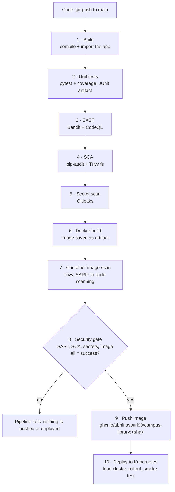
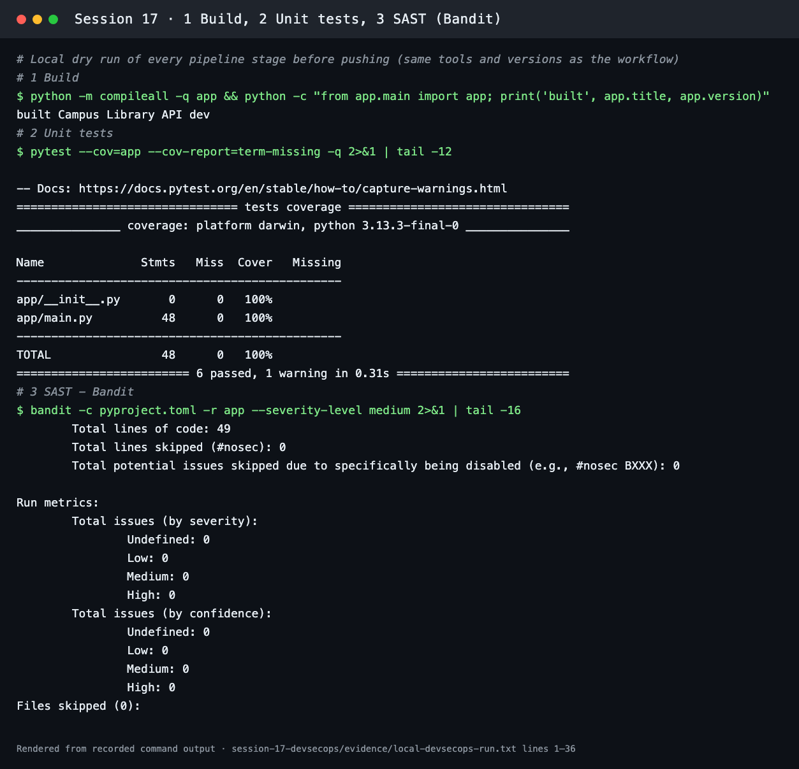
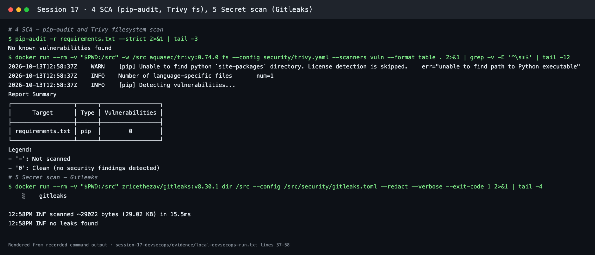
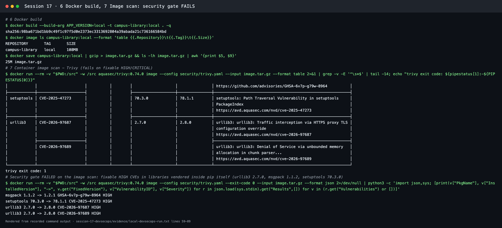
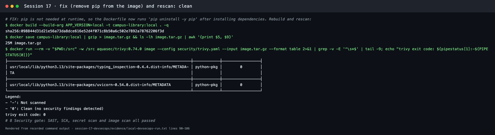
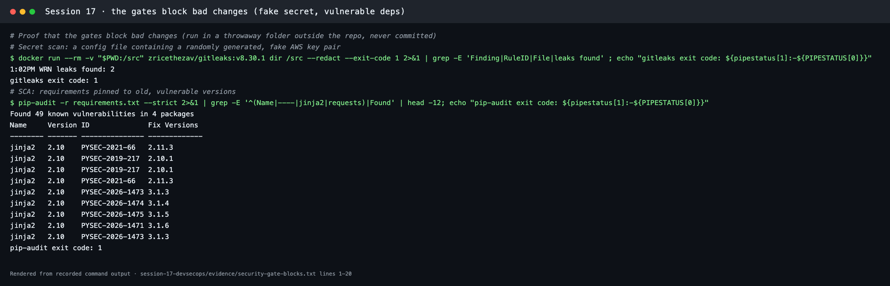
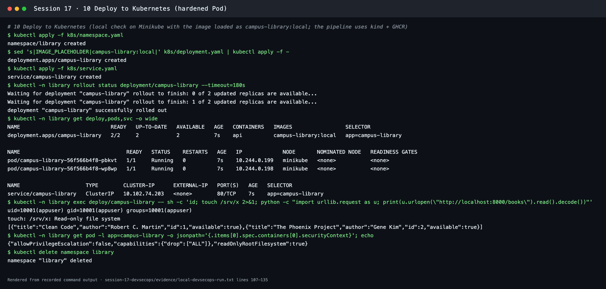

# Session 17: Complete CI/CD & DevSecOps

**Course:** SST DevOps & Cloud · **Author:** Abhinav (24BCS10282)

A **Campus Library API** (FastAPI: list, add, borrow and return books) goes through a CI/CD pipeline with security built into every stage. Every stage must pass, including a **security gate**, before the image is pushed to GitHub Container Registry and deployed to Kubernetes.

The pipeline is [.github/workflows/session17-devsecops.yml](../.github/workflows/session17-devsecops.yml), with a copy in [workflows/](workflows/). Every stage was first run locally with the same tool versions. Those transcripts are in [evidence/](evidence/), and the screenshots are renders of them made with [scripts/render-evidence-png.py](../scripts/render-evidence-png.py).

| Deliverable | Where |
| --- | --- |
| Application | [app/main.py](app/main.py), tests in [tests/test_api.py](tests/test_api.py) (6 tests) |
| Dockerfile | [Dockerfile](Dockerfile): `python:3.13-alpine`, pip removed after install, non-root uid 10001 |
| GitHub Actions workflow | [session17-devsecops.yml](../.github/workflows/session17-devsecops.yml): 10 jobs |
| Security tools configuration | [security/trivy.yaml](security/trivy.yaml) (SCA + image scan), [security/gitleaks.toml](security/gitleaks.toml) (secret scan), `[tool.bandit]` in [pyproject.toml](pyproject.toml) (SAST), CodeQL in the workflow |
| Kubernetes manifests | [k8s/namespace.yaml](k8s/namespace.yaml), [k8s/deployment.yaml](k8s/deployment.yaml) (hardened, 2 replicas, probes), [k8s/service.yaml](k8s/service.yaml) |
| Successful pipeline output | [evidence/local-devsecops-run.txt](evidence/local-devsecops-run.txt), [evidence/security-gate-blocks.txt](evidence/security-gate-blocks.txt), and [the GitHub runs](#pipeline-runs-on-github) |
| Screenshots | [screenshots/](screenshots/) |

## Pipeline flow

The jobs are chained with `needs:` in exactly the order the task asks for. The image is built **once** in job 6 and passed on as an artifact (`docker save | gzip`), so the image that is scanned is byte-for-byte the image that is pushed.

## CI/CD stages

| Stage | Job | What happens | Fails when |
| --- | --- | --- | --- |
| Application build | `1 · Build` | Installs runtime dependencies, compiles the code (`compileall`), imports the FastAPI app, and checks that the workflow copy matches | Syntax/import error, or the workflow copy drifted |
| Unit testing | `2 · Unit tests` | `pytest --cov=app`, uploads `reports/junit.xml` as an artifact | Any test fails |
| Docker image build | `6 · Docker build` | `docker build --build-arg APP_VERSION=<sha>`, then saves the image to an artifact | The build fails |
| Container registry | `9 · Push image to GHCR` | Logs in with `GITHUB_TOKEN` (`packages: write`), tags `ghcr.io/<owner>/campus-library:<12-char sha>`, pushes | The gate did not pass, or the event is a PR or not `main` |
| Kubernetes deployment | `10 · Deploy to Kubernetes` | Creates a **kind** cluster, adds a `ghcr-pull` image-pull Secret, swaps `IMAGE_PLACEHOLDER` for the pushed image, applies the manifests, waits for the rollout, smoke-tests `/health` and `/books` through the Service | The rollout or the smoke test fails |

## Security stages

| Practice | Tool(s) | What it looks for | Configuration | Gate rule |
| --- | --- | --- | --- | --- |
| **SAST** (static application security testing) | **Bandit** 1.9.4, **GitHub CodeQL** | Insecure code patterns in *our* source: `eval`, shell injection, weak crypto, hard-coded passwords, binding to all interfaces… | `[tool.bandit]` in `pyproject.toml` (tests excluded). CodeQL `python`, `build-mode: none` | Bandit exits non-zero on **medium or high** findings. CodeQL results go to the repository's Security tab |
| **SCA** (software composition analysis) | **pip-audit** 2.10.1, **Trivy** `fs` | Known CVEs in *third-party* dependencies (`requirements.txt`) | `--strict`; [security/trivy.yaml](security/trivy.yaml) | Any known vulnerability (pip-audit), or a fixable HIGH/CRITICAL (Trivy) |
| **Secret scanning** | **Gitleaks** 8.30.1 | API keys, tokens, private keys and passwords committed in files | [security/gitleaks.toml](security/gitleaks.toml): default rules + an allowlist for recorded evidence | Any finding (`--exit-code 1`), shown redacted |
| **Container image scanning** | **Trivy** 0.74.0 `image` | CVEs in the OS packages (Alpine) **and** every Python package inside the built image | Same `trivy.yaml`: `severity: HIGH, CRITICAL`, `ignore-unfixed: true`, `exit-code: 1` | A fixable HIGH/CRITICAL in the image. A SARIF report is uploaded either way |
| **Security gate** | `8 · Security gate` job | Collects the results of SAST, SCA, secret scan and image scan into a summary table | `if: always()` so that it runs even after a failure | Fails unless **all four** results are `success`. `push-image` `needs` the gate |

`ignore-unfixed: true` means the gate blocks on problems we can actually fix by upgrading, and doesn't block forever on CVEs that have no release with a fix yet. The Trivy vulnerability database is pulled from `public.ecr.aws` first, with `ghcr.io` as a fallback, to avoid GHCR rate limits.

## Local run of every stage

### Build, unit tests, SAST

### SCA and secret scan

### The image scan caught a real problem and the gate failed

The first image scan failed. The application's own dependencies were clean, but `pip` itself, which ships in the Python base image, vendors older copies of **urllib3 2.7.0** (CVE-2026-97687 and CVE-2026-97689, HIGH), **msgpack 1.1.2** (GHSA-6v7p-g79w-8964, HIGH) and **setuptools 70.3.0** (CVE-2025-47273, HIGH, path traversal). Trivy scans every package in the image, so it found them, and the gate stopped the pipeline:

**Root cause:** pip (and the setuptools that comes with it) is only needed while installing dependencies, not at runtime. **Fix:** the Dockerfile now runs `pip uninstall -y pip` in the same `RUN` layer as the install. The rebuilt image scans clean (exit code 0):

Removing pip also removes a tool an attacker could use to install packages inside a compromised container.

### Proof that the gates block bad changes

In a throwaway folder outside the repository (never committed) I fed each gate something it must reject:

- a config file with a randomly generated, **fake** AWS key pair
- a `requirements.txt` pinned to old, vulnerable `jinja2`/`requests` versions

Gitleaks found 2 leaks and pip-audit found 49 known vulnerabilities, and both exited with code 1. That non-zero exit is what fails the job, and so the gate:

### Deploy to Kubernetes

Locally the image was loaded into Minikube as `campus-library:local`. The pipeline uses a kind cluster and the GHCR image. Both replicas became Ready, and the Pod runs as uid 10001 with a read-only root filesystem:

## Kubernetes manifests

| File | Notes |
| --- | --- |
| [k8s/namespace.yaml](k8s/namespace.yaml) | Namespace `library` |
| [k8s/deployment.yaml](k8s/deployment.yaml) | 2 replicas, readiness and liveness probes on `/health`, CPU/memory requests and limits, `imagePullSecrets: ghcr-pull` |
| [k8s/service.yaml](k8s/service.yaml) | ClusterIP Service on port 80 → container port `http` (8000) |

The Deployment's hardened settings:

- `runAsNonRoot: true` and `runAsUser: 10001`
- `seccompProfile: RuntimeDefault`
- `allowPrivilegeEscalation: false`
- `readOnlyRootFilesystem: true`
- `capabilities.drop: ["ALL"]`

The image placeholder `IMAGE_PLACEHOLDER` is replaced with the exact SHA-tagged image that passed the gate. It is never `latest`.

## Pipeline runs on GitHub

- **Runs:** [Actions → "Session 17 · DevSecOps"](https://github.com/Abhinavsuri90/DevOps-Coursework/actions/workflows/session17-devsecops.yml). The job graph shows the ten numbered stages in order, and the **Security gate** job writes a pass/fail table into the run summary.
- **Code scanning:** CodeQL and the Trivy SARIF report appear under the repository's *Security → Code scanning* tab.
- **Image:** [GHCR packages](https://github.com/Abhinavsuri90?tab=packages): `campus-library`, tagged with the commit SHA.
- **Deploy:** the `10 · Deploy to Kubernetes (kind)` job log shows `kubectl get deploy,pods,svc` and the smoke-test responses, and its summary shows the deployed image and `/health`.

## Lessons learned

- **Scan the image as well as the code.** The source and `requirements.txt` were clean, yet the image still had four fixable HIGH CVEs from tooling that came with the base image.
- **Make gates fail closed.** The gate job runs with `if: always()` and passes only when every security job reports `success`. Skipped or cancelled counts as a failure, and the push and deploy jobs depend on the gate.
- **Build once, promote the same artifact.** The scanned image is the pushed image, tagged with the commit SHA.
- **Keep secrets out of Git and out of logs.** `GITHUB_TOKEN` is short-lived and scoped per job (`packages: write` only for the push job). Gitleaks runs on every push, and its findings are printed redacted.
