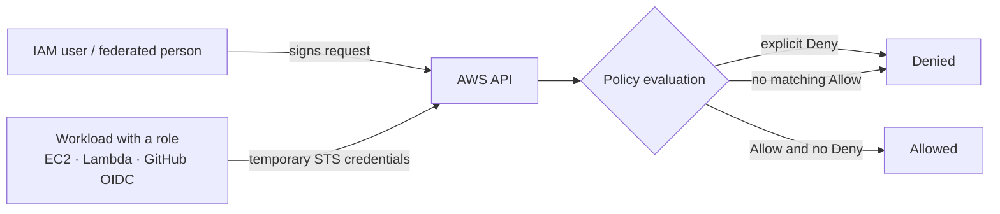

# 01 · IAM — Governance

**Course:** SST DevOps & Cloud · **Session 18** · **Author:** Abhinav

AWS Identity and Access Management (IAM) decides **who** can call AWS APIs (authentication) and **what** they are allowed to do (authorization). It is a global service (not tied to a region) and has no extra charge.



## What is IAM?

Every request to AWS is signed with credentials. IAM checks the principal behind those credentials, collects every policy that applies (identity policies, resource policies, permission boundaries, organization SCPs, session policies), and evaluates them. The rule is simple:

1. Everything starts as **implicitly denied**.
2. An **explicit `Allow`** grants access.
3. An **explicit `Deny`** anywhere always wins over any `Allow`.

The **root user** (the account's sign-up email) can do everything and cannot be limited by IAM policies. It should only be used for a few account-level tasks.

## Users

An IAM user is a long-lived identity for one person or one application.

| Credential | Used for | Notes |
| --- | --- | --- |
| Console password | AWS Management Console | Enforce a password policy and MFA |
| Access key (ID + secret) | CLI, SDKs, Terraform | Long-term secret, so rotate it and never commit it to Git |
| MFA device | Second factor | Virtual app, hardware key or passkey |

```bash
aws iam create-user --user-name terraform-student
aws iam create-access-key --user-name terraform-student   # secret is shown once
aws sts get-caller-identity                                  # who am I?
```

For people, AWS now recommends **IAM Identity Center** (single sign-on with short-lived credentials) over individual IAM users. In this coursework one IAM user with an access key is used for Terraform, then the key is deleted.

## Groups

A group is a collection of users that share permissions. Attaching a policy to a group applies it to every member.

- Groups cannot be nested and are **not principals** (a policy cannot name a group as the one making a request).
- A user can belong to up to 10 groups.

```bash
aws iam create-group --group-name developers
aws iam attach-group-policy --group-name developers \
  --policy-arn arn:aws:iam::aws:policy/ReadOnlyAccess
aws iam add-user-to-group --group-name developers --user-name terraform-student
```

## Roles

A role is an identity **without long-term credentials**. A trusted principal *assumes* the role and receives temporary credentials from AWS STS (Security Token Service) that expire automatically.

A role has two policies:

- **Trust policy:** who may assume the role.
- **Permission policies:** what the role may do.

```json
{
  "Version": "2012-10-17",
  "Statement": [{
    "Effect": "Allow",
    "Principal": { "Service": "ec2.amazonaws.com" },
    "Action": "sts:AssumeRole"
  }]
}
```

Typical roles:

- **EC2 instance profile:** an app on EC2 reads S3 without storing keys.
- **EKS cluster and node roles:** used in the Session 21 Terraform.
- **Cross-account roles:** used from a separate account.
- **GitHub Actions OIDC role:** CI deploys to AWS without stored secrets.

## Policies

Policies are JSON documents.

```json
{
  "Version": "2012-10-17",
  "Statement": [
    {
      "Sid": "ReadOneBucket",
      "Effect": "Allow",
      "Action": ["s3:GetObject", "s3:ListBucket"],
      "Resource": [
        "arn:aws:s3:::abhinav-24bcs10282-tf-s3-demo",
        "arn:aws:s3:::abhinav-24bcs10282-tf-s3-demo/*"
      ],
      "Condition": { "Bool": { "aws:SecureTransport": "true" } }
    }
  ]
}
```

| Element | Meaning |
| --- | --- |
| `Effect` | `Allow` or `Deny` |
| `Action` | API operations such as `s3:GetObject` (wildcards allowed) |
| `Resource` | ARNs the statement applies to |
| `Condition` | Optional context checks (source IP, MFA, TLS, tags, region) |
| `Principal` | Only in resource-based and trust policies: who the statement is about |

| Policy type | Attached to | Example |
| --- | --- | --- |
| AWS managed | Users, groups, roles | `ReadOnlyAccess`, `AmazonS3ReadOnlyAccess` |
| Customer managed | Users, groups, roles | Your reusable JSON, versioned |
| Inline | One identity only | One-off exception, deleted with the identity |
| Resource-based | The resource | S3 bucket policy, KMS key policy |
| Permission boundary | User or role | Maximum permissions an identity can ever get |
| SCP (Organizations) | Accounts / OUs | Guardrail such as "deny all regions except ap-south-1" |

## Permissions

The effective permission is the **intersection** of the identity policy, any permission boundary, and any SCP or session policy. It is combined with the resource policy, and any explicit deny always wins.

Useful checks:

```bash
aws iam list-attached-user-policies --user-name terraform-student
aws iam simulate-principal-policy \
  --policy-source-arn arn:aws:iam::<account-id>:user/terraform-student \
  --action-names s3:CreateBucket ec2:RunInstances
aws iam generate-credential-report && aws iam get-credential-report
```

## Least privilege

Grant only the actions and resources a task needs, and only for as long as it needs them.

- Start with a narrow policy and add permissions when a real `AccessDenied` shows a need.
- Use **IAM Access Analyzer** to generate policies from CloudTrail activity and to find resources shared outside the account.
- Scope `Resource` to specific ARNs instead of `*`, and add `Condition` keys such as `aws:RequestedRegion`.
- Prefer roles with temporary credentials over users with access keys.

> In this coursework the Terraform user has `AdministratorAccess` because EKS (Session 21) must create IAM roles. That is acceptable only for a short-lived personal lab account. The key is deleted after grading.

## IAM best practices

1. Turn on MFA for the root user. Do not create root access keys, and keep the root user for account-level tasks only.
2. Use federation or IAM Identity Center for humans, and roles for workloads.
3. Require MFA for console users and set a strong password policy.
4. Rotate access keys, and remove unused users, keys and roles (check "last accessed" data).
5. Apply least privilege with Access Analyzer, conditions and permission boundaries.
6. Use groups or permission sets, not per-user policies.
7. Turn on CloudTrail to record every IAM and API call.
8. Never put secrets in Git, Dockerfiles or Terraform files. Use roles, Secrets Manager or SSM Parameter Store.

## Common use cases

| Scenario | IAM design |
| --- | --- |
| Developers in a team | Identity Center permission set or group with scoped policies |
| App on EC2 reads S3 | Instance profile role with `s3:GetObject` on one bucket |
| GitHub Actions deploys to AWS | OIDC identity provider + role trusted for `repo:<owner>/<repo>:ref:refs/heads/main` |
| Terraform from a laptop | Short-lived role or temporary user key, deleted after use |
| Auditor access | `SecurityAudit` / `ReadOnlyAccess` managed policies |
| Cross-account access | Role in the target account trusted by the source account |

## Interview summary

IAM authenticates principals and authorizes API calls by evaluating JSON policies with **default deny, explicit allow, and explicit deny always wins**. Users and groups are for people, roles give temporary credentials to workloads and federated users, and least privilege plus MFA keeps the blast radius small.
