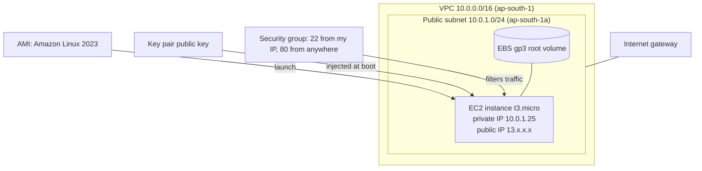
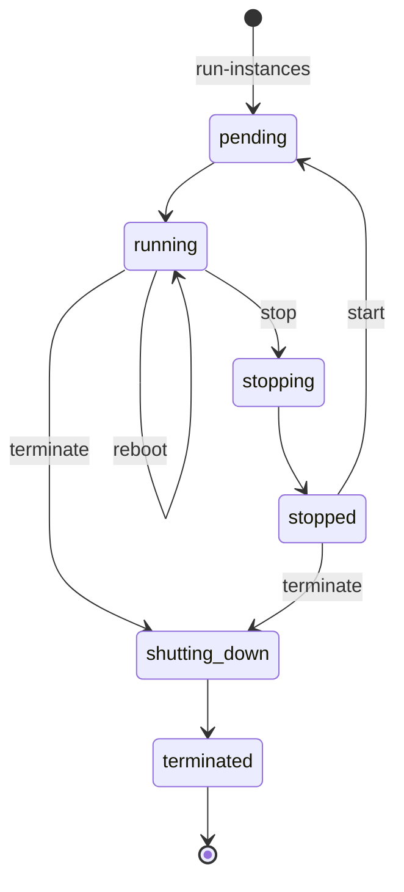

# 02 · EC2 — Compute

**Course:** SST DevOps & Cloud · **Session 18** · **Author:** Abhinav

Amazon Elastic Compute Cloud (EC2) provides virtual servers ("instances") that you can launch in minutes, resize, and stop when you no longer need them. Linux On-Demand instances are billed per second.



## What is EC2?

EC2 is **Infrastructure as a Service (IaaS)**. AWS runs the physical hosts, hypervisor (Nitro), and network. You choose the operating system, size, storage, and network placement, and you are responsible for patching the OS and securing the application.

| Purchase option | Best for |
| --- | --- |
| On-Demand | Short-lived, unpredictable workloads (this coursework) |
| Savings Plans / Reserved Instances | Steady 1- or 3-year usage at a large discount |
| Spot Instances | Fault-tolerant batch jobs using spare capacity, which AWS can interrupt with a 2-minute notice |
| Dedicated Hosts / Instances | Licensing or compliance needs for isolated hardware |

## AMI (Amazon Machine Image)

An AMI is the template for an instance's root volume. It contains:

- an EBS snapshot of the OS (and optionally preinstalled software)
- launch permissions (public, private, or shared with specific accounts)
- a block-device mapping that sets the volumes created at launch

AMI IDs are **region-specific**. Instead of hard-coding them, look up the latest one:

```bash
aws ssm get-parameter --region ap-south-1 \
  --name /aws/service/ami-amazon-linux-latest/al2023-ami-kernel-default-x86_64 \
  --query Parameter.Value --output text
```

```hcl
data "aws_ami" "al2023" {
  most_recent = true
  owners      = ["amazon"]
  filter {
    name   = "name"
    values = ["al2023-ami-2023*-x86_64"]
  }
}
```

You can also create **custom AMIs** ("golden images") with Packer or `aws ec2 create-image` so that every instance starts from the same baseline.

## Instance types

Names follow the pattern **family + generation + attributes + size**. For example, `m7g.large` is a general-purpose (m), 7th generation, Graviton/ARM (g), large instance.

| Family | Optimised for | Examples | Typical workload |
| --- | --- | --- | --- |
| T (burstable) | Low baseline CPU that bursts using CPU credits | `t3.micro`, `t4g.small` | Dev, small web apps, free tier |
| M (general) | Balanced CPU and memory | `m7i.large`, `m7g.xlarge` | App servers, small databases |
| C (compute) | High CPU-to-memory ratio | `c7i.2xlarge` | Batch, encoding, CI builds |
| R / X (memory) | Large memory | `r7g.4xlarge` | In-memory caches, big databases |
| I / D (storage) | Fast local NVMe | `i4i.xlarge` | NoSQL, search indexes |
| G / P (accelerated) | GPUs | `g5.xlarge`, `p5.48xlarge` | ML inference and training, graphics |

Sizes double in resources at each step (`large` → `xlarge` → `2xlarge`…). Attributes include `g` (Graviton), `a` (AMD), `i` (Intel), `d` (local NVMe) and `n` (higher networking).

## Key pairs

A key pair is an SSH public/private key pair. AWS stores the **public** key and places it into `~/.ssh/authorized_keys` at first boot. You keep the **private** key (`.pem`).

```bash
aws ec2 create-key-pair --key-name abhinav-lab --key-type ed25519 \
  --query KeyMaterial --output text > abhinav-lab.pem
chmod 400 abhinav-lab.pem
ssh -i abhinav-lab.pem ec2-user@<public-ip>
```

- AWS cannot recover a lost private key, so you would have to replace the key using a new one or EC2 Instance Connect.
- Never commit `.pem` files. `*.pem` is in this repository's secret scanning rules.
- **SSM Session Manager** gives shell access without opening port 22 or managing keys, which is preferred in production.

## Security Groups

A security group is a **stateful virtual firewall** attached to an instance's network interface (ENI).

- Rules can only **allow**; anything not allowed is denied.
- Stateful means return traffic for an allowed connection is allowed automatically.
- A new group allows all **outbound** traffic and no **inbound** traffic by default.
- A rule's source can be a CIDR block or **another security group** (e.g. "allow 5432 only from the app-tier SG").

```hcl
resource "aws_security_group" "web" {
  name   = "web-sg"
  vpc_id = aws_vpc.main.id

  ingress {
    from_port   = 80
    to_port     = 80
    protocol    = "tcp"
    cidr_blocks = ["0.0.0.0/0"]
  }

  ingress {
    from_port   = 22
    to_port     = 22
    protocol    = "tcp"
    cidr_blocks = ["203.0.113.10/32"] # my IP only
  }

  egress {
    from_port   = 0
    to_port     = 0
    protocol    = "-1"
    cidr_blocks = ["0.0.0.0/0"]
  }
}
```

SSH should not be open to `0.0.0.0/0`, because bots constantly scan port 22.

## EBS (Elastic Block Store)

EBS volumes are network-attached block disks that live in **one Availability Zone** and persist independently of the instance.

| Volume type | Media | Use |
| --- | --- | --- |
| `gp3` | SSD, 3,000 IOPS / 125 MB/s baseline, tunable | Default for boot and most apps |
| `io2` Block Express | Provisioned-IOPS SSD | Latency-sensitive databases |
| `st1` | Throughput HDD | Big sequential data, logs |
| `sc1` | Cold HDD | Infrequently accessed data |

- **Snapshots** are incremental point-in-time backups stored in S3. They can be copied to other regions and used to create new volumes or AMIs.
- Volumes can be **encrypted** with KMS. You can turn on encryption by default per region.
- `DeleteOnTermination` is true for root volumes by default.
- **Instance store** is fast local disk whose data is lost when the instance stops or terminates.

## Public vs private IP

| | Private IPv4 | Public IPv4 | Elastic IP |
| --- | --- | --- | --- |
| Source | Subnet CIDR (e.g. 10.0.1.25) | AWS public pool | AWS public pool, reserved to your account |
| Reachable from | Inside the VPC (and peered / VPN networks) | The internet (if an IGW route and SG allow it) | The internet |
| Lifetime | Stays for the instance's life | **Changes on stop/start** | Static until you release it |
| Cost | Free | Charged hourly per address (since Feb 2024) | Charged hourly per address |

An instance in a private subnet has only a private IP. It reaches the internet outbound through a **NAT gateway**, and inbound traffic arrives through a **load balancer**.

## Instance lifecycle



- **Running:** compute is billed (per second for Linux, 60-second minimum).
- **Stopped:** no compute charge, but EBS volumes and Elastic IPs are still billed. A start moves the instance to a new host, so the public IP changes.
- **Hibernate:** RAM is saved to the encrypted root EBS volume, for faster resume.
- **Terminated:** the instance is gone, and root volumes with `DeleteOnTermination` are deleted.

```bash
aws ec2 describe-instances --query "Reservations[].Instances[].{id:InstanceId,state:State.Name,type:InstanceType,ip:PublicIpAddress}"
aws ec2 stop-instances --instance-ids i-0123456789abcdef0
aws ec2 terminate-instances --instance-ids i-0123456789abcdef0
```

## Common use cases

- Web and API servers behind an Application Load Balancer, with an Auto Scaling group for elasticity
- Kubernetes worker nodes (EKS managed node groups, as in Session 21)
- Self-hosted CI runners and build agents
- Batch processing on Spot instances
- Bastion or jump hosts (being replaced by SSM Session Manager)
- Lift-and-shift migration of on-premises VMs

Session 19's Terraform project launches one `t3.micro` (free-tier eligible) web server with `user_data` to demonstrate EC2 together with a VPC, subnet and security group.

## Interview summary

EC2 instances are virtual servers launched from an **AMI** onto an **instance type**, secured by **security groups**, accessed with **key pairs** or SSM, and backed by **EBS** volumes. Private IPs stay with the instance, while auto-assigned public IPs change on stop/start unless you attach an Elastic IP.
