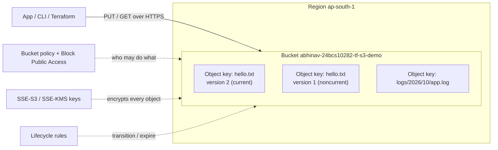

# 03 · S3 — Storage

**Course:** SST DevOps & Cloud · **Session 18** · **Author:** Abhinav

Amazon Simple Storage Service (S3) is object storage: you put files ("objects") into containers ("buckets") over an HTTPS API and read them back from anywhere. S3 Standard is designed for 99.999999999% (11 nines) durability by storing data across at least three Availability Zones in a region.



## What is S3?

- **Object storage, not a file system or a disk.** An object is written and read as a whole. There are no in-place edits, no appends and no real folders.
- **Practically unlimited capacity.** You pay per GB-month stored, per request, and for data transferred out to the internet. There is nothing to provision.
- **Regional service with a global namespace.** Data stays in the region you choose, but general purpose bucket names must be unique across all AWS accounts.
- **Strong read-after-write consistency.** Since December 2020, a successful PUT is immediately visible to every GET and LIST.
- **Accessed by API.** You use the AWS CLI (`aws s3`, `aws s3api`), the SDKs, Terraform, or a URL such as `https://<bucket>.s3.ap-south-1.amazonaws.com/<key>`.

## Buckets

A bucket is the top-level container for objects. Its settings (region, versioning, encryption, policy, lifecycle) apply to all objects inside it.

| Rule | Detail |
| --- | --- |
| Naming | 3–63 characters: lowercase letters, numbers, hyphens (and dots, which break virtual-hosted HTTPS, so avoid them). Must be globally unique |
| Region | Fixed at creation. Choose it close to users and for data-residency rules |
| Quota | 10,000 general purpose buckets per account by default (can be raised) |
| Types | **General purpose** (normal buckets), **directory buckets** (S3 Express One Zone, single-AZ, very low latency), **table buckets** (S3 Tables, Apache Iceberg) |
| Deletion | A bucket must be empty before it can be deleted (Terraform's `force_destroy = true` empties it first) |

```bash
aws s3 mb s3://abhinav-24bcs10282-cli-demo --region ap-south-1
aws s3 ls
aws s3 rb s3://abhinav-24bcs10282-cli-demo --force   # empty + delete
```

## Objects

An object has these parts:

- a **key**, the full name, e.g. `reports/2026/october.pdf`. The `/` is only part of the name. The console shows it as folders, and `--prefix` and `--delimiter` let you list "directories".
- the **data**: a single PUT can upload up to 5 GB. Bigger objects (and anything over ~100 MB, as a recommendation) use **multipart upload**, which sends parts in parallel and retries failed parts.
- **metadata**: system metadata (`Content-Type`, `ETag`, `Last-Modified`) plus user metadata (`x-amz-meta-*`).
- up to 10 **tags**, used in lifecycle rules, IAM conditions and cost reports.
- a **version ID**, when versioning is enabled.

```bash
aws s3 cp hello.txt s3://my-bucket/hello.txt                 # upload
aws s3 cp s3://my-bucket/hello.txt -                          # print to stdout
aws s3 sync ./site s3://my-bucket/site --delete               # mirror a folder
aws s3api head-object --bucket my-bucket --key hello.txt      # metadata only
aws s3 presign s3://my-bucket/hello.txt --expires-in 300      # temporary share link
```

A **pre-signed URL** grants time-limited access to one object without making the bucket public.

## Storage classes

You choose the class per object. All classes except One Zone and Express One Zone store data in at least 3 AZs.

| Class | Retrieval | Minimum storage duration | Good for |
| --- | --- | --- | --- |
| S3 Standard | Milliseconds | None | Frequently accessed data (default) |
| S3 Intelligent-Tiering | Milliseconds (optional archive tiers are slower) | None | Unknown or changing access patterns: S3 moves objects between tiers for a small monitoring fee |
| S3 Standard-IA | Milliseconds, with a per-GB retrieval fee | 30 days | Accessed less than about once a month, e.g. backups |
| S3 One Zone-IA | Milliseconds, single AZ | 30 days | Re-creatable data such as secondary copies and thumbnails |
| S3 Express One Zone | Single-digit milliseconds, directory buckets | None (stored per hour) | Latency-sensitive analytics and ML training |
| S3 Glacier Instant Retrieval | Milliseconds | 90 days | Archives read about once a quarter (medical images, old media) |
| S3 Glacier Flexible Retrieval | Minutes to hours (restore first) | 90 days | Archives where minutes or hours of waiting is fine |
| S3 Glacier Deep Archive | Within 12 hours (restore first) | 180 days | Compliance archives kept for years, cheapest class |

The IA classes also bill each object as at least 128 KB, so many tiny objects should stay in Standard.

## Versioning

Versioning keeps **every version** of an object in the same bucket. It protects against accidental overwrites and deletes.

- Bucket states are **unversioned** (the default), **enabled**, or **suspended**. Once enabled, versioning can only be suspended, never turned off.
- A PUT to an existing key creates a new version, and the old one becomes *noncurrent*.
- A DELETE without a version ID adds a **delete marker**. The object looks gone, but older versions remain and can be restored by deleting the marker.
- Every version is billed as stored data, so pair versioning with lifecycle rules that expire noncurrent versions.
- **Object Lock** (WORM, used for compliance) and **cross-region replication** both require versioning.

```bash
aws s3api put-bucket-versioning --bucket my-bucket --versioning-configuration Status=Enabled
aws s3api list-object-versions --bucket my-bucket --prefix hello.txt \
  --query "Versions[].{id:VersionId,latest:IsLatest,modified:LastModified}"
```

## Lifecycle policies

Lifecycle rules make S3 move or delete objects automatically, filtered by prefix, tag or object size:

- **Transition actions** move objects to a cheaper class after N days (e.g. Standard → Standard-IA at 30 days → Glacier Flexible Retrieval at 90 days).
- **Expiration actions** delete objects after N days, or delete noncurrent versions N days after they became noncurrent.
- **Abort incomplete multipart uploads**: unfinished uploads are invisible but billed, so clean them up.

```hcl
resource "aws_s3_bucket_lifecycle_configuration" "logs" {
  bucket = aws_s3_bucket.demo.id

  rule {
    id     = "logs-to-archive"
    status = "Enabled"
    filter {
      prefix = "logs/"
    }
    transition {
      days          = 30
      storage_class = "STANDARD_IA"
    }
    transition {
      days          = 90
      storage_class = "GLACIER"
    }
    expiration {
      days = 365
    }
    noncurrent_version_expiration {
      noncurrent_days = 30
    }
    abort_incomplete_multipart_upload {
      days_after_initiation = 7
    }
  }
}
```

## Encryption

**At rest**, every new object has been encrypted by default since January 2023. You choose the method:

| Option | Who manages the key | Notes |
| --- | --- | --- |
| **SSE-S3** (AES-256) | S3 | Default, no extra cost. Used by this session's Terraform demo |
| **SSE-KMS** | AWS KMS (AWS-managed or your customer-managed key) | Key policies, CloudTrail audit of every key use, and you can disable the key. Turn on **S3 Bucket Keys** to cut KMS request costs |
| **DSSE-KMS** | KMS, two layers of encryption | For compliance rules that require dual-layer encryption |
| **SSE-C** | You send the key with every request | S3 never stores the key, so if you lose it the data is gone. Rarely used |
| Client-side | Your application | Data is encrypted before it reaches AWS |

**In transit**, S3 endpoints use TLS. A bucket policy can deny any request that is not HTTPS:

```json
{
  "Version": "2012-10-17",
  "Statement": [{
    "Sid": "DenyInsecureTransport",
    "Effect": "Deny",
    "Principal": "*",
    "Action": "s3:*",
    "Resource": ["arn:aws:s3:::my-bucket", "arn:aws:s3:::my-bucket/*"],
    "Condition": { "Bool": { "aws:SecureTransport": "false" } }
  }]
}
```

## Bucket policies

A bucket policy is a **resource-based** JSON policy attached to the bucket. It answers "which principals may do which S3 actions on this bucket and its objects, under which conditions". It is evaluated together with the caller's IAM (identity-based) policies, and an explicit `Deny` in either one always wins.

- **Block Public Access**, at account and bucket level, overrides any policy or ACL that would make data public. It is on by default for new buckets, and this session's Terraform demo sets all four flags explicitly.
- **Object Ownership = Bucket owner enforced** disables ACLs (the default since April 2023). Access is then controlled only by policies, which is simpler to audit.
- Typical statements:
  - allow a CloudFront distribution (Origin Access Control) to read a private website bucket
  - allow another AWS account to write logs into the bucket
  - deny everything that is not HTTPS (shown above)
  - deny uploads without encryption headers

```json
{
  "Version": "2012-10-17",
  "Statement": [{
    "Sid": "AllowCloudFrontRead",
    "Effect": "Allow",
    "Principal": { "Service": "cloudfront.amazonaws.com" },
    "Action": "s3:GetObject",
    "Resource": "arn:aws:s3:::my-site-bucket/*",
    "Condition": { "StringEquals": { "AWS:SourceArn": "arn:aws:cloudfront::111122223333:distribution/EDFDVBD6EXAMPLE" } }
  }]
}
```

Use **IAM policies** to say what *your* users and roles may do across many buckets. Use a **bucket policy** for cross-account access, service principals, and guard-rails that must apply to everyone.

## Common use cases

- **Backups and archives**, using lifecycle rules down to the Glacier classes
- **Static websites and front-end assets** (a React build such as SpendWise's), served through CloudFront
- **Data lakes**: raw files queried with Athena, Glue, EMR or Redshift Spectrum
- **Terraform remote state**: an S3 backend with versioning. Since Terraform 1.10, `use_lockfile = true` locks state in S3 itself, without a DynamoDB table
- **CI/CD artifacts**, build caches and container image layers (ECR stores layers in S3)
- **Log storage**: ALB, CloudFront and CloudTrail logs land in S3
- **Media and user uploads**, delivered through pre-signed URLs

The [Terraform S3 demo](../../terraform-s3-demo/) creates a private, versioned, encrypted bucket with Block Public Access on, uploads `hello.txt`, and destroys it all again.

## Interview summary

S3 stores **objects** (key + data + metadata) in globally named **buckets** inside a region, with 11-nines durability and strong consistency. You cut cost with **storage classes** and **lifecycle rules**, protect data with **versioning** (and Object Lock), encrypt everything (SSE-S3 by default, SSE-KMS for audited keys, TLS in transit), and control access with IAM policies, **bucket policies** and **Block Public Access**.
