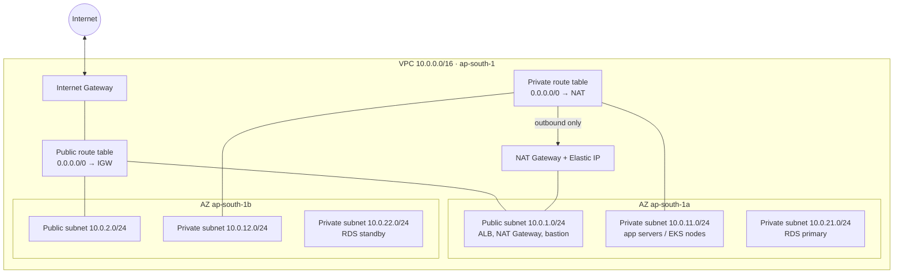

# 04 · VPC — Networking

**Course:** SST DevOps & Cloud · **Session 18** · **Author:** Abhinav

An Amazon Virtual Private Cloud (VPC) is your own logically isolated network inside an AWS region. You choose its IP range, split it into subnets, and decide how traffic flows to the internet, to other VPCs, and to your on-premises network. EC2 instances, RDS databases, EKS nodes and load balancers all live inside a VPC.



## What is a VPC?

- A VPC belongs to **one region** and spans **all Availability Zones** in it. Subnets are the part that is tied to a single AZ.
- Every account has a **default VPC** per region (172.31.0.0/16, with a public subnet in each AZ) so that you can launch instances quickly. Real projects create their own VPC with Terraform.
- A VPC is isolated by default. Nothing reaches it from the internet until you add an internet gateway, routes and security-group rules.
- Ways to connect it to other networks:
  - **VPC peering** between two VPCs
  - **Transit Gateway** as a hub for many VPCs
  - **Site-to-Site VPN** and **Direct Connect** to on-premises networks
  - **VPC endpoints / PrivateLink** to reach AWS services without the internet

## CIDR

CIDR (Classless Inter-Domain Routing) notation describes an IP range as `address/prefix-length`. The prefix length is the number of fixed leading bits. The rest are host bits.

| CIDR | Addresses | Typical use |
| --- | --- | --- |
| `10.0.0.0/16` | 65,536 | Whole VPC (the largest allowed size is /16, the smallest /28) |
| `10.0.1.0/24` | 256 (251 usable in AWS) | One subnet |
| `10.0.1.0/28` | 16 (11 usable) | Smallest subnet |
| `203.0.113.10/32` | 1 | A single IP, e.g. "SSH only from my laptop" |

- Use private RFC 1918 ranges: `10.0.0.0/8`, `172.16.0.0/12` or `192.168.0.0/16`.
- **Plan ranges so they do not overlap** with other VPCs or the office network. Peering and VPNs cannot route between overlapping ranges.
- AWS **reserves 5 addresses in every subnet**: the network address, `.1` (VPC router), `.2` (DNS), `.3` (reserved for future use) and the broadcast address.
- You can add secondary CIDR blocks and IPv6 (/56 for the VPC, /64 per subnet) later.

Terraform's `cidrsubnet()` carves subnets out of the VPC range, as the Session 19 and Session 21 projects do:

```hcl
cidrsubnet("10.0.0.0/16", 8, 1)   # "10.0.1.0/24"
cidrsubnet("10.0.0.0/16", 8, 2)   # "10.0.2.0/24"
```

## Subnets

A subnet is a slice of the VPC CIDR **inside one AZ**. Resources get their private IPs from it.

- Spread subnets over **at least two AZs** for high availability. EKS and RDS subnet groups require two.
- A subnet is associated with exactly **one route table** and **one network ACL**.
- `map_public_ip_on_launch = true` auto-assigns a public IPv4 to instances launched in the subnet.
- A common layout is three tiers: **public** (load balancers, NAT), **private app**, and **private data**.

## Route tables

A route table is a list of rules: *destination CIDR → target*. The most specific (longest prefix) match wins.

| Destination | Target | Meaning |
| --- | --- | --- |
| `10.0.0.0/16` | `local` | Traffic inside the VPC, always present and cannot be removed |
| `0.0.0.0/0` | `igw-…` | Everything else goes to the internet (this makes a subnet public) |
| `0.0.0.0/0` | `nat-…` | Private subnets: outbound internet through NAT |
| `10.1.0.0/16` | `pcx-…` / `tgw-…` | Another VPC through peering or a Transit Gateway |
| `pl-… (S3 prefix list)` | `vpce-…` | S3/DynamoDB through a free gateway endpoint |

The VPC's **main route table** is used by any subnet without an explicit association, so leave it private and associate public subnets explicitly.

## Internet Gateway

An Internet Gateway (IGW) is a horizontally scaled, redundant VPC component that connects the VPC to the internet. You attach one per VPC and it has no bandwidth limits or cost of its own. It does two jobs:

1. It is the **target** in route tables for internet-bound traffic.
2. It performs **1:1 NAT** between an instance's private IP and its public IPv4 / Elastic IP.

An instance is reachable from the internet only when **all** of these are true: it has a public IP, its subnet routes `0.0.0.0/0` to the IGW, and both the security group and the NACL allow the traffic.

## NAT Gateway

A NAT Gateway lets instances in **private** subnets start **outbound** connections (OS updates, pulling container images, calling APIs) while the internet still cannot start connections to them.

- It lives in a **public** subnet, has an **Elastic IP**, and private route tables send `0.0.0.0/0` to it.
- It is zonal. For high availability, create one per AZ and give each AZ's private route table its own NAT.
- **It costs money even when idle**: an hourly charge plus a per-GB processing charge. That is why the Session 19 and Session 21 lab projects use public subnets only and skip NAT.
- Cheaper alternatives for some traffic are **VPC endpoints** (S3/DynamoDB gateway endpoints are free) and **egress-only internet gateways** for IPv6.

## Security Groups

Security groups are **stateful** firewalls attached to network interfaces (instance level). Return traffic is allowed automatically.

- They have **allow rules only**. Anything not allowed is dropped.
- A source can be a CIDR or **another security group**, e.g. "RDS SG allows 5432 from the app SG". With that rule, membership in the app SG is what grants access, so instance IPs can change freely.
- New groups allow all outbound and no inbound traffic.

```hcl
resource "aws_vpc_security_group_ingress_rule" "http" {
  security_group_id = aws_security_group.web.id
  cidr_ipv4         = "0.0.0.0/0"
  from_port         = 80
  to_port           = 80
  ip_protocol       = "tcp"
}
```

## Network ACLs

A network ACL (NACL) is a **stateless** firewall at the **subnet** boundary.

| | Security group | Network ACL |
| --- | --- | --- |
| Applies to | Network interface (instance) | Whole subnet |
| State | Stateful: replies allowed automatically | Stateless: replies need their own rule (ephemeral ports 1024–65535) |
| Rules | Allow only | Allow **and deny** |
| Evaluation | All rules together | In order, lowest rule number first; the first match wins |
| Default | Deny all inbound, allow all outbound | The default NACL allows everything both ways |

Use security groups for normal access control. Add NACL deny rules for coarse subnet-wide blocks, e.g. blocking a known-bad CIDR.

## Public vs private subnet

AWS has no "public" checkbox. It is decided by the **route table**:

| | Public subnet | Private subnet |
| --- | --- | --- |
| Default route | `0.0.0.0/0 → Internet Gateway` | `0.0.0.0/0 → NAT Gateway` (or no internet route at all) |
| Public IPs | Instances usually get one | Instances have private IPs only |
| Reachable from the internet | Yes, if SG/NACL allow it | No, only through a load balancer or bastion in a public subnet |
| Typical resources | ALB/NLB, NAT Gateway, bastion host | Application servers, EKS worker nodes, RDS, ElastiCache |

Best practice is to put only edge components in public subnets and keep workloads and data private. The lab projects place EC2 (Session 19) and EKS nodes (Session 21) in public subnets only to avoid NAT Gateway charges, and they lock access down with security groups.

```bash
# Is a subnet public? Look for a 0.0.0.0/0 route to an igw- target in its route table.
aws ec2 describe-route-tables --filters Name=association.subnet-id,Values=subnet-0123456789abcdef0 \
  --query "RouteTables[].Routes[?DestinationCidrBlock=='0.0.0.0/0'].GatewayId"
```

## Interview summary

A **VPC** is a regional private network defined by a **CIDR** block, split into **subnets** that each live in one AZ. **Route tables** decide where traffic goes: a route to an **Internet Gateway** makes a subnet public, and private subnets reach out through a **NAT Gateway**. **Security groups** (stateful, allow-only, per interface) and **NACLs** (stateless, allow/deny, per subnet) filter the traffic.
