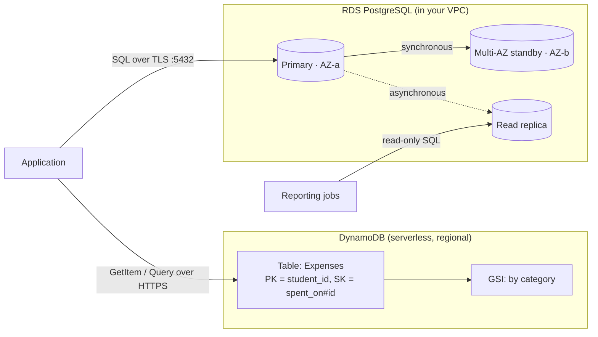

# 05 · DynamoDB & RDS — Database Services

**Course:** SST DevOps & Cloud · **Session 18** · **Author:** Abhinav

AWS runs databases as managed services, so you don't install engines, patch operating systems or build replication yourself. The two most used are **Amazon DynamoDB** (serverless NoSQL key-value and document store) and **Amazon RDS** (managed relational databases such as PostgreSQL and MySQL).



---

# DynamoDB

## NoSQL

DynamoDB is a **NoSQL** database. It does not use the relational model of fixed schemas, joins and SQL. Instead you design for **known access patterns**:

- **Schemaless items.** Apart from the primary key, every item can have different attributes.
- **Scales horizontally** without limits. Data is spread over partitions by the partition key.
- **Single-digit-millisecond** latency at any size.
- **Serverless.** There are no instances. You pay per request (**on-demand**) or for reserved read/write capacity units (**provisioned**, with auto scaling).
- **Reads are eventually consistent by default.** A strongly consistent read is an option on the table and its LSIs, but not on GSIs.
- Built-in extras:
  - **TTL** expires items automatically.
  - **Streams** provide a change log for Lambda triggers.
  - **Transactions** give ACID across up to 100 items.
  - **Global tables** give multi-region active-active replication.
  - **Point-in-time recovery** restores to any second in the last 35 days.

## Tables, items and attributes

| Concept | Relational equivalent | Notes |
| --- | --- | --- |
| **Table** | Table | Created with only a primary key definition and a capacity mode |
| **Item** | Row | A set of attributes, max **400 KB** per item |
| **Attribute** | Column | Typed: String, Number, Binary, Boolean, Null, List, Map, String/Number/Binary Set |

```json
{
  "student_id": "24BCS10282",
  "spent_on#id": "2026-10-13#42",
  "title": "Canteen thali",
  "amount": 95,
  "category": "food",
  "tags": ["lunch", "campus"]
}
```

## Partition key

The **partition key** (also called the *hash key*) is required for every table:

- DynamoDB hashes it to choose the physical partition that stores the item.
- With a partition key alone, it must be **unique**, and `GetItem` by key is the fastest possible lookup.
- Choose a **high-cardinality** key (user ID, order ID) so that traffic spreads evenly. A low-cardinality key such as `status = "open"` creates a **hot partition** that gets throttled.

## Sort key

The optional **sort key** (*range key*) together with the partition key forms a **composite primary key**:

- Items with the same partition key are stored together, **ordered by the sort key**.
- `Query` can then use the sort key with conditions such as `=`, `<`, `between` and `begins_with`. For example, "all expenses of student X in October" is `PK = X AND SK begins_with "2026-10"`.
- The pair `(partition key, sort key)` must be unique.

Other access patterns need **secondary indexes**:

- A **Global Secondary Index (GSI)** has a different partition and sort key, can be added at any time, and has its own capacity.
- A **Local Secondary Index (LSI)** has the same partition key and a different sort key, and must be defined when the table is created.

`Scan` reads the whole table, so it is slow and expensive at scale. Design keys so that you `Query` instead.

```hcl
resource "aws_dynamodb_table" "expenses" {
  name         = "expenses"
  billing_mode = "PAY_PER_REQUEST"
  hash_key     = "student_id"
  range_key    = "spent_on_id"

  attribute {
    name = "student_id"
    type = "S"
  }
  attribute {
    name = "spent_on_id"
    type = "S"
  }

  point_in_time_recovery {
    enabled = true
  }
}
```

```bash
aws dynamodb query --table-name expenses \
  --key-condition-expression "student_id = :s AND begins_with(spent_on_id, :m)" \
  --expression-attribute-values '{":s":{"S":"24BCS10282"},":m":{"S":"2026-10"}}'
```

## DynamoDB use cases

- User profiles, sessions, shopping carts and preferences: key lookups at any scale
- Gaming leaderboards, IoT telemetry and clickstreams: high write throughput
- Serverless back ends (API Gateway + Lambda + DynamoDB)
- Idempotency keys, feature flags and metadata stores
- State locking for older Terraform S3 backends. Newer Terraform versions lock state in S3 itself, as explained in the [S3 notes](../03-s3/)

---

# RDS

## Relational database

Amazon **Relational Database Service** runs real relational engines for you: tables with schemas, SQL, joins, foreign keys and ACID transactions.

- **AWS handles** provisioning, OS and engine patching (in a maintenance window), automated backups, monitoring (CloudWatch, Performance Insights), failover and storage auto-scaling.
- **You handle** schema design, queries and indexes, parameter tuning, and who can connect.
- **Trade-off:** there is no SSH or OS access, and some engine features and super-user rights are restricted.

## Supported engines

| Engine | Notes |
| --- | --- |
| **Amazon Aurora** (MySQL- and PostgreSQL-compatible) | AWS's cloud-native engine. Storage is shared and replicated 6 ways across 3 AZs, with up to 15 low-lag replicas. Aurora Serverless v2 scales capacity automatically |
| **PostgreSQL** | Open source, rich SQL and extensions (SpendWise uses PostgreSQL 17) |
| **MySQL** | Open source, very common for web apps |
| **MariaDB** | Community fork of MySQL |
| **Oracle** | Bring-your-own-license or license-included |
| **Microsoft SQL Server** | Express, Web, Standard and Enterprise editions |
| **IBM Db2** | Added in 2023 for enterprise workloads |

## DB instances

A **DB instance** is the managed database server. You choose:

| Setting | Examples |
| --- | --- |
| Instance class | `db.t4g.micro` (burstable, dev/test), `db.m7g.large` (general purpose), `db.r7g.xlarge` (memory-optimised) |
| Storage | `gp3` SSD (default), `io2` provisioned IOPS for heavy OLTP. Storage auto-scaling can grow the disk automatically |
| Network | A **DB subnet group** (private subnets in at least 2 AZs), security groups, and `publicly_accessible = false` |
| Endpoint | A DNS name such as `mydb.abc123.ap-south-1.rds.amazonaws.com:5432`. Always connect with the name, never the IP, because failover moves the name |

## Security

- **Network:** keep the instance in private subnets with no public access. Its security group allows the DB port only **from the application's security group**.
- **Encryption at rest** uses KMS. It must be chosen when the instance is created, and it also covers backups, snapshots and replicas.
- **Encryption in transit:** TLS, which you can enforce (e.g. `rds.force_ssl = 1` for PostgreSQL).
- **Credentials:**
  - Let RDS store the master password in **AWS Secrets Manager** with automatic rotation (`manage_master_user_password = true`). Never put it in Terraform variables or Git.
  - Applications can use **IAM database authentication** to get short-lived tokens instead of passwords.
- **Audit:** CloudTrail records API calls, and engine logs (e.g. the PostgreSQL log, `pgaudit`) can be exported to CloudWatch Logs.

```hcl
resource "aws_db_instance" "spendwise" {
  identifier                  = "spendwise-db"
  engine                      = "postgres"
  engine_version              = "17"
  instance_class              = "db.t4g.micro"
  allocated_storage           = 20
  db_name                     = "spendwise"
  username                    = "spendwise"
  manage_master_user_password = true # password lives in Secrets Manager
  db_subnet_group_name        = aws_db_subnet_group.private.name
  vpc_security_group_ids      = [aws_security_group.db.id]
  publicly_accessible         = false
  storage_encrypted           = true
  backup_retention_period     = 7
  multi_az                    = true
  deletion_protection         = true
}
```

## Backups

| Type | How | Retention | Restore |
| --- | --- | --- | --- |
| **Automated backups** | Daily snapshot plus transaction logs every ~5 minutes | 1–35 days (0 disables them) | **Point-in-time restore** to any second in the window, usually up to the last 5 minutes |
| **Manual snapshots** | `aws rds create-db-snapshot` or the console | Until you delete them | Restore to a new instance. Can be copied to other regions or shared with other accounts |
| **AWS Backup** | Central backup plans across services | Policy-defined | Cross-account and cross-region vaults |

A restore always creates a **new** DB instance with a new endpoint, so point the application at it or swap DNS. Taking a final snapshot before deleting (`skip_final_snapshot = false`) saves you from accidental data loss.

## Multi-AZ

Multi-AZ is for **high availability**, not for scaling reads:

- **Multi-AZ DB instance:** a **synchronous standby** in another AZ, which cannot serve reads. On failure, during patching or on instance resize, RDS fails over automatically, typically in **1–2 minutes**. The endpoint DNS flips to the standby, so the application only needs to reconnect.
- **Multi-AZ DB cluster** (MySQL and PostgreSQL): one writer plus **two readable standbys** in three AZs, with faster failover (typically under 35 seconds).
- Backups are taken from the standby, so the primary's I/O is not frozen.

## Read replicas

Read replicas are for **scaling reads** (and for disaster recovery):

- They are **asynchronous** copies, so a replica can lag a little behind the primary.
- The application sends read-only queries (reports, dashboards) to the replica endpoints, while writes still go to the primary.
- MySQL, MariaDB and PostgreSQL support up to **15 replicas**, which can be in other regions (cross-region DR).
- A replica can be **promoted** to a standalone writable database, e.g. during a regional disaster or a migration.
- Replicas can have Multi-AZ enabled themselves.

| | Multi-AZ standby | Read replica |
| --- | --- | --- |
| Purpose | Availability (automatic failover) | Read scaling, DR |
| Replication | Synchronous | Asynchronous |
| Serves reads | No (instance deployment) / Yes (cluster deployment) | Yes |
| Region | Same region | Same or another region |

## RDS use cases

- Web and mobile application back ends (users, orders, payments) that need transactions and joins
- E-commerce and ERP/CRM systems, and migrated on-premises Oracle or SQL Server databases
- Reporting on read replicas
- **SpendWise in production.** In the final project, PostgreSQL runs as a StatefulSet with a PVC on Kubernetes. On AWS you would replace it with RDS PostgreSQL (Multi-AZ, Secrets Manager credentials), and the backend would only need a new `DATABASE_URL`

---

## DynamoDB vs RDS: choosing

| Question | DynamoDB | RDS |
| --- | --- | --- |
| Data model | Key-value / document, denormalised | Relational tables, normalised |
| Query style | Known access patterns by key (`GetItem`, `Query`) | Ad-hoc SQL, joins, aggregations |
| Scaling | Automatic, practically unlimited | Vertical (bigger instance) + read replicas, Aurora for more |
| Operations | Serverless, no instances | Instances, maintenance windows, failover |
| Transactions | Supported, limited to 100 items | Full ACID |
| Pay for | Requests (or provisioned capacity) + storage | Instance hours + storage + I/O |

## Interview summary

**DynamoDB** is serverless NoSQL. Tables hold items made of attributes, addressed by a **partition key** (plus an optional **sort key**). It suits huge, predictable key-based access with millisecond latency. **RDS** runs managed relational engines (PostgreSQL, MySQL, Aurora…) on DB instances in private subnets, with KMS encryption, automated backups and point-in-time restore. **Multi-AZ** provides failover, and **read replicas** scale reads.
