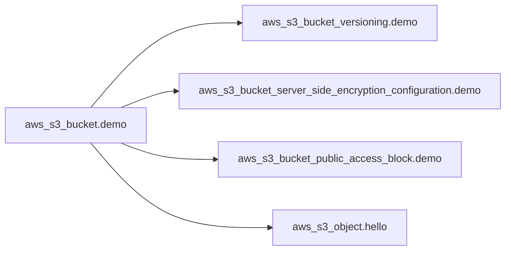
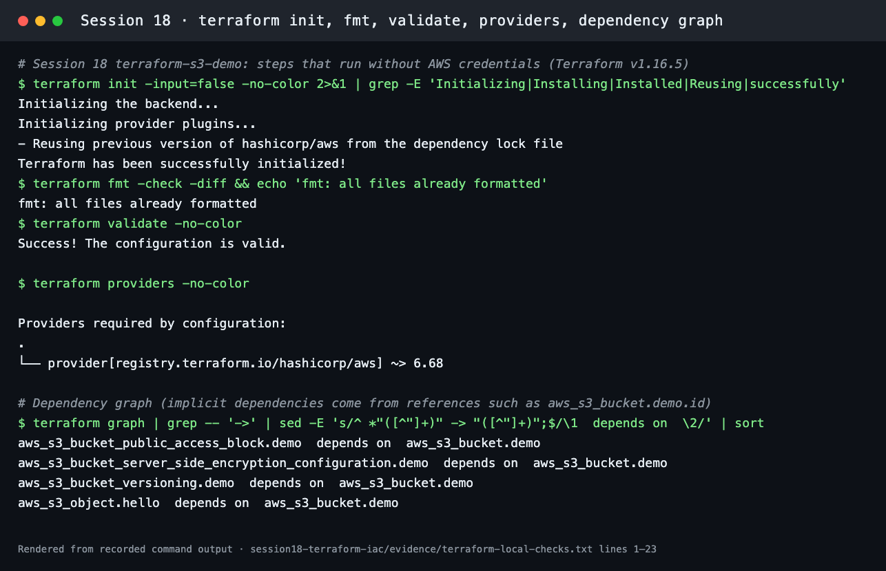

# Terraform S3 Demo

**Session 18 · Task 1** · Author: Abhinav (24BCS10282)

This project creates one **private, versioned, encrypted S3 bucket** with a sample object, using Terraform and the AWS provider. Every resource gets the tags `Project`, `Session`, `Owner` and `ManagedBy=Terraform` from the provider's `default_tags`.

| File | Contents |
| --- | --- |
| [provider.tf](provider.tf) | `terraform { required_version >= 1.6.0, aws ~> 6.68 }` and `provider "aws"` with `region = var.aws_region` and `default_tags` |
| [variables.tf](variables.tf) | `aws_region` (default `ap-south-1`), `bucket_name` (with a `validation` regex for S3 naming rules), `environment`, `owner` |
| [main.tf](main.tf) | `aws_s3_bucket.demo` (`force_destroy = true` so that destroy can empty it), `aws_s3_bucket_versioning` (Enabled), `aws_s3_bucket_server_side_encryption_configuration` (AES256 / SSE-S3), `aws_s3_bucket_public_access_block` (all four flags true), `aws_s3_object.hello` (`hello.txt`) |
| [outputs.tf](outputs.tf) | `bucket_name`, `bucket_arn`, `bucket_region`, `versioning_status`, `sample_object_uri` |
| [terraform.tfvars](terraform.tfvars) | `bucket_name = "abhinav-24bcs10282-tf-s3-demo"` (globally unique), region, environment and owner. **No credentials** |
| [.terraform.lock.hcl](.terraform.lock.hcl) | Provider version and checksums, committed so that everyone gets the same provider build |



All four child resources reference `aws_s3_bucket.demo.id`, so Terraform creates the bucket first and destroys it last. `terraform graph` shows exactly this order (see below).

## Workflow

### 1. `terraform init`, `fmt`, `validate`

```bash
cd session18-terraform-iac/terraform-s3-demo
terraform init        # downloads hashicorp/aws into .terraform/, honours .terraform.lock.hcl
terraform fmt         # canonical formatting (-check to only report)
terraform validate    # syntax, types and references; no AWS calls
```

Recorded run ([evidence/terraform-local-checks.txt](../evidence/terraform-local-checks.txt)):



### Run it on AWS

These steps call AWS APIs and need credentials. The two options are:

- `aws login`: browser sign-in with temporary credentials (recent AWS CLI v2)
- `aws configure`: an IAM user's access key, with region `ap-south-1`

Check with `aws sts get-caller-identity`. Credentials never go into `.tf` or `.tfvars` files.

```bash
terraform plan -out tfplan
```
Expected: `Plan: 5 to add, 0 to change, 0 to destroy.` (the bucket, versioning, encryption, public access block, and `hello.txt`).

```bash
terraform apply tfplan
```
Creates the resources in dependency order and prints the outputs.

```bash
terraform show
```
Prints the state: bucket ARN, versioning `Enabled`, `AES256`, and the object's ETag.

```bash
terraform output
terraform output -raw sample_object_uri
```
Prints `bucket_name`, `bucket_arn`, `bucket_region`, `versioning_status` and `sample_object_uri`.

```bash
aws s3 ls s3://abhinav-24bcs10282-tf-s3-demo/
aws s3 cp s3://abhinav-24bcs10282-tf-s3-demo/hello.txt -
```
Proves the bucket and object really exist: `Hello from Terraform - Session 18 - Abhinav`.

```bash
aws s3api get-public-access-block --bucket abhinav-24bcs10282-tf-s3-demo
```
All four flags show `true`.

```bash
terraform destroy
```
`Destroy complete! Resources: 5 destroyed.` The `force_destroy` setting removes the object versions first.

```bash
terraform state list
```
After destroy this prints nothing: the state is empty.

## What each step teaches

- **init:** providers are plugins, versioned and locked like application dependencies.
- **validate vs plan:** `validate` is offline and checks the code. `plan` is online and compares the code with reality.
- **apply:** only the planned actions run. Saving the plan (`-out`) guarantees that what you reviewed is what gets applied.
- **show / output:** the state is the source of truth for IDs and ARNs, and outputs expose them to people and scripts.
- **destroy:** dependencies are torn down in reverse order (children first, then the bucket).

## Security notes

- The bucket is private (Block Public Access) and encrypted at rest (SSE-S3). Versioning protects against overwrites and deletes.
- `terraform.tfstate` (and its backup) is git-ignored by [.gitignore](.gitignore): state files can contain sensitive values and must never be committed.
- No access keys exist anywhere in this folder. The provider uses the standard AWS credential chain.
