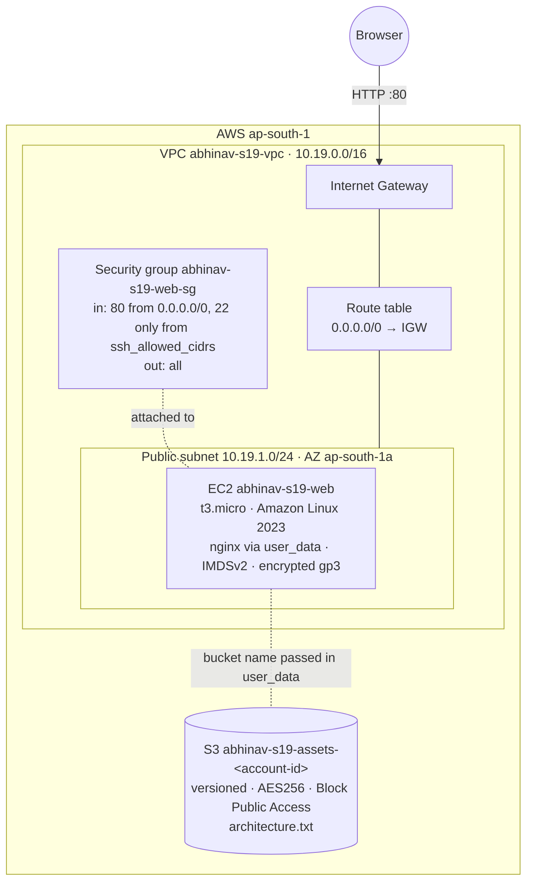
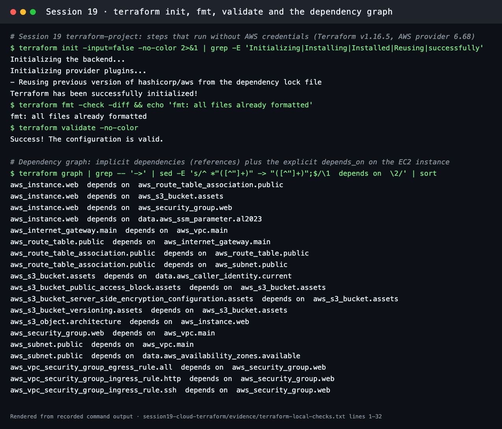

# Session 19: Cloud & Terraform in Action

**Course:** SST DevOps & Cloud · **Author:** Abhinav (24BCS10282)

This is an end-to-end AWS infrastructure project in Terraform (v1.16.5, AWS provider 6.68, region `ap-south-1`). It builds a **VPC → public subnet → security group → EC2 web server**, plus an **S3 bucket** for artifacts. The EC2 instance boots nginx with a page showing its own instance metadata, and the bucket receives an `architecture.txt` object that references the VPC, subnet and instance.

| Deliverable | Where |
| --- | --- |
| Terraform project | [terraform-project/](terraform-project/) |
| AWS resources | VPC, Internet Gateway, subnet, route table, security group + rules, EC2 instance, S3 bucket + versioning, encryption, public access block, object. See [Resources](#resources) |
| Architecture diagram | [Architecture](#architecture) |
| Terraform commands | [Commands](#terraform-commands) |
| Screenshots | [screenshots/](screenshots/) |
| README | this file |

## Architecture



```text
Terraform
    ├── VPC             aws_vpc.main, aws_internet_gateway.main
    ├── Subnet          aws_subnet.public, aws_route_table.public, aws_route_table_association.public
    ├── Security Group  aws_security_group.web + ingress (http, ssh for_each) and egress rules
    ├── EC2             aws_instance.web (AMI from SSM, user_data.sh)
    └── S3              aws_s3_bucket.assets + versioning + encryption + public access block + aws_s3_object.architecture
```

## How the project shows each Terraform concept

| Concept | Where |
| --- | --- |
| **Providers** | [versions.tf](terraform-project/versions.tf): `required_providers { aws = { source = "hashicorp/aws", version = "~> 6.68" } }`, `provider "aws"` with `region` and `default_tags` (Project, Session, Owner, ManagedBy) |
| **Variables** | [variables.tf](terraform-project/variables.tf): `aws_region`, `project` (name prefix), `owner`, `vpc_cidr`, `public_subnet_cidr`, `instance_type` (t3.micro), `ssh_allowed_cidrs` (list, empty = no SSH). Overrides go in `terraform.tfvars` ([example](terraform-project/terraform.tfvars.example)) |
| **Resources** | [vpc.tf](terraform-project/vpc.tf), [security.tf](terraform-project/security.tf), [ec2.tf](terraform-project/ec2.tf), [s3.tf](terraform-project/s3.tf) |
| **Data sources** | `aws_availability_zones` (first AZ for the subnet), `aws_ssm_parameter` (latest Amazon Linux 2023 AMI, so no hard-coded AMI ID), `aws_caller_identity` (account ID for a unique bucket name) |
| **Outputs** | [outputs.tf](terraform-project/outputs.tf): `vpc_id`, `public_subnet_id`, `security_group_id`, `instance_id`, `instance_public_ip`, `web_url`, `assets_bucket` |
| **Dependencies** | *Implicit:* every reference such as `aws_vpc.main.id` adds an edge to the graph. *Explicit:* `depends_on = [aws_route_table_association.public]` on the instance, so the internet route exists before the instance boots and `dnf install nginx` can reach the internet |
| **Expressions & functions** | `templatefile()` renders `user_data.sh` with the project and bucket name. `for_each = toset(var.ssh_allowed_cidrs)` creates one SSH rule per CIDR (zero by default). String interpolation builds names |
| **State** | `terraform.tfstate` maps each resource address to its real AWS ID. It is local and git-ignored. `terraform state list` / `state show` inspect it, and in a team it would live in an S3 backend with locking |

## Resources

| Resource | Key settings |
| --- | --- |
| `aws_vpc.main` | 10.19.0.0/16, DNS support and hostnames on |
| `aws_internet_gateway.main` | Attached to the VPC |
| `aws_subnet.public` | 10.19.1.0/24 in the first available AZ, `map_public_ip_on_launch = true` |
| `aws_route_table.public` + association | `0.0.0.0/0 → IGW`, which is what makes the subnet public |
| `aws_security_group.web` + rules | Ingress 80/tcp from anywhere, 22/tcp only from `ssh_allowed_cidrs` (none by default), egress all. Uses the newer one-rule-per-resource `aws_vpc_security_group_*_rule` resources |
| `aws_instance.web` | `t3.micro`, AL2023 AMI from SSM, **IMDSv2 required**, encrypted 8 GiB gp3 root volume, `user_data` installs nginx and writes a page with instance ID, type, AZ and IPs |
| `aws_s3_bucket.assets` + 3 settings | Versioning, SSE-S3 (AES256), Block Public Access on all four flags, `force_destroy` for clean teardown |
| `aws_s3_object.architecture` | `architecture.txt`: "VPC 10.19.0.0/16 -> subnet 10.19.1.0/24 -> EC2 i-…", which depends on the instance ID |

## Terraform commands

Recorded locally ([evidence/terraform-local-checks.txt](evidence/terraform-local-checks.txt)): `init`, `fmt`, `validate` and the dependency graph. The graph shows the explicit `depends_on` (instance → route table association) next to the implicit dependencies.



The full life cycle on AWS needs credentials (`aws login` or `aws configure`):

```bash
cd session19-cloud-terraform/terraform-project
cp terraform.tfvars.example terraform.tfvars      # optional: e.g. ssh_allowed_cidrs = ["<my-ip>/32"]
terraform init
terraform fmt -check && terraform validate
terraform plan -out tfplan                        # expected with defaults: Plan: 14 to add, 0 to change, 0 to destroy
terraform apply tfplan
terraform output                                  # vpc_id, instance_public_ip, web_url, assets_bucket …
curl "$(terraform output -raw web_url)"            # the nginx page (about a minute after boot)
aws s3 cp "s3://$(terraform output -raw assets_bucket)/architecture.txt" -
terraform state list                              # the 14 managed resources
terraform state show aws_instance.web             # one resource in detail (AMI, IPs, IMDS options)
terraform plan                                    # "No changes": reality matches the code
terraform destroy                                 # Destroy complete! Resources: 14 destroyed.
```

**Cost:** `t3.micro` is free-tier eligible, and the bucket holds a few bytes. The only paid item while running is the instance's public IPv4 address, billed per hour. Destroy right after the demo.

## Lessons learned

- **Let references build the graph.** `depends_on` is only for dependencies Terraform cannot see. Here that's the instance needing the internet route at boot, which no attribute reference expresses.
- **Look things up instead of hard-coding them:** AMI IDs (SSM parameter), AZ names and account IDs differ per region and account.
- **Secure defaults in code:** IMDSv2, encrypted volumes, no SSH unless a CIDR is given, private encrypted buckets.
- **`plan` after `apply` should say "No changes".** Anything else means drift, or code that does not converge.
