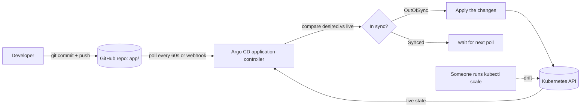
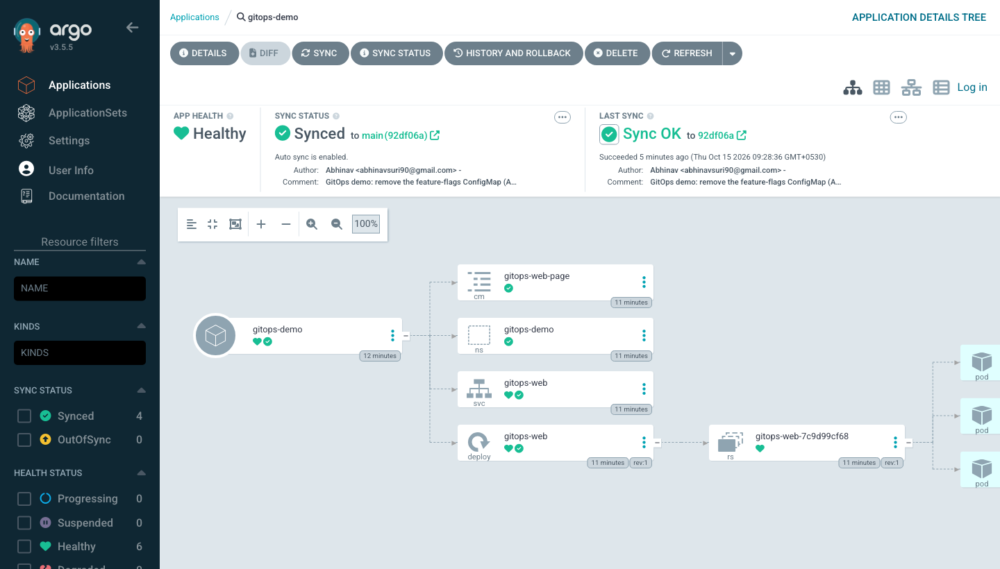
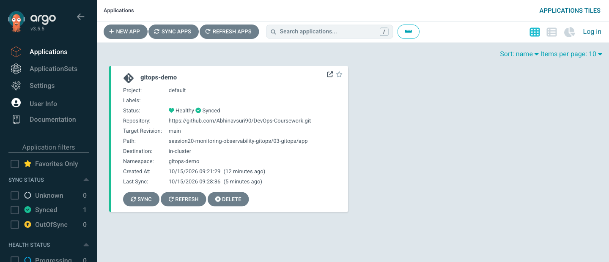
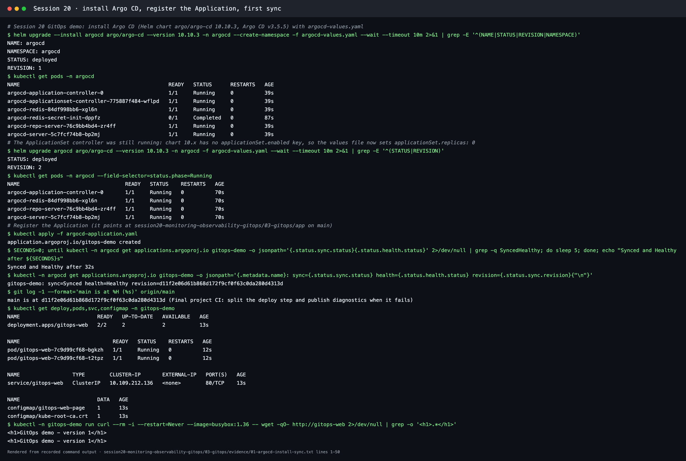
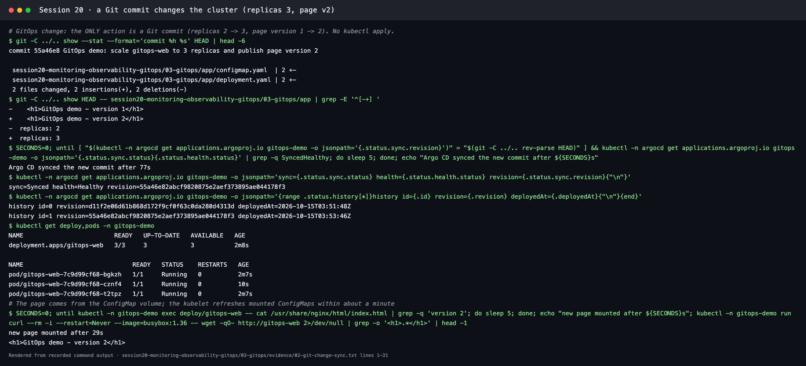
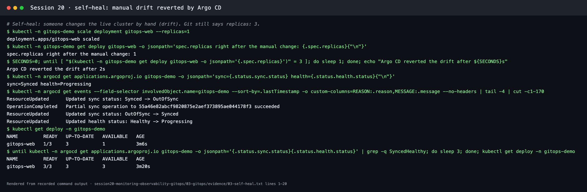
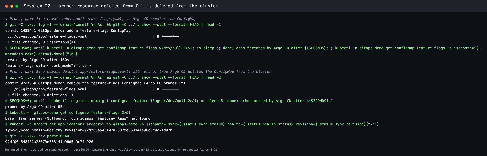

# GitOps with Argo CD

**Session 20 · Task 3** · Author: Abhinav (24BCS10282)

## What is GitOps?

GitOps is a way of operating infrastructure and applications where **the desired state of the system is declared in Git**, and an automated agent running in the cluster **continuously makes the live state match Git**. Deployments happen by changing Git (commit, pull request, merge) rather than by running `kubectl apply` or a deploy script against production.

The OpenGitOps principles:

1. **Declarative:** the whole system is described as desired state (YAML, Helm values, Kustomize), not as a list of steps.
2. **Versioned and immutable:** that description is stored in Git, which gives history, review, and a revert for every change.
3. **Pulled automatically:** an agent in the cluster pulls the desired state. CI does not push credentials into the cluster.
4. **Continuously reconciled:** the agent keeps comparing desired and actual state and corrects any drift.

## Git as the source of truth

- **One place to look:** what is running equals what is on the `main` branch of the config path.
- **Audit trail:** `git log` shows who changed what and when, and why (commit message, PR).
- **Review before production:** changes go through pull requests and checks.
- **Rollback = `git revert`:** the agent rolls the cluster back to the previous commit's state.
- **Disaster recovery:** a new cluster plus the same Git repo rebuilds the same system.

In this demo the desired state is [`app/`](app/) in **github.com/Abhinavsuri90/DevOps-Coursework**, and the Argo CD `Application` ([argocd-application.yaml](argocd-application.yaml)) points at that path on `main`.

## Declarative configuration

[`app/`](app/) contains only *what* should exist: a Namespace, a ConfigMap with the page, a Deployment with `replicas: 2`, and a Service. There are no imperative steps. Kubernetes controllers and Argo CD work out *how* to get there.

## Continuous reconciliation



- **Sync:** apply Git's state to the cluster.
- **Self-heal** (`selfHeal: true`): if someone changes the live state by hand, Argo CD puts it back to match Git.
- **Prune** (`prune: true`): resources deleted from Git are deleted from the cluster.

## GitOps workflow

```text
1. Developer changes app/deployment.yaml (e.g. replicas 2 -> 3) on a branch
2. Pull request -> review -> CI validates the manifests
3. Merge to main
4. Argo CD notices the new commit (poll or webhook) -> OutOfSync
5. Argo CD applies the change -> Synced / Healthy
6. If anyone edits the cluster directly, Argo CD reverts it (self-heal)
7. Rollback = git revert <commit> -> Argo CD syncs the previous state
```

In the final project, CI builds and pushes an image tagged with the commit SHA, then commits the new tag to the GitOps values file, and Argo CD deploys it. CI never needs cluster credentials.

## Kubernetes + GitOps

| Tool | Notes |
| --- | --- |
| **Argo CD** | Web UI and CLI, `Application`/`AppProject` CRDs, health assessment, sync waves, multi-cluster (used here) |
| Flux CD | Set of controllers (`GitRepository`, `Kustomization`, `HelmRelease`), CNCF graduated |
| Argo Rollouts / Flagger | Progressive delivery (canary, blue-green) on top of GitOps |

Argo CD's main components are the **repo-server** (clones Git and renders manifests from Helm, Kustomize or plain YAML), the **application-controller** (compares and syncs), the **API server and UI**, and **Redis** (cache).

## Files

| File | Purpose |
| --- | --- |
| [argocd-values.yaml](argocd-values.yaml) | Small Argo CD install: no Dex or notifications, ApplicationSet controller at 0 replicas, 60 s Git polling, read-only anonymous UI for local screenshots |
| [argocd-application.yaml](argocd-application.yaml) | `Application` gitops-demo → this repo, path `session20-monitoring-observability-gitops/03-gitops/app`, automated sync with prune and self-heal |
| [app/](app/) | The desired state that Argo CD syncs |

## Live demo

Argo CD v3.5.5 was installed on Minikube with [argocd-values.yaml](argocd-values.yaml) (Helm chart `argo/argo-cd` 10.10.3) and pointed at this repository. Every step below was recorded: transcripts are in [evidence/](evidence/), terminal screenshots are renders of them, and the Argo CD UI images are real browser captures.

| Step | What I did | What Argo CD did | Time |
| --- | --- | --- | --- |
| 1. Initial sync | `kubectl apply -f argocd-application.yaml` | Cloned `main`, created the namespace, ConfigMap, Deployment (2 replicas) and Service. **Synced + Healthy** | 32 s |
| 2. Change through Git | Commit [`5d5e64c`](https://github.com/Abhinavsuri90/DevOps-Coursework/commit/5d5e64c): `replicas: 2 → 3`, page `version 1 → version 2`. **No kubectl** | Detected the new commit, applied it: 3/3 Pods, page served "GitOps demo - version 2" | 77 s |
| 3. Self-heal | `kubectl scale deployment gitops-web --replicas=1` (manual drift) | Saw the drift, status *OutOfSync*, and reset `replicas` to 3, because Git is the truth | 2 s |
| 4. Prune, add | Commit [`81c5b8d`](https://github.com/Abhinavsuri90/DevOps-Coursework/commit/81c5b8d) adds `app/feature-flags.yaml` | Created ConfigMap `feature-flags` | 130 s |
| 5. Prune, delete | Commit [`c7a29eb`](https://github.com/Abhinavsuri90/DevOps-Coursework/commit/c7a29eb) deletes the file | **Deleted** the ConfigMap from the cluster (`prune: true`) | 65 s |

**Commit IDs:** this repository's history was rewritten after the demo, when commit messages were cleaned up. The same commits therefore have new IDs: `55a46e8` → `5d5e64c`, `1482441` → `81c5b8d`, `92df06a` → `c7a29eb`, and `d11f2e0` (the commit synced first) → `fc12367`. The transcripts and the Argo CD screenshot show the IDs as they were during the demo.

The waits of about 1–2 minutes come from polling: Argo CD checks Git every 60 s (`timeout.reconciliation`). A GitHub webhook would make syncs almost instant.

**Argo CD UI after the demo:** the app is Healthy and Synced to `main (92df06a)` (now `c7a29eb`, see the note below) with auto-sync enabled, and the tree shows Namespace, ConfigMap, Service and Deployment → ReplicaSet → 3 Pods.





**1. Install and first sync:**



**2. A Git commit changes the cluster:**



**3. Self-heal:**



**4–5. Prune:**



**Issue found during the install:** chart 10.x has no `applicationSet.enabled` switch, so the ApplicationSet controller kept running even though the values file "disabled" it. The fix is `applicationSet.replicas: 0`. Before and after are recorded in [evidence/01-argocd-install-sync.txt](evidence/01-argocd-install-sync.txt).

**Capturing the UI:** Argo CD keeps an event stream open, so the usual headless-Chrome capture (virtual time budget) never finished. [scripts/capture-spa.mjs](../../scripts/capture-spa.mjs) drives Chrome over the DevTools protocol instead: it loads the page, waits in real time, then takes the screenshot.
