# Session 20: Monitoring, Observability & GitOps

**Course:** SST DevOps & Cloud · **Author:** Abhinav (24BCS10282)

Everything ran on Minikube v1.39.0 / Kubernetes v1.37.0:
- **Monitoring:** kube-prometheus-stack chart 92.3.1 (Prometheus Operator v0.94.1, Prometheus, Alertmanager, Grafana, kube-state-metrics, node-exporter) installed with Helm 4.
- **GitOps:** Argo CD syncing from this GitHub repository.

Transcripts are in [evidence/](evidence/). Screenshots named `browser-*` are real headless-Chrome captures of the Prometheus, Alertmanager, Grafana and Argo CD UIs; the others are renders of the terminal transcripts.

| Task | Where |
| --- | --- |
| 1. Monitoring demo: metrics, logs, alerts, CPU, memory, application health | [Task 1](#task-1-monitoring), files in [01-monitoring/](01-monitoring/) |
| 2. Observability: the three pillars, why it matters, tools, Kubernetes observability | [02-observability/README.md](02-observability/README.md) |
| 3. GitOps: Git as source of truth, declarative config, reconciliation, workflow, Argo CD demo | [03-gitops/README.md](03-gitops/README.md) |

---

## Task 1: Monitoring

### Architecture

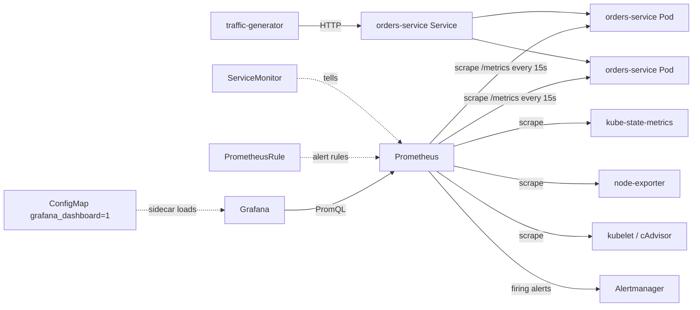

### Files

| File | Purpose |
| --- | --- |
| [kube-prometheus-stack-values.yaml](01-monitoring/kube-prometheus-stack-values.yaml) | Minikube-sized values: Minikube-incompatible control-plane scrapes disabled, 12 h retention, all ServiceMonitors/rules selected, Grafana admin from a runtime Secret, read-only anonymous Grafana for screenshots |
| [orders-service.yaml](01-monitoring/orders-service.yaml) | Instrumented API (Python stdlib only): `/metrics` with a request counter and latency histogram, JSON logs, `/healthz` probes, `ERROR_RATE` knob, plus a traffic generator |
| [servicemonitor.yaml](01-monitoring/servicemonitor.yaml) | Scrape `orders-service` Pods on `/metrics` every 15 s |
| [alert-rules.yaml](01-monitoring/alert-rules.yaml) | `OrdersHighErrorRate`, `OrdersServiceDown`, `OrdersHighLatencyP95`, `OrdersPodHighCPU` |
| [grafana-dashboard.yaml](01-monitoring/grafana-dashboard.yaml) | "Orders Service – Golden Signals" dashboard loaded by Grafana's sidecar |
| [promql.sh](01-monitoring/promql.sh), [alerts.sh](01-monitoring/alerts.sh) | Small helpers that query the Prometheus and Alertmanager HTTP APIs |

```bash
kubectl create namespace monitoring
kubectl -n monitoring create secret generic grafana-admin \
  --from-literal=admin-user=admin --from-literal=admin-password="$(openssl rand -hex 12)"
helm repo add prometheus-community https://prometheus-community.github.io/helm-charts
helm upgrade --install kps prometheus-community/kube-prometheus-stack -n monitoring \
  -f 01-monitoring/kube-prometheus-stack-values.yaml --wait --timeout 25m
kubectl apply -f 01-monitoring/orders-service.yaml -f 01-monitoring/servicemonitor.yaml \
  -f 01-monitoring/alert-rules.yaml -f 01-monitoring/grafana-dashboard.yaml
kubectl -n monitoring port-forward svc/kps-kube-prometheus-stack-prometheus 9090:9090 &
kubectl -n monitoring port-forward svc/kps-grafana 3000:80 &
kubectl -n monitoring port-forward svc/kps-kube-prometheus-stack-alertmanager 9093:9093 &
```

The install took 2 m 12 s. All 6 monitoring Pods were Running, and the 10 `monitoring.coreos.com` CRDs (ServiceMonitor, PrometheusRule, …) were registered.

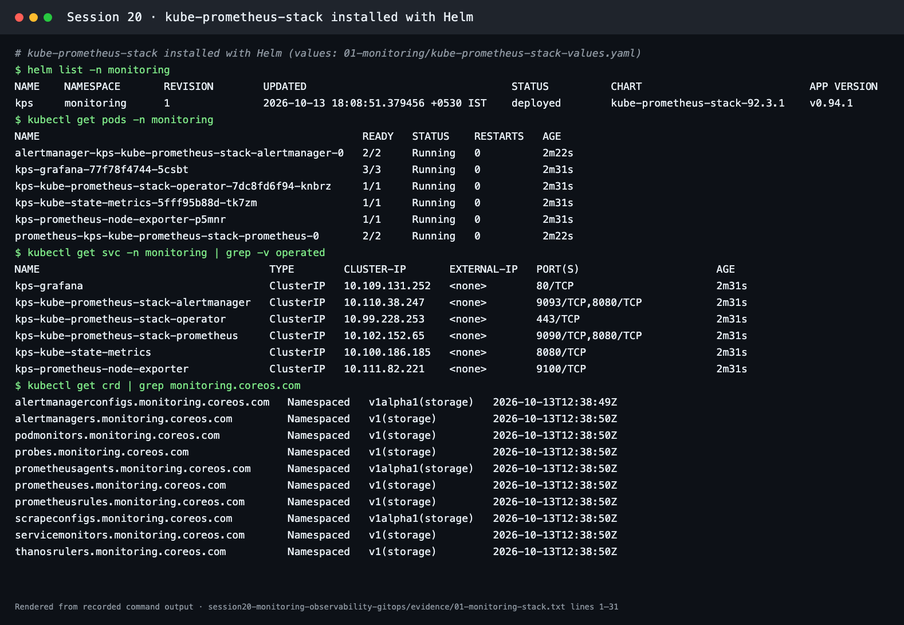
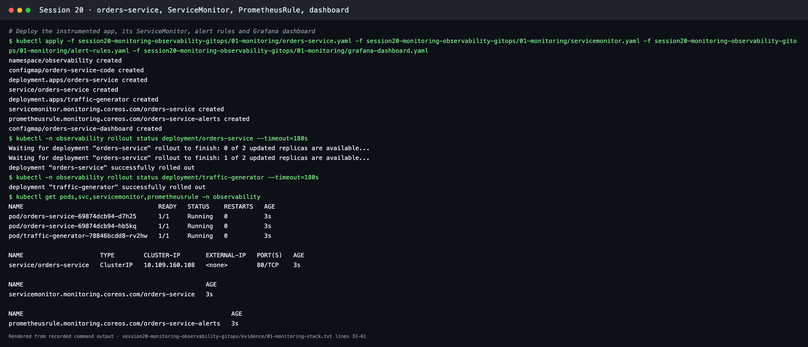

### Metrics

The app's own metrics (from `/metrics`) and the queries used:

| Signal | PromQL | Value observed |
| --- | --- | --- |
| Traffic | `sum(rate(orders_http_requests_total[1m]))` | 7.18 req/s |
| By status | `sum by (status) (rate(orders_http_requests_total[1m]))` | 200 → 7.03/s, 500 → 0.16/s |
| Error ratio | `5xx rate / total rate` | 0.022, matching `ERROR_RATE=0.02` |
| Latency p95 | `histogram_quantile(0.95, sum by (le) (rate(orders_http_request_duration_seconds_bucket[5m])))` | 0.094 s |

Prometheus discovered both Pods through the ServiceMonitor: `http://10.244.0.189:8080/metrics health=up` and `http://10.244.0.191:8080/metrics health=up`.

### Logs

Each request is one JSON line, so logs can be filtered by field:

```json
{"ts": "2026-10-13T12:43:13Z", "level": "info", "pod": "orders-service-69874dcb94-d7h25", "path": "/api/orders", "status": 200, "duration_ms": 43.4}
{"ts": "2026-10-13T12:45:36Z", "level": "error", "pod": "orders-service-5c845fc8b7-tgfwm", "path": "/api/orders", "status": 500, "duration_ms": 7.0}
```

`kubectl logs deploy/orders-service --tail=500 | grep -c '"level": "error"'` counted 11 errors before the incident.

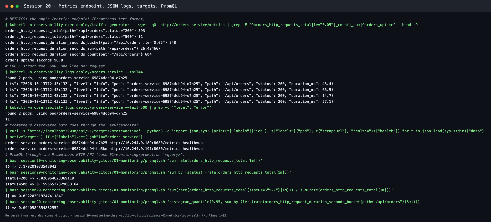

### CPU and memory utilisation

| Source | Result |
| --- | --- |
| `rate(container_cpu_usage_seconds_total{…}[2m])` (cAdvisor) | about 0.012 cores per Pod |
| `container_memory_working_set_bytes` | 16.8 MB and 19.1 MB |
| `kubectl top pods -n observability` (metrics-server) | 14m CPU, 16–18Mi each |
| Grafana "Kubernetes / Compute Resources / Namespace (Pods)" | Usage vs requests and limits: CPU 31% of requests, memory 39.7% of requests, 13.2% of limits |

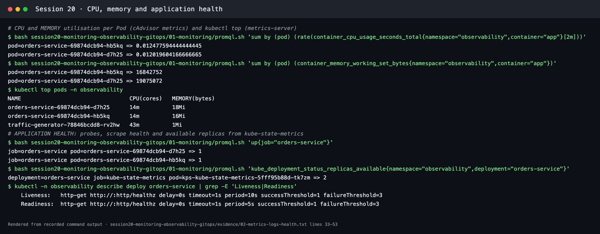
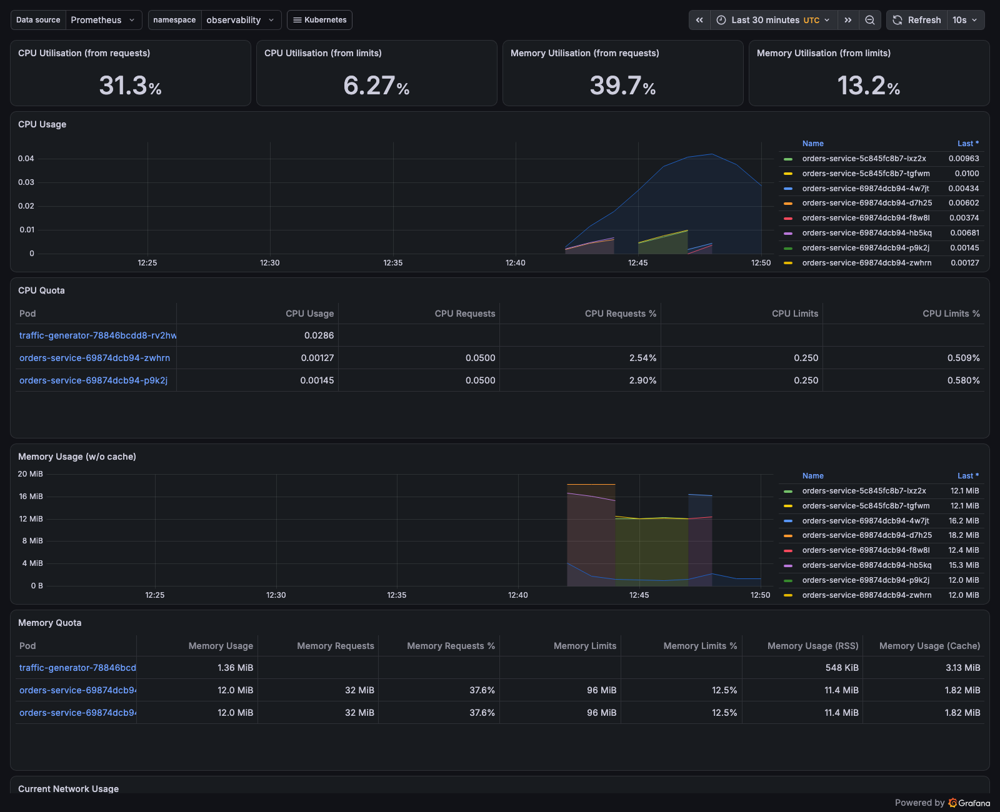

### Application health

- **Probes:** `Liveness: http-get /healthz period=10s`, `Readiness: http-get /healthz period=5s`.
- **Scrape health:** `up{job="orders-service"}` = 1 for both Pods.
- **Cluster state:** `kube_deployment_status_replicas_available{deployment="orders-service"}` = 2 (kube-state-metrics).

### Alerts

The rules were loaded as `health=ok state=inactive`. Then a real incident was simulated and fixed:

| Time (UTC) | Action | Prometheus | Alertmanager |
| --- | --- | --- | --- |
| 12:44 | `kubectl set env deployment/orders-service ERROR_RATE=0.5` | `OrdersHighErrorRate state=pending` (error ratio 0.26 → 0.49) | — |
| 12:45:16 | `for: 1m` elapsed | **`state=firing`** | `OrdersHighErrorRate severity=warning state=active` |
| 12:47:47 | `ERROR_RATE=0.02` again | no orders alerts | cleared |
| 12:48 | `kubectl scale deployment/orders-service --replicas=0` | `OrdersServiceDown state=firing` (value 1, from `absent(up{job="orders-service"})`) | `severity=critical state=active` |
| 12:50:05 | scaled back to 2 | no orders alerts | cleared |

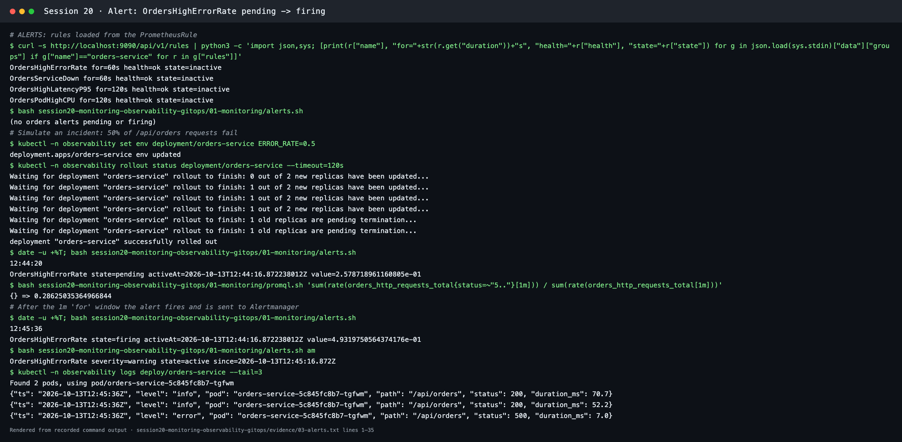
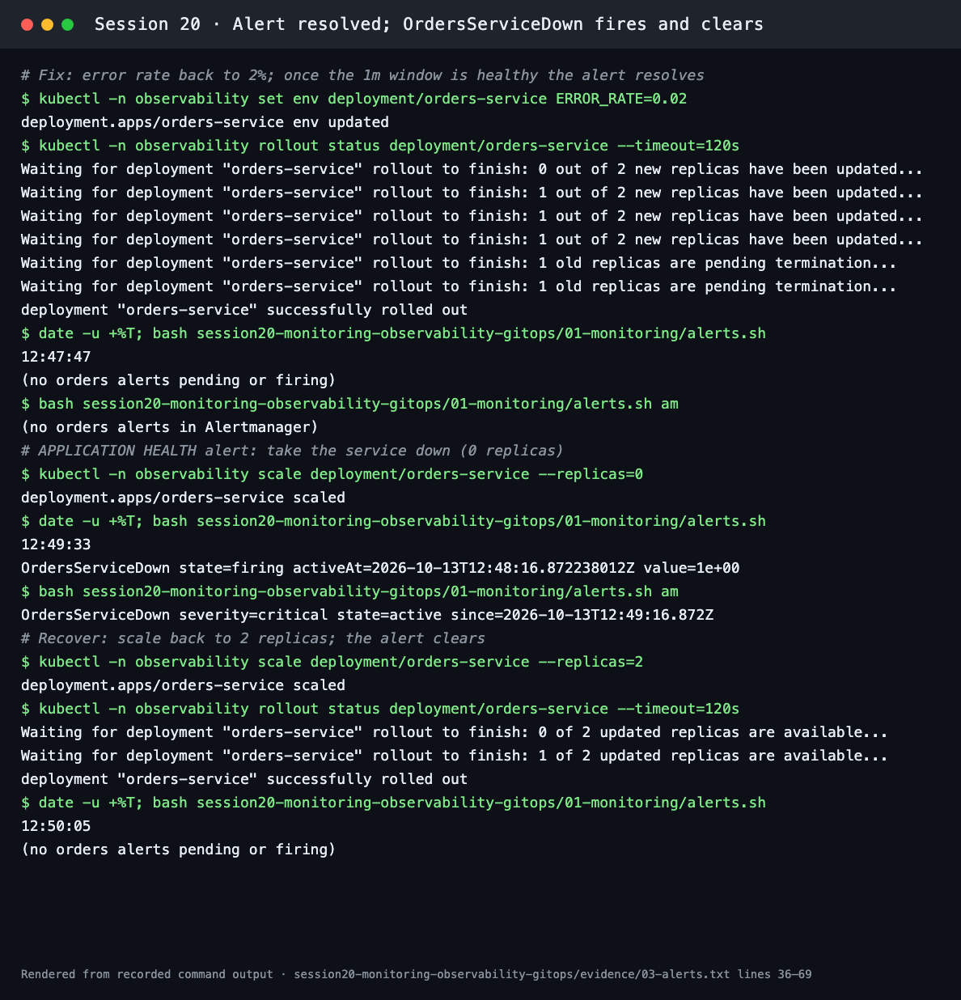

Live UIs during the incident:

| Prometheus › Alerts (firing) | Alertmanager |
| --- | --- |
| 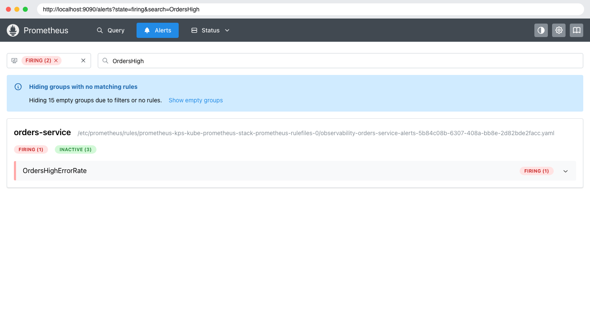 | 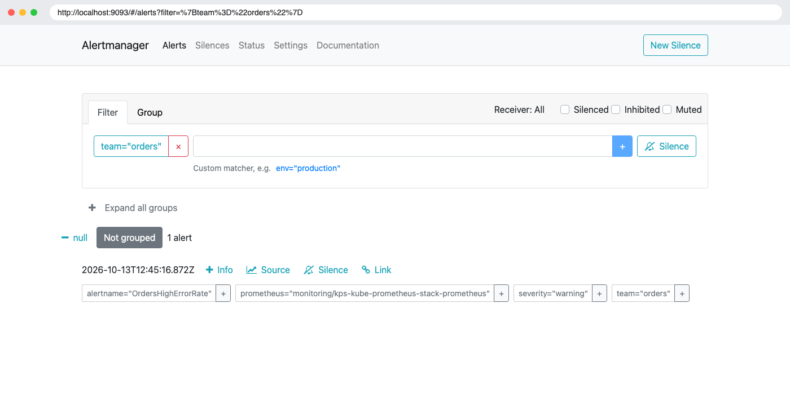 |

Prometheus › Targets for the ServiceMonitor:

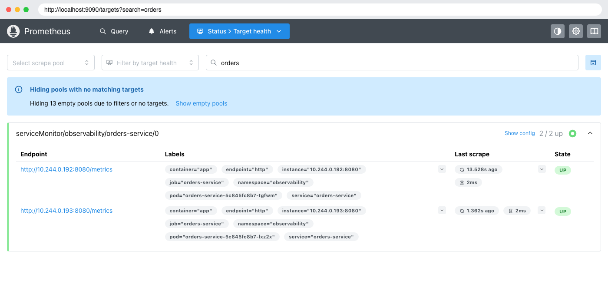

Grafana "Orders Service – Golden Signals" during the incident: 13.2 req/s, **50.9% errors**, p95 94.1 ms, 2 Pods scraped. The status chart shows the 500s rising to meet the 200s, and the CPU and memory panels show the Pods being replaced by the `set env` rollout.

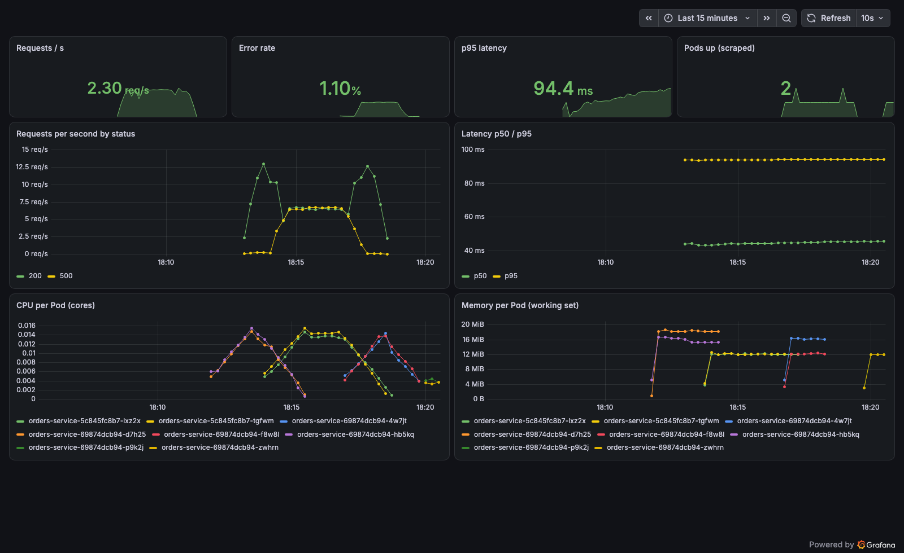

---

## Task 2: Observability

See [02-observability/README.md](02-observability/README.md): monitoring vs observability, metrics/logs/traces (with this demo's real metric and log formats), why observability is required, common tools, and the Kubernetes observability stack layer by layer.

## Task 3: GitOps

See [03-gitops/README.md](03-gitops/README.md): GitOps principles and a live Argo CD demo against this repository (initial sync, a Git change rolled out automatically, self-healing of manual drift, and pruning).
