# Session 9: Kubernetes fundamentals

**Course:** SST DevOps & Cloud · **Author:** Abhinav

These commands were run in a temporary Minikube v1.39.0 / Kubernetes v1.37.0 cluster. The complete observed output is in [cluster-lifecycle.txt](evidence/cluster-lifecycle.txt), [kubernetes-basics.txt](evidence/kubernetes-basics.txt) and [basic-objects.txt](evidence/basic-objects.txt). The PNGs are labelled renders of those real transcripts, made with [scripts/render-evidence-png.py](../scripts/render-evidence-png.py); direct desktop screenshots were not captured.

| Assignment task | Where |
| --- | --- |
| 1. Install and configure Minikube | [Install and cluster lifecycle](#1-2-install-minikube-and-verify-the-cluster) |
| 2. Verify Kubernetes cluster status | [Install and cluster lifecycle](#1-2-install-minikube-and-verify-the-cluster) |
| 3. Explore Kubernetes architecture | [Cluster architecture](#3-cluster-architecture) |
| 4. Basic Kubernetes objects and commands | [Basic objects and commands](#4-basic-kubernetes-objects-and-commands) |
| 5. Kubernetes Basics tutorial, hands-on | [Kubernetes Basics tutorial](#5-kubernetes-basics-tutorial-hands-on), all six modules |

## 1-2. Install Minikube and verify the cluster

Install on macOS with `brew install minikube` (kubectl comes with it), or with the binary download from the [Minikube start guide](https://minikube.sigs.k8s.io/docs/start/). The lifecycle run below used standalone binaries (see `MINIKUBE_HOME` in its transcript), and the tutorial run used the Homebrew build. Both are Minikube v1.39.0 with the Docker driver on Apple Silicon.

| Step | One-line description | Exact command | Terminal output | Screenshot |
| --- | --- | --- | --- | --- |
| 1 | Verify the Minikube and kubectl installations. | `minikube version`<br>`kubectl version --client` | Minikube `v1.39.0`; kubectl `v1.37.0` | [01-version-check.png](screenshots/01-version-check.png) |
| 2 | Start the local Kubernetes cluster. | `minikube start --driver=docker --cpus=2 --memory=4096` | `Done! kubectl is now configured to use "minikube" cluster` | [02-minikube-start.png](screenshots/02-minikube-start.png) |
| 3 | Check the control plane and node readiness. | `minikube status`<br>`kubectl get nodes -o wide` | Host, kubelet, API server running; node `Ready` | [03-minikube-status.png](screenshots/03-minikube-status.png) |
| 4 | Stop the cluster and confirm its state. | `minikube stop`<br>`minikube status` | `1 node stopped`; host, kubelet, API server stopped | [04-minikube-stop.png](screenshots/04-minikube-stop.png) |

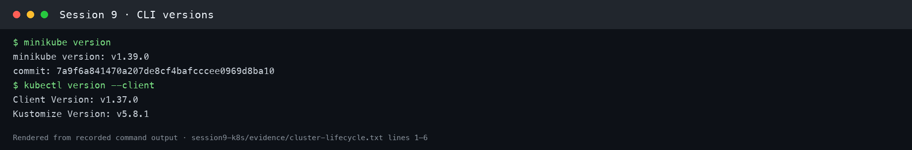
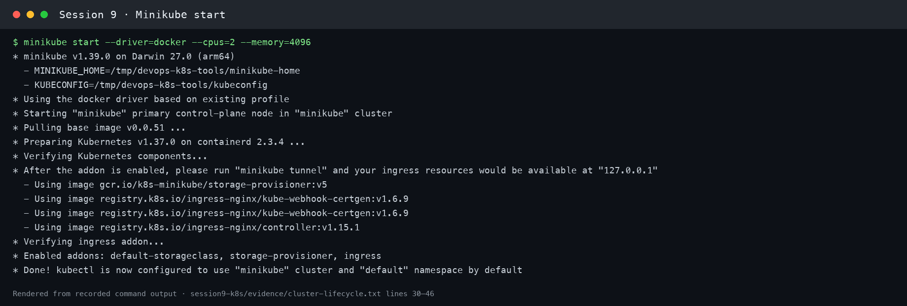
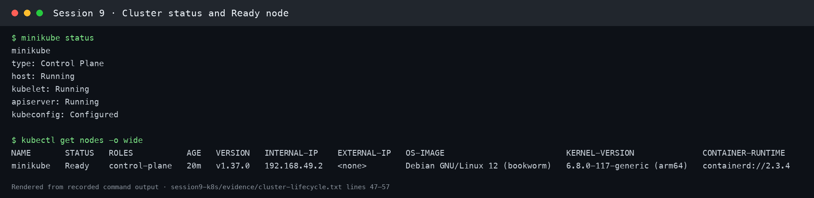
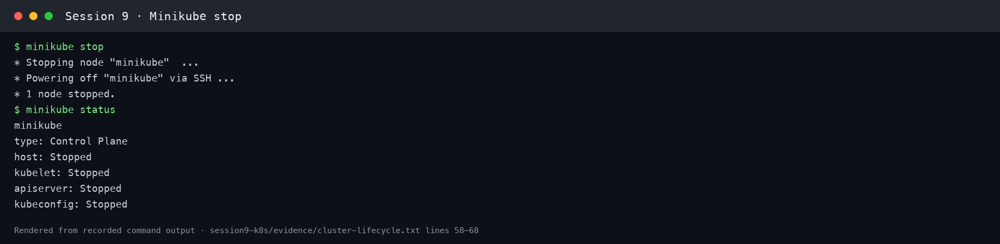

## 3. Cluster architecture

[Kubernetes' architecture reference](https://kubernetes.io/docs/concepts/architecture/) describes the control plane as the part that maintains desired cluster state, and worker nodes as the machines that run Pods.

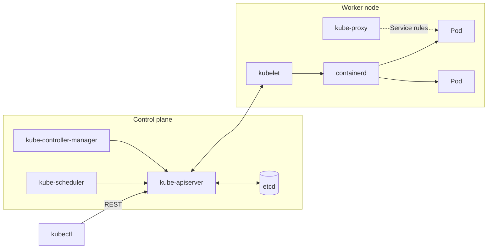

| Component | Role |
| --- | --- |
| `kube-apiserver` | Exposes the Kubernetes API; kubectl and other components communicate through it. |
| `etcd` | Consistent key-value store for API data and cluster state. Backups are essential. |
| `kube-scheduler` | Assigns unscheduled Pods to suitable nodes based on resources and constraints. |
| `kube-controller-manager` | Runs reconciliation controllers, including Node and ReplicaSet controllers. |
| `kubelet` | Node agent that makes assigned Pods run and reports their status. |
| Container runtime | Runs containers for the kubelet, commonly containerd or CRI-O. |
| `kube-proxy` | Implements Service networking on nodes when that component is used. |

A Deployment sent through `kubectl` reaches the API server, which persists the desired state in etcd. Controllers create the needed Pods, the scheduler assigns nodes, and each node's kubelet asks its runtime to start containers and reports status through the API. Service traffic reaches healthy Pod endpoints using the cluster's networking implementation. Minikube hosts both control-plane and worker components on one node. In this cluster, `kubectl get all -n kube-system` shows them as Pods: `etcd-minikube`, `kube-apiserver-minikube`, `kube-scheduler-minikube`, `kube-controller-manager-minikube`, `kube-proxy`, and `coredns`.

## 4. Basic Kubernetes objects and commands

| Object | Short name | What it is for |
| --- | --- | --- |
| Node | `no` | A machine (VM or physical) that runs Pods |
| Namespace | `ns` | A virtual cluster for grouping and isolating objects (`default`, `kube-system`, …) |
| Pod | `po` | Smallest deployable unit: one or more containers sharing network and storage |
| ReplicaSet | `rs` | Keeps N identical Pods running |
| Deployment | `deploy` | Manages ReplicaSets, giving rolling updates and rollbacks |
| Service | `svc` | Stable IP and DNS name that load-balances to matching Pods |
| ConfigMap / Secret | `cm` / – | Configuration and sensitive data injected into Pods |
| Labels and selectors | – | Key/value tags (`app=kubernetes-bootcamp`) that Services and controllers use to find Pods |

| Command | Purpose |
| --- | --- |
| `kubectl get <kind>` / `-o wide` / `-l key=value` | List objects, with more columns or filtered by label |
| `kubectl describe <kind> <name>` | Details plus recent Events |
| `kubectl create deployment …` / `kubectl apply -f file.yaml` | Create objects imperatively or declaratively |
| `kubectl logs <pod>` / `kubectl exec <pod> -- <cmd>` | Read container output / run a command inside a container |
| `kubectl expose` / `kubectl scale` / `kubectl set image` | Create a Service, change replicas, update the image |
| `kubectl rollout status\|history\|undo` | Follow, inspect or revert a Deployment rollout |
| `kubectl api-resources` / `kubectl explain <field>` | Discover object kinds / read built-in field docs |

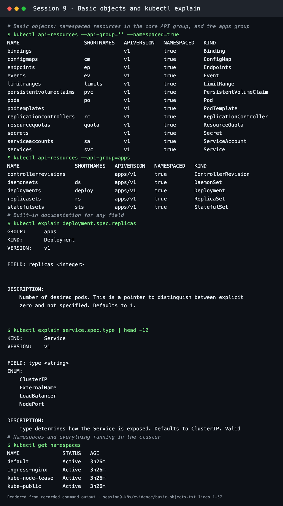

## 5. Kubernetes Basics tutorial (hands-on)

All six modules of the [official Kubernetes Basics tutorial](https://kubernetes.io/docs/tutorials/kubernetes-basics/) were done with the tutorial's own images (`gcr.io/google-samples/kubernetes-bootcamp:v1` and `docker.io/jocatalin/kubernetes-bootcamp:v2`). These images are amd64-only. On this Apple Silicon Minikube they ran through Docker Desktop's x86-64 emulation: `uname -m` inside the Pod printed `x86_64`.

### Module 1–2: Create a cluster, deploy an app

```bash
kubectl version
kubectl cluster-info
kubectl get nodes
kubectl create deployment kubernetes-bootcamp --image=gcr.io/google-samples/kubernetes-bootcamp:v1
kubectl get deployments
kubectl proxy --port=8001 &          # authenticated tunnel to the API server
curl http://localhost:8001/version
export POD_NAME=$(kubectl get pods -l app=kubernetes-bootcamp -o jsonpath='{.items[0].metadata.name}')
curl http://localhost:8001/api/v1/namespaces/default/pods/$POD_NAME:8080/proxy/
```

Result: `kubernetes-bootcamp 1/1`, API server `v1.37.0` on `linux/arm64`, and the app answered through the API proxy: `Hello Kubernetes bootcamp! | Running on: kubernetes-bootcamp-5cc66bcc9b-b2x85 | v=1`.

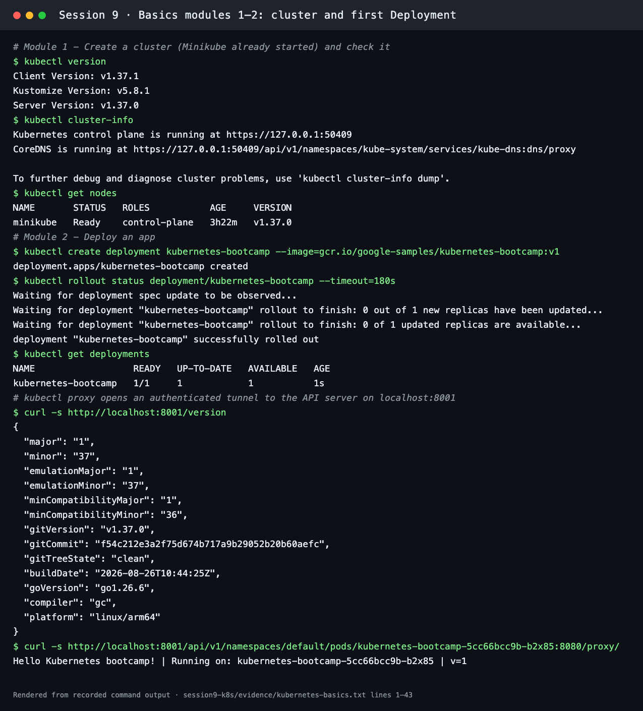

### Module 3: Explore the app

```bash
kubectl get pods -o wide
kubectl describe pod $POD_NAME
kubectl logs $POD_NAME
kubectl exec $POD_NAME -- env
kubectl exec $POD_NAME -- head -12 server.js
kubectl exec $POD_NAME -- curl -s http://localhost:8080
```

`describe` showed the node, Pod IP `10.244.0.40`, `Controlled By: ReplicaSet/kubernetes-bootcamp-5cc66bcc9b`, the image digest and the container state. `exec` ran commands inside the container: env vars such as `KUBERNETES_SERVICE_HOST=10.96.0.1`, and the Node.js source that prints `v=1`.

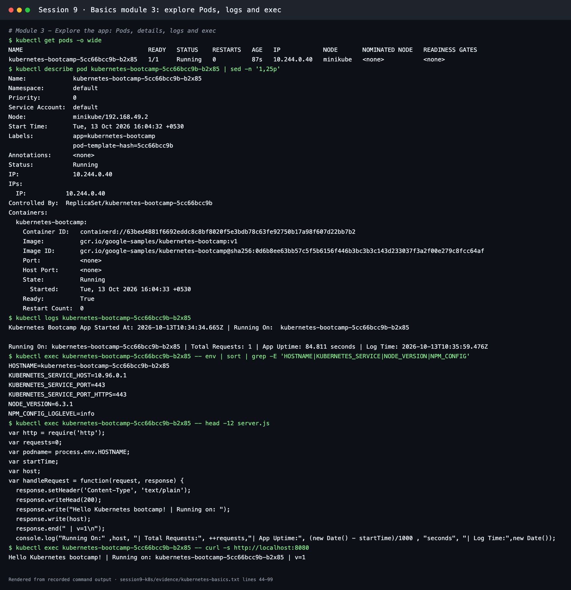

### Module 4: Expose the app (Services and labels)

```bash
kubectl expose deployment/kubernetes-bootcamp --type=NodePort --port 8080
kubectl describe services/kubernetes-bootcamp
minikube service kubernetes-bootcamp --url   # Docker driver on macOS needs this localhost tunnel
curl http://127.0.0.1:<tunnel-port>
kubectl label pods $POD_NAME version=v1
kubectl get pods -l version=v1
kubectl delete service -l app=kubernetes-bootcamp
kubectl exec $POD_NAME -- curl -s http://localhost:8080
```

The NodePort Service received port `32278` with endpoint `10.244.0.40:8080`. After the Service was deleted, the tunnel returned `000`, but the app still answered **inside** the Pod. The Service only provides access; it is not the app.

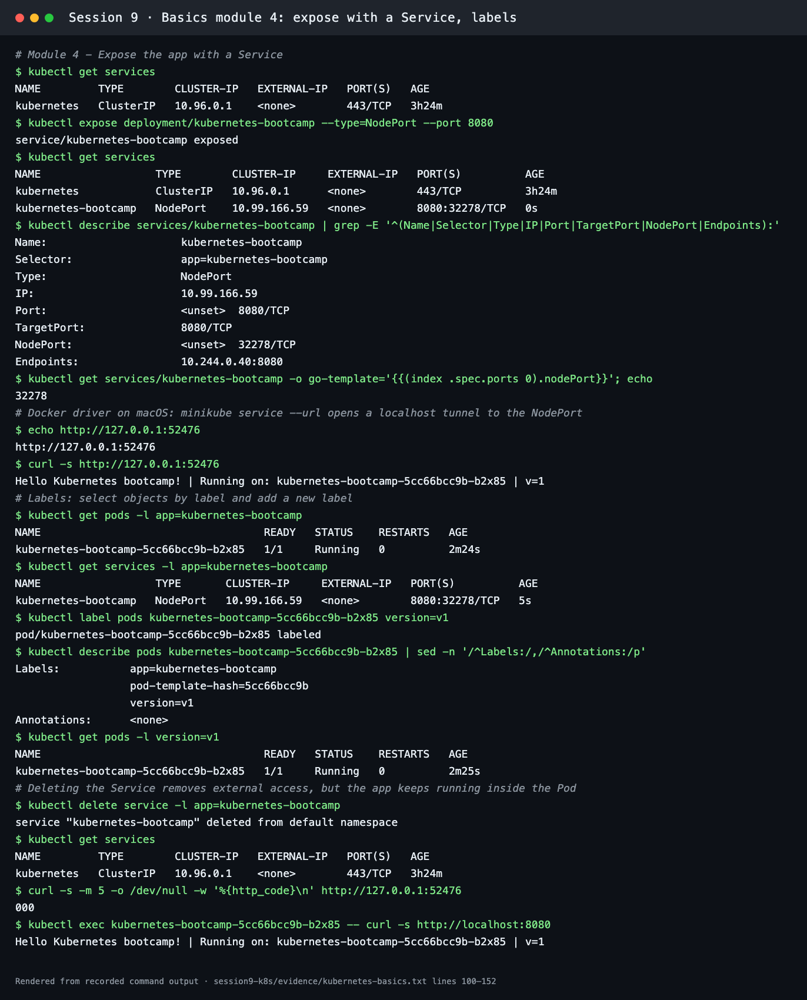

### Module 5: Scale the app

```bash
kubectl get rs
kubectl scale deployments/kubernetes-bootcamp --replicas=4
kubectl get pods -o wide
kubectl expose deployment/kubernetes-bootcamp --type=NodePort --port 8080
for i in 1 2 3 4 5 6 7 8; do curl -s http://127.0.0.1:<tunnel-port>; done
kubectl scale deployments/kubernetes-bootcamp --replicas=2
```

Four Pods (`10.244.0.40–43`) came up, and the Deployment events show `Scaled up replica set … from 1 to 4`. Eight requests through the Service were answered by four different Pods, which shows load balancing. Scaling down to 2 terminated the extra Pods. The old bootcamp app ignores `SIGTERM`, so they stay `Terminating` for the 30-second grace period.

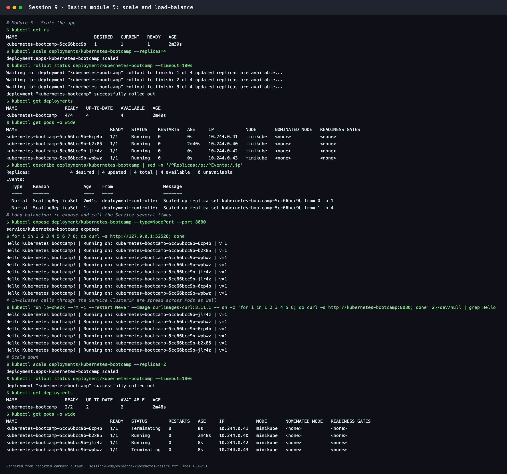

### Module 6: Rolling update and rollback

```bash
kubectl set image deployments/kubernetes-bootcamp kubernetes-bootcamp=docker.io/jocatalin/kubernetes-bootcamp:v2
kubectl rollout status deployments/kubernetes-bootcamp
kubectl set image deployments/kubernetes-bootcamp kubernetes-bootcamp=gcr.io/google-samples/kubernetes-bootcamp:v10
kubectl get pods                                  # ImagePullBackOff
kubectl describe pod <v10-pod>                    # ... kubernetes-bootcamp:v10: not found
kubectl rollout undo deployments/kubernetes-bootcamp
kubectl rollout status deployments/kubernetes-bootcamp
kubectl delete deployments/kubernetes-bootcamp services/kubernetes-bootcamp
```

- **v2:** new Pods `kubernetes-bootcamp-5b97597885-*` replaced the v1 Pods one at a time, and requests returned `| v=2`.
- **v10:** the tag doesn't exist, so the new Pod went `ErrImagePull` → `ImagePullBackOff`. The rolling update **paused with both v2 Pods still serving** (`READY 2/2, UP-TO-DATE 1`).
- **Rollback:** `rollout undo` restored revision 2 (v2), and `rollout status` reported success. The last listing was taken while old Pods were still inside their termination grace period, so their phase still shows `Running`/`Pending` until they disappear.

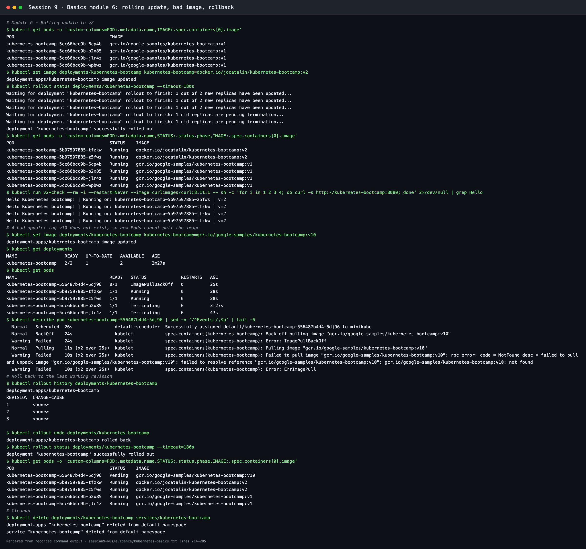

## Cleanup

```bash
kubectl delete deployments/kubernetes-bootcamp services/kubernetes-bootcamp
minikube stop        # or: minikube delete
```
